# STM32 开发板入门综合讲义

> **从点亮第一颗 LED 到跑通 FreeRTOS —— 一份面向零基础学习者的系统性实战讲义**
>
> 目标平台：STM32F103C8T6（"Blue Pill" 蓝pill 开发板）
> 开发方式：STM32CubeMX + HAL 库
> 覆盖工具链：Keil MDK / STM32CubeIDE / VSCode + PlatformIO（三线并行）
> 配套代码：每章核心案例提供独立、可直接编译烧录的工程文件

---

## 前言：如何正确使用这份讲义

### 0.1 这份讲义解决什么问题

STM32 是嵌入式开发中最经典、资料最丰富、生态最成熟的 Cortex-M 平台。但初学者最大的痛苦往往是"资料太多、不知道从哪看起"——官方参考手册上千页，论坛教程良莠不齐，要么讲原理不讲实操，要么贴代码不讲原理。

这份讲义的目标，是把一条 **从零到能独立做项目的完整学习路径** 压缩到一份可系统阅读的文档里。它同时做到三件事：

1. **原理讲透**：每个外设都从"它是什么、硬件怎么工作"讲起，不让你只会复制代码。
2. **实操闭环**：每个章节都有可直接编译烧录的案例，并给出"怎么验证它真的工作了"。
3. **工具链全覆盖**：同一份代码，分别讲解在 Keil、STM32CubeIDE、PlatformIO 三个环境下的编译与烧录方法。

### 0.2 学习前提与时间预期

- **最好具备**：C 语言基础（指针、结构体、函数）、基本电路知识（高低电平、上拉电阻、I2C 概念）。完全没有也能学，遇到 C 语法会补充说明。
- **硬件准备**：
  - 一块 STM32F103C8T6 "Blue Pill" 开发板（约 ¥10–20）
  - 一个 ST-Link V2 调试下载器（烧录必需）
  - 一根 USB 转 TTL 串口线（串口章节用）
  - 面包板 + 若干杜邦线 + LED + 电阻（约 220Ω–1kΩ）+ 按键
  - 可选：0.96 寸 OLED（I2C 章节用）、电位器（ADC 章节用）
- **时间预期**：每天 2 小时，约 2–3 周可完整跟完；只学基础篇（第 1–3 章）约 1 周即可点亮第一颗灯。

### 0.3 讲义结构速览

```
基础篇（建立认知与工具链）
  第1章  STM32 与开发板硬件认知
  第2章  开发环境搭建（三 IDE 全讲）
  第3章  点亮第一个 LED —— GPIO 输出
进阶篇（掌握核心外设）
  第4章  系统时钟树与启动流程
  第5章  按键输入与外部中断 EXTI
  第6章  定时器（SysTick / TIM）
  第7章  PWM 输出
  第8章  串口通信 UART（printf 重定向）
  第9章  ADC 模拟量采集
高阶篇（工程化能力）
  第10章 DMA 数据传输
  第11章 I2C / SPI 通信（OLED 实战）
  第12章 FreeRTOS 实时操作系统入门
附录    常见问题排查 / 参考资料索引
```

每章统一采用四段式结构：

> **① 原理讲解 → ② 代码实操 → ③ 运行验证 → ④ 常见坑**

### 0.4 学习建议（重要）

- **不要只读，要动手**。每个案例都亲手上机跑一遍，比读十遍更有效。
- **先跑通，再深挖**。第一遍先确保代码能烧录运行，理解"能用"；第二遍再回到原理部分，理解"为什么"。
- **善用调试器**。会打断点、看变量、单步执行，是区分"会玩板子"和"会做开发"的关键分水岭，务必在第 2 章学会。
- **学会查手册**。讲义会带你走一遍查官方参考手册的方法，这是长期能力。

---

# 第1章 STM32 与开发板硬件认知

> **本章目标**：搞清楚 STM32F103C8T6 是什么、蓝pill 板上有什么、引脚怎么认、供电和启动怎么配。看完后你能在板上找到每个引脚，并能解释"为什么这么接"。

## 1.1 什么是 STM32

STM32 是**意法半导体（STMicroelectronics, ST）**推出的基于 **ARM Cortex-M** 内核的 32 位微控制器（MCU，Microcontroller Unit）系列。它与普通 8 位单片机（如 51、AVR）的核心区别在于：

- **32 位内核**：寄存器、数据总线、地址总线都是 32 位，一次能处理 32 位数据，性能远高于 8 位机。
- **Cortex-M 内核**：由英国 ARM 公司设计的处理器内核（IP 核），ST 拿到授权后在其外围集成各种外设（GPIO、定时器、串口、ADC……）封装成芯片。注意：**内核是 ARM 的，外设是 ST 的**——这是后面查手册时的重要认知。

STM32 家族按内核与定位分成多条产品线，常见的有：

| 产品线 | 内核 | 定位 | 典型型号 |
|---|---|---|---|
| **F1（主流）** | Cortex-M3 | 通用入门，最经典 | **F103C8T6** |
| F4（高性能） | Cortex-M4F | 带 FPU 浮点、更高主频 | F407、F411 |
| F7 / H7 | M7 | 顶级性能、多媒体 | F767、H743 |
| G 系列 | M4/M33 | 新增、低成本 | G030、G431 |
| L 系列 | M0+/M4 | 低功耗 | L011、L431 |

**为什么入门选 F103**：教程最多、资料最全、价格最低、生态最成熟。学会 F103 后，迁移到 F4/H7 只是换手册、改配置的事——**核心开发思想完全一致**。

## 1.2 认识 STM32F103C8T6 芯片

型号 `STM32F103C8T6` 的每一位都有含义，这是 ST 命名规则，看懂了就能由型号反推芯片规格：

```
STM32  F  103   C   8   T   6
  │    │   │   │   │   │   │
  │    │   │   │   │   │   └─ 温度范围：6 = -40℃~+85℃（工业级）
  │    │   │   │   │   └───── 封装：T = LQFP（薄型四方扁平封装）
  │    │   │   │   └───────── 引脚数/闪存容量档：8 = 64KB Flash
  │    │   │   └───────────── C = 48 引脚（LQFP48）
  │    │   └───────────────── 103 = 主流高性能系列（F1 家族）
  │    └───────────────────── F = 通用闪存系列
  └────────────────────────── STM32 = 32位微控制器
```

由此可知 F103C8T6 的关键规格：

| 参数 | 规格 |
|---|---|
| 内核 | ARM Cortex-M3，最高 **72 MHz** |
| Flash（程序存储） | **64 KB** |
| RAM（运行内存） | **20 KB** |
| 引脚数 | **48**（LQFP48 封装） |
| GPIO | 37 个可用 I/O（21 个在 datasheet 标注，实际受封装限制约 30+ 可用） |
| 定时器 | 3 个通用定时器 TIM2/3/4、1 个高级定时器 TIM1、SysTick |
| ADC | 2 个 12 位 ADC，10 个通道 |
| 通信接口 | USART×3、I2C×2、SPI×2、CAN、USB 2.0 全速 |
| 电压 | 2.0–3.6V（典型 **3.3V**），I/O 兼容 5V 输入（多数引脚） |

> **数据来源**：ST 官方数据手册 *STM32F103x8/xB Medium-density performance line datasheet*（DS5319）及 ST 官网产品页。详见附录 A 参考资料。

**一句话记住**：这是一颗"64KB 程序 + 20KB 内存 + 72MHz 主频"的小型 32 位单片机，跑操作系统（FreeRTOS）绰绰有余，是性价比最高的入门芯片。

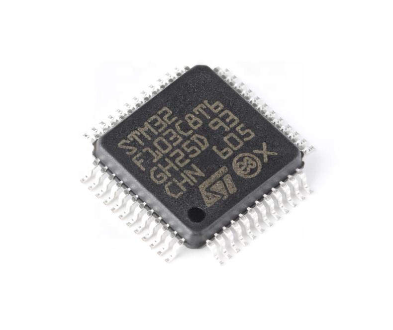

## 1.3 认识"Blue Pill" 开发板

**Blue Pill（蓝丸）**是 STM32F103C8T6 开发板的通用叫法，因经典的蓝色 PCB 得名（最早由社区开源设计，后被广泛仿制）。它是全球最流行的 STM32 入门板之一，淘宝/立创商城普遍 10–20 元。

### 1.3.1 板上有什么

一块典型的蓝pill 板上，从上到下依次有：

| 板上元件 | 位置/说明 | 用途 |
|---|---|---|
| **STM32F103C8T6 芯片** | 板中央 48 脚 | 主控 |
| **USB 接口（Mini USB）** | 板侧 | 供电 + USB 通信 |
| **8MHz 晶振** | 芯片旁 | 主时钟源（经 PLL 倍频到 72MHz） |
| **32.768kHz 晶振** | 板上 | 低速外部时钟 LSE（RTC 用，很多板未焊） |
| **AM1117-3.3 LDO 稳压器** | 板下 | 把 5V 稳成 3.3V 给芯片 |
| **电源指示灯（红）** | 板上 | 上电亮 |
| **PC13 板载 LED（蓝）** | 板上，接 PC13 | 编程测试用，高电平点亮 |
| **BOOT0 跳线** | 板侧 | 启动模式选择 |
| **RST 复位键** | 板侧 | 复位 |
| **2.54mm 排针** | 四周 | 引出全部 GPIO |

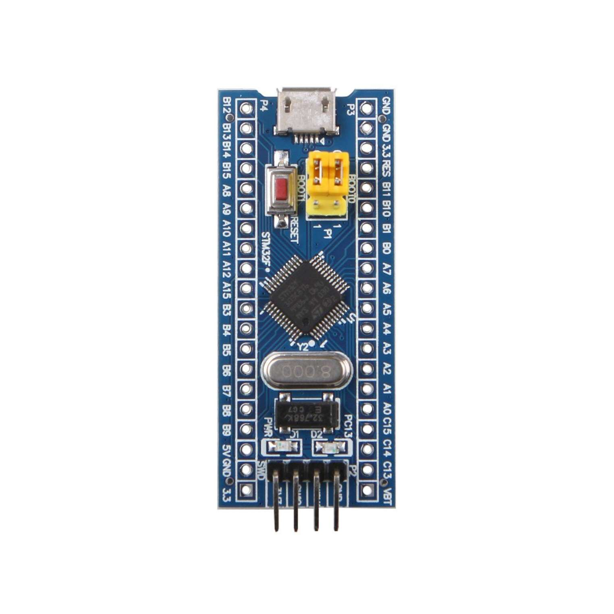

### 1.3.2 引脚排布（最关键的一张图）

48 脚封装的引脚按 **"每侧 12 脚"** 排列，蓝pill 板两侧各有两排排针。引脚命名规律：`P<端口><编号>`，如 PA0、PB1、PC13。

```
             3V3  GND  5V  GND   ------ 电源区
  PA9  PA10  PA11 PA12 PA15 PB3 PB4 PB5 PB6 PB7 PB8 PB9  ← 右侧排针
  PB10 PB11 ...                     ← 右侧另一排（含 USB 相关）
  ...左侧排针（含 PA0-PA8、PC13-15、BOOT）...
```

> 由于排版限制，这里不逐脚罗列（完整引脚定义见附录参考链接：博客园《stm32f103c8t6 引脚资源定义》）。**关键认知**：
> - 引脚分 `PA`、`PB`、`PC` 三个 GPIO 端口（Port），每个端口最多 16 个引脚（PA0–PA15…）。
> - 同一引脚往往有多个复用功能（串口、定时器、ADC……），用哪个功能由软件配置决定。
> - **下载排针 SWD**：板上留有一组 `SWDIO / SWCLK / GND / 3.3V` 排针，接 ST-Link 用。

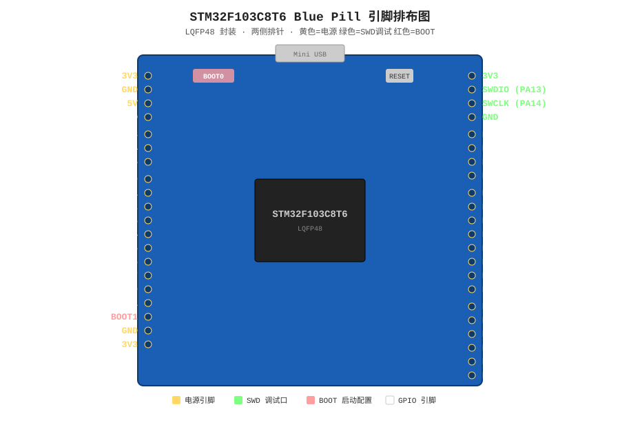

### 1.3.3 供电

- 蓝pill 有 **两套供电**：`5V` 引脚（USB 或外部 5V 输入）与 `3V3` 引脚（3.3V）。
- 板上 LDO 会把 5V 稳压成 3.3V 给芯片。**推荐统一用 3.3V 供电逻辑**：凡是你自己外接的传感器、LED，都用板上 3V3，不要同时怼 5V 和 3V3。
- **I/O 电压是 3.3V**，但多数 GPIO 引脚**容忍 5V 输入**（datasheet 标注 5V tolerant），所以可直接接 5V 传感器逻辑输出，但输出给 5V 设备时要注意。

## 1.4 启动模式与 BOOT0（理解即够）

F103 的启动模式由 **BOOT0 / BOOT1** 引脚电平决定，决定芯片从哪读取第一条指令：

| BOOT0 | BOOT1 | 启动位置 | 说明 |
|---|---|---|---|
| 0 | x | 从 Flash（主存储区）启动 | **正常程序运行模式（默认）** |
| 1 | 0 | 从系统存储器启动 | 内置 Bootloader，用于串口 ISP 烧录 |
| 1 | 1 | 从 SRAM 启动 | 调试用，少见 |

- 蓝pill 默认 **BOOT0 接地（跳线帽默认位置）**，即从 Flash 启动，正常跑你的程序。
- 如果以后要用 **串口一键下载**（USB 转 TTL 连 PA9/PA10，通过内置 Bootloader 烧录），需要把 BOOT0 拨到 1。
- 本讲义以 **ST-Link 下载** 为主，**不需要动 BOOT0**，保持默认即可。

## 1.5 GPIO 硬件基础（为第3章铺垫）

**GPIO**（General Purpose Input/Output，通用输入输出）是单片机最基础的外设，一个引脚就是一根"数字信号线"。

一个 STM32 的 GPIO 引脚内部主要由以下部分组成（参考手册 RM0008 GPIO 章节）：

- **输出数据寄存器 ODR**（Output Data Register）：你写 1，引脚输出高电平（3.3V）；写 0，输出低电平（0V）。
- **输入数据寄存器 IDR**（Input Data Register）：读引脚当前电平。
- **上拉/下拉电阻**：可配置内部弱上拉（默认高）或下拉（默认低），用于不确定电平时给定默认状态。
- **推挽/开漏输出模式**：推挽能主动输出高和低（驱动能力强）；开漏只能拉低，要靠外部上拉才能输出高（多用于 I2C）。
- **复用功能**（Alternate Function, AF）：引脚不仅做普通 I/O，还能被定时器、串口等外设接管。

这些在第 3 章会用 CubeMX 图形化配置，第 4 章会看它背后的寄存器。现在只需要建立概念。

## 1.6 本章小结与自测

**小结**：
- STM32 = ARM Cortex-M 内核 + ST 外设；F103 是入门首选。
- F103C8T6：72MHz / 64KB Flash / 20KB RAM / 48 引脚 / 3.3V。
- 蓝pill 板上：芯片、USB、8MHz 晶振、3.3V LDO、PC13 板载 LED、BOOT0、SWD 排针。
- 启动由 BOOT0 决定，默认 Flash 启动即可。
- GPIO 引脚可配置输入/输出/复用，内部有上拉下拉、推挽开漏之分。

**自测题**：
1. `STM32F103C8T6` 的 "8" 和 "C" 各代表什么？
2. 蓝pill 芯片的额定主频是多少？主时钟晶振是多少 MHz，如何得到 72MHz？
3. 默认情况下程序从哪里启动？需要改 BOOT0 吗？
4. 说出 3 个蓝pill 板上可见的关键元件及其作用。

---

<!-- ===== 第1章 完 ===== -->

# 第2章 开发环境搭建（三 IDE 全讲）

> **本章目标**：装好全部工具链，用 CubeMX 生成第一个工程，并在 Keil MDK / STM32CubeIDE / PlatformIO 三个环境中至少跑通"编译 → 烧录 → 调试"。这是整个学习过程最"劝退"但也最关键的章节，一次配好，后面全顺。

## 2.1 三条工具链的关系与选择

为了讲清楚，先理解 STM32 开发的"生产线"：

```
STM32CubeMX（图形化配置外设）
        │  生成代码
        ▼
   一个 HAL 库 C 工程
        │  交给编译器
        ▼
   编译成 .hex/.bin（机器码）
        │  通过调试器
        ▼
   烧录进芯片 → 运行
```

其中：
- **STM32CubeMX**：ST 官方图形化配置工具，你勾选外设、填参数，它自动生成初始化代码。**所有 IDE 共用它**。
- **HAL 库**：ST 提供的硬件抽象层函数库，把底层寄存器操作封装成好用的 API（如 `HAL_GPIO_WritePin`）。本讲义主线。
- **IDE（编译器+编辑器+调试器）**：三个任选其一：
  - **Keil MDK**：国内最普及、教程最多，但仅 Windows、收费（有试用）。
  - **STM32CubeIDE**：ST 官方免费 IDE，跨平台，与 CubeMX 深度集成。
  - **VSCode + PlatformIO**：开源、跨平台、Git 友好，适合进阶与 Linux/macOS 用户。

> **建议**：如果完全按本讲义学，选 **一个** 当主力即可（推荐 Keil 或 CubeIDE，教程最多）。PlatformIO 适合作为"第二套"了解，讲义会覆盖三者的配置方法。

## 2.2 第一步：安装 STM32CubeMX（通用，三个都要）

1. 到 ST 官网（st.com）或国内镜像下载 **STM32CubeMX**（需注册 ST 账号免费获取）。
2. 安装时选择附带下载 **STM32CubeF1 固件包**（HAL 库），或在首次创建工程时自动下载。
3. 安装后可先不急着建工程，我们到 2.3 统一操作。

## 2.3 用 CubeMX 创建第一个工程（通用核心步骤）

无论你用哪个 IDE，第一步都用 CubeMX 生成工程。以"点亮 PC13 板载 LED"的最小工程为例：

1. **新建工程**：`File → New Project` → 选 `MCU Selector` → 搜索 `STM32F103C8T6` → 选中 → 确认。
2. **配置时钟**：左侧 `System Core → RCC`，把 `HSE`（外部高速晶振）设为 `Crystal/Ceramic Resonator`（蓝pill 有 8MHz 晶振）。左侧 `System Core → SYS`，把 `Debug` 设为 `Serial Wire`（**必须**，否则接了 ST-Link 也无法调试，且芯片可能被锁）。
3. **配置 GPIO**：左侧 `Pinout & Configuration`，用鼠标点引脚，把 **PC13** 设为 `GPIO_Output`。
4. **配置时钟树**：切到 `Clock Configuration` 标签页，HSE 填 8，把 `HCLK` 设为 **72MHz**（CubeMX 会自动算出 PLL 倍频系数）。若 HCLK 处显红，双击改为 72。
5. **工程设置**：`Project Manager` 标签：
   - Project Name：`LedDemo`
   - Toolchain / IDE：**可选** Keil / STM32CubeIDE / Makefile（对应不同 IDE）
   - 在 `Code Generator` 勾选 `Generate peripheral initialization as a pair of '.c/.h' files per peripheral`（可选，便于学习）。
6. 点击右上角 **`GENERATE CODE`**，生成工程到指定目录。

生成后的工程结构（核心文件）：

```
LedDemo/
├── Core/
│   ├── Inc/          # 头文件（main.h, stm32f1xx_hal_conf.h 等）
│   └── Src/
│       ├── main.c    # 主函数，用户代码区（USER CODE 段）
│       ├── stm32f1xx_hal_msp.c  # MSP 初始化（时钟/引脚）
│       └── system_stm32f1xx.c   # 系统时钟配置
├── Drivers/          # HAL 库源码
├── LedDemo.ioc       # CubeMX 配置文件（再次打开 CubeMX 用）
└── <对应IDE工程文件>
```

> **理解关键**：`main.c` 里用 `/* USER CODE BEGIN */` 和 `/* USER CODE END */` 注释圈出了"用户代码保护区"。CubeMX 重新生成代码时**只保留这些区段内的代码**，区段外的会被覆盖。**以后你自己的代码永远写在 USER CODE 区段内**，这是 CubeMX 工作流的铁律。

在 `main.c` 的 `main()` 函数中找到 `/* USER CODE BEGIN 2 */`，加入一句点亮 LED 的代码：

```c
/* USER CODE BEGIN 2 */
HAL_GPIO_WritePin(GPIOC, GPIO_PIN_13, GPIO_PIN_RESET); // PC13 输出低电平
/* USER CODE END 2 */
```

> 注意：蓝pill 的板载 LED 接在 PC13，**低电平点亮**（`GPIO_PIN_RESET`），和常见"高电平点亮"相反。第 3 章会详细解释。

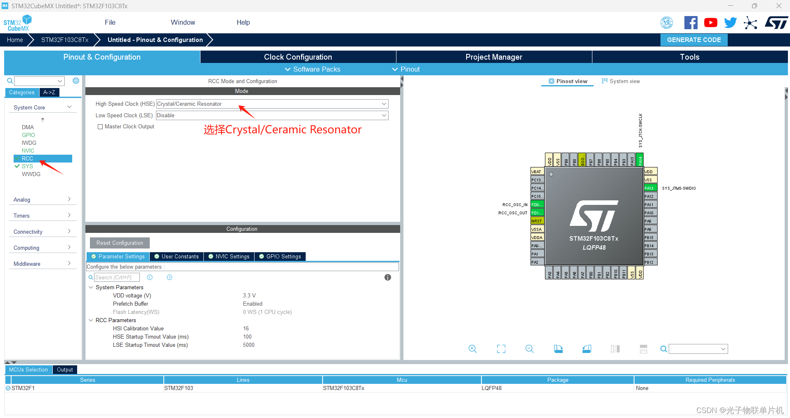

## 2.4 分支 A：用 Keil MDK 编译烧录

### 2.4.1 安装
- 到 keil.com 下载安装 **Keil MDK-ARM**（Windows）。
- 安装对应 **STM32F1xx Device Pack**（在 Pack Installer 里搜 F1 安装，或首次打开工程自动提示）。
- 安装 **ST-Link 驱动**（ST 官网 STSW-link009，或使用 STM32CubeProg 自带驱动）。

### 2.4.2 打开与编译
1. 用 CubeMX 生成工程时，Toolchain 选 **MDK-ARM V5**，会生成 `.uvprojx` 工程。
2. 双击打开工程 → 点击魔法棒（Options for Target）→ 检查 `Device` 是否为 STM32F103C8。
3. 点击 **Build（F7）** 编译，下方 Output 显示 `0 Error(s)` 即成功。

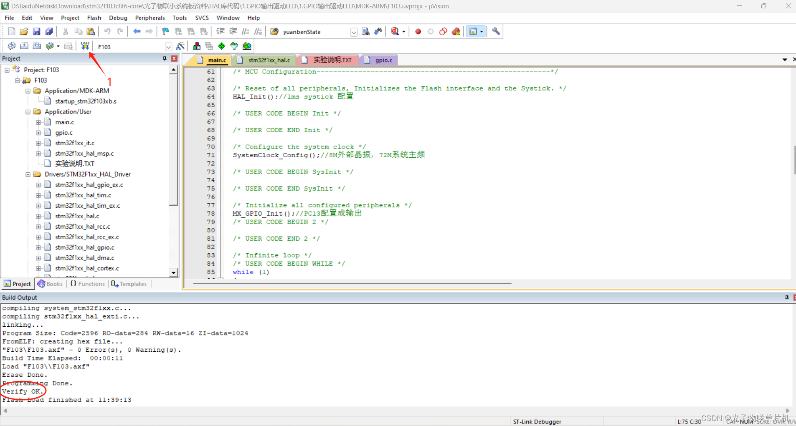

### 2.4.3 烧录与调试

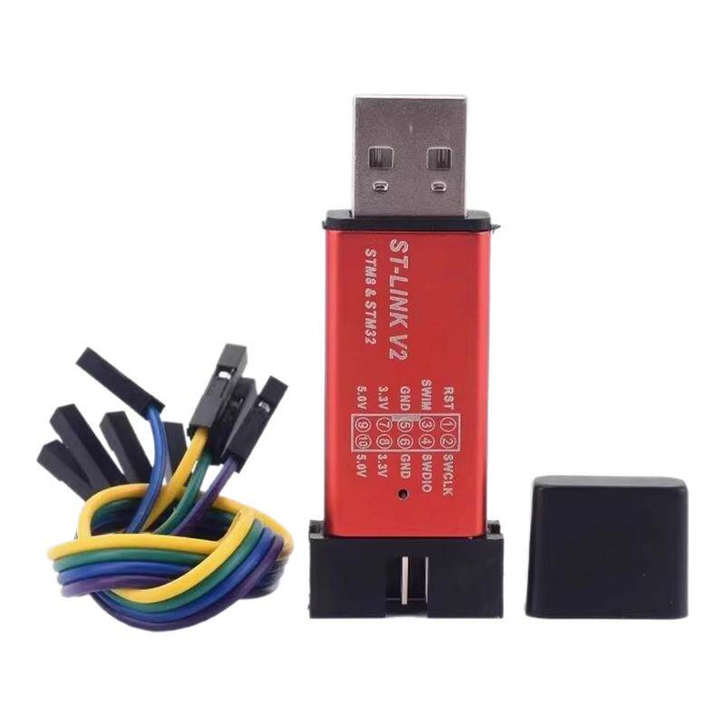
1. 魔法棒 → `Debug` 标签 → 右侧选 `ST-Link Debugger` → `Settings` 里确认能识别到目标芯片。
2. 用杜邦线把 ST-Link 接到蓝pill 的 **SWDIO / SWCLK / GND / 3.3V** 四根线（注意 SWDIO 接 DIO、SWCLK 接 CLK、GND 共地，3.3V 供 ST-Link 参考，通常可不接 3.3V）。
3. 点击 **Download（F8）** 烧录 → 点 **Debug（Ctrl+F5）** 进入调试（可打断点、单步、看寄存器）。烧录后直接 **Reset** 或点运行，PC13 LED 应点亮。

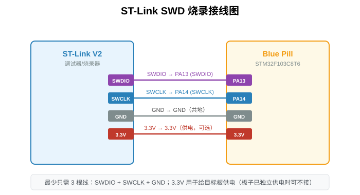

## 2.5 分支 B：用 STM32CubeIDE 编译烧录

### 2.5.1 安装与导入
- 到 ST 官网免费下载安装 **STM32CubeIDE**（跨平台）。
- 方式一：CubeMX 生成工程时 Toolchain 直接选 **STM32CubeIDE**，生成 `.project` 工程。
- 方式二：CubeMX 里选 Toolchain `STM32CubeIDE` 生成后，在 CubeIDE `File → Import → Existing Projects` 导入。

### 2.5.2 编译烧录
1. 打开工程后，CubeIDE 已内置编译链（arm-none-eabi-gcc）与调试器，**无需额外安装**。
2. 点击工具栏 **Build**（锤子图标）编译。
3. 连接 ST-Link → 点击 **Run**（绿色三角）或 **Debug**（虫子图标）。
4. `Debug` 默认停在 `main()`，点继续（F8）即运行，LED 点亮。

> CubeIDE 优势：免费、跨平台、内置 CubeMX 视图（双击 `.ioc` 可再次可视化配置），对新手最友好。

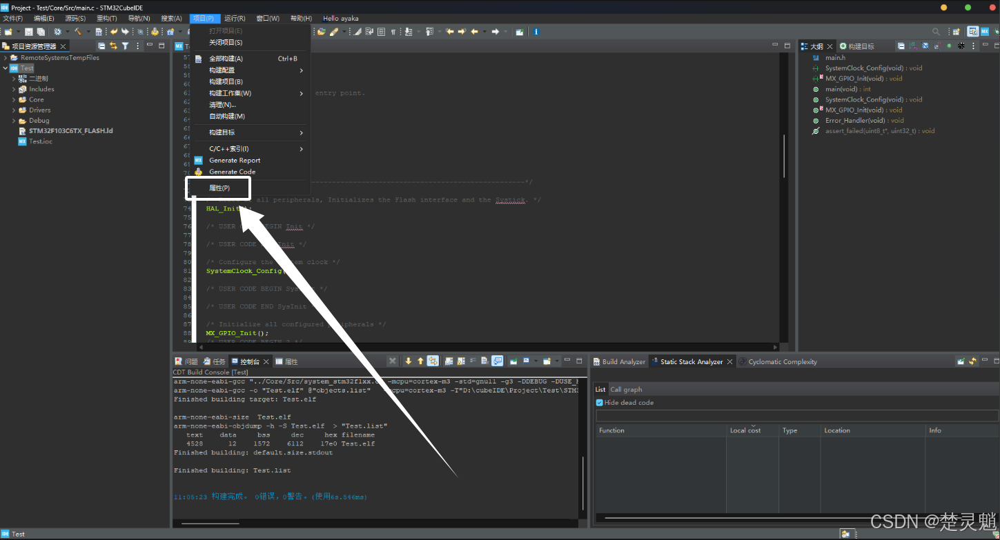

## 2.6 分支 C：用 VSCode + PlatformIO 编译烧录

### 2.6.1 安装
- 安装 **VSCode**（code.visualstudio.com）。
- 在扩展商店安装 **PlatformIO IDE**（"PlatformIO IDE for VSCode"，作者 PlatformIO）。
- 安装 **ST-Link 驱动**（同 Keil）。

### 2.6.2 创建工程
PlatformIO 的 F103 工程通过 `platformio.ini` 描述。生成方式：
1. `PlatformIO Home → New Project`，Name 填 `LedDemo`，Board 搜索 **`bluepill_f103c8`**（或 genericSTM32F103C8），Framework 选 **`Arduino` 或 `STM32Cube`**。
   - 若用 CubeMX 生成的 HAL 工程，建议：CubeMX 里 Toolchain 选 **`Makefile`** 生成，再把生成目录作为 PlatformIO 工程的源码区。
2. 或者直接用 PlatformIO 自带的 `STM32Cube` 框架模板。

一个典型的 `platformio.ini`：

```ini
[env:bluepill_f103c8]
platform = ststm32
board = bluepill_f103c8
framework = arduino      ; 或 stm32cube
upload_protocol = stlink
debug_tool = stlink
build_type = debug
monitor_speed = 115200
```

### 2.6.3 编译烧录调试
1. 点底部状态栏 **Build（✓）** 编译。
2. 连接 ST-Link → 点 **Upload（→）** 烧录。
3. 点 **Debug**（虫子）调试；若克隆 ST-Link 报 CPUTAPID 错误，在 `platformio.ini` 加：
   ```ini
   upload_flags = -c set CPUTAPID 0x2ba01477
   debug_init_break = tbreak setup
   ```
   （这是社区针对国产克隆 ST-Link 的通用解法，参考 PlatformIO Community 帖子，见附录 A。）

### 2.6.4 烧录小贴士（Windows）
- Windows 下 ST-Link 插上即用，烧录前在**设备管理器**确认出现 `STLink` 设备；若显示未知设备或感叹号，重装驱动。

## 2.7 调试器使用入门（三个 IDE 通用思想）

调试是开发效率之王。无论哪个 IDE，核心操作一致：

| 操作 | 说明 |
|---|---|
| **打断点** | 在代码行号左侧单击出现红点，程序跑到这行暂停 |
| **单步跳过 F10** | 不进入函数内部，一行行执行 |
| **单步进入 F11** | 进入函数内部逐行执行 |
| **查看变量** | 调试窗口添加变量（如 `value`），实时看变化 |
| **查看外设寄存器** | 看 GPIO ODR、定时器 CNT 等硬件寄存器值 |
| **继续 F5/F8** | 暂停后继续运行 |

**验证方式**：调试时让程序停在 `HAL_GPIO_WritePin` 前后，单步执行，观察对应引脚电平变化（可用万用表/示波器，或看 LED 亮灭）。

## 2.8 常见坑与排查（环境搭建）

1. **芯片锁死 / 无法连接**：多半是 SYS 没开 Serial Wire 或把 SWD 引脚复用成 GPIO。解法：把 BOOT0 拨到 1（从系统存储器启动），连 ST-Link 用 `STM32CubeProgrammer` 全片擦除（Full erase）后 BOOT0 拨回 0。
2. **识别不到 ST-Link**：换 USB 口、重装驱动、检查杜邦线是否接对（SWDIO/SWCLK 别接反）。
3. **编译报头文件找不到**：CubeMX 生成的工程路径不能有中文/空格，且 IDE 打开的是工程文件而非整个文件夹。
4. **下载后不运行**：检查 Debug 配置是否选了 `Reset and Run`（Keil 在 Utilities/Debug 设置里，CubeIDE 在启动配置里）。
5. **PlatformIO 下载报 CPUTAPID**：见 2.6.3 的 `upload_flags` 配置。

## 2.9 本章小结与自测

**小结**：
- 开发流水线：CubeMX 配置生成 → 编译 → 烧录 → 调试。
- HAL 库工程结构 + USER CODE 保护区是 CubeMX 的核心铁律。
- Keil（Windows 普及）、CubeIDE（免费跨平台）、PlatformIO（开源跨平台）三选一即可。
- SYS 开 Serial Wire、Debug 选 ST-Link、烧录设 Reset and Run，是三个最易踩的坑。

**自测题**：
1. 为什么 SYS 必须开启 Serial Wire？
2. CubeMX 重新生成代码时，用户代码写在哪些区段内才不会被覆盖？
3. 蓝pill 板载 LED 是低电平点亮还是高电平点亮？
4. 芯片无法连接时，BOOT0 拨到 1 的作用是什么？

---

<!-- ===== 第2章 完 ===== -->

# 第3章 点亮第一个 LED —— GPIO 输出

> **本章目标**：真正理解 GPIO 输出的工作原理，用 CubeMX + HAL 写第一段业务代码点亮 LED，并掌握"控制任意引脚"的通用方法。这是 STM32 开发的"Hello World"。

## 3.1 原理：GPIO 输出到底发生了什么

回顾第 1.5 节的 GPIO 结构。当你让一个引脚输出高/低电平时，软件层面做两件事：

1. **配置引脚模式**（一次）：告诉硬件这个脚是"输出"还是"输入"，用哪种输出方式（推挽/开漏）、要不要上拉。
2. **写电平**（随时）：往输出数据寄存器（ODR）写入 0 或 1。

在 HAL 库中，对应两个函数：

```c
// 配置引脚模式（通常在初始化阶段调用一次）
HAL_GPIO_Init(GPIO_TypeDef *GPIOx, GPIO_InitTypeDef *GPIO_Init);

// 写引脚电平（可反复调用）
HAL_GPIO_WritePin(GPIO_TypeDef *GPIOx, uint16_t GPIO_Pin, GPIO_PinState PinState);
```

其中 `PinState` 只有两个取值：
- `GPIO_PIN_RESET` = 0 = **低电平**（0V）
- `GPIO_PIN_SET` = 1 = **高电平**（3.3V）

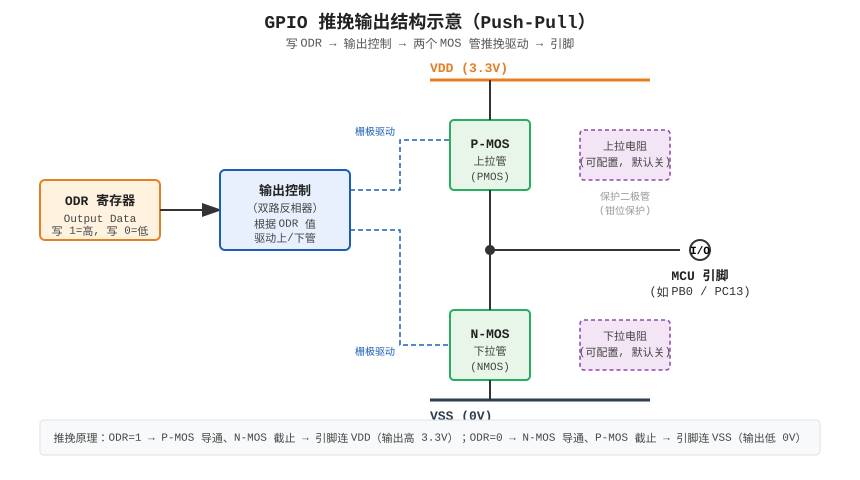

### 3.1.1 为什么蓝pill 的 LED 是"低电平点亮"

看原理图：板载 LED 一端接 **3.3V 电源**，另一端经限流电阻接到 **PC13 引脚**。

- PC13 输出**低电平**（0V）→ 电流从 3.3V 流过 LED 和电阻到 PC13 → **LED 亮**。
- PC13 输出**高电平**（3.3V）→ 两端都是 3.3V，无电位差 → **LED 灭**。

所以这里用 `GPIO_PIN_RESET`（低电平）点亮。**这是硬件设计决定的，不是代码惯例**——同理，如果你外接一个 LED 接到"引脚 + 电阻 + GND"（叫"灌电流"接法，低电平点亮），就要输出低电平；接到"3.3V + 电阻 + 引脚"（叫"拉电流"接法，高电平点亮），就输出高电平。理解这个，以后接任何 LED 都不会糊涂。

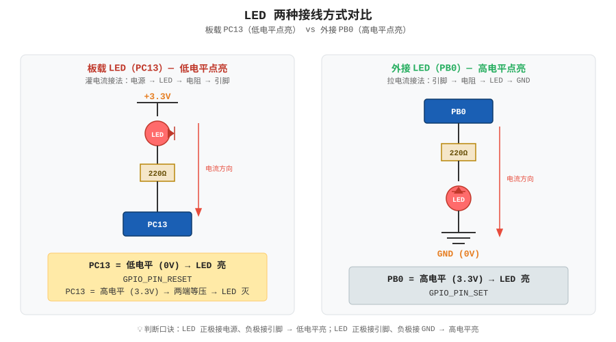

### 3.1.2 GPIO 输出模式的几个参数（CubeMX 界面）

在 CubeMX 里配置一个输出引脚时，常见选项含义：

| 选项 | 含义 | 典型选择 |
|---|---|---|
| GPIO output level | 上电初始电平 | Low / High |
| GPIO mode | 输出模式 | Push Pull（推挽，默认）|
| GPIO Pull-up/Pull-down | 上拉/下拉 | 输出通常 No pull |
| Maximum output speed | 输出速率 | Low（默认）即可，高速信号才需 High |

> **推挽 vs 开漏**：推挽（Push-Pull）能主动输出高和低，驱动 LED 用这个；开漏（Open-Drain）只能拉低，需外部上拉，用于 I2C 等。第 3 章一律用推挽。

## 3.2 实操：用 CubeMX 配置 PC13 并写代码

> 前置：已按第 2.3 节创建工程 `LedDemo`，SYS 开了 Serial Wire，时钟 72MHz。

### 3.2.1 CubeMX 配置回顾
1. PC13 设 `GPIO_Output`。
2. 生成代码。

### 3.2.2 写业务代码（main.c 的 USER CODE 区）

**方案一：让 LED 常亮**

在 `/* USER CODE BEGIN 2 */` 段：

```c
/* USER CODE BEGIN 2 */
HAL_GPIO_WritePin(GPIOC, GPIO_PIN_13, GPIO_PIN_RESET); // 低电平 → 点亮
/* USER CODE END 2 */
```

**方案二：让 LED 闪烁（更有成就感）**

在 USER CODE BEGIN 2 里初始化，再在 `while (1)` 主循环的 USER CODE 区里翻转：

```c
/* USER CODE BEGIN 2 */
HAL_GPIO_WritePin(GPIOC, GPIO_PIN_13, GPIO_PIN_RESET); // 先点亮
/* USER CODE END 2 */

while (1)
{
  /* USER CODE END WHILE */
  HAL_GPIO_TogglePin(GPIOC, GPIO_PIN_13); // 翻转电平
  HAL_Delay(500);                          // 延时 500ms
  /* USER CODE BEGIN 3 */
}
/* USER CODE END 3 */
```

> - `HAL_GPIO_TogglePin` 翻转引脚（亮↔灭）。
> - `HAL_Delay(500)` 是 HAL 库的毫秒延时，依赖 SysTick（第 4、6 章详讲）。
> - 注意把代码放在 `/* USER CODE BEGIN 3 */` 区段内（这是主循环区），否则重新生成会丢。

### 3.2.3 编译烧录
按第 2.4/2.5/2.6 对应分支编译烧录。烧录后应看到 PC13 蓝灯 **闪烁**。

## 3.3 进阶：控制任意引脚（通用方法）

学会 PC13 后，控制任何 GPIO 都是同一套模板。以 PA0 为例（比如外接一个 LED 到 PA0 + 电阻 + GND，高电平点亮）：

1. CubeMX 里把 **PA0** 设为 `GPIO_Output`，重新生成。
2. 代码：

```c
// 点亮 PA0 上的 LED（高电平点亮接法）
HAL_GPIO_WritePin(GPIOA, GPIO_PIN_0, GPIO_PIN_SET);
```

**规律**：`HAL_GPIO_WritePin(端口, 引脚, 电平)`，端口用 `GPIOA/GPIOB/GPIOC`，引脚用 `GPIO_PIN_x`（可 `|` 组合多个引脚）。

组合控制多个引脚：

```c
// 同时点亮 PA0、PA1、PA2
HAL_GPIO_WritePin(GPIOA, GPIO_PIN_0 | GPIO_PIN_1 | GPIO_PIN_2, GPIO_PIN_SET);
```

## 3.4 深入：读懂 HAL 底层（为后续打基础）

好奇"HAL 到底干了什么"的读者，看 `HAL_GPIO_WritePin` 的源码（在 `stm32f1xx_hal_gpio.c`）：

```c
void HAL_GPIO_WritePin(GPIO_TypeDef *GPIOx, uint16_t GPIO_Pin, GPIO_PinState PinState)
{
  /* 检查参数 */
  assert_param(IS_GPIO_PIN(GPIO_Pin));
  assert_param(IS_GPIO_PIN_ACTION(PinState));

  if (PinState != GPIO_PIN_RESET)
  {
    GPIOx->BSRR = GPIO_Pin;          // 置位：写 1 输出高
  }
  else
  {
    GPIOx->BRR  = GPIO_Pin;          // 复位：写 1 输出低
  }
}
```

这里 `BSRR`/`BRR` 是 GPIO 的**置位/复位寄存器**（参考手册 RM0008 GPIO 章节）。写入 BSRR 的对应位=输出高，写入 BRR=输出低。HAL 只是帮你把"写哪个寄存器哪个位"封装成了好懂的函数。

> **为什么要用 BSRR/BRR 而不是直接写 ODR**：BSRR/BRR 是"只置位/只复位"，不影响其他引脚，且无需"读-改-写"（不会在多任务下出错）。这是 ST 硬件设计的一个巧思。

## 3.5 验证方法（不止"看灯亮"）

1. **肉眼**：LED 亮灭（最直观，但只能验证 PC13）。
2. **万用表**：红笔接引脚、黑笔接 GND，输出高电平应测到约 3.3V，低电平约 0V。
3. **调试器**：打断点在 `HAL_GPIO_WritePin`，单步执行，看变量变化 + 测引脚电平。
4. **示波器**（进阶）：看翻转波形的频率与占空比。

## 3.6 常见坑

1. **LED 不亮**：
   - 检查接线（LED 正负极、电阻）。
   - 检查是否设对了端口/引脚（PC13 是 GPIOC，不是 GPIOA）。
   - 蓝pill 板载 LED 低电平点亮，若你用了 `GPIO_PIN_SET` 自然不亮。
   - 检查烧录是否成功（Reset and Run 是否开）。
2. **烧录后没反应**：SYS 没开 Serial Wire，导致 ST-Link 烧完就断开 → 回 CubeMX 打开 Serial Wire 重新生成。
3. **代码丢失**：写在 USER CODE 区段外，重新生成被覆盖 → 检查代码是否在 BEGIN/END 之间。
4. **引脚看错**：PC13 在板上位置容易和邻近脚混淆，用排针丝印 + 万用表确认。

## 3.7 本章小结与自测

**小结**：
- GPIO 输出 = 配置模式（一次） + 写电平（随时）。
- 低电平点亮 vs 高电平点亮由硬件接法决定，看原理图判断。
- HAL 三个核心函数：`HAL_GPIO_Init` / `HAL_GPIO_WritePin` / `HAL_GPIO_TogglePin`。
- 底层是 BSRR/BRR 寄存器；HAL 封装了寄存器操作。
- 代码永远写在 USER CODE 区段。

**自测题**：
1. 为什么蓝pill 板载 LED 用 `GPIO_PIN_RESET` 点亮？
2. `HAL_GPIO_WritePin(GPIOA, GPIO_PIN_5, GPIO_PIN_SET)` 的效果是？
3. BSRR 寄存器写 1 对应输出高还是低？
4. 如何同时控制 PA0、PA1、PA2 都输出高？

---

<!-- ===== 第3章 完 ===== -->
# 第4章 系统时钟树与启动流程

> **本章目标**：搞懂 STM32 的时钟从哪里来、怎么倍频到 72MHz、每条总线多少频率，以及上电后芯片内部到底发生了什么。理解时钟是理解定时器、串口波特率、PWM 频率的前提。

## 4.1 为什么"时钟"如此重要

单片机是"时序"设备——所有外设（定时器、串口、ADC）都依赖一个稳定的时钟节拍。时钟频率决定了：
- CPU 执行指令的速度（72MHz = 每秒 7200 万次）
- 定时器计时精度（如 1ms 中断靠时钟分频）
- 串口波特率（如 115200 bit/s 由时钟算出）
- PWM 输出频率

STM32 的时钟像一个"树"，从根部的一个振荡源开始，经过分频/倍频，分发到各个外设。这条树就是 **时钟树（Clock Tree）**。

## 4.2 时钟源（振荡源）

F103 有多个可选时钟源（参考手册 RM0008 RCC 章节 / 数据手册时钟树图）：

| 时钟源 | 缩写 | 频率 | 说明 |
|---|---|---|---|
| 高速外部晶振 | **HSE** | 外部晶振（蓝pill 为 **8MHz**） | 精度高，主时钟首选 |
| 高速内部振荡器 | **HSI** | 内部 RC，约 8MHz | 上电默认源，精度较低（±1% 量级） |
| 低速外部晶振 | **LSE** | 32.768kHz | 供 RTC，很多蓝pill 未焊 |
| 低速内部振荡器 | **LSI** | 约 40kHz | 供独立看门狗/RTC 备用 |
| **PLL** | — | 锁相环倍频 | 把输入倍频到更高频率（如 8→72MHz） |

**关键：蓝pill 的主时钟路径**
```
HSE(8MHz) ──PLL 锁相环─(×9)──► PLLCLK(72MHz)
                                    │
                                    ▼
                              SYSCLK(72MHz)  ← CPU 系统时钟
```

CubeMX 里 `Clock Configuration` 显示的就是这棵树：把 HSE 填 8，PLL 会自动选 ×9 得 72，`HCLK`（AHB 总线时钟）设 72。

## 4.3 总线系统与分频（AHB/APB）

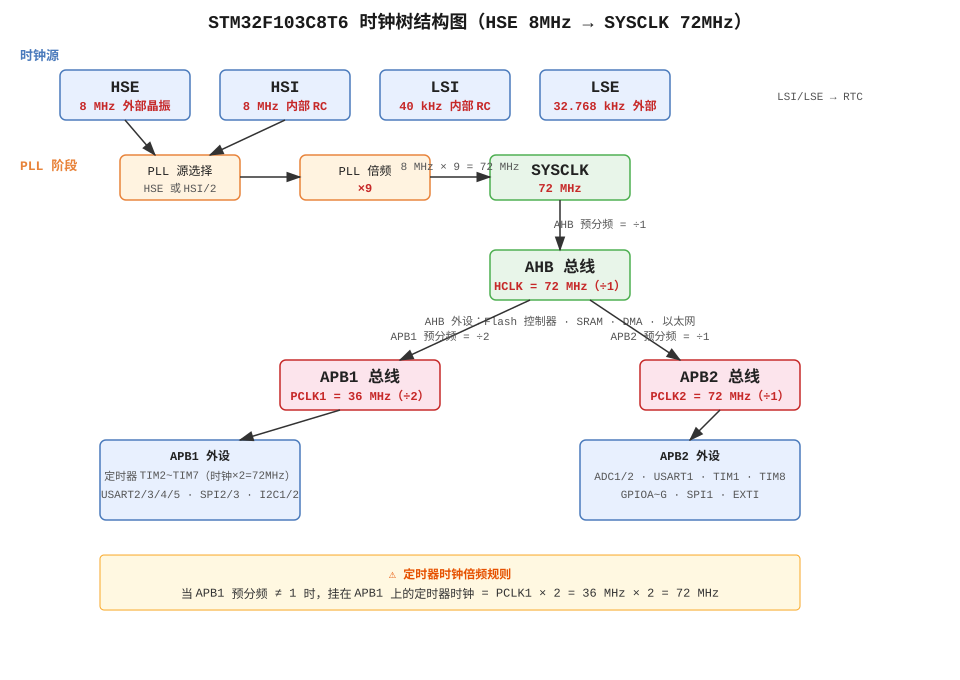

系统时钟 SYSCLK 之后，还要通过总线分频分发到各外设：

```
SYSCLK(72MHz)
   │
   ├──► AHB 总线 (HCLK=72MHz)   → CPU、Flash、SRAM、GPIO、DMA、SysTick
   │      │
   │      ├──► APB1 总线 (PCLK1)  ←─ 低速外设：TIM2/3/4、UART2/3、I2C、SPI2、ADC、RTC
   │      │       分频 /2 → 36MHz
   │      │
   │      └──► APB2 总线 (PCLK2)  ←─ 高速外设：TIM1、UART1、SPI1、ADC、GPIO
   │              分频 /1 → 72MHz
```

- **AHB（Advanced High-performance Bus）**：高速总线，CPU 挂这里。
- **APB1**：低速外设总线，F103 默认分频 /2 = **36MHz**。
- **APB2**：高速外设总线，F103 默认 /1 = **72MHz**。

> **为什么重要**：定时器、ADC、串口的时钟源来自 APB 总线。例如串口 USART1 在 APB2（72MHz），USART2/3 在 APB1（36MHz）；通用定时器 TIM2/3/4 在 APB1（36MHz，且定时器时钟还有 2 倍频规则）。第 6、8 章算频率时会回到这里。

**记忆技巧**：
- APB1 = "低速" = 36MHz
- APB2 = "高速" = 72MHz
- 串口1/定时器1 在高速，串口2/3、定时器2/3/4 在低速。

## 4.4 上电启动流程（Reset → main）

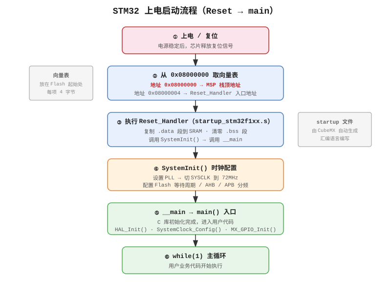

从按下复位到 `main()`，芯片内部按固定顺序走（参考手册启动章节）：

```
上电/复位
  └─► 1. 硬件复位，PC（程序计数器）指向 0x00000000 处的向量表
  └─► 2. 从向量表读两个关键值：
        · 首字 → 初始堆栈指针 MSP
        · 次字 → 复位向量（Reset_Handler 地址）
  └─► 3. Reset_Handler：
        · 拷贝 .data 段（已初始化全局变量）从 Flash 到 RAM
        · 清零 .bss 段（未初始化全局变量）
        · 调用 SystemInit() 设置时钟（CubeMX 生成的 system_stm32f1xx.c）
  └─► 4. 调用 main()（这里开始执行我们的代码）
```

> **这就是"嵌入式开发为什么要懂启动文件"**：启动文件（CubeMX 工程里 `startup_stm32f103x8.s`，汇编）负责准备 C 语言运行环境。你不必手写，但要理解"main 之前发生了什么"。

## 4.5 时钟配置的两种路径

### 4.5.1 CubeMX 图形化（推荐，理解为主）

CubeMX 的 `Clock Configuration` 标签页就是一个可视化时钟树：
- 填 HSE=8
- 设 `PLLMUL`（倍频）→ 得 PLLCLK
- 设 `HCLK`（AHB 分频）
- 设 `APB1/APB2` 分频
- 目标：`HCLK=72MHz`，`PCLK1=36MHz`，`PCLK2=72MHz`

### 4.5.2 背后的代码（SystemInit + HAL_RCC）

CubeMX 生成的时钟配置在 `system_stm32f1xx.c`（`SystemInit` 设置 Flash 等待周期）和 `main.c` 的 `SystemClock_Config()`（用 HAL 库配置 PLL/分频）。看一眼 `main.c` 里自动生成的 `SystemClock_Config()`：

```c
void SystemClock_Config(void)
{
  RCC_OscInitTypeDef RCC_OscInitStruct = {0};
  RCC_ClkInitTypeDef RCC_ClkInitStruct = {0};

  /* 配置外部晶振 HSE 作为时钟源 */
  RCC_OscInitStruct.OscillatorType = RCC_OSCILLATORTYPE_HSE;
  RCC_OscInitStruct.HSEState = RCC_HSE_ON;
  RCC_OscInitStruct.HSEPredivValue = RCC_HSE_PREDIV_DIV1;
  RCC_OscInitStruct.HSIState = RCC_HSI_ON;
  RCC_OscInitStruct.PLL.PLLState = RCC_PLL_ON;
  RCC_OscInitStruct.PLL.PLLSource = RCC_PLLSOURCE_HSE;
  RCC_OscInitStruct.PLL.PLLMUL = RCC_PLL_MUL9;   /* 8MHz × 9 = 72MHz */
  if (HAL_RCC_OscConfig(&RCC_OscInitStruct) != HAL_OK)
  {
    Error_Handler();
  }

  /* 选择系统时钟源并分频 */
  RCC_ClkInitStruct.ClockType = RCC_CLOCKTYPE_HCLK | RCC_CLOCKTYPE_SYSCLK
                              | RCC_CLOCKTYPE_PCLK1 | RCC_CLOCKTYPE_PCLK2;
  RCC_ClkInitStruct.SYSCLKSource = RCC_SYSCLKSOURCE_PLLCLK;  /* 用 PLL 输出 */
  RCC_ClkInitStruct.AHBCLKDivider = RCC_SYSCLK_DIV1;         /* HCLK=72MHz */
  RCC_ClkInitStruct.APB1CLKDivider = RCC_HCLK_DIV2;          /* PCLK1=36MHz */
  RCC_ClkInitStruct.APB2CLKDivider = RCC_HCLK_DIV1;          /* PCLK2=72MHz */
  if (HAL_RCC_ClockConfig(&RCC_ClkInitStruct, FLASH_LATENCY_2) != HAL_OK)
  {
    Error_Handler();
  }
}
```

> **这段是自动生成的，不要手改**（除非故意调频率）。你只需在 CubeMX 界面里调，它替你生成。`FLASH_LATENCY_2` 是 Flash 等待周期：72MHz 时需要 2 个等待周期才能稳定读 Flash（这是"为什么 72MHz 要配 FLASH_LATENCY_2"的原因）。

## 4.6 验证时钟是否 72MHz

1. **调试器**：在调试中打开 `RCC` 相关寄存器，或直接查看 CubeIDE/Keil 的 Registers 窗口里 `RCC->CFGR`，确认 `SW`（系统时钟源）= PLL，`HPRE`、`PPRE1`、`PPRE2` 分频值符合预期。
2. **SysTick 计时**：第 6 章用 `HAL_GetTick()` 测延时，若 1 秒延迟误差明显，多半时钟配置有问题。
3. **示波器**（进阶）：把某引脚配成 MCO 输出时钟（`PA8 = MCO`），可测到实际时钟频率。

## 4.7 常见坑

1. **HSE 没使能导致时钟慢/异常**：CubeMX 里 RCC 的 HSE 忘设 `Crystal/Ceramic`，会用内部 HSI（精度低）。
2. **HCLK 填 72 时 CubeMX 标红**：分频组合不对，按树自动调整或双击目标框。
3. **改了频率后外设全乱**：定时器/串口频率都依赖时钟树，改时钟后必须重新配置相关外设的预分频。
4. **忘记 FLASH_LATENCY**：CubeMX 自动处理，但手写时钟配置时易漏，导致高速下读 Flash 出错。

## 4.8 本章小结与自测

**小结**：
- 时钟树：HSE(8MHz) → PLL×9 → SYSCLK(72MHz) → AHB(72MHz) → APB1(36MHz)/APB2(72MHz)。
- APB1 低速、APB2 高速；外设时钟源影响定时器/串口/ADC 的频率计算。
- 启动流程：向量表 → Reset_Handler → SystemInit（配时钟）→ main。
- 时钟配置由 CubeMX 生成在 `SystemClock_Config()`，通常不改。

**自测题**：
1. F103 如何从 8MHz 晶振得到 72MHz？
2. USART1 在 APB1 还是 APB2？频率各多少？
3. 上电后到 main() 之前发生了哪些关键步骤？
4. 为什么 72MHz 需要 FLASH_LATENCY_2？

---

<!-- ===== 第4章 完 ===== -->

# 第5章 按键输入与外部中断 EXTI

> **本章目标**：学会 GPIO 输入（读按键电平）+ 两种实现方式（轮询 & 中断），并深入理解 Cortex-M 的 NVIC 中断机制。这是从"会输出"走向"会输入、会响应事件"的关键一章。

## 5.1 原理：GPIO 输入与按键电路

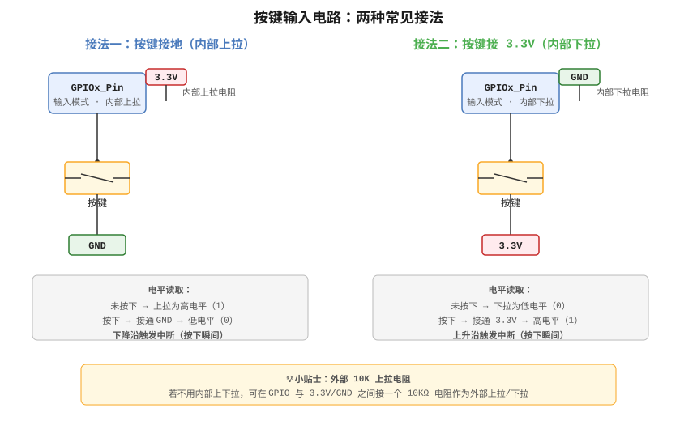

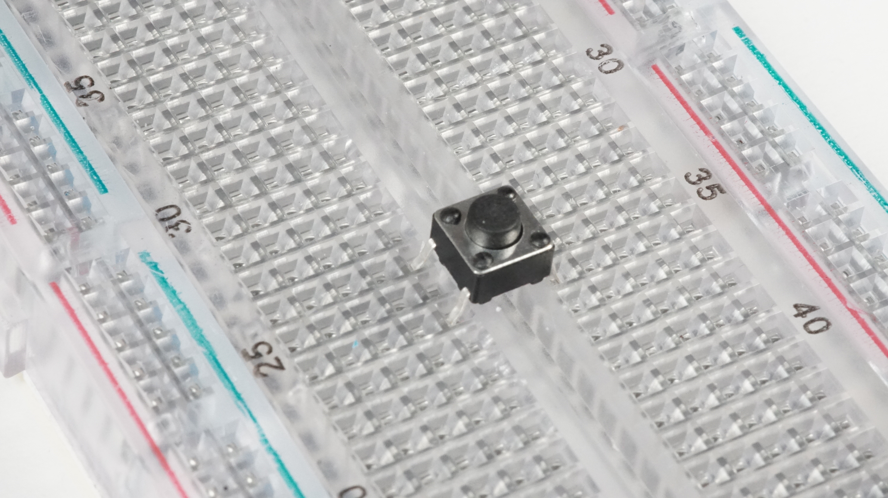

### 5.1.1 读取 GPIO 输入

一个按键通常一端接引脚、另一端接 GND，引脚内部或外部接上拉电阻。原理：

```
        VCC(3.3V)
         │
        [R] 上拉电阻
         │
  引脚 ──┼── 按键 ── GND
```
- 未按下：引脚被上拉电阻拉到 3.3V → 读到 **高电平**（`GPIO_PIN_SET`）。
- 按下：按键导通，引脚接地 → 读到 **低电平**（`GPIO_PIN_RESET`）。

HAL 读引脚函数：

```c
GPIO_PinState HAL_GPIO_ReadPin(GPIO_TypeDef *GPIOx, uint16_t GPIO_Pin);
// 返回 GPIO_PIN_SET(1) 或 GPIO_PIN_RESET(0)
```

### 5.1.2 为什么要用中断

**轮询（Polling）**：主循环不停 `HAL_GPIO_ReadPin` 查按键。简单，但 CPU 一直"空转"，且如果程序忙其他事（如延时）就来不及响应。

**中断（Interrupt）**：引脚电平变化时，硬件自动打断当前程序，跳去执行"中断服务函数"（ISR），处理完再回来。CPU 平时干正事，事件来了才响应——**高效、实时**。

外部中断的硬件链条：

```
引脚电平变化(边沿)
   └─► EXTI 外部中断控制器检测边沿(上升/下降)
        └─► NVIC 中断控制器分发到对应中断号
             └─► CPU 暂停当前，跳转到中断服务函数 ISR
                  └─► 处理完 → 返回继续原程序
```

### 5.1.3 NVIC：Cortex-M 的中枢

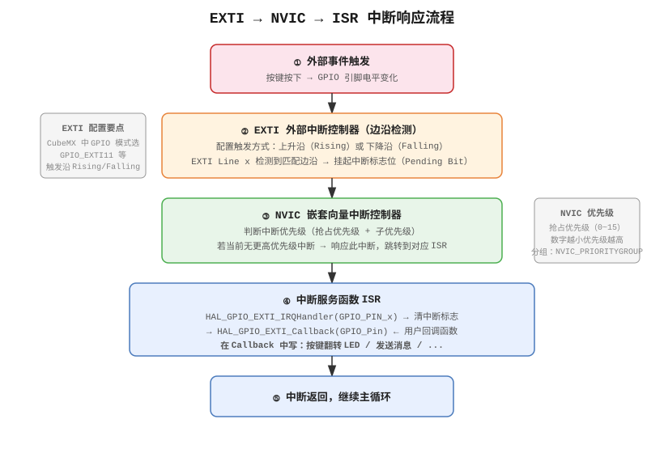

**NVIC**（Nested Vectored Interrupt Controller，嵌套向量中断控制器）是 Cortex-M 内核的中断管理单元，负责：
- **使能/屏蔽**每个中断
- **分配优先级**（抢占优先级 Preemption + 子优先级 Sub）
- **嵌套**：高优先级可打断低优先级

F103 的 NVIC 支持中断优先级分组（参考手册 NVIC 章节）。**分组模式**决定了优先级抢占/子级的位数分配，CubeMX 里默认 `NVIC_PRIORITYGROUP_4`（4 位全给抢占优先级，0–15）。对入门，只需理解：**数值越小，优先级越高**；`configMAX_SYSCALL_INTERRUPT_PRIORITY` 这类概念在 FreeRTOS 章节再展开。

## 5.2 实操：按键点亮 LED（轮询版，最简单）

**目标**：按键未按下 LED 灭，按下 LED 亮。

### 5.2.1 CubeMX 配置
1. **PC13** → `GPIO_Output`（LED）。
2. **PA0** → 配置为输入：
   - 点击 PA0 → 选 `GPIO_Input`
   - 在 `GPIO` 标签页里设：`GPIO Pull-up/Pull-down = Pull-up`（内部上拉，配合按键接地）
3. 重新生成。

### 5.2.2 代码（USER CODE 区）

```c
/* USER CODE BEGIN 2 */
/* 初始化：LED 灭（PC13 高电平灭） */
HAL_GPIO_WritePin(GPIOC, GPIO_PIN_13, GPIO_PIN_SET);
/* USER CODE END 2 */

while (1)
{
  /* USER CODE END WHILE */

  /* 读 PA0：按键按下 → 低电平 → 点亮 LED */
  if (HAL_GPIO_ReadPin(GPIOA, GPIO_PIN_0) == GPIO_PIN_RESET)
  {
    HAL_GPIO_WritePin(GPIOC, GPIO_PIN_13, GPIO_PIN_RESET); // 点亮
  }
  else
  {
    HAL_GPIO_WritePin(GPIOC, GPIO_PIN_13, GPIO_PIN_SET);   // 熄灭
  }

  /* USER CODE BEGIN 3 */
}
```

**验证**：按下按键 LED 亮，松开灭。

> **关键认知**：这里按键接地 + 内部上拉，所以"按下=低=RESET"。如果你的按键接 VCC（下拉方案），逻辑正好相反。判断依据是电路图，不是死记。

## 5.3 实操：外部中断版（按键触发，更高效）

**目标**：按下按键产生中断，LED 翻转一次（每按一下切换亮灭）。

### 5.3.1 CubeMX 配置（比轮询多三步）
1. **PA0** 设 `GPIO_EXTI0`（外部中断输入）。
2. 在 `GPIO` 标签页设：`GPIO mode = External Interrupt Mode with Falling edge trigger detection`（下降沿触发：高→低，即按下瞬间）。
3. 左侧 `System Core → NVIC`：勾选 `EXTI line0 interrupt`，优先级可默认。
4. 重新生成。

> 会自动生成中断服务函数骨架 `EXTI0_IRQHandler` 并调用 `HAL_GPIO_EXTI_IRQHandler(GPIO_PIN_0)`，而真正写业务逻辑的是回调函数 `HAL_GPIO_EXTI_Callback`。

### 5.3.2 代码

在 `main.c` 末尾（USER CODE BEGIN 4 区段）添加回调函数：

```c
/* USER CODE BEGIN 4 */
/* EXTI 回调函数：当 PA0 触发外部中断时被 HAL 调用 */
void HAL_GPIO_EXTI_Callback(uint16_t GPIO_Pin)
{
  if (GPIO_Pin == GPIO_PIN_0)          // 确认是 PA0 触发
  {
    HAL_GPIO_TogglePin(GPIOC, GPIO_PIN_13); // 翻转 LED
  }
}
/* USER CODE END 4 */
```

**验证**：每次按下按键，LED 亮灭翻转一次。

> **为什么有两层函数**：`EXTI0_IRQHandler`（中断入口，由 CubeMX 生成，里面调 `HAL_GPIO_EXTI_IRQHandler`）→ `HAL_GPIO_EXTI_IRQHandler`（HAL 库负责清除标志、调回调）→ `HAL_GPIO_EXTI_Callback`（你写的业务逻辑）。**你只需要写最内层的 Callback**，这是 HAL 的中断回调机制，后面所有外设中断都遵循"在 Callback 里写逻辑"。

### 5.3.3 关于"按键抖动"

机械按键按下/松开瞬间电平会**抖动**（几十毫秒内高低跳变），一次按下可能触发多次中断，LED 会"乱闪"。入门可以先容忍，进阶可用：
- **硬件消抖**：RC 滤波电路。
- **软件消抖**：检测到下降沿后延时 ~20ms 再确认电平。
- 第 6 章学了定时器后可用"定时器扫描去抖"。

> 本讲义入门阶段先不消抖，理解中断机制为主；附录 A 会给出消抖参考。

## 5.4 深入：读一读 HAL 的中断处理

`HAL_GPIO_EXTI_IRQHandler` 源码核心（`stm32f1xx_hal_gpio.c`）：

```c
void HAL_GPIO_EXTI_IRQHandler(uint16_t GPIO_Pin)
{
  /* 清除 EXTI 对应引脚的挂起标志（pending flag） */
  if (__HAL_GPIO_EXTI_GET_IT(GPIO_Pin) != RESET)
  {
    __HAL_GPIO_EXTI_CLEAR_IT(GPIO_Pin);
    /* 调用用户回调 */
    HAL_GPIO_EXTI_Callback(GPIO_Pin);
  }
}
```

**关键**：中断处理完必须**清除标志位**，否则会反复进入中断。HAL 已经帮你清了，你只写 Callback。

## 5.5 常见坑

1. **中断不触发**：检查 NVIC 是否勾选使能；检查触发边沿方向是否和按键电路匹配（接地按键按下降沿）。
2. **一次按键多次翻转**：抖动未消抖，加延时/定时器消抖。
3. **回调里加 `HAL_Delay` 卡死**：中断里尽量别用长延时；若中断和主循环都用到同一资源要小心。
4. **读按键电平反了**：上拉/下拉、按键接法没想清楚，先画电路图再定逻辑。
5. **回调没被调用**：确认 `EXTI0_IRQHandler` 里有 `HAL_GPIO_EXTI_IRQHandler(GPIO_PIN_0)`（CubeMX 自动生成，别删），且你的 Callback 是全局函数写在 USER CODE 4 区。

## 5.6 本章小结与自测

**小结**：
- 输入读取：`HAL_GPIO_ReadPin`，配合上拉/下拉确定默认电平。
- 轮询简单但占 CPU；中断高效实时。
- EXTI（外部中断）+ NVIC（中断控制）：事件触发 → 中断 → Callback 写逻辑。
- 数值越小优先级越高；中断必须清标志。

**自测题**：
1. 按键接地 + 内部上拉时，按下读到的电平是什么？
2. 轮询和中断各自的优缺点？
3. `HAL_GPIO_EXTI_Callback` 里写业务逻辑，为什么不需要清标志位？
4. NVIC 中，优先级数值 3 和 10，谁先响应？

---

<!-- ===== 第5章 完 ===== -->

# 第6章 定时器（SysTick / TIM）

> **本章目标**：理解定时器原理，会用 HAL 的延时函数（SysTick），并学会通用定时器 TIM 的定时中断——这是实现"精确延时、周期性任务、以及后续 PWM/输入捕获"的基础。

## 6.1 原理：定时器是什么

定时器是一个**硬件计数器**，靠时钟节拍自动累加，到设定值触发事件（如中断），CPU 无需一直盯着。它比软件循环延时精确得多，且不占 CPU。

F103 有几种定时器（参考手册 RM0008 TIM 章节）：

| 类型 | 型号 | 特点 |
|---|---|---|
| 高级定时器 | **TIM1** | 16 位，支持 PWM/捕获/互补输出/刹车（电机控制） |
| 通用定时器 | **TIM2/3/4** | 16 位（TIM2 某些型号 32 位），PWM、输入捕获、定时 |
| 基本定时器 | TIM6/7（部分型号） | 仅定时 |
| **SysTick** | — | Cortex-M 内核自带 24 位递减计数器，HAL 延时用它 |

> 注意：F103C8T6 实际有 TIM1、TIM2、TIM3、TIM4（+ SysTick）。讲义用 **TIM2** 演示定时中断。

### 6.1.1 定时器计数原理

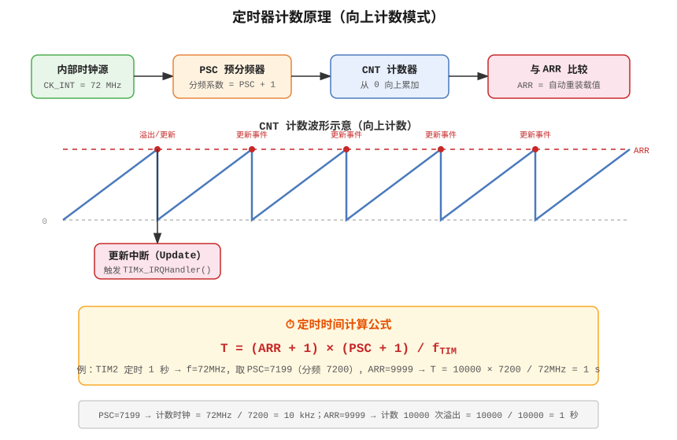

一个定时器由 **预分频器（PSC）** 和 **自动重装载寄存器（ARR）** 配合决定溢出周期：

```
时钟(如 APB1 的 36MHz 定时器时钟，实际有 2 倍频)
   │  /PSC（预分频，分频后得到计数频率 f_cnt）
   ▼
计数器 CNT 每个 f_cnt 周期 +1
   │  到 ARR 值 → 溢出（触发中断）
   ▼
CNT 归零，重新计数
```

**溢出周期公式**（核心公式，务必掌握）：

```
溢出时间 T = (ARR + 1) × (PSC + 1) / f_clk
```

- `f_clk`：定时器输入时钟频率
- `PSC`：预分频值（0–65535）
- `ARR`：自动重装载值（0–65535 或 65535 视型号）

**举例（关键计算）**：让 TIM2 每 1ms 溢出一次。
- TIM2 的输入时钟：在 APB1 且 APB1 分频为 2 时，定时器时钟 = PCLK1 × 2 = 72MHz（这是 STM32 的"定时器时钟 2 倍频"规则）。假设我们直接用 72MHz。
- 选 `PSC = 71` → 计数频率 = 72MHz / (71+1) = 1MHz（即 1μs 计 1 次）
- 要 1ms 溢出：`ARR = 999` → 周期 = (999+1) × 1μs = 1000μs = 1ms

> 在 CubeMX 里，`Prescaler=71`、`Counter Period=999`，对应 PSC/ARR，配置界面会直接显示结果。

### 6.1.2 SysTick 与 HAL_Delay

`HAL_Delay(ms)` 内部就是让 SysTick（24 位递减计数器）每 1ms 触发一次更新中断，靠一个 `uwTick` 全局变量累加毫秒数实现的。所以**只要时钟配置正确，HAL_Delay 就是准的**。

## 6.2 实操：TIM2 定时中断，LED 每 1 秒翻转

**目标**：用 TIM2 每 500ms 触发一次中断，让 LED 每秒亮灭一次（比 HAL_Delay 更"专业"的周期任务方式）。

### 6.2.1 CubeMX 配置

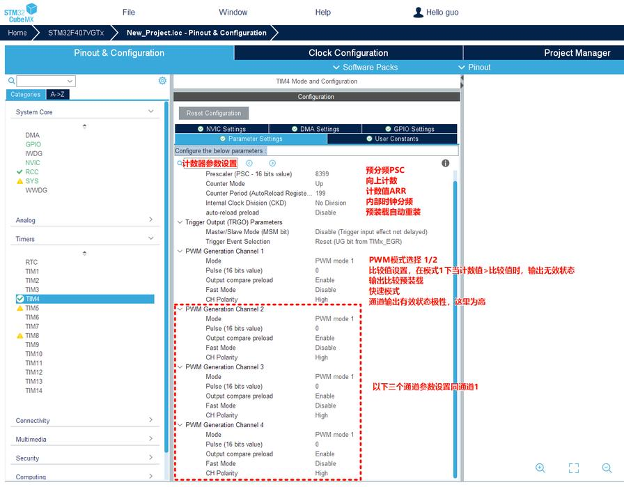
1. 左侧 `Timers → TIM2`，勾选 `Activated`。
2. 参数设置（`Parameter Settings`）：
   - `Prescaler (PSC)` = **71**
   - `Counter Mode` = `Up`（向上计数）
   - `Counter Period (ARR)` = **9999**（配合 71 → 1MHz 计数，10ms 溢出；下面用中断计数实现 1s）
   - `auto-reload preload` = Enable（可选）
3. `NVIC Settings`：勾选 **`TIM2 global interrupt`**。
4. 重新生成。

> 若想要"正好 1 秒一次中断"，可设 PSC=7199、ARR=9999 → 计数频率 10kHz，溢出 (9999+1)/10k = 1s。这里用 PSC=71/ARR=9999（10ms 中断）则演示"计数实现更长周期"。

### 6.2.2 代码

```c
/* 全局变量（文件顶部 USER CODE 区） */
/* USER CODE BEGIN PV */
volatile uint32_t tim_counter = 0;   // 中断里累加的计数
/* USER CODE END PV */

/* USER CODE BEGIN 2 */
HAL_TIM_Base_Start_IT(&htim2);       // 启动 TIM2 定时中断
/* USER CODE END 2 */

/* USER CODE BEGIN 4 */
/* TIM 定时中断回调：每 10ms 进入一次 */
void HAL_TIM_PeriodElapsedCallback(TIM_HandleTypeDef *htim)
{
  if (htim->Instance == TIM2)
  {
    tim_counter++;
    if (tim_counter >= 100)           // 100 × 10ms = 1s
    {
      tim_counter = 0;
      HAL_GPIO_TogglePin(GPIOC, GPIO_PIN_13);  // 翻转 LED
    }
  }
}
/* USER CODE END 4 */
```

**验证**：LED 每 1 秒翻转一次，比 HAL_Delay 更精确、且不阻塞主循环（主循环还能干别的）。

> **重点**：`HAL_TIM_Base_Start_IT(&htim2)` 启动中断模式定时器；回调 `HAL_TIM_PeriodElapsedCallback` 是"周期溢出回调"，同样只需写业务逻辑。

## 6.3 进阶：一图看懂"回调"设计模式

前面几章你已经遇到多个 Callback。HAL 的中断回调统一思想：

```
外设中断 ISR（CubeMX 生成）
   └─► HAL 库中断处理函数（清标志 + 调回调）
        └─► 用户回调 Callback（你在 USER CODE 4 里写）
```

常见回调一览：

| 外设 | 回调函数 | 触发时机 |
|---|---|---|
| EXTI | `HAL_GPIO_EXTI_Callback` | 外部中断 |
| 定时器 | `HAL_TIM_PeriodElapsedCallback` | 定时器溢出 |
| 串口 | `HAL_UART_RxCpltCallback` | 接收完成 |
| ADC | `HAL_ADC_ConvCpltCallback` | 转换完成 |

## 6.4 常见坑

1. **忘了启动定时器**：`HAL_TIM_Base_Start_IT` 没调用，中断永不触发。
2. **NVIC 没勾选**：定时器中断没在 NVIC 里使能。
3. **中断里用了 HAL_Delay 卡死**：中断回调里避免调用依赖 SysTick 的延时（易冲突）。
4. **回调里忘了判断是哪个定时器**：多个定时器共用同一回调，用 `htim->Instance == TIMx` 区分。
5. **PSC/ARR 算错导致频率不对**：重新核对公式 `T=(ARR+1)×(PSC+1)/f_clk`，并用调试器看 `CNT` 寄存器验证。

## 6.5 本章小结与自测

**小结**：
- 定时器 = 硬件计数器，靠时钟累加，溢出触发中断。
- 核心公式：`T = (ARR+1) × (PSC+1) / f_clk`。
- APB1 定时器时钟有 2 倍频规则（APB1 分频>1 时）。
- `HAL_TIM_Base_Start_IT` 启动；`HAL_TIM_PeriodElapsedCallback` 写逻辑。
- HAL 回调设计模式贯穿所有外设。

**自测题**：
1. 写出定时器溢出周期公式，并说明各变量含义。
2. 要让 TIM 每 100ms 中断一次，PSC/ARR 如何组合（计数频率 1MHz）？
3. 为什么 F103 的 APB1 定时器时钟是 72MHz 而非 36MHz？
4. 多个定时器共用回调时如何区分是哪个定时器？

---

<!-- ===== 第6章 完 ===== -->
# 第7章 PWM 输出

> **本章目标**：理解 PWM（脉宽调制）原理，用定时器输出可调占空比的波形，实现呼吸灯和舵机控制两个典型应用。这是"定时器实战化"的一章。

## 7.1 原理：什么是 PWM

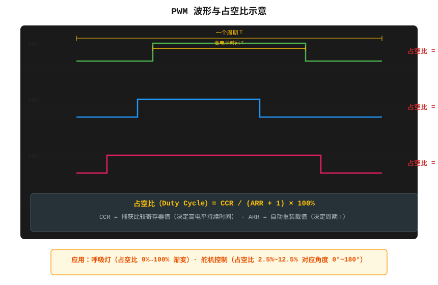

**PWM**（Pulse Width Modulation，脉宽调制）是一种通过**调整方波中高电平所占的比例**（占空比 Duty Cycle）来控制"平均输出"的技术。

```
一个周期 T（频率 f = 1/T）
高电平时间 = 占空比 × T

__|‾‾‾‾|____|‾‾‾‾|____    占空比 50%
__|‾‾‾‾‾‾‾‾|________    占空比 ~75%
__|‾‾‾‾|___________    占空比 ~25%
```

- **占空比（Duty）** = 高电平时间 / 周期，范围 0%–100%。
- **平均电压** = 占空比 × 高电平电压。例如 3.3V 的 50% 占空比 ≈ 平均 1.65V。

**PWM 用途**：
- **调光/呼吸灯**：改变 LED 亮度（快速切换人眼感觉不到闪烁，只看到平均亮度变化）。
- **电机调速 / 舵机控制**：改变占空比控制速度/角度。
- **DAC 替代**：PWM + RC 滤波可得模拟电压。
- **音频/蜂鸣器**：改变频率与占空比。

## 7.2 原理：定时器怎么输出 PWM

通用定时器的 PWM 模式：利用 **输出比较（OC，Output Compare）**——当计数器 CNT 的值与设定的 **比较寄存器 CCR** 相等时，自动翻转/控制输出引脚电平。

```
计数器 CNT 从 0 计到 ARR
         CCR 是比较点
         │
0 ───────●───────► ARR
  高电平   │   低电平
   (CNT<CCR) (CNT>CCR)
```

- **ARR**（自动重装载）决定 **周期/频率**：`f_PWM = f_clk / ((PSC+1)×(ARR+1))`
- **CCR**（比较寄存器）决定 **占空比**：`占空比 = CCR / (ARR+1)`

**关键公式（务必掌握）**：
```
f_PWM = f_clk / ((PSC+1) × (ARR+1))
占空比 = CCR / (ARR+1)
```

HAL 改占空比函数：
```c
__HAL_TIM_SET_COMPARE(&htim, TIM_CHANNEL_x, CCR值);
```

## 7.3 实操：呼吸灯（LED 亮度渐变）

**目标**：LED 亮度从暗到亮再到暗循环（呼吸效果）。

### 7.3.1 CubeMX 配置
1. 选一个定时器 + 一个 PWM 输出引脚。这里用 **TIM2_CH1**（PA0）演示（蓝pill PA0 可作 TIM2_CH1）。
   - 左侧 `Timers → TIM2` 勾选 Activated。
   - `PWM Generation Channel 1` 选 `PWM Generation CH1`。
2. 参数：
   - `Prescaler (PSC)` = **71**（→ 计数频率 1MHz）
   - `Counter Mode` = Up
   - `Counter Period (ARR)` = **999**（→ PWM 频率 = 1MHz/1000 = **1kHz**）
   - `Pulse`（即 CCR 初值）= 0
3. GPIO 自动生成（PA0 配成 PWM 复用）。
4. 重新生成。

### 7.3.2 代码

```c
/* USER CODE BEGIN PV */
uint16_t duty = 0;        // 当前占空比对应 CCR 值 (0~999)
uint8_t  dir  = 1;        // 方向：1 增亮，0 变暗
/* USER CODE END PV */

/* USER CODE BEGIN 2 */
HAL_TIM_PWM_Start(&htim2, TIM_CHANNEL_1);   // 启动 PWM 输出
/* USER CODE END 2 */

while (1)
{
  /* USER CODE END WHILE */

  /* 更新占空比，形成呼吸效果 */
  if (dir)
  {
    duty += 5;
    if (duty >= 999) dir = 0;
  }
  else
  {
    duty -= 5;
    if (duty <= 0) dir = 1;
  }
  __HAL_TIM_SET_COMPARE(&htim2, TIM_CHANNEL_1, duty);
  HAL_Delay(10);

  /* USER CODE BEGIN 3 */
}
```

**验证**：LED 亮度缓慢渐变循环（呼吸灯）。若用 PA0 外接 LED（高电平点亮接法），效果明显。

> - `HAL_TIM_PWM_Start(&htim2, TIM_CHANNEL_1)` 启动 PWM。
> - `__HAL_TIM_SET_COMPARE` 实时改 CCR → 改占空比 → 改亮度。
> - PWM 频率 1kHz，人眼无闪烁，只感亮度变化。

## 7.4 进阶应用：舵机控制（SG90）

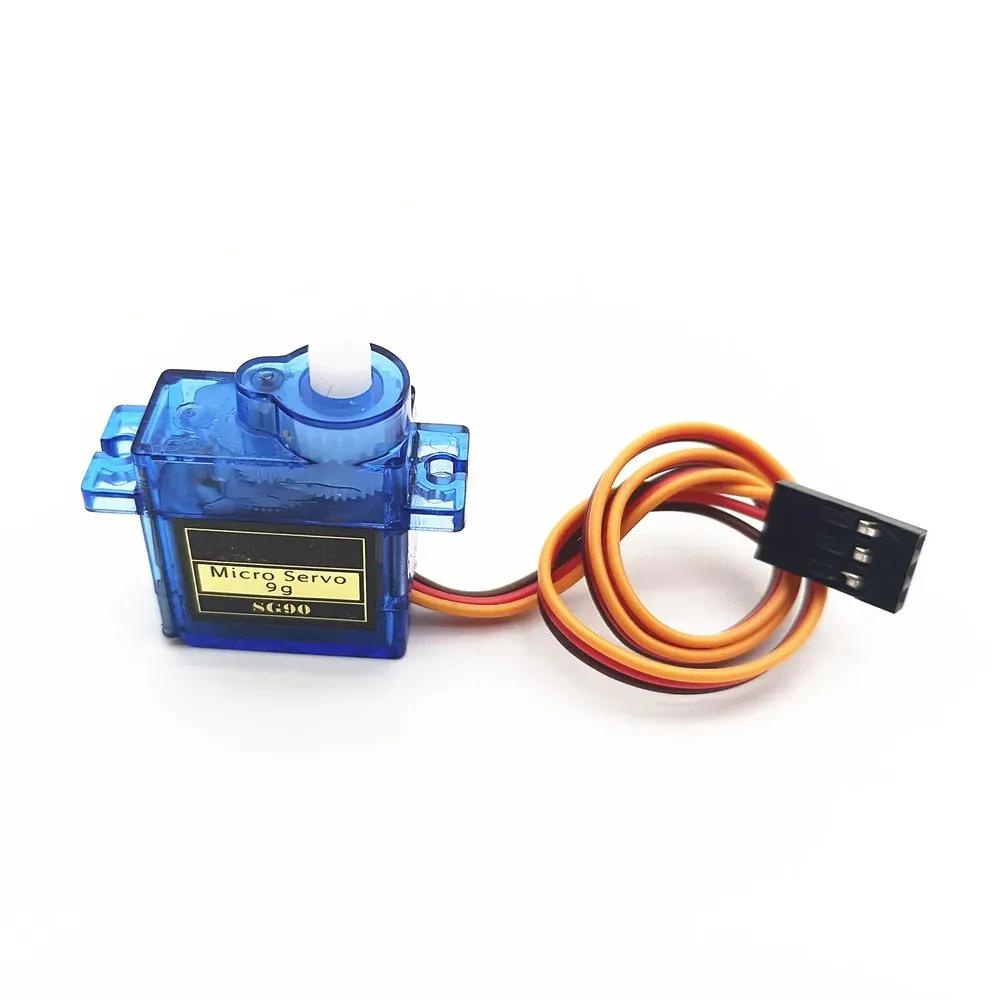

舵机通过 PWM 信号控制角度：**周期 20ms（50Hz），占空比约 0.5ms–2.5ms 对应 0°–180°**。

- 0°：高电平 0.5ms → 占空比 = 0.5/20 = 2.5%
- 90°：高电平 1.5ms → 7.5%
- 180°：高电平 2.5ms → 12.5%

**配置**（以 TIM2_CH1 为例）：
- 要 50Hz：`f_PWM = 1MHz/((PSC+1)×(ARR+1)) = 50Hz`
- 取 `PSC=71`（1MHz 计数）、`ARR=19999` → 周期 = 20000×1μs = 20ms ✓
- CCR 范围：0.5ms→500，1.5ms→1500，2.5ms→2500

```c
// 控制舵机到 90°
__HAL_TIM_SET_COMPARE(&htim2, TIM_CHANNEL_1, 1500);  // 1.5ms
```

> 接线注意：SG90 舵机红线接 5V、棕线接 GND、橙线接 PWM 引脚。F103 引脚输出 3.3V 通常可直接驱动信号线（SG90 阈值兼容）。

## 7.5 常见坑

1. **PWM 频率不对**：核对 `f_PWM = f_clk/((PSC+1)(ARR+1))`；舵机要 50Hz，LED 调光 1kHz 即可。
2. **占空比调不了**：用 `__HAL_TIM_SET_COMPARE` 而非直接改结构体；确认 channel 对应正确。
3. **LED 不亮**：确认用对了引脚（PA0=TIM2_CH1）、启动了 `HAL_TIM_PWM_Start`、占空比非 0。
4. **呼吸灯太快/太慢**：调 `duty` 步进和 `HAL_Delay`。
5. **舵机抖动**：占空比数值或频率不准，校准 CCR 端点（500/2500）。

## 7.6 本章小结与自测

**小结**：
- PWM = 变占空比控制平均输出；占空比=CCR/(ARR+1)。
- 频率由 PSC/ARR 决定，占空比由 CCR 决定。
- `HAL_TIM_PWM_Start` 启动，`__HAL_TIM_SET_COMPARE` 改占空比。
- 呼吸灯（调光）、舵机（50Hz 信号）是两大典型应用。

**自测题**：
1. 写出 PWM 频率和占空比公式。
2. 要让舵机转到 90°，CCR 应设为多少（PSC=71, ARR=19999）？
3. 呼吸灯改变亮度靠改变哪个参数？
4. PWM 调光为何感觉不到闪烁？

---

<!-- ===== 第7章 完 ===== -->

# 第8章 串口通信 UART（printf 重定向）

> **本章目标**：理解串口通信原理，用 USART1 实现收发，并学会把 `printf` 重定向到串口（调试神器）。这是嵌入式开发的"眼睛"，几乎每个项目必备。

## 8.1 原理：串口是什么

**UART**（Universal Asynchronous Receiver/Transmitter，通用异步收发器）是一种异步串行通信协议：一条 TX 线发送、一条 RX 线接收，双方约定**波特率**（每秒传输的 bit 数），无需时钟线。

```
发送方 TX ──────► 接收方 RX
接收方 RX ◄────── 发送方 TX
        （双方需共地 GND）
```

- **异步**：无时钟线，靠波特率同步。
- **帧格式**：起始位(1) + 数据位(8) + 校验位(可选) + 停止位(1/2)。
- **波特率**：如 115200，即每秒 115200 bit。

**电平注意**：
- STM32 引脚输出 **3.3V TTL** 电平。
- 电脑 USB 是 USB 电平。所以要用 **USB 转 TTL 串口模块**（如 CH340/CP2102）在中间转换。
- 接 USB-TTL：**TX 接 RX、RX 接 TX**（交叉！），GND 共地。

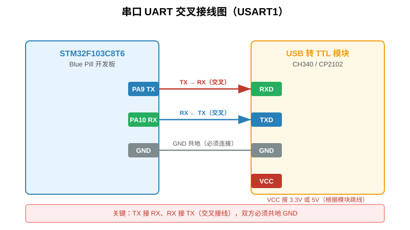

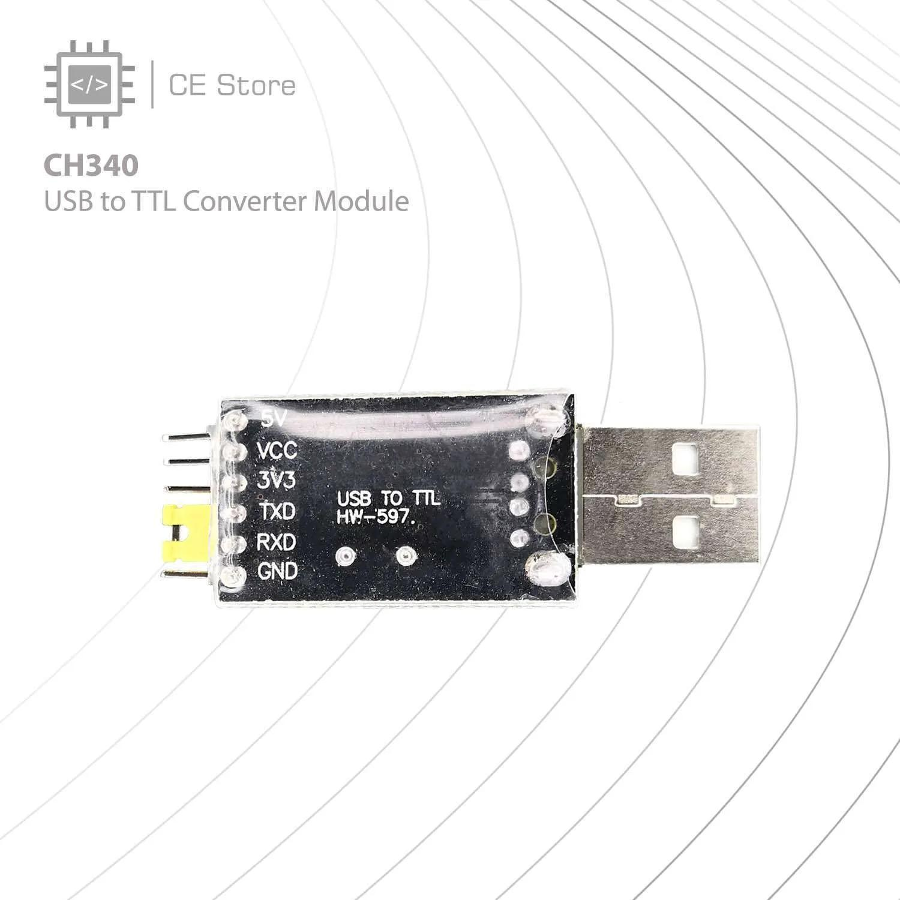

## 8.2 实操：USART1 发送 "Hello World"

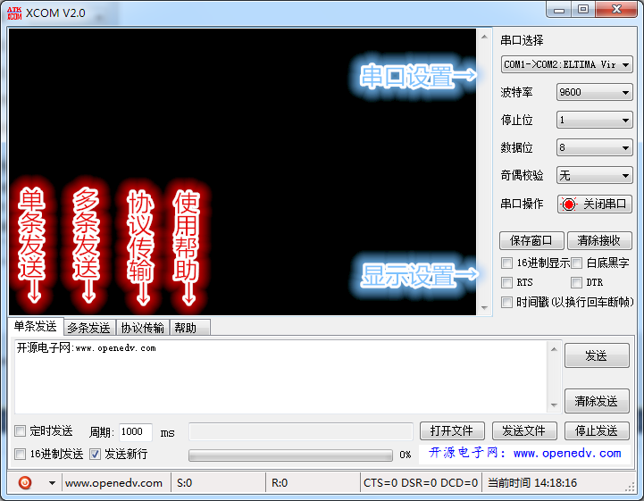

### 8.2.1 CubeMX 配置
1. 左侧 `Connectivity → USART1` 勾选 Activated。
2. 参数：
   - `Baud Rate` = **115200**
   - `Word Length` = 8 Bits
   - `Parity` = None
   - `Stop Bits` = 1
3. 默认引脚：USART1 = **PA9 (TX)、PA10 (RX)**。
4. 重新生成。

### 8.2.2 代码：阻塞发送

```c
/* USER CODE BEGIN 2 */
HAL_UART_Transmit(&huart1, (uint8_t*)"Hello World!\r\n", 15, 1000);
/* USER CODE END 2 */
```

- `HAL_UART_Transmit(句柄, 数据, 长度, 超时ms)` 阻塞发送。
- 需要在电脑端打开串口助手（如 PuTTY、SSCOM、VSCode Serial Monitor），波特率 115200。

### 8.2.3 进阶：printf 重定向（强烈推荐）

让 C 语言的 `printf()` 直接输出到串口，是嵌入式调试的标配。方法：重定向 `fputc`（把字符打印到 UART1）。

在 `main.c` 顶部添加头文件，并实现重定向函数：

```c
/* USER CODE BEGIN Includes */
#include <stdio.h>
/* USER CODE END Includes */

/* USER CODE BEGIN 0 */
/* printf 重定向：把字符逐个发到 USART1 */
int fputc(int ch, FILE *f)
{
  HAL_UART_Transmit(&huart1, (uint8_t *)&ch, 1, 1000);
  return ch;
}
/* USER CODE END 0 */
```

之后就能：

```c
/* USER CODE BEGIN 2 */
printf("Hello STM32! System running at %lu Hz\r\n", SystemCoreClock);
/* USER CODE END 2 */
```

> **注意（Keil）**：Keil 里要勾选 `Use MicroLIB`（Options for Target → Target），否则 `printf` 重定向不生效或内存占用大。CubeIDE/PlatformIO 用 gcc，通常直接可用（CubeIDE 若打印浮点需在 `-u _printf_float` 加链接参数，或用 CubeIDE 的 `setvbuf` 处理）。

## 8.3 实操：串口接收（中断方式）

**目标**：接收到一个字节后立即回显（echo），验证双向通信。

### 8.3.1 CubeMX 配置
1. USART1 开启 **`USART1 global interrupt`**（NVIC 勾选）。
2. 重新生成。

### 8.3.2 代码

```c
/* 全局接收变量 */
/* USER CODE BEGIN PV */
uint8_t rx_byte = 0;
/* USER CODE END PV */

/* USER CODE BEGIN 2 */
HAL_UART_Receive_IT(&huart1, &rx_byte, 1);   // 启动中断接收 1 字节
/* USER CODE END 2 */

/* USER CODE BEGIN 4 */
/* 串口接收完成回调 */
void HAL_UART_RxCpltCallback(UART_HandleTypeDef *huart)
{
  if (huart->Instance == USART1)
  {
    HAL_UART_Transmit(&huart1, &rx_byte, 1, 100);  // 回显
    HAL_UART_Receive_IT(&huart1, &rx_byte, 1);     // 重新开启接收
  }
}
/* USER CODE END 4 */
```

**验证**：串口助手里发送任意字符，会原样返回（echo）。

> **关键**：`HAL_UART_Receive_IT` 只接收一次，接收完成后**必须重新调用**才继续收下一个（回调里又调了一次）。这是 HAL 中断接收的经典模式。

## 8.4 深入：接收一个字符串（队列/缓冲思想）

实际项目常需要接收一整行。入门可先掌握"单字节中断 + 缓冲数组"模式：

```c
/* USER CODE BEGIN PV */
uint8_t rx_buf[128];       // 接收缓冲
volatile uint16_t rx_idx = 0;
/* USER CODE END PV */

/* USER CODE BEGIN 4 */
void HAL_UART_RxCpltCallback(UART_HandleTypeDef *huart)
{
  if (huart->Instance == USART1)
  {
    rx_buf[rx_idx++] = rx_byte;         // 存入缓冲
    if (rx_byte == '\n')                // 收到换行，一行结束
    {
      rx_buf[rx_idx] = '\0';            // 加字符串结束符
      printf("Received: %s", rx_buf);   // 打印这一行
      rx_idx = 0;
    }
    HAL_UART_Receive_IT(&huart1, &rx_byte, 1);
  }
}
/* USER CODE END 4 */
```

> 这只是一个入门骨架；真实项目会用环形缓冲（Ring Buffer）或 DMA + 空闲中断。第 10 章讲 DMA 后会看到更高效的方式。

## 8.5 常见坑

1. **收不到 / 乱码**：
   - TX/RX 是否交叉（TX↔RX）。
   - 波特率两端是否一致（115200）。
   - 是否共地（GND 必须连）。
   - 用了带 5V 逻辑的模块而引脚 3.3V 不兼容（换 3.3V 兼容模块或注意电平）。
2. **printf 不输出（Keil）**：没开 MicroLIB。
3. **接收一次就停**：回调里忘了重新 `HAL_UART_Receive_IT`。
4. **回显/处理重复**：中断回调里避免做太多耗时操作。
5. **浮点 printf 打印乱码（CubeIDE）**：需链接 `-u _printf_float`。

## 8.6 本章小结与自测

**小结**：
- UART 异步串行，靠波特率同步，TX↔RX 交叉 + 共地。
- `HAL_UART_Transmit`（阻塞发）、`HAL_UART_Receive_IT`（中断收）。
- `printf` 重定向 `fputc` 到 USART1 是调试标配（Keil 需 MicroLIB）。
- 中断接收完成后必须重新开启。

**自测题**：
1. 串口接线为什么 TX 接 RX、RX 接 TX？
2. 重定向 printf 需要实现哪个函数？
3. 为什么接收完成后要再次调用 `HAL_UART_Receive_IT`？
4. 波特率不一致会出现什么现象？

---

<!-- ===== 第8章 完 ===== -->

# 第9章 ADC 模拟量采集

> **本章目标**：理解 ADC 原理，用 ADC 采集电位器/光敏电阻的模拟电压并转换为数字量，通过串口打印出来。这是 MCU 与"真实世界"（模拟信号）交互的入口。

## 9.1 原理：什么是 ADC

**ADC**（Analog-to-Digital Converter，模数转换器）把连续变化的**模拟电压**转换成数字量。

F103 的 ADC：
- **12 位分辨率**：输出 0–4095（2^12=4096 个台阶）
- 参考电压通常为 3.3V
- 转换公式：

```
数字值 = 模拟电压 / 3.3V × 4095
模拟电压 = 数字值 × 3.3V / 4095
```

**举例**：电位器输出电压 1.65V → 数字值 = 1.65/3.3×4095 = 2047（约一半）。

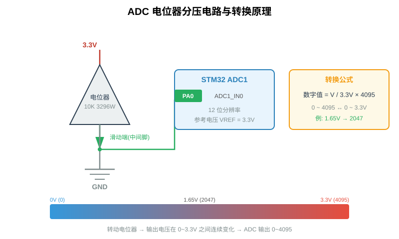

### 9.1.1 ADC 输入引脚

F103C8T6 的 ADC1 有 10 个通道，常用：
- **通道 0 → PA0**
- **通道 1 → PA1**
- **通道 2 → PA2**
- ……
- 通道 8 → PB0、通道 9 → PB1

配置时把对应引脚设成 **Analog（模拟）模式**（CubeMX 里点引脚选 `ADCx_INy`）。

### 9.1.2 三种转换模式

| 模式 | 说明 |
|---|---|
| 单次转换 | 转换一次就停，读一次值 |
| 连续转换 | 自动连续转换，一直更新 |
| 扫描+多通道 | 依次转换多个通道 |

入门先掌握**单通道单次转换**（最易理解），进阶可学多通道 + DMA（第 10 章结合）。

## 9.2 实操：采集电位器电压并串口打印

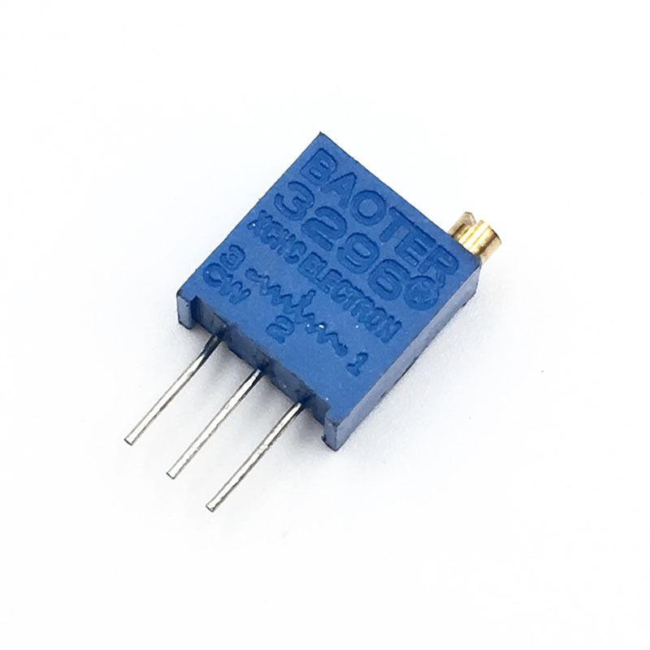

**目标**：电位器（分压电路）输出接 PA0，ADC 采集，串口实时打印电压值。

### 9.2.1 电路
- 电位器三脚：一脚接 3.3V、一脚接 GND、中间滑动端（输出）接 **PA0**。
- 转动电位器，PA0 电压在 0–3.3V 间变化。

### 9.2.2 CubeMX 配置
1. 左侧 `Analog → ADC1` 勾选 Activated。
2. 参数（`Parameter Settings`）：
   - 保持默认 `Resolution=12 bits`，`Scan Conversion Mode=Disable`，`Continuous Conversion Mode=Disable`（单次）。
3. 在 `Pinout` 上点 **PA0** → 选 `ADC1_IN0`（模拟输入）。
4. 重新生成。

### 9.2.3 代码

```c
/* USER CODE BEGIN PV */
uint16_t adc_val = 0;
float voltage = 0.0f;
/* USER CODE END PV */

while (1)
{
  /* USER CODE END WHILE */

  HAL_ADC_Start(&hadc1);                 // 启动 ADC 转换
  HAL_ADC_PollForConversion(&hadc1, 100); // 等待转换完成
  adc_val = HAL_ADC_GetValue(&hadc1);     // 读取数字值
  voltage = adc_val * 3.3f / 4095.0f;     // 换算电压

  printf("ADC = %u, Voltage = %.2f V\r\n", adc_val, voltage);
  HAL_Delay(500);

  /* USER CODE BEGIN 3 */
}
```

**验证**：转动电位器，串口打印的电压值在 0–3.3V 间变化，与万用表测的一致。

> - `HAL_ADC_Start` + `HAL_ADC_PollForConversion` + `HAL_ADC_GetValue` 是"单次转换三件套"。
> - 浮点 printf 在 CubeIDE 需 `-u _printf_float`（见 8.2.3）。

## 9.3 进阶：ADC 多通道（扫描 + 中断）

同时采集 PA0、PA1 两个通道：

### 9.3.1 CubeMX
1. PA0 → `ADC1_IN0`，PA1 → `ADC1_IN1`。
2. ADC1：`Scan Conversion Mode = Enable`，`Continuous = Enable`，`Number of Conversion = 2`。
3. `Rank 1/2` 分别设通道 0、通道 1。
4. 勾选 `ADC1 global interrupt`。
5. 重新生成。

### 9.3.2 代码

```c
/* USER CODE BEGIN PV */
uint32_t adc_buf[2];                    // 存两个通道结果
/* USER CODE END PV */

/* USER CODE BEGIN 2 */
HAL_ADC_Start_DMA(&hadc1, (uint32_t*)adc_buf, 2);   // DMA 方式采集
/* USER CODE END 2 */

while (1)
{
  /* USER CODE END WHILE */
  printf("CH0=%lu (%.2fV), CH1=%lu (%.2fV)\r\n",
         adc_buf[0], adc_buf[0]*3.3f/4095.0f,
         adc_buf[1], adc_buf[1]*3.3f/4095.0f);
  HAL_Delay(500);
  /* USER CODE BEGIN 3 */
}
```

> `HAL_ADC_Start_DMA` 配合 DMA 自动把转换结果搬到 `adc_buf`，无需中断轮询——这是第 10 章 DMA 的第一次实战应用。

## 9.4 常见坑

1. **采集值不变 / 恒为 0 或满量程**：
   - 引脚没设成 Analog 模式。
   - 电位器接线错（没分压）。
   - ADC 未启动或未等待完成。
2. **浮点打印乱码（CubeIDE）**：`-u _printf_float`。
3. **多通道值错乱**：扫描顺序（Rank）和读取顺序要一致；DMA 缓冲长度 = 通道数。
4. **参考电压不准**：默认参考是 VREF（板上接 3.3V），若要精确测外部电压需外接精密基准。

## 9.5 本章小结与自测

**小结**：
- ADC 12 位：数字值 = 电压/3.3 × 4095。
- 单次转换三件套：`HAL_ADC_Start` → `PollForConversion` → `GetValue`。
- 多通道用扫描 + DMA（`HAL_ADC_Start_DMA`）。
- 模拟输入引脚要配成 Analog 模式。

**自测题**：
1. 3.3V 参考、12 位 ADC，1.65V 对应的数字值是多少？
2. 单次转换需要哪三个 HAL 调用？
3. 多通道采集为什么要配 DMA？
4. 模拟引脚模式是哪种？

---

<!-- ===== 第9章 完 ===== -->
# 第10章 DMA 数据传输

> **本章目标**：理解 DMA（直接存储器访问）如何"绕过 CPU"搬运数据，学会用 DMA 做串口收发和 ADC 连续采集。这是让嵌入式程序"解放 CPU、更高效"的关键技术。

## 10.1 原理：为什么需要 DMA

普通的数据搬运流程：CPU 从外设寄存器读一个字节 → 存入内存 → 处理 → 写回。**每一步都要 CPU 参与**，大量数据时 CPU 被占满，无法干别的事。

**DMA**（Direct Memory Access，直接存储器访问）是一个**独立的硬件搬运工**：CPU 配置好后，DMA 控制器自动在"外设 <-> 内存"或"内存 <-> 内存"之间搬数据，搬完才用中断通知 CPU。**搬运过程 CPU 全程空闲**，可以去跑其他代码。

```
无 DMA：CPU 亲自搬运，搬运期间干不了别的
有 DMA：DMA 搬运，CPU 空闲可做别的事，搬完通知
```

**典型场景**：
- 串口接收大量数据（如 256 字节），DMA 自动收，CPU 空闲。
- ADC 连续采样 N 个点，DMA 搬到内存数组。
- 内存块拷贝、外设数据块传输。

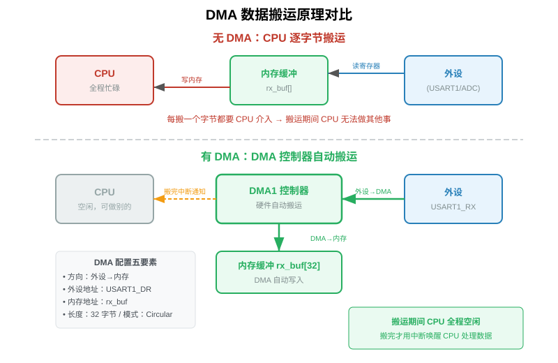

### 10.1.1 DMA 的通道与配置要素

F103 有两个 DMA 控制器（DMA1、DMA2），每个有多个**通道（Channel）**，每个通道可服务特定外设请求（参考手册 DMA 章节）。配置 DMA 需要：
- **数据方向**：外设→内存 / 内存→外设 / 内存→内存
- **源/目的地址**：外设寄存器地址 + 内存缓冲地址
- **传输数据量**（要搬几个元素）
- **传输宽度**（字节/半字/字）
- **模式**：Normal（搬一次停）/ Circular（循环搬，常用）

> **HAL 用法**：CubeMX 勾选外设的 `DMA Settings` → 填地址/长度/模式 → 生成代码，HAL 提供 `HAL_UART_Receive_DMA`、`HAL_ADC_Start_DMA` 等封装。

## 10.2 实操：串口用 DMA 接收一帧数据

**目标**：DMA 自动接收 32 字节数据到缓冲，接收完成触发中断回调，打印出来。

### 10.2.1 CubeMX 配置
1. USART1 Activated，开中断。
2. USART1 的 `DMA Settings` 标签：
   - Add `USART1_RX` → `DMA Request = USART1_RX`，`Mode = Circular`（循环），`Data Width = Byte`。
   - 方向外设→内存，地址由代码填。
3. 重新生成。

> 工程会自动生成 `hdma_usart1_rx` 句柄。中断回调 `HAL_UARTEx_RxEventCallback` 是"DMA 接收事件回调"（接收完成/过半时调用）。

### 10.2.2 代码

```c
/* USER CODE BEGIN PV */
uint8_t rx_buf[32];          // DMA 接收缓冲
/* USER CODE END PV */

/* USER CODE BEGIN 2 */
HAL_UARTEx_ReceiveToIdle_DMA(&huart1, rx_buf, sizeof(rx_buf));
/* USER CODE END 2 */

/* USER CODE BEGIN 4 */
/* DMA 接收完成回调（接收满或空闲时触发） */
void HAL_UARTEx_RxEventCallback(UART_HandleTypeDef *huart, uint16_t Size)
{
  if (huart->Instance == USART1)
  {
    printf("Received %u bytes: %s\r\n", Size, rx_buf);
    HAL_UARTEx_ReceiveToIdle_DMA(&huart1, rx_buf, sizeof(rx_buf)); // 重新开启
  }
}
/* USER CODE END 4 */
```

**验证**：串口助手发送 ≤32 字节，DMA 自动接收并打印长度与内容。

> - `HAL_UARTEx_ReceiveToIdle_DMA`：DMA + 空闲中断组合，收满或串口空闲即回调，无需逐字节中断。
> - **好处**：CPU 在接收期间完全空闲，可用于其他任务。

## 10.3 实操：ADC + DMA 连续采样

（已在第 9.3 节结合多通道演示过，这里强调 DMA 的作用）

```c
/* USER CODE BEGIN PV */
uint32_t adc_buf[8];        // DMA 自动填充的采样数组
/* USER CODE END PV */

/* USER CODE BEGIN 2 */
HAL_ADC_Start_DMA(&hadc1, (uint32_t*)adc_buf, 8);   // 连续采集 8 个点
/* USER CODE END 2 */

while (1)
{
  /* USER CODE END WHILE */
  /* DMA 在后台持续往 adc_buf 填数据，主循环直接读均值 */
  uint32_t sum = 0;
  for (int i = 0; i < 8; i++) sum += adc_buf[i];
  printf("Average = %.2f V\r\n", (sum / 8) * 3.3f / 4095.0f);
  HAL_Delay(500);
  /* USER CODE BEGIN 3 */
}
```

**验证**：串口持续打印 8 点平均电压，且采集过程不阻塞主循环。

## 10.4 DMA 的优势总结（为什么用它）

| 场景 | 无 DMA | 有 DMA |
|---|---|---|
| 串口收 1KB | CPU 逐字节处理，占用高 | DMA 后台搬，CPU 空闲 |
| ADC 连续采样 | CPU 每点轮询 | DMA 自动搬数组 |
| 实时性 | 差（CPU 忙时错过） | 好（外设请求即搬） |
| 代码复杂度 | 简单但低效 | 稍复杂但高效 |

## 10.5 常见坑

1. **DMA 没触发**：确认 DMA 通道绑定正确、外设已启动 DMA 模式（如 `HAL_UART_Receive_DMA` 而非阻塞版）。
2. **只收一次就停**：DMA 模式用 Normal（非循环）时搬完即停，需重新启动；循环模式则自动继续。
3. **缓冲大小/宽度不匹配**：DMA 长度、数据宽度（Byte/HalfWord/Word）必须和实际匹配。
4. **地址配置错**：CubeMX 自动处理大部分，手写时源/目的地址要分清外设与内存。
5. **回调没执行**：确认外设中断 + DMA 中断都在 NVIC 使能。

## 10.6 本章小结与自测

**小结**：
- DMA 是独立硬件搬运工，搬运不占 CPU。
- 方向、地址、长度、宽度、模式是 DMA 五大要素。
- 串口 `HAL_UARTEx_ReceiveToIdle_DMA`、ADC `HAL_ADC_Start_DMA` 是典型用法。
- 循环模式自动继续，Normal 模式搬完即停。

**自测题**：
1. DMA 相比 CPU 搬运的核心优势是什么？
2. 串口 DMA 接收完成后回调里要做什么？
3. Normal 和 Circular 模式的区别？
4. ADC+DMA 中，采样数据最终存在哪里？

---

<!-- ===== 第10章 完 ===== -->

# 第11章 I2C / SPI 通信（OLED 实战）

> **本章目标**：理解 I2C 和 SPI 两种常用串行总线协议，用 HAL 库驱动 SSD1306 OLED 显示屏显示文字。这是嵌入式"接外设/传感器"的必修课，掌握后绝大多数传感器（温湿度、陀螺仪、OLED）都能接。

## 11.1 原理：I2C 总线

**I2C**（Inter-Integrated Circuit）是一种**两线**串行总线：
- **SCL**：时钟线（主机产生时钟）
- **SDA**：数据线（双向）

特点：
- **主从结构**：一个主机（MCU）可接多个从机（传感器/显示屏）。
- **地址寻址**：每个从机有 7 位地址（如 OLED 常见 0x3C / 0x78）。
- **开漏 + 上拉**：SDA/SCL 是开漏输出，需外部上拉电阻（通常 4.7k 到 3.3V）。
- **半双工**：同一时刻只能一方发。

```
主机(MCU)        从机A        从机B
   │              │            │
   └── SDA ───────┴───────┴────┘   (上拉)
   └── SCL ───────┴───────┴────┘
```

**F103 的 I2C1** 默认引脚：**PB6=SCL、PB7=SDA**。

> **常见坑提示**：F103 的硬件 I2C 有历史 bug（部分型号），不少教程建议用"软件模拟 I2C"。但对入门，HAL 硬件 I2C 通常够用；若遇卡死可改用软件 I2C（附录 A 给参考）。

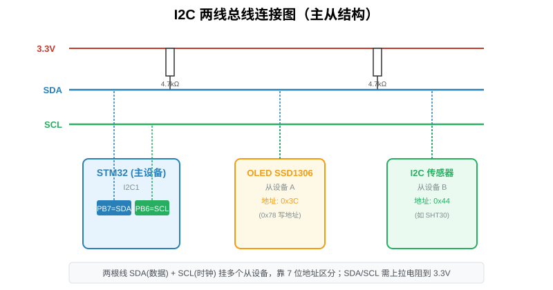

## 11.2 原理：SPI 总线

**SPI**（Serial Peripheral Interface）是一种**四线**高速串行总线：
- **SCK**：时钟线（主机产生）
- **MOSI**：主发从收
- **MISO**：从发主收
- **CS/SS**：片选（选中哪个从机）

特点：
- **全双工**：可同时收发。
- **高速**：比 I2C 快（可达数十 MHz）。
- **需片选线**：一个从机一条 CS。

```
主机(MCU)  ──SCK──► 从机
           ──MOSI──►
           ◄──MISO──
           ──CS──►   (每个从机一条)
```

**F103 的 SPI1** 默认引脚：**PA5=SCK、PA6=MISO、PA7=MOSI、PA4/PA15=CS（可自定义）**。

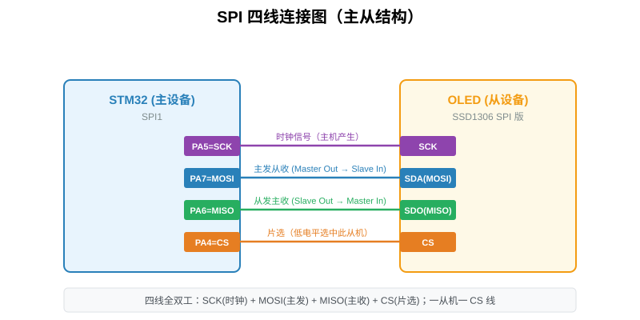

## 11.3 实操：用 I2C 驱动 SSD1306 OLED（0.96 寸）

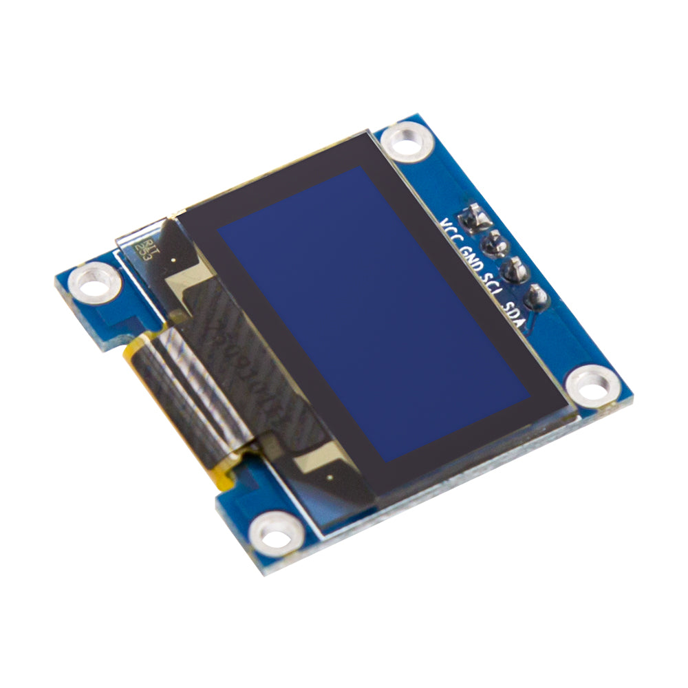

**目标**：OLED 显示"Hello STM32"。这是最常见、最有成就感的入门实战。

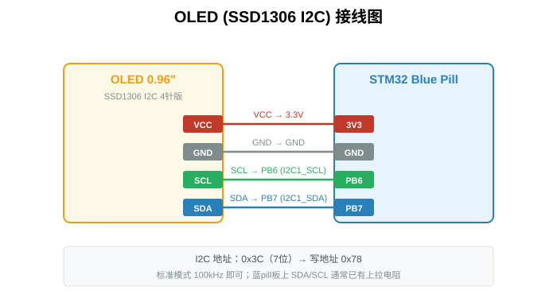

### 11.3.1 接线

| OLED(SSD1306 I2C) | STM32 (蓝pill) |
|---|---|
| GND | GND |
| VCC | 3V3 |
| SCL | **PB6** (I2C1_SCL) |
| SDA | **PB7** (I2C1_SDA) |

### 11.3.2 CubeMX 配置
1. 左侧 `Connectivity → I2C1` 勾选 Activated。
2. 参数默认即可（Standard Mode 100kHz 通常够用）。
3. 确认引脚 PB6/PB7 自动配置为 I2C1。
4. 重新生成。

### 11.3.3 代码

**需要一个 SSD1306 驱动**。推荐使用成熟的轻量驱动（如经典的 ssd1306 库，见附录 A），或自己写初始化序列。核心初始化 + 显示：

```c
/* USER CODE BEGIN Includes */
#include "ssd1306.h"     // 假设引入 SSD1306 驱动头文件
/* USER CODE END Includes */

/* USER CODE BEGIN 2 */
ssd1306_Init();                     // 初始化 OLED（发送初始化命令序列）
ssd1306_Fill(Black);                // 清屏
ssd1306_SetCursor(10, 0);           // 设置光标
ssd1306_WriteString("Hello STM32!", Font_7x10, White);  // 写字符串
ssd1306_UpdateScreen();             // 把显存刷到屏幕（核心！）
/* USER CODE END 2 */
```

**理解驱动三层**：
1. **底层 HAL 命令**：`HAL_I2C_Mem_Write(&hi2c1, 0x78, addr, 1, data, len, 100)` 发命令/数据。
2. **驱动层函数**：`ssd1306_WriteString` 等把字模写进**显存缓冲**（RAM 里的一个数组）。
3. **刷新层**：`ssd1306_UpdateScreen()` 把整个显存通过 I2C 刷到屏幕。

> **关键认知**：OLED 无内置显存（或显存小），需要用 MCU 的 RAM 做"显存缓冲"，画图先写缓冲再一次性刷新。这就是 `ssd1306_UpdateScreen()` 每次都要调用的原因。

**SSD1306 底层写的一个例子（驱动内部）**：

```c
void ssd1306_WriteCommand(uint8_t cmd)
{
  uint8_t buf[2] = {0x00, cmd};       // 控制字节 0x00 = 命令
  HAL_I2C_Master_Transmit(&hi2c1, 0x78, buf, 2, 100);
}
void ssd1306_WriteData(uint8_t data)
{
  uint8_t buf[2] = {0x40, data};      // 控制字节 0x40 = 数据
  HAL_I2C_Master_Transmit(&hi2c1, 0x78, buf, 2, 100);
}
```

> 地址 0x78 = (0x3C << 1)：SSD1306 默认 7 位地址 0x3C，I2C 传输时左移一位得 0x78。这就是"0x3C 与 0x78"两个地址说法的来源。

**验证**：OLED 显示 "Hello STM32!"。

## 11.4 进阶：SPI 驱动 OLED（更快刷新）

若用 SPI 版本 OLED，接线与配置不同，但上层驱动逻辑相同（只是底层从 I2C 换成 SPI 写）。CubeMX 配 SPI1，驱动层用 `HAL_SPI_Transmit`。刷新速度明显更快（适合动画）。因篇幅，SPI 版 OLED 接线表：

| OLED(SPI) | STM32 |
|---|---|
| GND / VCC | GND / 3V3 |
| SCK | **PA5** |
| SDA(MOSI) | **PA7** |
| RES | 任意 GPIO（PA3 例） |
| DC | 任意 GPIO（PA2 例） |
| CS | 任意 GPIO（PA4 例） |

> 参考附录 A 的 WaveShare / syuez 文档可拿到完整 SPI OLED 接线与驱动示例。

## 11.5 通用：接一个 I2C 传感器（举一反三）

掌握 I2C 后，接任意 I2C 传感器（如温湿度 SHT30、大气压 BMP280、九轴 MPU6050）都是同一套路：

1. **查芯片手册**：7 位地址、寄存器映射。
2. **CubeMX 开对应 I2C**。
3. **写驱动**：`HAL_I2C_Mem_Read/Write` 读/写寄存器。
4. **上层应用**：读原始值 → 换算物理量 → 显示。

例：读 I2C 设备某寄存器：

```c
uint8_t reg, val;
HAL_I2C_Mem_Read(&hi2c1, DEV_ADDR << 1, reg, 1, &val, 1, 100);
```

## 11.6 常见坑

1. **I2C 通信卡死**：检查 SDA/SCL 是否接对、上拉是否接（蓝pill 板常已有上拉）、地址是否写对（0x78 还是 0x3C）。
2. **OLED 不显示**：地址错、VCC 没接 3.3V、忘了 `UpdateScreen`、初始化顺序错。
3. **I2C 硬件 bug 卡死**：F103 部分批次硬件 I2C 有坑，改用软件 I2C（附录 A）。
4. **SPI 乱码**：CPOL/CPHA（时钟极性/相位）要和从机匹配，查手册设 Mode 0/1/2/3。
5. **多个 I2C 设备地址冲突**：改从机地址跳线。

## 11.7 本章小结与自测

**小结**：
- I2C：两线（SCL/SDA）+ 主从 + 地址寻址 + 开漏上拉，半双工。
- SPI：四线（SCK/MOSI/MISO/CS）+ 全双工 + 高速，一从机一 CS。
- SSD1306 OLED：驱动 = 底层 HAL 写命令/数据 + 显存缓冲 + `UpdateScreen` 刷新。
- 接任意 I2C 传感器 = 地址 + 寄存器映射 + `HAL_I2C_Mem_Read/Write`。

**自测题**：
1. I2C 需要几根线？靠什么区分从机？
2. SPI 相比 I2C 的优势是什么？多一个从机要加哪根线？
3. 为什么 OLED 每次显示都要 `UpdateScreen`？
4. SSD1306 的 0x78 和 0x3C 是什么关系？

---

<!-- ===== 第11章 完 ===== -->

# 第12章 FreeRTOS 实时操作系统入门

> **本章目标**：理解 RTOS 的核心概念（任务、调度、优先级、同步），用 CubeMX 集成 FreeRTOS，实现多任务 + 队列通信的经典例子。这是从"裸机"走向"操作系统"的跨越，也是工程化开发的分水岭。

## 12.1 什么是 RTOS，为什么要用它

**裸机（Bare-metal）** 开发：一个 `while(1)` 主循环，靠中断插话。当任务变多（多个外设要同时处理），裸机难组织：延时会阻塞、响应不及时、代码难维护。

**RTOS**（Real-Time Operating System，实时操作系统）提供**多任务**：把大程序拆成多个"任务"，调度器按优先级/时间片在它们之间快速切换，实现"同时干多件事"。

```
裸机：            while(1){ 任务A; 任务B; 任务C; }   ← 串行，互相阻塞
RTOS：            任务A ──┐
                  任务B ──┼── 调度器轮转/优先级 ──► "并发"
                  任务C ──┘
```

**为什么用 FreeRTOS**：
- **开源、免费**（MIT 许可）
- **轻量**：内核小、占用 RAM 少，适合 F103（64KB Flash / 20KB RAM）
- **生态成熟**：CubeMX 原生集成，一键生成
- **跨平台**：学会后可用于几乎所有 MCU

## 12.2 核心概念（务必理解）

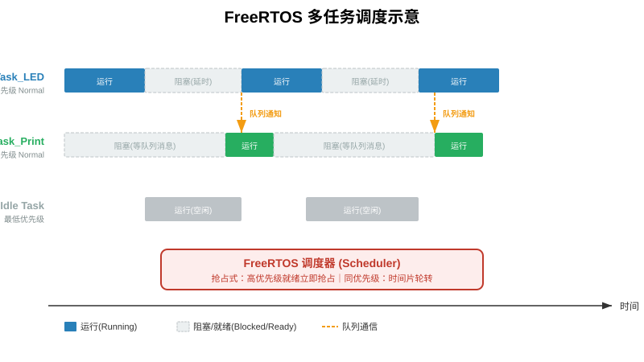

### 12.2.1 任务（Task）
一个任务是一个独立的 C 函数，有**自己的栈**和**优先级**。典型结构：

```c
void vTask_A(void *argument)
{
  for (;;)                        // 任务通常是个死循环
  {
    // 做任务A的事情
    vTaskDelay(100);              // 让出CPU，延时100个tick
  }
}
```

任务创建（HAL 层 `osThreadNew` 或原生 `xTaskCreate`）：

```c
osThreadNew(vTask_A, NULL, &task_attributes);  // CMSIS-RTOS v2
// 或
xTaskCreate(vTask_A, "TaskA", 128, NULL, 1, NULL);  // FreeRTOS原生
```

### 12.2.2 调度与优先级

- 每个任务有**优先级**（数值 0–N，数字越小优先级越低；**高优先级先跑**）。
- **抢占式调度**：高优先级任务就绪时，立即抢占低优先级任务。
- 相同优先级任务按**时间片轮转**（round-robin）。
- `vTaskDelay` / 等待事件时，任务让出 CPU，调度器切到别的就绪任务。

```
优先级高 ─► 任务B（实时性要求高）
优先级低 ─► 任务A（后台循环）
调度器：B就绪就立刻跑B；B阻塞时A跑。
```

### 12.2.3 同步与通信（队列、信号量）

任务之间不能乱访问共享数据（会冲突），FreeRTOS 提供：
- **队列（Queue）**：任务间传递数据（先进先出）。
- **信号量（Semaphore）**：任务间互斥/通知（如"数据准备好了"）。
- **互斥量（Mutex）**：保护共享资源。

**HAL/CMSIS 封装**：CubeMX 生成的 FreeRTOS 使用 **CMSIS-RTOS v2 API**（`osThreadNew`、`osMessageQueuePut` 等），与原生 API 对应。

## 12.3 实操：CubeMX 集成 FreeRTOS（两个任务 + 队列）

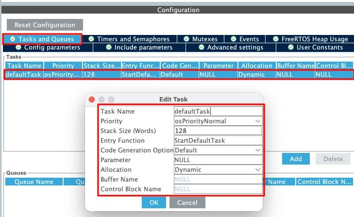

**目标**：任务1 每秒翻转 LED；任务2 每 2 秒串口打印。用队列让任务1 通知任务2"我翻转了"。

### 12.3.1 CubeMX 配置
1. 左侧 `Middleware → FREERTOS` 勾选 Activated。
2. 选择 **`Interface = CMSIS_V2`**（新版 API）。
3. `Task and Queues` 标签：
   - 双击 `defaultTask`，改名 `Task_LED`，Priority = `osPriorityNormal`。
   - 添加新任务 `Task_Print`，Priority = `osPriorityNormal`。
   - 添加一个**队列** `MsgQueue`，长度若干。
4. 重新生成。
   - 会自动生成任务函数 `Task_LED`、`Task_Print` 骨架和队列句柄 `osMessageQueueId_t MsgQueueHandle`。

### 12.3.2 代码（在生成的函数体里写）

```c
/* USER CODE BEGIN Header_Task_LED */
void Task_LED(void *argument)
{
  /* USER CODE BEGIN 5 */
  uint32_t msg = 1;
  for (;;)
  {
    HAL_GPIO_TogglePin(GPIOC, GPIO_PIN_13);   // 翻转 LED
    osMessageQueuePut(MsgQueueHandle, &msg, 0, 0);  // 发消息给队列
    vTaskDelay(pdMS_TO_TICKS(1000));          // 延时 1 秒（让出CPU）
  }
  /* USER CODE END 5 */
}
/* USER CODE END Header_Task_LED */

void Task_Print(void *argument)
{
  /* USER CODE BEGIN 5 */
  uint32_t rmsg;
  for (;;)
  {
    osMessageQueueGet(MsgQueueHandle, &rmsg, 0, portMAX_DELAY);  // 阻塞等消息
    printf("LED toggled, msg=%lu\r\n", rmsg);
  }
  /* USER CODE END 5 */
}
```

**验证**：
- LED 每秒翻转。
- 串口每 1 秒打印一条（任务2 被队列消息唤醒）。
- 两个任务"看起来同时跑"，实际由调度器切换。

> - `vTaskDelay(pdMS_TO_TICKS(1000))`：延时 1 秒并让出 CPU（`pdMS_TO_TICKS` 把毫秒转成 tick）。
> - `osMessageQueuePut` 发、`osMessageQueueGet` 收；`portMAX_DELAY` 表示一直阻塞等到有消息。
> - **关键**：任务里**不要再调用 `HAL_Delay`**（会阻塞调度器/与 tick 冲突），一律用 `vTaskDelay`。

## 12.4 进阶：中断与 FreeRTOS 的配合（重要）

当在中断里需要通知任务时，**不能**直接调用普通队列 API，要用"FromISR"版本：

```c
/* 在中断回调里，向队列发消息（FromISR 版本） */
void HAL_GPIO_EXTI_Callback(uint16_t GPIO_Pin)
{
  if (GPIO_Pin == GPIO_PIN_0)
  {
    BaseType_t xHigherPriorityTaskWoken = pdFALSE;
    uint32_t evt = 1;
    osMessageQueuePutFromISR(MsgQueueHandle, &evt, 0, &xHigherPriorityTaskWoken);
  }
}
```

**关键规则**：
1. 中断服务函数里用 `xxxFromISR` 版本 API。
2. 使用 RTOS API 的中断，其优先级必须设置**低于** `configMAX_SYSCALL_INTERRUPT_PRIORITY`（STM32 默认在 `FreeRTOSConfig.h` 中，通常 5 或 15）。若中断优先级高于它，可能导致系统崩溃。
3. 中断尽量**只做标记/发消息**，耗时处理放任务里。

## 12.5 常见坑

1. **任务里用 `HAL_Delay` 卡死/异常**：改用 `vTaskDelay`。
2. **栈溢出（HardFault/死机）**：任务栈设太小，调大（`osThreadNew` 的 stack_size）。
3. **队列没创建/句柄为 NULL**：确认 CubeMX 里添加了队列，生成的句柄没被误删。
4. **中断里调普通 API 崩溃**：用 `FromISR` 版本 + 检查中断优先级。
5. **F103 RAM 有限**：任务栈 + 队列要算着用（20KB RAM，任务栈 128~512 字合理）。
6. **默认任务与自己的任务都在跑**：defaultTask 没删会一起跑，删掉或改用途。

## 12.6 FreeRTOS 与裸机的选择

| 维度 | 裸机 | FreeRTOS |
|---|---|---|
| 复杂度 | 低 | 较高 |
| 任务多 | 难组织 | 清晰 |
| 实时性 | 靠中断 | 调度器保证 |
| 资源占用 | 少 | 多（栈+内核） |
| 适用 | 简单项目 | 复杂多任务项目 |

**给初学者的建议**：先扎实掌握裸机（第 3–11 章），再学 RTOS。RTOS 不是替代裸机，而是一种更强大的工具。

## 12.7 本章小结与自测

**小结**：
- RTOS = 多任务 + 调度器，实现"并发"。
- 任务：独立函数 + 独立栈 + 优先级；高优先级抢占。
- 队列/信号量：任务间通信与同步。
- CubeMX 集成 FreeRTOS（CMSIS-V2）：`osThreadNew`/`osMessageQueuePut/Get`。
- 中断用 `FromISR` 版本，优先级别超过 `configMAX_SYSCALL_INTERRUPT_PRIORITY`。
- 任务里用 `vTaskDelay`，别用 `HAL_Delay`。

**自测题**：
1. RTOS 相比裸机的核心优势是什么？
2. 高优先级任务就绪时，调度器做什么？
3. 任务里为什么不能用 `HAL_Delay` 而要用 `vTaskDelay`？
4. 中断里通知任务应该用哪个版本的队列 API？

---

<!-- ===== 第12章 完 ===== -->

# 附录 A 常见问题排查总表

| 症状 | 可能原因 | 解决 |
|---|---|---|
| 芯片无法连接/锁死 | SYS 没开 Serial Wire | BOOT0=1 进系统存储，用 STM32CubeProgrammer 全片擦除后 BOOT0 归 0 |
| 识别不到 ST-Link | 驱动/接线 | 重装驱动，检查 SWDIO/SWCLK/GND 接线 |
| 烧录后不运行 | 没开 Reset and Run | Debug 配置勾选 Reset and Run |
| LED 不亮 | 引脚/电平/接线错 | 核对 GPIO 端口引脚、高低电平方向、LED 正负极电阻 |
| 串口乱码 | 波特率/接线 | 核对波特率一致、TX↔RX 交叉、共地 |
| printf 无输出 | Keil 没开 MicroLIB | Options→Target 勾 Use MicroLIB |
| 浮点 printf 乱码 | CubeIDE 未链浮点库 | 加 `-u _printf_float` |
| I2C 卡死 | 上拉/地址/硬件 bug | 查上拉、地址(0x78/0x3C)、必要时软件 I2C |
| 定时器不触发 | 没启动/NVIC 没勾 | `HAL_TIM_Base_Start_IT` + NVIC 使能 |
| 中断不响应 | 优先级/使能/边沿 | 检查 NVIC、触发边沿、清标志 |
| FreeRTOS 死机 | 栈溢出/中断优先级 | 调大任务栈、检查 configMAX_SYSCALL_INTERRUPT_PRIORITY |
| PlatformIO 下载报错 | 克隆 ST-Link CPUTAPID | `upload_flags = -c set CPUTAPID 0x2ba01477` |


# 附录 B 参考资料索引

> 讲义结论均可追溯至以下来源。标注"已核验"=本讲义撰写时依据该来源确认的关键事实。

**官方一手文档（ST）**
- STM32F103x8/xB 数据手册（Datasheet, DS5319）：芯片规格、引脚、电气特性。*已核验：72MHz/64KB Flash/20KB RAM/48 引脚/2.0–3.6V。* https://www.st.com/resource/en/datasheet/stm32f103c8.pdf
- STM32F10xxx 参考手册（Reference Manual, RM0008）：GPIO/时钟树/NVIC/TIM/ADC/USART/DMA/I2C/SPI 全部外设寄存器。*已核验：时钟树、GPIO BSRR/BRR、APB1/APB2 分频、定时器 2 倍频规则。*
- STM32CubeF1 固件包（含 HAL 库源码、例程）：st.com 下载。
- STM32CubeMX 用户手册 / STM32 step-by-step 入门系列（ST 官方 wiki）。*已核验：CubeMX 生成流程、IDE 集成。*
- ST AN（应用笔记）：STM32F10xxx I2C optimized examples（CD00209826）；"在具有 RTOS 的 STM32Cube 上开发应用"（DM00105262）。*已核验：I2C 四种模式、RTOS 中断优先级规则。*

**权威教程 / 社区**
- 正点原子《STM32 库函数开发指南》——国内最系统的教程体系。
- 野火《STM32 库开发实战指南：基于 STM32F103》——库开发方式倡导者（孔夫子/京东有售）。
- 江协科技 / 韦东山《STM32F103 资料下载和介绍》——视频 + 资料。
- CSDN 精选：CubeMX 使用 FreeRTOS 编程指南、GPIO 深入理解、STM32F103 资源与启动配置。
- PlatformIO Community：蓝pill + 克隆 ST-Link 调试（CPUTAPID）问题讨论。*已核验：upload_flags 解法。*
- WaveShare / syuez：SSD1306 OLED（I2C/SPI）接线与驱动示例。*已核验：OLED 接线、SPI Mode、SSD1306 地址 0x78/0x3C。*
- FreeRTOS 官方文档（freertos.org）：任务/调度/队列/中断规则、Cortex-M3 移植。

**学术论文（增强理解，可选延伸）**
- 嵌入式系统教学/实验类论文：ARM Cortex-M 内核与 HAL 库在实验教学中的应用。
- RTOS 调度类：FreeRTOS 实时调度与优先级反转处理。
- 低功耗/电机控制类：PWM 与 ADC 在工程中的典型应用论文。
- （注：论文非讲义直接依据，用于拓展原理深度，可在读研/毕设时按需检索。）

# 附录 C 学习路线图（Follow-up）

```
阶段一：裸机基础（第1-3章）→ 点亮 LED，掌握工具链、GPIO
阶段二：核心外设（第4-9章）→ 时钟/中断/定时器/PWM/串口/ADC
阶段三：工程化（第10-11章）→ DMA、I2C/SPI 接传感器
阶段四：操作系统（第12章）→ FreeRTOS 多任务
延伸：项目实战（环境监测、智能小车、蓝牙透传、OLED 仪表盘）
延伸：进阶（输入捕获、看门狗、低功耗、USB、CAN、以太网）
```

---

<!-- ===== 讲义全文完 ===== -->
