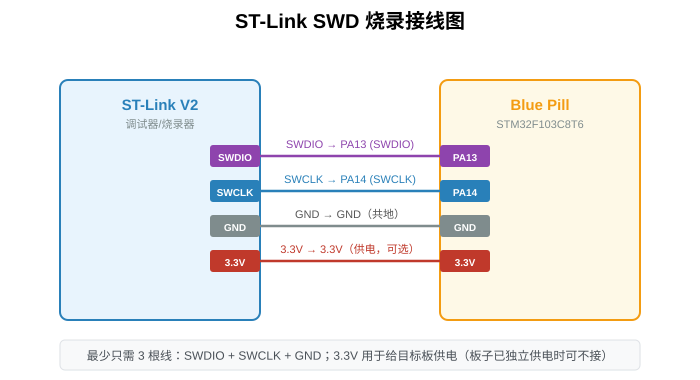
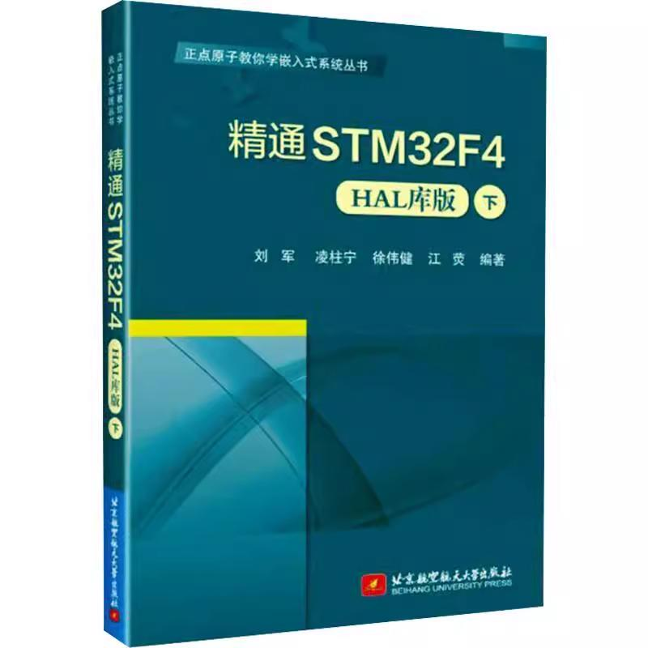
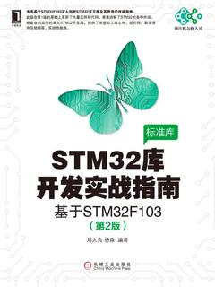

# 附录：排查表、参考资料、学习路线

> 这份附录是给你**查**的，不是给你读的。项目跑不起来、烧不进去、OLED 不亮、FreeRTOS 死机——翻这里。所有结论来自正文各章的踩坑记录和官方文档。

---

## 附录 A 常见问题排查总表

### A.1 烧录与连接

| 症状 | 可能原因 | 解决 |
|---|---|---|
| ST-Link 识别不到 | 驱动没装 / USB 线是充电线 / 接线错 | 装 ST-Link 驱动；换数据线；查 SWDIO→PA13、SWCLK→PA14、GND→GND、3.3V→3.3V |
| 烧录提示 "No target connected" | SWD 引脚被配成别的功能（比如 PB6 被 I2C 占了，但 SWD 是 PA13/PA14，一般不冲突） | 按住复位再点烧录；或 BOOT0 接 3.3V 让芯片进系统存储器模式，用 STM32CubeProgrammer 全片擦除 |
| 芯片被锁死（读保护 RDP） | 之前开了读保护 | STM32CubeProgrammer 里 Option Bytes，把 RDP 改成 0xAA（会全片擦除） |
| 烧完不运行 | 没开 Reset and Run / 晶振不对 / 中断向量表没对齐 | Keil Debug 配置勾 "Reset and Run"；确认 HSE 是 8MHz（Blue Pill 板载晶振）；检查 startup 文件 |
| PlatformIO 克隆 ST-Link 报 CPUTAPID 错 | 廉价 ST-Link 固件 ID 不对 | `upload_flags = -c set CPUTAPID 0x2ba01477` |



### A.2 GPIO 与 LED

| 症状 | 可能原因 | 解决 |
|---|---|---|
| LED 不亮 | 引脚错 / 电平反 / 正负极接反 / 没串联电阻 | 对照[第 3 章 GPIO](ch03_GPIO点LED.md) 接线表；Blue Pill 板载 LED 在 PC13，低电平亮；外接 LED 串 220~1k 电阻 |
| LED 微亮 | 引脚配成模拟输入 / 悬空 | 配成 GPIO_Output_PushPull |
| 按键按了没反应 | 没上拉/下拉 / 消抖没做 / EXTI 没配 | 内部上拉 + 外部 0.1μF 电容；用[第 5 章中断](ch05_EXTI中断.md)的消抖状态机 |

### A.3 时钟与启动

| 症状 | 可能原因 | 解决 |
|---|---|---|
| 串口波特率不对（乱码） | 时钟树配错，HSE 不是 8MHz | CubeMX RCC 里 HSE 选 Crystal/Ceramic Resonator；Clock Configuration 里确认 SYSCLK=72MHz |
| 延时不对（`HAL_Delay` 慢一倍） | SysTick 时钟源配错 | CubeMX 里 SysTick 保持默认；别手动改 |
| 跑着跑着死机 | 栈溢出 / HardFault | 调试器看 PC 指针；一般是数组越界或空指针 |

### A.4 串口

| 症状 | 可能原因 | 解决 |
|---|---|---|
| 串口全是乱码 | 波特率两边不一致 / TX/RX 没交叉 / 没共地 | 两端波特率严格一致（常见 115200）；MCU_TX→USB-RX、MCU_RX→USB-TX；共 GND |
| printf 没输出 | Keil 没开 MicroLIB / fputc 没重定向 | Options → Target 勾 "Use MicroLIB"；重定向 fputc 到 USART1_DR（见[第 8 章](ch08_串口.md)） |
| 浮点 printf 显示错 | CubeIDE 默认没链浮点 printf | 链接选项加 `-u _printf_float` |
| 串口丢字节 | 阻塞接收跟不上波特率 | 用[第 10 章 DMA + 空闲中断](ch10_DMA.md) |

### A.5 定时器与 PWM

| 症状 | 可能原因 | 解决 |
|---|---|---|
| 定时中断不进 | 没启动 / NVIC 没勾 | `HAL_TIM_Base_Start_IT(&htimx)`；CubeMX NVIC 里勾 TIMx global interrupt |
| PWM 没输出 | 通道没启 / 占空比寄存器没写 | `HAL_TIM_PWM_Start(&htimx, TIM_CHANNEL_x)`；改 `__HAL_TIM_SET_COMPARE` |
| PWM 频率不对 | PSC/ARR 算错 | 频率 = 72MHz / ((PSC+1) × (ARR+1))，见[第 7 章 PWM](ch07_PWM.md) |
| 舵机抖 | 电源不足 / 地线没共 | 舵机独立供电，信号地和 MCU 地必须连一起 |

### A.6 ADC

| 症状 | 可能原因 | 解决 |
|---|---|---|
| ADC 读数乱跳 | 没滤波 / 输入阻抗高 | 加 0.1μF 电容到 GND；多次采样取平均；见[第 9 章 ADC](ch09_ADC.md) |
| ADC 满量程不对 | 参考电压不是 3.3V | F103 默认 VREF+ 接 3.3V；用内部 VREFINT（1.2V）校准 |
| DMA 采到一半停了 | DMA 循环模式没开 / 缓冲区没对齐 | CubeMX 里 DMA 模式选 Circular；buffer 用 `__attribute__((aligned(4)))` |

### A.7 I2C / SPI / OLED

| 症状 | 可能原因 | 解决 |
|---|---|---|
| I2C 完全没反应 | 接线反 / 地址错 / 没上拉 | 跑 I2C scanner（见[第 11 章](ch11_I2C_SPI与OLED.md) 11.4.3）；确认 PB6=SCL、PB7=SDA；模块板一般已带上拉 |
| OLED 不亮 | 电荷泵命令没发 / 地址错 / 忘了 UpdateScreen | 换完整初始化序列；确认地址 0x78 还是 0x7A；每次画图后必须调 `ssd1306_UpdateScreen()` |
| OLED 花屏 | 显存缓冲没清 / 初始化顺序错 | 启动时 `ssd1306_Fill(Black)`；按手册顺序发初始化命令 |
| I2C 卡死（HAL 返回 BUSY） | 从机拉死 SDA | 软件发 9 个 SCL 时钟释放总线；或重启 |
| SPI 接屏幕乱码 | CPOL/CPHA 不匹配 | 在 Mode 0 和 Mode 3 之间切；见[第 11 章](ch11_I2C_SPI与OLED.md) 11.3.2 |
| 多个 I2C 设备只能用一个 | 地址冲突 | 跑 scanner；改 ADDR 跳线；或上 TCA9548A 多路复用 |

### A.8 FreeRTOS

| 症状 | 可能原因 | 解决 |
|---|---|---|
| 启动就 HardFault | 栈太小 / 堆不够 | 任务栈从 128 调到 256~512；加大 `configTOTAL_HEAP_SIZE` |
| 任务像在轮流卡住 | 任务里用了 `HAL_Delay` | 换成 `vTaskDelay(pdMS_TO_TICKS(...))` |
| 按键中断一按就死机 | 中断里调了普通 API / 中断优先级太高 | 用 `...FromISR` 版本；中断优先级设成 ≥ `configMAX_SYSCALL_INTERRUPT_PRIORITY`（默认 5） |
| 队列收不到消息 | 句柄拼错 / 队列没创建 | 对着 `freertos.c` 里实际的句柄名改 |
| 随机死机 | 栈溢出踩内存 | 用 `uxTaskGetStackHighWaterMark` 量每个任务剩余栈 |
| RAM 不够 | 任务栈 + 队列 + 内核超 20KB | 砍栈大小、砍队列长度、用任务通知代替队列 |

---

## 附录 B 参考资料索引

> 本讲义的所有结论都可以追溯到下面这些来源。标注"已核验"的，表示撰写时我亲自对照过原文确认关键事实。

### B.1 ST 官方文档（一手）

- **STM32F103x8/xB 数据手册（DS5319）**：芯片规格、引脚定义、电气特性。
  已核验：72MHz / 64KB Flash / 20KB RAM / 48 引脚 / 2.0–3.6V。
  https://www.st.com/resource/en/datasheet/stm32f103c8.pdf

- **STM32F10xxx 参考手册（RM0008）**：GPIO、时钟树、NVIC、TIM、ADC、USART、DMA、I2C、SPI 全部外设的寄存器定义。这是最厚也是最有用的一本，遇到寄存器级问题就翻它。
  已核验：时钟树、GPIO BSRR/BRR、APB1/APB2 分频、定时器 2 倍频规则、I2C 寄存器 CR1/CR2/SR。

- **STM32CubeF1 固件包**：HAL 库源码 + 大量例程。ST 官网免费下载，例程比任何教程都靠谱。

- **AN2825（STM32F10xxx I2C optimized examples）**：ST 自己出的 I2C 坑指南，讲了 F103 硬件 I2C 的硅片 bug 和规避方法。

- **DM00105262（Developing applications on STM32Cube with RTOS）**：FreeRTOS + STM32 的官方应用笔记，中断优先级规则的权威来源。

### B.2 中文教程体系



- **正点原子《STM32 库开发指南》**：国内最系统的中文教程体系，文档 + 视频 + 配套开发板。我们这篇讲义的思路很多地方参考了它的章节组织。注意正点原子的板子是 F103/F407，引脚映射和 Blue Pill 略有不同，移植时对照一下。



- **野火《STM32 库开发实战指南：基于 STM32F103》**：库开发方式的另一套体系，对 F103 讲得很细，寄存器层面比正点原子深。孔夫子、京东都能买到。

- **江协科技 / 韦东山**：视频教程，入门友好。适合看不懂文档的时候看一遍视频建立直觉。

- **FreeRTOS 官方文档**：https://www.freertos.org 。任务、队列、信号量、中断规则、Cortex-M3 移植，全是一手资料。

- **WaveShare / syuez SSD1306 示例代码**：GitHub 上搜 "stm32-ssd1306"，最常用的轻量 OLED 驱动。已核验：地址 0x78、SPI Mode、初始化序列。

### B.3 社区和博客

- **CSDN / 博客园**：搜具体问题（"STM32 I2C 卡死"、"FreeRTOS HardFault"），踩坑记录一大堆。质量参差，但前几篇高分的基本能解决问题。
- **PlatformIO Community**：蓝pill + 克隆 ST-Link 的 CPUTAPID 问题的讨论源头。
- **STM32 中文论坛**（bbs.21ic / EDAA）：老帖子多，问题基本都有人遇到过。

### B.4 论文（可选延伸）

做毕设或者要写原理综述的时候可以查：

- 嵌入式系统教学类：ARM Cortex-M 内核与 HAL 库在实验教学中的应用。
- RTOS 调度类：FreeRTOS 实时调度与优先级反转处理。
- PWM/ADC 工程应用类：电机控制、电源管理方向的论文。

这些不是本讲义的直接依据，用来拓展深度，按需检索。

---

## 附录 C 学习路线图

### C.1 本讲义的学习路径

我们这十二章是按这个顺序排的，你如果是新手，别跳着学：

```
阶段一：认知与工具（第 1~3 章）
  ├─ ch01 硬件认知：Blue Pill、ST-Link、STM32 是什么
  ├─ ch02 环境搭建：CubeMX + Keil / CubeIDE
  └─ ch03 GPIO 点 LED：第一个程序、烧录、调试

阶段二：核心外设（第 4~9 章）
  ├─ ch04 时钟与启动：HSE、PLL、72MHz、启动流程
  ├─ ch05 EXTI 中断：按键、NVIC、消抖
  ├─ ch06 定时器：基本定时、中断、编码器
  ├─ ch07 PWM：呼吸灯、舵机
  ├─ ch08 串口：printf、收发、环形缓冲
  └─ ch09 ADC：采样、电位器、NTC

阶段三：工程化（第 10~11 章）
  ├─ ch10 DMA：串口不定长接收、ADC 连续采样
  └─ ch11 I2C / SPI：OLED、AHT20、BMP280

阶段四：操作系统（第 12 章）
  └─ ch12 FreeRTOS：多任务、队列、信号量、中断配合
```

### C.2 做完这些项目，你就出师了

按难度排，每一个都是把前面几章串起来：

1. **呼吸灯 + 按键调速**（ch03 + ch05 + ch07）
2. **串口控 LED**（ch05 + ch08）：上位机发 1/0，板上 LED 亮灭
3. **ADC 电位器调 PWM**（ch07 + ch09）：拧电位器，LED 呼吸频率变
4. **OLED 显示串口数据**（ch08 + ch11）：串口收到什么，OLED 打什么
5. **环境监测仪**（ch09 + ch11）：AHT20 + BMP280 + OLED，温湿度气压实时显示
6. **FreeRTOS 环境监测仪**（ch11 + ch12）：传感器任务、显示任务、按键任务拆开
7. **智能小车 / 蓝牙透传**（ch07 + ch08 + ch11）：HC-05 蓝牙，手机 App 控车

### C.3 学完本讲义之后往哪走

- **进阶外设**：输入捕获（测频率）、看门狗（IWDG/WWDG）、低功耗（STOP/Standby 模式）、USB（虚拟串口）、CAN（工业车规）、以太网（LWIP）。
- **换芯片**：STM32F4（高性能，带 FPU 和 DMA2）、STM32H7（Cortex-M7，主频 400MHz+）、STM32G0（低成本新系列）。
- **上 RTOS**：FreeRTOS 熟了之后看 RT-Thread（组件化、中文文档好）、ThreadX（微软系）、Zephyr（Linux 基金会）。
- **做产品**：学 PCB 设计（立创EDA、KiCad）、EMC、低功耗设计、BOOTLOADER（IAP 在线升级）。
- **往上层**：Linux 嵌入式（树莓派、全志、IMX6ULL）、QT 嵌入式界面、物联网（MQTT、云平台）。

### C.4 给新手的几句实话

- 别一上来就啃 RM0008 参考手册，先把外设用起来，出问题再翻。
- 别迷信"必须寄存器开发"，HAL 库够你做 90% 的项目；等你要抠性能了再回去看寄存器。
- 别买一堆开发板，一块 Blue Pill 15 块钱，加一堆模块也就 100 块，足够玩到 FreeRTOS 熟练。
- 遇到问题先搜，搜不到再问。99% 的问题前人都踩过。
- 写代码留版本（git），改坏了能回滚。
- 焊不好杜邦线就买个面包板 + 母对母跳线，别在飞线上浪费时间。
- 示波器不是必须的，但逻辑分析仪（20 块钱那种）强烈推荐——I2C/SPI/串口调试神器，比printf猜半天强。

### C.5 一份最小硬件清单

如果你手头还什么都没有，按这个买就够了：

| 物品 | 数量 | 大概价格 |
|---|---|---|
| STM32F103C8T6 Blue Pill 核心板 | 1 | ¥15 |
| ST-Link V2 下载器（克隆版） | 1 | ¥15 |
| USB-TTL CH340 串口模块 | 1 | ¥8 |
| 0.96 寸 SSD1306 OLED (I2C) | 1 | ¥8 |
| AHT20 温湿度模块 | 1 | ¥6 |
| BMP280 气压模块 | 1 | ¥6 |
| 面包板 + 杜邦线包 | 1 | ¥15 |
| 按键、LED、电位器、电阻杂包 | 1 | ¥10 |

全套加起来 80~100 块，能把本讲义所有例子跑一遍。

---

<!-- ===== 附录完 ===== -->
