# 第 1 章　STM32 与开发板硬件认知

> 这一章不急着写代码。我第一次碰 STM32 的时候，上来就照着教程点 LED，灯是亮了，可你要问我"这灯到底接在哪根线上、芯片里面长什么样"，我一个都答不上来。结果后面调串口、调定时器的时候处处踩坑，才回头补硬件。所以我把这章写在最前面——先把这块板子和这颗芯片看明白，后面每一行代码你都知道自己在跟谁说话。

学完这章，你应该能做三件事：把蓝pill 板翻过来调过去，指出每个元件是干嘛的；看到 `STM32F103C8T6` 这串型号能反推出它的规格；并且能解释"为什么程序是从 Flash 跑起来的"、"为什么 PC13 输出低电平灯才亮"。

我知道这一章概念很密，一下子塞给你芯片内部结构、总线、启动模式、供电这些东西，看着有点劝退。但我向你保证：这些东西你今天不用全记住，留个印象就够。真正的作用是——后面我们点 LED、调串口、做定时器的时候，你会突然"哦，原来那个东西就是这里讲的这个"，那种恍然大悟的瞬间，才是真正学会的时候。这章先当导游图翻一遍，后面随时回来查。

举个例子预告一下：你现在看"ICode/DCode/System 三条总线"觉得是天书，可等你学到 DMA（第 9、10 章），或者调试时看到变量跑飞了，再回头看这张图，你会立刻明白"数据到底是从哪条线过去的"。知识就是这样，先有个架子，后面的细节才有地方挂。

另外提前打个预防针：这一章涉及的图比较多，有实物照片、有我自己画的示意图。实物照片帮你对号入座认出板子，示意图帮你理解内部结构，两者配合着看。

---

## 1.1 先说清楚：STM32 到底是个什么东西

STM32 是意法半导体（STMicroelectronics，圈内都叫 ST）出的一系列 32 位单片机。名字里的 STM 来自 ST + MCU（Microcontroller Unit，微控制器），32 就是 32 位。

但这里有个特别容易糊涂、却特别重要的认知，我第一次没人告诉我，自己懵了好久：

**内核是 ARM 的，外设是 ST 的。**

ARM 这家英国公司自己不生产芯片，它设计处理器内核（Cortex-M0 / M3 / M4 / M7……），然后把这个"IP 核"授权给 ST、NXP、GD（兆易创新）、沁恒……这些公司。ST 拿到 Cortex-M3 的设计图纸之后，在这个内核外面一圈圈地接上自己的外设：GPIO、串口、定时器、ADC、SPI、I2C、USB……最后封装成一颗芯片，取名 STM32F103。

打个比方：Cortex-M3 是发动机的图纸，ARM 是发动机设计公司；ST 是整车厂，它拿这台发动机，配上自己设计的变速箱、车壳、内饰，造出一辆整车卖你。**所以你查资料的时候会遇到两本手册**：一本讲内核（ARM 的《Cortex-M3 权威指南》），一本讲这颗芯片的外设（ST 的《STM32F103 参考手册》RM0008）。内核相关的问题看前者，外设怎么配寄存器看后者。这个分工你心里要有数。

那为什么入门都选 F1 这条线？因为它是 ST 最经典、产量最大、资料最多的一条产品线。我给你列一下 STM32 大致的家谱：

如果你之前玩过 Arduino（比如用的是 Uno，ATmega328P 那颗 8 位芯片），可以这么理解：Arduino 把"怎么操作硬件"藏得很深，一行 `digitalWrite()` 背后帮你做了一堆；STM32 则是把这些暴露给你看——寄存器、时钟、中断、总线，你都能亲自配。所以学 STM32 稍苦一点，但你换来的是对"单片机到底怎么工作"的真正理解。这也是为什么很多人说"Arduino 入门、STM32 进阶"——不是 Arduino 不好，是它太贴心，贴心到你不知道里面发生了什么。

| 产品线 | 内核 | 定位 | 典型型号 |
|---|---|---|---|
| **F1（主流）** | Cortex-M3 | 通用入门，最经典 | **F103C8T6（就是我们这块）** |
| F4（高性能） | Cortex-M4F | 带硬件浮点 FPU，主频更高 | F407、F411 |
| F7 / H7 | Cortex-M7 | 顶级性能，能跑多媒体、Linux 级应用 | F767、H743 |
| G 系列 | M4/M33 | ST 后来推的性价比新型号 | G030、G431 |
| L 系列 | M0+/M4 | 低功耗，电池供电场景 | L011、L431 |

入门死磕 F103 就对了：教程遍地都是、淘宝十几块钱一块、HAL 库和 CubeMX 对它的支持最完整。等你把 F103 玩熟了，以后换 F407，你会发现配置外设的思路一模一样，只是主频快了、外设多了、多了个浮点单元而已。

---

## 1.2 型号 `STM32F103C8T6` 每个字母都在说话

这串看着像乱码的东西，其实是 ST 的命名规则，拆开看每一段都对应一个规格。我刚学的时候把它抄在便签上贴显示器边上，用几次就记住了：

```
STM32  F  103   C   8   T   6
  │    │   │    │   │   │   └─ 温度档：6 = -40℃ ~ +85℃（工业级）
  │    │   │    │   │   └───── 封装：T = LQFP 薄型四方扁平封装
  │    │   │    │   └───────── Flash 容量档：8 = 64KB（xB 容量档）
  │    │   │    └───────────── 引脚数：C = 48 脚（LQFP48）
  │    │   └────────────────── 子系列：103 = F1 家族主流性能型
  │    └────────────────────── 大类：F = 通用闪存型
  └─────────────────────────── STM32 = ST 的 32 位单片机
```

看懂这个，你以后看到一颗陌生芯片就能心里有数。比如哪天有人给你一块 `STM32F407VET6`，你扫一眼：F4、168MHz 级、V 是 100 脚、E 是 512KB Flash、T 是 LQFP、6 工业级——直接就知道这是块比蓝pill 大一圈、猛一档的板子。

回到我们这颗，关键规格列成表：

| 参数 | 规格 |
|---|---|
| 内核 | ARM Cortex-M3，最高主频 **72 MHz** |
| Flash（程序存储器） | **64 KB**，断电不丢 |
| RAM（运行内存 SRAM） | **20 KB** |
| 封装 / 引脚 | LQFP48，共 48 个脚 |
| GPIO | 约 37 个可用 IO（受封装和复用限制） |
| 定时器 | 高级定时器 TIM1，通用 TIM2/3/4，外加内核自带 SysTick |
| ADC | 2 个 12 位 ADC，合起来 10 个外部通道 |
| 通信接口 | USART×3、I2C×2、SPI×2、一路 CAN、一路 USB 全速 |
| 供电 | 2.0–3.6V，典型 **3.3V**；多数 IO 容忍 5V 输入 |

一句话记住它的体格：**72MHz 的小脑袋、64KB 的"硬盘"、20KB 的"内存"**。这点内存跑个裸机大循环绰绰有余，塞个 FreeRTOS 也不在话下——这也是为什么这么小一块片子能当入门神板。

顺带说一个容易踩的命名细节：型号里那个 "8" 代表 64KB Flash，再往上一档是 "B"，代表 128KB。所以 `STM32F103C8T6` 是 64KB，`STM32F103CBT6` 就是 128KB——两者其他都一样，只是 Flash 大了一倍。蓝pill 市面上 C8 和 CB 两种都有，有些无良商家把 64KB 的片子当 128KB 卖。你烧个超过 64KB 的程序烧不进去，多半就是这个原因。好在 64KB 对入门完全够用。

还有那个 "T6"：T 是 LQFP 封装（你能在板子上看到的方方正正贴片黑块），6 是温度档工业级 -40~85℃。这俩对学习没影响，知道就行。

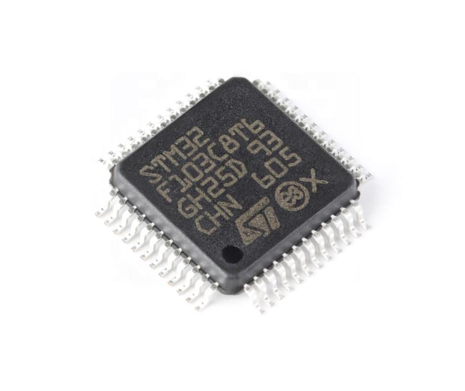

> 上面这些数字不是我背下来的，全部来自 ST 官方数据手册 *STM32F103x8/xB Medium-density performance line datasheet*（编号 DS5319）。养成习惯：写代码卡住时，先翻手册，别光靠搜博客。

---

## 1.3 撬开壳子看里面：芯片内部长什么样

我猜你现在对"72MHz、64KB Flash"只有个抽象印象。这一节我们把芯片当成一台迷你计算机，看看它内部到底是怎么连的。下面这张图是我根据参考手册 RM0008 开头的系统结构图简化画的，你不用背，看懂"谁通过哪条路跟谁说话"就行。

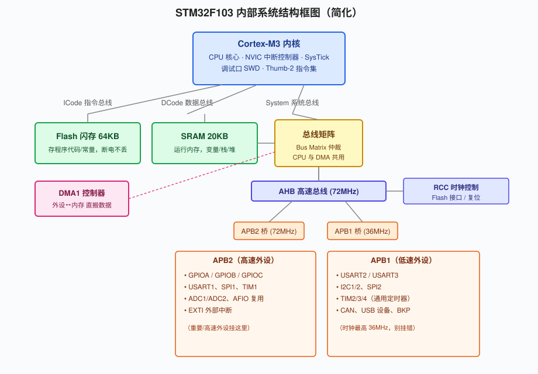

### 1.3.1 内核旁边的三条总线

左上角是 Cortex-M3 内核。它不是孤零零一个 CPU，旁边还跟着两个我们以后会频繁打交道的家伙：**NVIC（嵌套向量中断控制器）**和 **SysTick（系统滴答定时器）**。NVIC 管中断（第 5、6 章会用到），SysTick 就是 `HAL_Delay()` 那个延时的心跳来源。

内核要跟外面的 Flash、内存、外设交换数据，靠的是三条总线，这个设计叫**哈佛结构**：

- **ICode 总线**：专门用来从 Flash 里取**指令**。CPU 跑程序，第一件事就是不停地从 Flash 把指令捞进来。
- **DCode 总线**：从 Flash 里读**常量**（比如你代码里的字符串、`const` 数组）。
- **System 总线**：这条最忙，负责访问 **SRAM**（你的变量、栈、堆都在这）和所有外设。

为什么要分三条？因为取指令和读数据可以同时进行，不用排队，这就是哈佛结构比冯诺依曼快的原因。你先有个感觉就行。

### 1.3.2 Flash、SRAM 和那 20KB 内存

图右上角两块存储器：

- **Flash（64KB）**：相当于硬盘，存你的程序代码和常量，断电不丢。你 `Download` 烧录，烧的就是这块。
- **SRAM（20KB）**：相当于电脑内存，程序运行时的变量、函数调用的栈、`malloc` 出来的堆，全在这。断电清零。

我刚学的时候没概念，后来有一次写串口接收缓冲区开了个 10KB 的数组，栈一炸程序就跑飞了——这才明白 20KB 其实很紧巴。所以在 F103 上写代码，别大手大脚开大数组。

### 1.3.3 总线矩阵、AHB 和两条 APB

中间那块黄色的叫**总线矩阵（Bus Matrix）**。它是个交通警察：CPU 和 DMA 都要来抢 Flash 和 SRAM 的访问权，总线矩阵负责排队，谁先用谁后用，避免打架。

System 总线下来接到 **AHB 高速总线**，上面挂着 RCC（时钟控制，管全芯片时钟的）、DMA 这些高速部件。然后 AHB 通过两个"桥"转成两条低速外设总线：

- **APB2**：最高 72MHz，挂的是重要、高速的外设——**所有 GPIO**、USART1、SPI1、TIM1、ADC。
- **APB1**：最高 36MHz，挂的是稍慢的——USART2/3、I2C、SPI2、TIM2/3/4、CAN、USB。

这个"哪个外设挂哪条总线"以后写代码配时钟会用到：开某个外设时钟时，你得知道它在 APB1 还是 APB2。现在混个眼熟，到第 4 章看寄存器时会回来。

图里还有个叫 **DMA（直接存储器访问）** 的模块，我单独说一句，因为后面第 9、10 章要用。设想你要通过串口一口气发 1000 个字节，如果让 CPU 一个字节一个字节地"读出来、再写进串口发送寄存器"，那这 1000 次循环期间 CPU 啥也干不了，全耗在搬运上。DMA 就是个不抢 CPU 的搬运工：你告诉它"把 SRAM 这段数组搬到串口去"，它自己在后台搬，搬完发个中断通知 CPU。CPU 中间该算什么算什么。后面 ADC 连续采样、串口批量收发，都是 DMA 在背后干活。你现在知道"有这么个能替 CPU 搬数据的家伙"就行。

还有个隐藏的知识点：**STM32 所有外设默认时钟是关着的。** 你写代码去操作 GPIO，第一件事是 RCC 把 GPIOA 的时钟打开——不开时钟，那个外设就是死的，你怎么写寄存器它都没反应。这是 51 单片机没有的概念，也是新手初学 HAL 时最容易忽略的（好在 CubeMX 帮你自动开了）。到第 4 章你会看到代码里那句 `__HAL_RCC_GPIOA_CLK_ENABLE()`，就是在干这事。

> 一个我踩过的坑：参考手册那张系统图画的是整个 STM32F10x 家族所有可能的外设，**不是你这颗 C8T6 全都有**。比如 C8T6 没有 FSMC、SDIO、DAC，GPIO 也只有 A/B/C 三组，没有 D/E/F/G。别照着图把不存在的外设往代码里写。

---

## 1.4 Cortex-M3 内核，你需要知道的几件事

既然内核是 ARM 设计好的黑盒，我们不用懂它怎么造的，但有几个特性天天用，先混个脸熟。

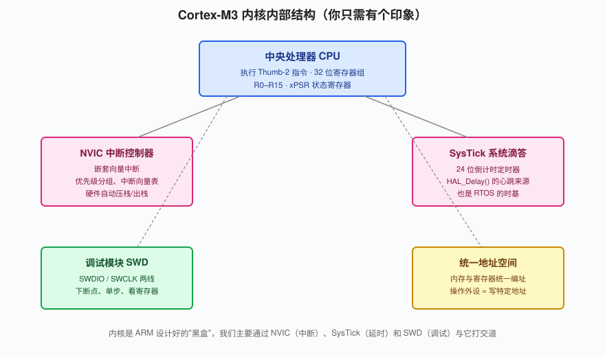

**Thumb-2 指令集。** ARM 以前的单片机有 ARM（32 位指令）和 Thumb（16 位指令）两套模式来回切，很烦。Cortex-M3 统一成 Thumb-2，指令 16 位 32 位混排，密度和速度兼顾。你写 C 代码感受不到它，但它意味着代码能在 64KB Flash 里塞得更紧凑。

**中断是 NVIC 管的，而且是硬件自动压栈。** 以前 51 单片机进中断，要你自己手动把寄存器一个个 push 进栈、退出再 pop，稍不留神就出错。Cortex-M3 不这样：中断来了，CPU 自动把 xPSR、PC、R0~R3、LR 这几个现场压进栈，跳进中断服务函数；退出时自动弹回来，还能硬件支持中断嵌套（高优先级打断低优先级）。这套机制就是第 5 章外部中断、第 6 章定时器中断的底层。

**调试接口 SWD。** 芯片留了两根调试线（SWDIO、SWCLK），ST-Link 接上来就能暂停 CPU、读寄存器、下断点、看变量。这是区分"会点灯"和"会开发"的分水岭——第 2 章你会亲手用它。注意 SWD 用的是 PA13/PA14 两个引脚，**如果你在 CubeMX 里把这俩引脚复用成普通 IO，调试口就废了**，芯片会直接跟你失联，这个坑我后面专门讲怎么救。

补救方法先剧透一下：一旦 SWD 引脚被你配成了 GPIO，正常手段 ST-Link 就连不上了。这时把 BOOT0 拨到 1，让芯片从系统存储器启动（这段启动代码用的是默认引脚，不碰 SWD），ST-Link 就能重新连上，然后做一次全片擦除，把你那段错误配置抹掉，再把 BOOT0 拨回 0。所以"芯片连不上"不等于板子报废，多半有救。第 2 章的常见坑会再讲一遍。

**统一编址。** 在 Cortex-M3 眼里，内存和外设寄存器没有区别——它们都排在同一条 4GB 的地址线上。你"操作一个外设"，本质就是往某个固定地址写几个数。比如 GPIOA 的输出寄存器地址是 `0x4001080C`，你往这个地址写 1，对应引脚就变高电平。第 4 章我们会直接碰寄存器，到时候你会恍然大悟：原来 HAL 库那层函数，底下就是这么回事。

我把这张"地址地图"的大致分布给你列一下，以后看反汇编、看启动文件会有用：

| 地址范围 | 里面是什么 |
|---|---|
| `0x0800 0000` 起 | Flash（你的程序从这里开始），我们这颗 64KB 到 `0x0800 FFFF` |
| `0x2000 0000` 起 | SRAM（20KB），变量和栈在这 |
| `0x4000 0000` 起 | 外设寄存器区，APB1 总线的外设都在这一段 |
| `0x4001 0000` 起 | APB2 外设区，GPIOA 就在 `0x4001 0800` 附近 |
| `0xE000 0000` 起 | 内核私有区，NVIC、SysTick、调试口都在这 |

你不用背这张表，但要有个概念："整个芯片是一块大内存，一部分存代码、一部分存变量、一部分是外设开关"。HAL 库函数 `HAL_GPIO_WritePin()` 最终编译出来，就是一句"往 `0x4001080C` 这个地址写个数"。

---

## 1.5 认识蓝pill（Blue Pill）这块板

光看芯片不行，你手里拿的是一块焊好的开发板。**Blue Pill（蓝丸）**是这块小板子的社区外号，因为最早那版是蓝色 PCB，又长得长长一片，像颗蓝色药丸。它是 ST 官方没出、由社区开源设计、然后被无数厂家仿制的板子，淘宝/立创普遍 10~20 块钱一片，堪称 STM32 界的"电子积木"。

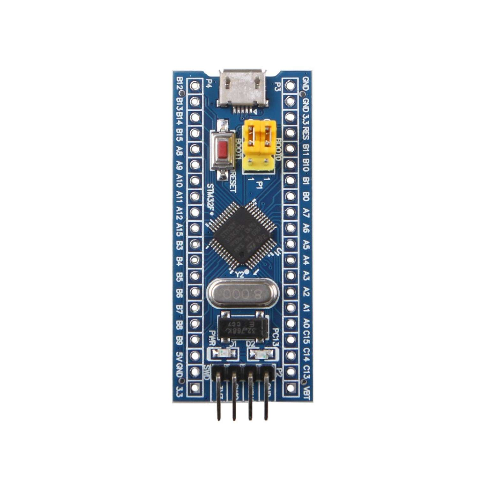

### 1.5.1 板上这些元件分别是干嘛的

把板子举起来对着光看，从上到下你会找到这些东西：

| 板上元件 | 在哪 | 干嘛用 |
|---|---|---|
| STM32F103C8T6 | 板中央那颗 48 脚黑方块 | 主控，就是我们研究的主角 |
| Mini USB 口 | 板侧那个方口 | 供电 + USB 通信（也可用于供电烧录） |
| 8MHz 晶振 | 芯片旁边那个银色小金属壳 | 主时钟源，板子的"心跳发生器" |
| 32.768kHz 晶振 | 板上另一颗更小的（很多批次没焊） | 低速时钟 LSE，给 RTC 实时时钟用 |
| AMS1117-3.3 LDO | 板下方那个三脚元件 | 把 USB 的 5V 稳成 3.3V 给芯片 |
| 电源指示灯（红） | 板上那颗红灯 | 一上电就亮，证明有电 |
| PC13 板载 LED（蓝） | 板上那颗蓝灯 | 我们第一个实验对象，接在 PC13 |
| BOOT0 跳线帽 | 板侧那个两针小帽子 | 选从哪里启动，见 1.7 |
| RESET 复位键 | 板侧小按键 | 按一下芯片重启 |
| 两排排针 | 板子两侧 | 把所有 GPIO 引出来给你接 |

这里有几个数字你要特别记住：

- **晶振是 8MHz，不是 72MHz。** 芯片主频 72MHz 是靠板上这个 8MHz 晶振，经过芯片内部的 PLL（锁相环）×9 倍频出来的。8 × 9 = 72。为什么不直接焊个 72MHz 晶振？因为晶振频率做太高贵、不稳，业界都是用几 MHz 的晶振倍频上去。第 2 章 CubeMX 配时钟树，干的就是告诉芯片"你外面接的是 8MHz，给我倍频到 72"。

我把这条"时钟生产线"完整走一遍，你以后配时钟树就不懵了：

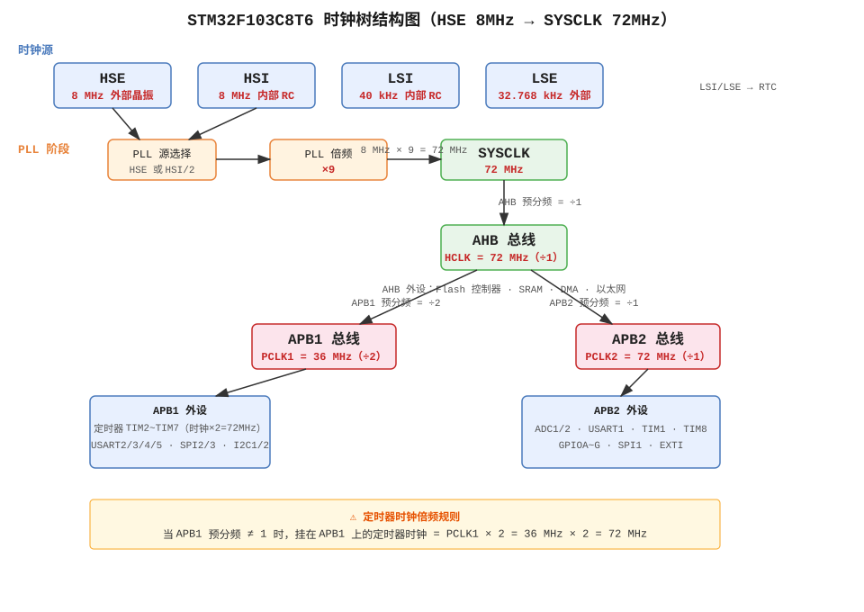

```
8MHz 外部晶振(HSE)
   │
   ├─→ 进 PLL，先 ÷1（不分频），再 ×9 倍频
   │        = 72MHz
   ▼
SYSCLK（系统时钟，最高 72MHz）
   │
   ├─→ AHB 分频 ÷1 ──→ HCLK = 72MHz（给内核、内存）
   │                        │
   │                        ├─→ APB1 分频 ÷2 ──→ 36MHz（给 APB1 外设）
   │                        └─→ APB2 分频 ÷1 ──→ 72MHz（给 APB2 外设）
   ▼
内核跑在 72MHz
```

你看，APB1 最高只能到 36MHz，所以前面说 APB1 外设慢一半。CubeMX 的"Clock Configuration"那个标签页，画的就是这条流水线，你填几个数字它自动算。这个图第 2 章我们会对着真实界面再看一遍。

- **板载 LED 接在 PC13，而且是低电平点亮。** 这跟很多教材"写 1 灯亮"不一样。蓝pill 这块板子把 LED 一端接 PC13、一端经电阻接 3.3V，所以 PC13 输出**低电平（0V）**的时候，电流从 3.3V 经 LED 灌进 PC13，灯才亮。你写高电平，两端都是 3.3V，没压差，灯反而灭。这个反直觉的点，我第一次调半天灯不亮就是栽在这。

### 1.5.2 工作台长什么样

你以后真正折腾的时候，板子不会是孤零零一块。典型的桌面是这样：蓝pill 插在面包板上，两边排针上插满彩色杜邦线，外接 LED、按键、传感器。下面这张是我从社区找的一张真实工作台，你感受一下以后的日常：

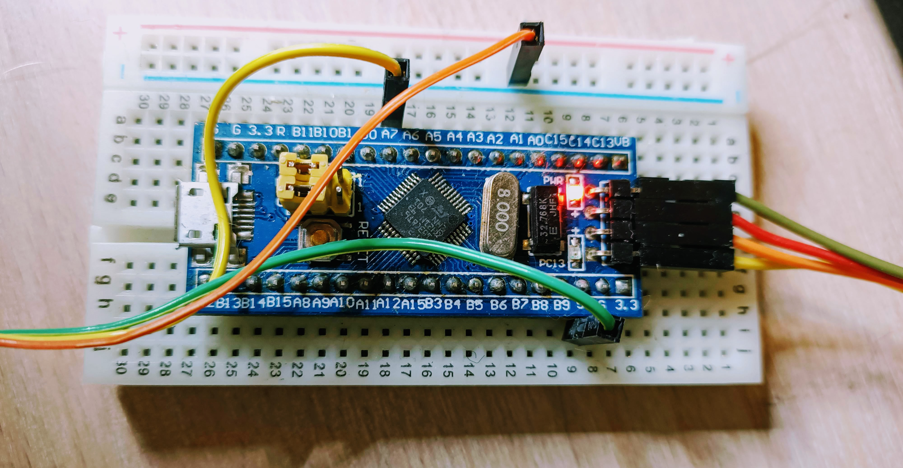

面包板（breadboard）那一道道横着的凹槽，内部是金属弹片，同一条槽里的孔是导通的；红色蓝色那两条长条是电源轨。杜邦线（那一根根彩色细线）用来在板子和面包板之间跳接。这些东西几十块钱能买一大包，做实验时先插上跑通，固定方案了再考虑焊接。

刚用面包板的人，最容易搞不清"哪些孔是通的"。记住它内部的连线规律：

- 中间那一道凹槽（就是板子中间那条横缝），把面包板分成上下两块，两边互相不通。
- 上下两块各自：每一行五个孔（a-b-c-d-e / f-g-h-i-j）内部是连通的，但 a 到 f 之间被中间那道缝隔断了。
- 最边上红、蓝两条长轨：红色那一条整列全通（通常接 VCC），蓝色整列全通（接 GND）。

杜邦线颜色没什么讲究，但老手都有约定俗成的习惯：红色接 3.3V/5V，黑色或棕色接 GND，其他颜色当信号线。这么做的好处是——你看一眼板子，红线一堆就知道是供电，黑线是地，五颜六色是信号线，排查接线时心里有数。

我建议你现在就把蓝pill 插到面包板中间那道缝上（板卡的排针正好骑跨在缝两边），把 `3V3` 和 `GND` 用杜邦线引到面包板的红、蓝电源轨上，以后接模块直接从电源轨取电，不用每次都挤板子上那两个针。

---

## 1.6 引脚怎么认：为什么一个脚能身兼数职

### 1.6.1 排针的命名规律

蓝pill 两侧两排排针，把芯片的脚引了出来。命名很规矩：`P` + 端口字母 + 编号。

- `PA0`~`PA15`：GPIOA 端口的 16 个脚（实际引出多少看封装）
- `PB0`~`PB15`：GPIOB
- `PC13`~`PC15`：GPIOC（C 组只引出来这几个，板载 LED 就在 PC13）

完整的引脚排布见下面这张图，左右两边各是一排排针，顶部那几个是电源脚：

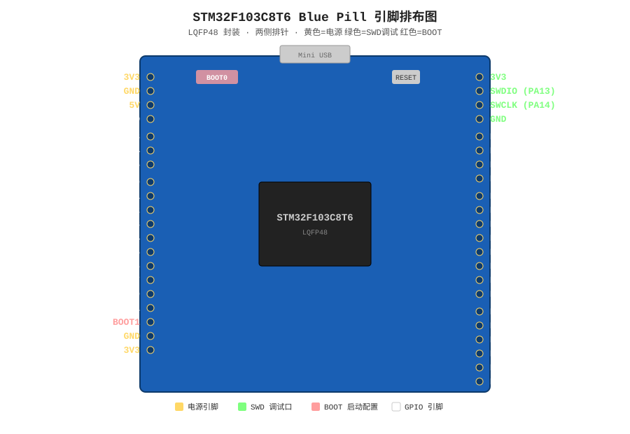

引脚区里有几个特殊脚你要一眼认出来：

- **`3V3`、`5V`、`GND`**：电源。给外接模块供电用。
- **`SWDIO`、`SWCLK`、`GND`、`3V3`**：这一组是 ST-Link 下载口，烧录调试全靠它。
- **`BOOT0`**：启动选择，下一节讲。

这里顺带说一个 PC13 的小脾气。板载 LED 焊在 PC13，可你看数据手册会发现：PC13、PC14、PC15 这三个脚是给 RTC 用的特殊脚，**它们的驱动能力比普通 GPIO 弱，而且最大电压不能高**（因为连着备用电池域）。所以你拿 PC13 点个小 LED 没问题，但别拿它去驱动什么大负载，也别随便往上面怼 5V 信号。做正经项目时，IO 尽量用 PA、PB 组的脚，PC13 这种"边角料"留着当指示灯。

### 1.6.2 引脚复用：一个脚的多重身份

这是 STM32 比 51 单片机高级的地方，也是新手最容易懵的地方。你看上面引脚图，同一个 `PA9` 脚，旁边往往标注了好几个名字：`USART1_TX`、`TIM1_CH2`……

意思是：**这根物理引脚，内部通过一个"多路开关"，可以接普通 GPIO，也可以接串口外设，还可以接定时器**。但同一时刻你只能选一个。选哪个，由你写的代码（或者 CubeMX 里点的那个选项）决定。

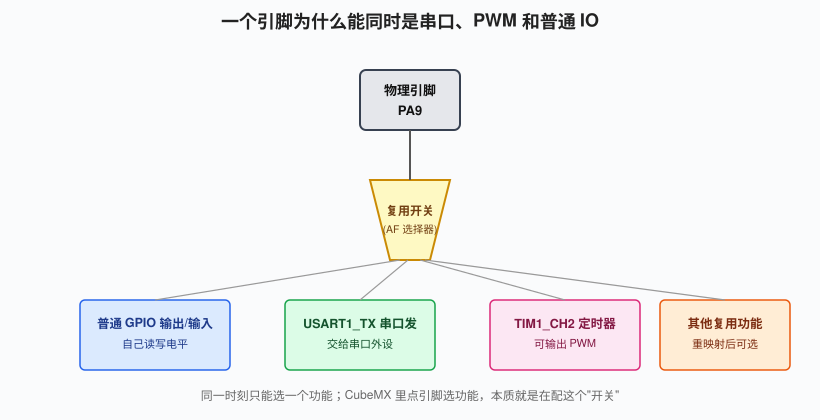

举个例子，PA9 这个脚：

- 你把它配成 `GPIO_Output`，它就是个普通 IO，你写 0/1 它就输出高低电平；
- 你把它配成 `USART1_TX`，它就被串口外设"接管"，变成串口发送脚，你再去手动写它的电平反而没用；
- 配成 `TIM1_CH2`，它就变成定时器 1 的通道 2，能自动输出 PWM。

还有个概念叫**重映射（remap）**：某个外设的默认引脚不喜欢，可以通过 AFIO 把它"搬到"另一个引脚上。比如 USART1_TX 默认在 PA9，可以重映射到 PB6。CubeMX 里点引脚时它会自动帮你处理这些，你不用记，但脑子里要有"引脚是可以换功能的"这根弦。

> 一个实际后果：你想用串口通信，别随便选 PA2，先看它默认是 USART2_TX 还是别的。选错了功能，线接对了也通信不了。CubeMX 点引脚时它会列出所有可选功能，照着点就不会错。

---

## 1.7 供电：3.3V 是铁律

蓝pill 有两路上电方式：

- 插 Mini USB，板子上 LDO 把 5V 稳成 3.3V；
- 或者直接通过 `5V` 引脚外部供 5V，板子照样自己稳压。

芯片的工作电压是 **2.0~3.6V，典型 3.3V**。记住一条铁律：**芯片 IO 的高电平就是 3.3V，不是 5V**。

好消息是 F103 大部分 GPIO 是 **5V 容忍（5V tolerant）**的——意思是你把一个 5V 的信号接到它输入脚上，不会烧，它能正确识别成高电平。坏消息是它自己输出高电平只有 3.3V，如果你那个模块要 5V 高电平才认，3.3V 可能不够，得加电平转换。

我建议新手阶段这么干，最省心：**所有外接传感器、模块，电源统一接板子上的 `3V3`，不要一个接 5V 一个接 3V3**。等你熟了再去折腾电平匹配。USB 供电那 5V 只用来给板子本身和那些"必须 5V"的模块（比如有些 OLED）。

再强调一个新手常犯的接线错误：**GND 必须共地**。只要你板子和外接模块之间有信号连线，两者的 GND 就必须连在一起。不然两边的"0V"不是同一个参考点，信号电平就是乱的。比如你用 ST-Link 接板子，ST-Link 的 GND 和板子的 GND 一定要用杜邦线连起来——别只接两根信号线，忘了地线，这是烧不进去的经典原因之一。

蓝pill 上那个 Mini USB 口，除了供电，还连着芯片的 USB 外设引脚（PA11/PA12）。也就是说你以后想做 USB 设备（比如让电脑把蓝pill 识别成一个串口或 U 盘），直接插这根 USB 线就行，不用外接 USB 转 TTL。但入门阶段我们用不到，知道有这么回事即可。

---

## 1.8 BOOT0 与启动模式：程序从哪里跑起来

芯片一上电，第一件事是"第一条指令去哪取"。这个由两个脚 `BOOT0`、`BOOT1` 的电平决定，叫启动模式。F103 主要用三种：

| BOOT0 | BOOT1 | 从哪启动 | 用途 |
|---|---|---|---|
| 0 | 任意 | 主 Flash | **正常跑你烧录的程序（默认）** |
| 1 | 0 | 系统存储器 | 芯片内置 Bootloader，用串口 ISP 烧录 |
| 1 | 1 | SRAM | 调试用，几乎不用 |

蓝pill 默认 BOOT0 上有个跳线帽接在接地位置，也就是 `BOOT0=0`，直接从 Flash 启动跑你的程序。**用 ST-Link 烧录的话，这个帽保持默认位置别动就行。**

这里解释一下"系统存储器里的 Bootloader"是个什么东西。ST 在每颗 STM32 出厂时，都在一块用户改不了的只读区域（系统存储器）里预先烧了一小段小程序，这个程序会监听串口（PA9/PA10）。当 BOOT0=1 上电时，芯片不跑你的 Flash 程序，而是跑这段 Bootloader——你拿串口工具按约定协议发数据，它就帮你写进 Flash。这就是"串口 ISP 一键下载"的原理，一个 ST-Link 都不用。代价是它只能烧录、不能调试，而且每次都要手动拨跳线、复位，麻烦。

什么时候要动它？当你不想买 ST-Link，想用 **USB 转 TTL 模块**（就是下面这个 CH340 小板）通过串口烧录时，得把 BOOT0 拨到 1，让芯片跳进内置 Bootloader，才能收串口数据烧程序。烧完再拨回 0。

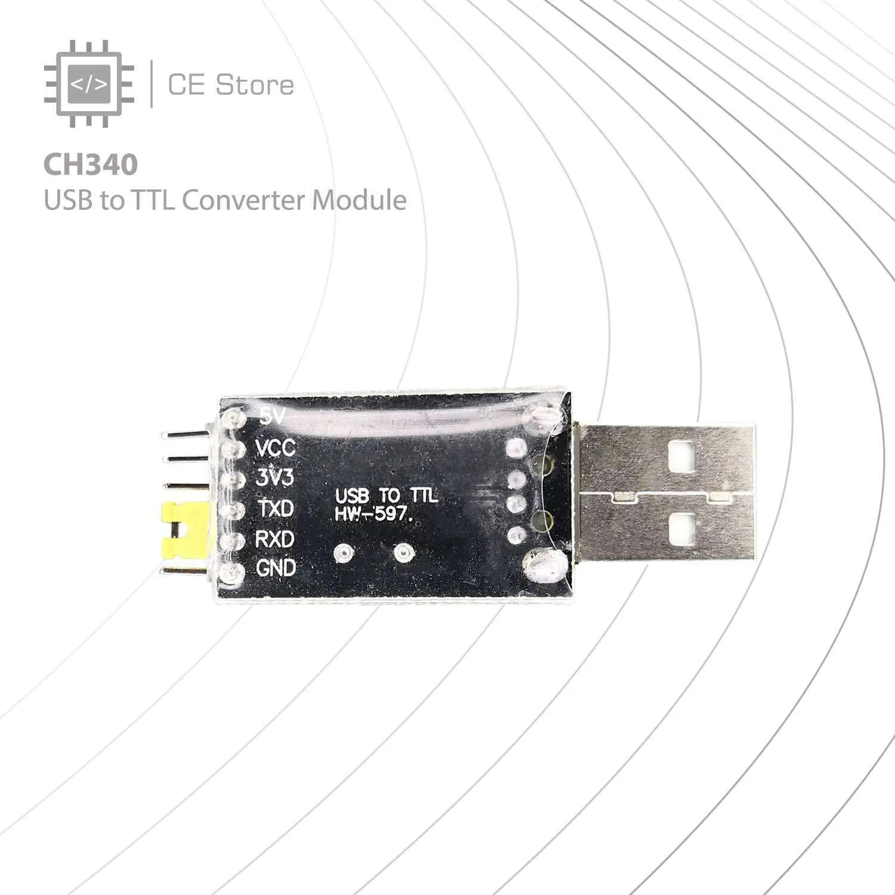

下面这张是真实的接线场景：左边蓝pill，中间就是那个 CH340 小板，用杜邦线把板子和模块连起来。以后做串口实验（第 8 章），你也是这么接——板子的 TX 接模块的 RX，板子的 RX 接模块的 TX，GND 对接。

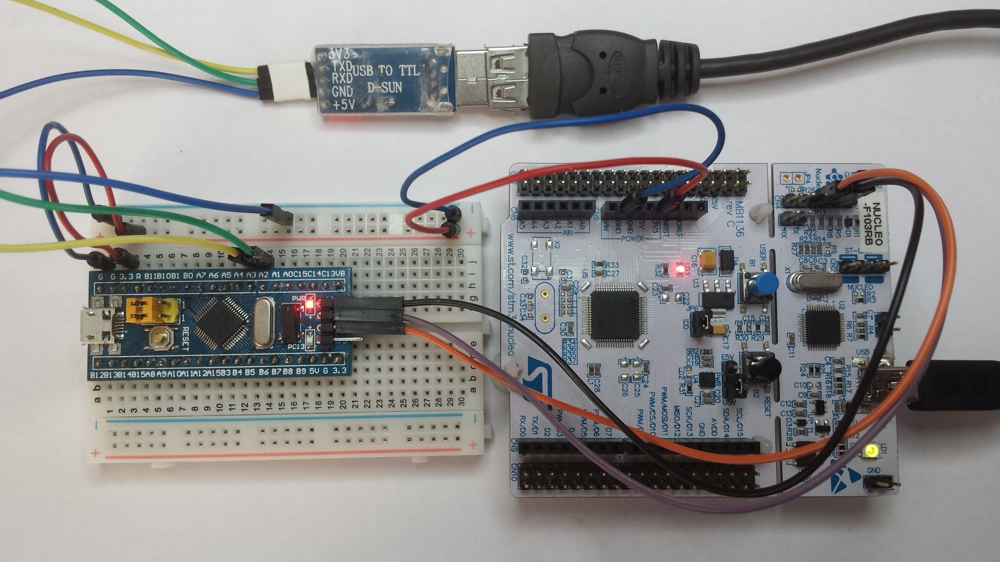

下面这张流程图把启动过程画清楚了，你对照着看：

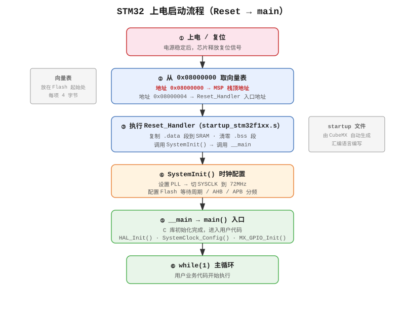

注意芯片每一次复位（不管是上电、按复位键、还是烧录软件触发的复位），都会重新读一次 BOOT0 引脚电平，再决定从哪儿启动。所以你改了 BOOT0 跳线帽之后，必须按一下复位键（或重新断电上电）才生效——光拨帽子不复位，芯片还是按老方式跑。这个细节我第一次拨 BOOT0 忘了复位，对着串口工具发半天数据没反应，还以为模块坏了。

我强烈建议你这章**先别折腾串口烧录**，老老实实买个 ST-Link（十几块钱），用 SWD 烧录最省事，而且调试功能（断点、单步）只有 SWD 给你。串口 ISP 能烧但不能调试，属于省钱的备胎方案。

---

## 1.9 GPIO 硬件底子（给第 3 章垫个脚）

GPIO（General Purpose Input/Output，通用输入输出）是单片机最最基础的外设。一个引脚，本质就是一根能读能写的数字信号线。

一个 STM32 的 GPIO 引脚内部，你得先记住这么几个零件（第 3 章用 CubeMX 点点点，第 4 章直接看寄存器，现在只混脸熟）：

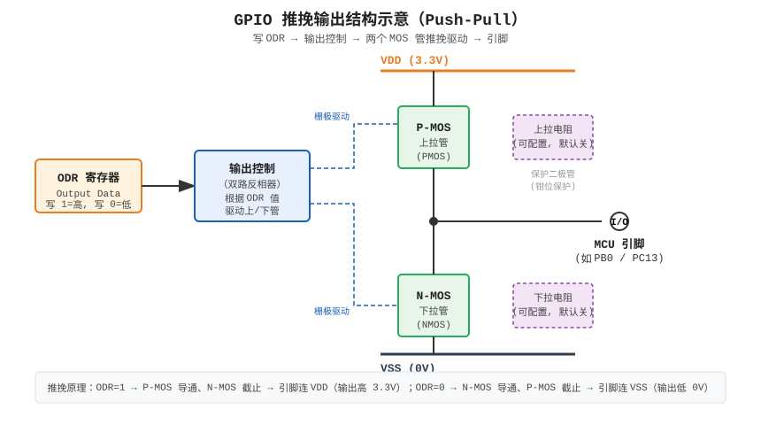

- **输出数据寄存器 ODR**：你往里写 1，引脚对外输出 3.3V（高电平）；写 0，输出 0V（低电平）。
- **输入数据寄存器 IDR**：反过来，你读它，能知道这根脚现在是高还是低。
- **上拉/下拉电阻**：引脚悬空时电平是乱的。芯片内部可以给你接个弱上拉（默认拉到高）或下拉（默认拉到低），给个确定状态。
- **推挽 / 开漏**：推挽输出能主动输出高和低，驱动能力强，点 LED 用它；开漏只能主动拉低，要输出高得靠外部上拉电阻——I2C 总线就是靠开漏+上拉实现的。
- **复用功能（AF）**：就是 1.6.2 说的，把脚交给外设管。

到第 3 章，我们就用这些知识把板载 PC13 那个灯玩起来：[第 3 章 GPIO 点亮第一颗灯](ch03_GPIO点LED.md)。

我把这几种输出/输入模式再掰开说两句，因为它们直接决定你外接电路要不要加电阻、加在哪：

- **推挽输出（Push-Pull）**：内部是一对上下互补的 MOS 管，上管导通就把脚主动拉到 3.3V，下管导通就主动拉到 0V。高低电平都"推"得动，驱动 LED、驱动数字芯片的输入，都用它。
- **开漏输出（Open-Drain）**：内部只接了一个下拉管，你要它输出高电平时，它根本不发力，全靠你在板子上外接一个上拉电阻到 3.3V，电平才被"拽"上去。听着很废，可 I2C、单总线这种"多设备共一根线"的场景就非得用它——这样就不会出现两个设备一个使劲输出高、一个使劲输出低，直接把脚短路烧了的情况。
- **上拉输入 / 下拉输入 / 浮空输入**：读按键的时候天天用。按键一端接引脚、一端接 GND，那你就得给引脚开"内部上拉"：没按时被上拉电阻拽成高电平，按下时被按键拉成低电平。这就是第 5 章按键输入的原理，省掉你外接电阻。浮空输入就是啥也不接，引脚电平悬空，适合接本来就有确定输出的信号源。

这些模式 CubeMX 里都有下拉选项，你点一下就帮你配好寄存器，但背后就是上面这点事。

---

## 1.10 一颗芯片要"活"下来：最小系统电路

蓝pill 之所以插根 USB 就能跑，是因为板厂已经把外围电路焊好了。但你要是哪天想自己画板子、或者只是想理解它为什么长这样，得先知道一件事：**光有那颗芯片本身，是点不亮的。** MCU 外围至少要凑齐这么几样，它才肯开始跑：

1. **供电 + 去耦电容**。芯片的 VDD 脚接 3.3V、VSS 脚接地，这是废话。关键是：每一个 VDD 脚旁边都要贴一颗 0.1µF 的小陶瓷电容到地，叫去耦电容。芯片内部数字电路瞬间电流忽大忽小，这颗电容负责就近"存"一点电荷，把供电线上的毛刺和压降毛刺滤掉。蓝pill 上那几个不起眼的黄色小贴片就是。**我见过新手自己画板，省了去耦电容，结果芯片随机跑飞、莫名其妙复位，查三天都查不出来**——这是硬件入门第一大坑。
2. **复位电路**。NRST（复位）脚要能被拉低一下，芯片才复位。蓝pill 上那个 RST 按键，本质就是把 NRST 对地短接一下。
3. **时钟源**。要么用芯片内部的 RC 振荡器（HSI，约 8MHz，但精度差），要么像蓝pill 这样外接一颗 8MHz 晶振（HSE，准）。要做串口通信、USB 这种对时钟精度敏感的事，必须用外部晶振，内部 RC 的误差会让串口波特率对不上。
4. **BOOT 引脚给个确定电平**。就是上一节的 BOOT0，拉到地，芯片上电才知道"从 Flash 开始跑"。

这四样凑齐，哪怕一块光秃秃的板，芯片就能工作——这就是"最小系统"的含义。蓝pill 说白了，就是把 STM32 最小系统 + 一颗电源灯 + 一颗测试 LED（PC13）+ 两排把所有脚引出来的排针，做成了一块能直接插面包板的小板。你以后看到 Nucleo、Discovery 那些官方大板，本质也是最小系统，只是外设堆得更多。

---

## 1.11 顺便聊聊选型：F103、F407 和国产替代

万一你以后要做个正经项目，可能会纠结"是不是该上更好的片子"。我把我用过的几个放一起对比，给你个参考：

| | STM32F103C8T6（蓝pill） | STM32F407 | 国产替代（如 GD32F103） |
|---|---|---|---|
| 内核 | Cortex-M3 | Cortex-M4F（带浮点） | 兼容 M3 |
| 主频 | 72MHz | 168MHz | 72MHz |
| Flash/RAM | 64KB / 20KB | 1MB / 192KB | 64KB+ / 多为 20KB+ |
| 价格 | 10~20 元（板） | 核心板 30~60 元 | 比 ST 略便宜/同价 |
| 资料生态 | 最多，教程烂大街 | 多，但比 F1 少 | 少，踩坑得自己查 |
| 适合 | 入门、小项目 | 要浮点、要性能、数据量大 | 量产降本 |

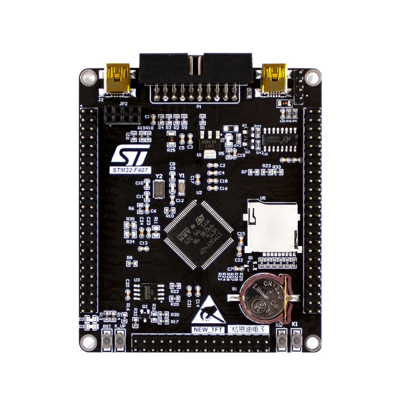

我的建议很直接：**入门就 F103，别好高骛远**。F407 强在浮点和性能，可你前半年学的 GPIO、串口、定时器、PWM、ADC，F103 全都有，用法一模一样。等你哪天真要跑 DSP 算法、要驱动大尺寸屏幕了，再上 F4 不迟，那时候你已经有底子了，换个芯片就是重开一个 CubeMX 工程的事。

再说句实在的：F103 这种十几块钱的板子，你烧错程序、接短路、甚至把引脚焊坏，都不心疼。这对学习太重要了——便宜的板子你才敢放手折腾。等你买了几百块的开发板，反而束手束脚怕弄坏。

至于国产替代，比如兆易创新的 GD32F103，很多引脚和代码跟 STM32 是**软件兼容**的——你 ST 的代码几乎能直接编译过去跑。但入门阶段我不建议用国产片练手，因为它在一些时序细节上和 ST 有出入，新手遇到问题根本分不清是自己代码错了还是芯片差异。等你能熟练调试了，量产时再考虑降本。

---

## 1.12 你桌上到底要买哪些东西

光有板子不行，我把入门一套配齐的清单列给你，照着买不花冤枉钱：

| 物品 | 大概价格 | 说明 |
|---|---|---|
| Blue Pill 蓝pill 板 ×2 | 20~30 元 | 多买一块当备件，烧坏了不慌 |
| ST-Link V2 下载器 | 10~15 元 | 烧录调试的命根子，别买太便宜的克隆货 |
| 面包板（830 孔那种） | 5~10 元 | 免焊接实验平台 |
| 杜邦线（公对公/公对母/母对母 各一排） | 5~10 元 | 跳接线，彩色那包 |
| USB 转 TTL 模块（CH340） | 5~10 元 | 串口调试 + 无 ST-Link 时备胎烧录 |
| LED、220Ω/1kΩ 电阻、按键 | 几块钱 | 第 3、5 章要用 |
| Mini USB 线 | 家里可能就有 | 给板子供电 |

全部加起来一百块以内能搞定。我当年一上来就买了套两百多的"豪华套装"，结果大半模块前两个月根本用不上。你按这个清单买，够撑到第 12 章。

接线的时候我啰嗦一句：杜邦线质量参差不齐，那种几块钱一大包的，有的头子松松垮垮，接触不良会让你怀疑人生。我第一次点灯点不亮，折腾半天是杜邦线内部断了。**线接触不良是新手最隐蔽的故障源**，怀疑电路有问题时，先把线拔插一遍、换一根试试。

买蓝pill 板也有讲究。现在淘宝上蓝pill 全是公模克隆货，质量参差，有几个点下单前问一句客服：

- 板上的 Flash 到底是真 64KB 还是虚标。有些便宜货用的是劣质片，标称 64KB 实际只认得到 32KB，你把工程做大了会莫名其妙烧不进去。
- 晶振是不是焊了两颗。前面说过，有些批次只焊了 8MHz 那颗主晶振，没焊 32.768kHz 的 RTC 晶振——不影响入门，想做 RTC 时钟就缺了。
- 排针是已经焊好的还是散件。新手直接买"已焊排针"的版本，别买那种给你一堆散排针让你自己焊的，烙铁没玩过容易焊坏。

ST-Link 也一样，十几块的那种 USB 小棒子大多是克隆的。克隆货大多能用，但偶尔会遇到连不上、下载报错的情况，这不是你的问题，后面 PlatformIO 那章我会给个专门的配置绕过它。

---

## 1.13 硬件常见的几个小毛病，先有个心理准备

新手刚上手，板子不出现象时八成不是你代码错，而是硬件接触问题。我把最常见的几个列出来，你以后对号入座：

- **电源灯都不亮**：先查 USB 线是不是只能充电不能传数据（很多安卓线是充电线），再查板子上电源开关（有的批次有），最后换个 USB 口。
- **电源灯亮，但程序烧不进去 / 连不上 ST-Link**：十有八九是 SWD 四根线接错了顺序，或者杜邦线内部断了。SWDIO 和 SWCLK 接反是最常见的，对调试器来说就是"怎么喊芯片都不应"。
- **灯怎么都不亮**：先确认你写的是 PC13、而且是低电平点亮；再确认 LED 是不是真的焊在 PC13（个别批次板子不一样）；最后怀疑 LED 本身焊反了或者烧了。
- **一接外设板子就复位/电源灯闪**：你外接模块的电流太大，或者把 3.3V 和 GND 接短路了。立刻断电，别硬上，短路久了会烧 LDO。
- **串口乱码**：99% 是波特率没对上，或者时钟没配准（用了内部 HSI 而不是外部 8MHz 晶振）。这是第 8 章的话题，先记住"乱码先查波特率和时钟"。
- **烧录提示 "No target connected"**：除了线接错，还有一种情况是你上一个工程把 SWD 引脚配成了别的功能。按 1.4 节说的，BOOT0 拨 1 进系统存储器，连上后全片擦除。
- **板子摸起来有点发烫**：立刻断电。发烫说明有地方短路或者电流过大，继续通电会烧芯片或 LDO。用手摸一下芯片和 AMS1117，正常只是微温。
- **程序烧进去了但不跑**：检查是不是忘了设"Reset and Run"，或者 BOOT0 还停在 1 的位置（那样会停在 Bootloader 里不跑你的程序）。

调试硬件有个万能顺序：**先看电（电源灯亮不亮、电压对不对）→ 再看线（有没有接反、松动）→ 最后才怀疑代码**。新手一上来就改代码，往往改半天是根线的事。

---

## 1.14 一个受用很久的习惯：学会查数据手册

教程会过时、博客会写错，但 ST 官方数据手册和参考手册不会。我建议你从第一天就把两份 PDF 下载下来放好：

- **数据手册（Datasheet，DS5319）**：讲这颗芯片的"简历"——引脚定义、电气参数、封装尺寸、绝对最大额定值。你想知道 PA9 都有哪些功能、某个脚最大能扛多大电流，翻它。
- **参考手册（Reference Manual，RM0008）**：讲"怎么用"——每个外设的寄存器怎么配、时序是怎样的。你想搞懂 GPIO、USART、定时器内部怎么工作，翻它。

教你一个最常用的查法：比如你要做串口，打开数据手册，翻到"Pin definitions"那一页的引脚定义表，找 `PA9` 这一行，会看到它默认功能是 `PA9`，同时列出 `USART1_TX / TIM1_CH2` 这些复用功能。这就等于官方亲口告诉你"这个脚能干这些事"。以后你看到任何一个陌生引脚，都先去这张表里查，别凭印象接线。

再比如你想知道 IO 口最大能输出多少电流，查数据手册的"I/O 口电气特性"，会看到每个脚吸收/灌电流建议不超过 25mA——这决定了你不能拿一个脚直接驱动一个大功率 LED，得加电阻甚至加三极管。这些数字，博客不会每次都提醒你，但手册里都写着。

两份手册怎么分工，再强调一句：数据手册是"字典"，查参数；参考手册是"教科书"，学怎么用外设。你跟着本讲义学到某个外设时，我会顺手告诉你"这部分在 RM0008 第几章"。一开始看不懂手册很正常，那里面全是寄存器位域，枯燥得很——但它是唯一不会骗你的东西。博客能告诉你"这么点就行"，手册才能告诉你"为什么这么点、上限在哪"。

我自己的用法是：学新外设时，先跟教程把它跑通建立感性认识，然后带着"它为什么要这么配"的问题翻参考手册对应章节，这时候那些寄存器位域就突然变得可读了。千万别一上来硬啃 RM0008，三百多页，谁啃谁懵。

---

## 1.15 这一章，建议你真动手做三件事

光读不看实物，这些概念是飘着的。我建议你现在就把板子拿在手里，做三件小事：

1. **拿眼睛把板子扫一遍**。对照 1.5.1 的表，在板子上找到芯片、Mini USB、那两颗银色晶振、AMS1117、红色电源灯、蓝色 PC13 灯、BOOT0 跳线帽、复位键。找到排针上标着 `3V3`、`5V`、`GND`、`SWDIO`、`SWCLK` 的那几个脚。这一遍下来，板子就不再是个陌生玩意儿了。
2. **插上 USB 看电源灯**。什么程序都不烧，就插 USB。红色电源灯应该立刻亮——这证明供电和 LDO 是好的。如果连这都不亮，先别往下学，线和板子都得检查。
3. **翻一翻那份 datasheet 的引脚定义表**。打开 DS5319 PDF，找到 pin definitions 那页，随便挑 PA9、PA10、PB6 这几个脚，看看它们除了 GPIO 之外还能当什么用。这是你以后查手册的基本功，先混个眼熟。
4. **找一找板上的 SWD 排针**。对着引脚图，在板子上找到标着 SWDIO、SWCLK、GND、3V3 的那几个小针——下一章我们就要往这儿插 ST-Link。提前认好，到时候不会手忙脚乱。

做完这几件，你对这块板子的"体感"就建立起来了。等下一章环境搭好、第一个灯闪起来的时候，你会清楚地知道那个灯在物理上到底是哪根线、哪个元件在亮。

我再啰嗦一句心态：硬件学习和写网页不一样。写网页报错，编译器会把错误位置指给你；硬件不工作，往往要你自己拿眼睛、拿万用表、拿逻辑去排查。这个过程慢，但特别锻炼人。遇到不亮、不通信、乱码，别烦躁，那就是入门的日常。

---

## 1.16 小结与自测

这章我们其实就围绕一件事：**你手里这块十几块钱的板子，到底是什么**。

- STM32 = ARM 的 Cortex-M 内核 + ST 自己堆的外设；内核手册和外设手册要分开看。
- F103C8T6：72MHz、64KB Flash、20KB RAM、48 脚、3.3V。型号每一位都对应规格。
- 芯片内部：内核经 ICode/DCode/System 三条总线连 Flash 和 SRAM，再经总线矩阵、AHB、APB1/APB2 连到各种外设。APB1 最高 36MHz，APB2 最高 72MHz。
- Cortex-M3 的 NVIC 管中断、SysTick 管时基、SWD 管调试，统一编址让"操作外设 = 写地址"。
- 8MHz 晶振经 PLL ×9 倍频到 72MHz；所有外设默认时钟关着，用之前得先开。
- 蓝pill 板上：8MHz 晶振倍频到 72、AMS1117 出 3.3V、PC13 板载 LED 低电平点亮、BOOT0 选启动。
- 引脚能复用成各种外设功能，同一时刻只选一个；供电记住 3.3V 铁律，5V 容忍不等于 5V 输出。
- 最小系统要有供电+去耦电容、复位、时钟、BOOT 这四样，蓝pill 已经帮你焊好了。

合上书，你自测一下：

1. `STM32F103C8T6` 里的 "C" 和 "8" 分别代表什么？
2. 板上晶振是 8MHz，芯片怎么跑到 72MHz 的？
3. 为什么板载 LED 写 `GPIO_PIN_RESET` 才亮，而不是写 SET？
4. 默认 BOOT0 接什么电平？用 ST-Link 烧录时要不要动它？
5. 说出三条总线（ICode/DCode/System）各自主要连什么。
6. 一颗芯片要跑起来，外围至少要有哪四样东西？去耦电容是干嘛的？
7. 推挽输出和开漏输出有什么区别？I2C 为什么要用开漏？
8. APB1 和 APB2 最高频率各是多少？为什么串口乱码要先怀疑时钟？
9. 你打算做项目时，会在 F103、F407、GD32 之间怎么选？为什么？
10. 用 ST-Link 烧录，SWD 那四根线分别是什么？为什么 GND 必须共地？

答不上来没关系，翻回去看图，这些数字以后用得多了自然就记住了。这一章没有一行代码，但它是后面所有章节的地基——地基打牢了，后面点 LED、调串口、做 PWM 才不会处处发懵。

顺便说一下本讲义配套的代码。我们每一章都会有一个可以烧录验证的小工程，最终都放在工程的 `code/` 目录下，比如第 3 章的 `ch03_led_blink.c`。本章还不涉及代码，你知道有这么个地方就行。等你第 2 章环境搭好，回来对照着看这些工程文件，会轻松很多。

这一章到这里就结束了。你现在应该对手里这块板子有了一个完整的"地图"。别急着往下，花十分钟把板子拿在手里，对着这章的图再看一遍实物。

下一章，我们就要把电脑上那一堆软件装好，让这块板子第一次跑起来了。准备好了吗？我们开始。

下一章我们把环境搭起来，真正让这块板子跑起来：[第 2 章 开发环境搭建](ch02_环境搭建.md)。

---

<!-- ===== 第 1 章 完 ===== -->
