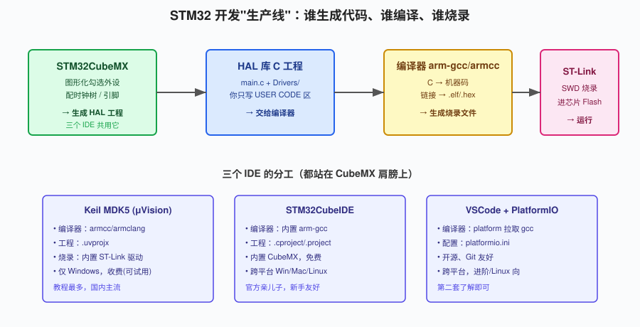
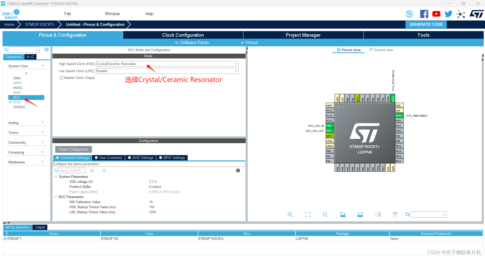
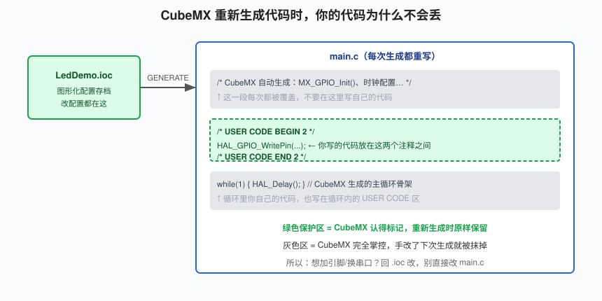
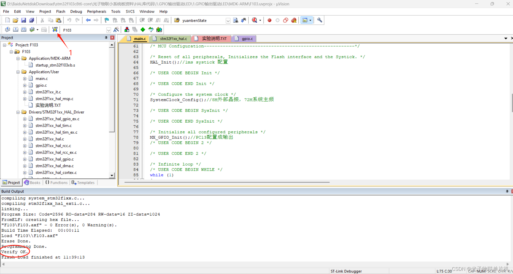
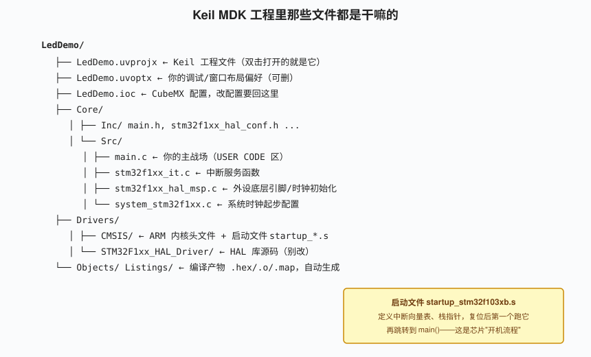
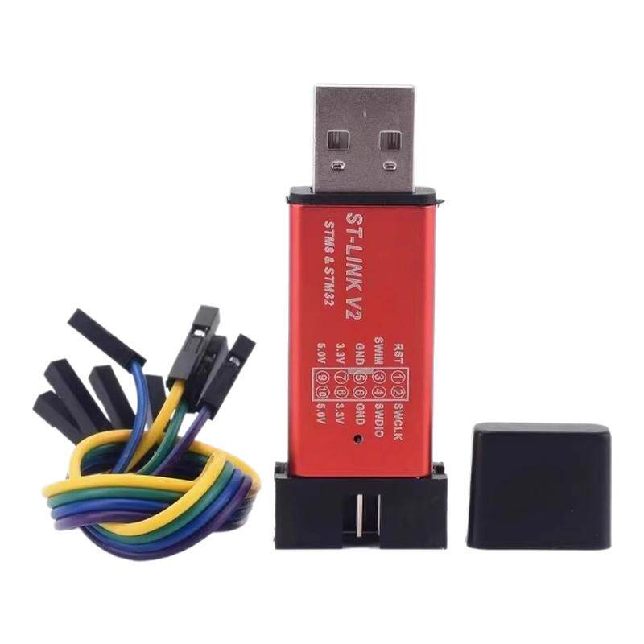
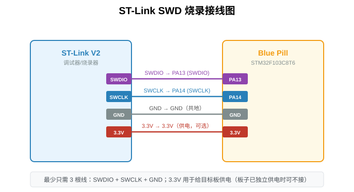
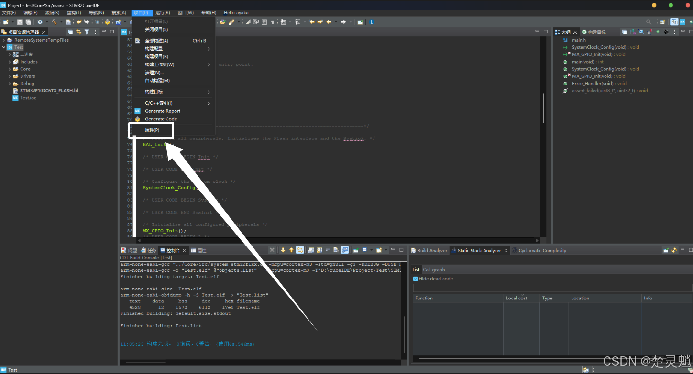
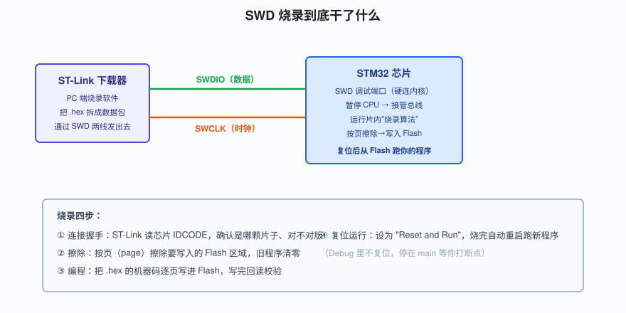

# 第 2 章　开发环境搭建（三 IDE 全讲）

> 这一章大概是整个教程里最"劝退"的一章。我当年学 STM32，光是把 Keil 装好、让 ST-Link 认出板子、点第一次灯，就折腾了整整一个周末——装驱动装到崩溃，烧录软件提示"no target connected"，对着板子发呆。事后回想，环境搭建这个事，本身没有任何技术含量，纯粹是"软件多、坑多、第一次见"。但它必须一次配好，后面所有章节都站在这上面。
>
> 所以这章我会写得特别啰嗦。我把我踩过的每一个坑都给你标出来，你照着走，争取一个下午把全套跑通。目标只有一个：编译通过、烧进去、PC13 那个蓝灯亮起来。

学完这章你要做到：在三个开发环境里至少跑通一个"编译 → 烧录 → 看灯亮"的完整闭环，并且明白这条流水线每一步在干什么。

我先给你打个预防针：环境搭建这一章，你大概率会卡住一两次。装驱动、认芯片、烧录失败，这些都正常。我自己第一次点灯，光是 ST-Link 驱动就折腾了一下午。你不是笨，是这套工具链第一次见就是这样。遇到报错别慌，把它当成解谜，顺着本章的坑表一步步排查。等灯亮的那一刻，你会发现前面熬的那几个小时特别值。

---

## 2.1 先别装软件，搞清楚"生产线"长什么样

很多人一上来就闷头装软件，装到一半就糊涂了：CubeMX、Keil、CubeIDE、PlatformIO……到底谁是谁？为什么有人用 Keil、有人用 VSCode？它们之间什么关系？

我先给你一张总图，把 STM32 开发这条"生产线"讲透。看懂这张图，你就不会在软件堆里迷路了。



整条流水线其实就四步：

1. **CubeMX 图形化配置**：你在一个可视化界面上点选要用哪个外设、填参数（比如"把 PC13 设成输出""串口波特率 115200"）。
2. **它帮你生成一份 C 工程**：里面是 HAL 库的初始化代码，以及一个等你填的 `main.c`。
3. **编译器把 C 代码翻译成机器码**：生成一个 `.hex` 或 `.bin` 文件，这是芯片能直接执行的东西。
4. **调试器（ST-Link）把机器码烧进芯片 Flash**，芯片复位后开始跑。

这里有个关键认知：**CubeMX 是所有人共用的，三个 IDE 都只是在它之后接棒。** CubeMX 负责"生成代码"，IDE 负责"打开这份代码、编译、烧录、调试"。所以不管你最后用 Keil 还是 CubeIDE 还是 PlatformIO，前面用 CubeMX 配置的步骤一模一样——区别只在于第 3、4 步用谁的工具。

这也解释了为什么你看不同教程，有人用 Keil 有人用 CubeIDE，可外设配置的截图长得几乎一样——因为那都是 CubeMX 的界面。你学会了 CubeMX，等于学会了一半。

三个 IDE 的本质区别，我列成表：

| | Keil MDK5 | STM32CubeIDE | VSCode+PlatformIO |
|---|---|---|---|
| 谁做代码生成 | CubeMX | CubeMX（内置） | CubeMX 或自带模板 |
| 谁编译 | armcc/armclang（收费） | 内置 arm-gcc（免费） | PlatformIO 拉取 arm-gcc |
| 谁烧录 | 内置 ST-Link 支持 | 内置 | 通过 stlink 工具 |
| 平台 | 仅 Windows | Win/Mac/Linux | 全平台 |
| 价格 | 收费（可试用 32KB 限制） | 完全免费 | 完全免费、开源 |
| 教程数量 | 国内最多 | 官方，新手友好 | 较少，偏进阶 |

我的建议：**第一次学，三选一当主力就行**。Windows 用户我推荐 Keil（教程一搜一大把），或者干脆 CubeIDE（免费、官方、内置一切，最省心）。PlatformIO 我会讲，但它适合你已经会了一遍、想换个顺手的编辑器时再上。别三个一起装着学，那是给自己找罪受。

我再帮你拿个主意，看你的情况选：

- **你是 Windows 电脑、跟着网上中文教程学**：选 Keil。你搜到的 90% 的 STM32 教程截图都是 Keil，照抄都不会错。缺点是免费版编译有 32KB 代码大小限制，后面做大了再想办法。
- **你不想花钱、或者用 Mac/Linux**：选 CubeIDE。官方免费、跨平台、CubeMX 内置，省心得很。缺点是界面有点笨重，启动慢。
- **你本身就是程序员、爱折腾 VSCode、用 Git 管代码**：上 PlatformIO。它工程就是个文件夹，命令行友好，适合有基础的人。新手直接上它会被一堆配置劝退。

拿不准就 CubeIDE，三个里最不容易踩环境坑。

> HAL 库是什么？一句话：ST 官方写的一层函数封装，把操作寄存器的细节藏起来，给你 `HAL_GPIO_WritePin()` 这种好看的函数用。本讲义全程用 HAL 库，你不用碰寄存器就能把功能跑起来——第 4 章我们再回头看它底下是什么。

---

## 2.2 第一步：装 STM32CubeMX（三个环境都要）

CubeMX 是 ST 官方的图形化配置工具，免费，但要在 ST 官网注册个账号才能下载。

- 去 ST 官网搜 "STM32CubeMX"，下载 Windows 安装包，一路下一步装。
- 装的时候它会问你要不要一起下载 **STM32CubeF1 固件包**（就是 F1 系列的 HAL 库源码）。勾上，省得后面再单独下。
- 如果没勾也没关系，第一次创建工程时它会提示你下载，点同意就行。

这里提醒一句：ST 官网下载有时候要科学上网，而且速度慢。如果你下得特别费劲，搜"STM32CubeMX 国内镜像"，或者找国内技术论坛的网盘备份，效果一样。固件包（F1 的 HAL 库）几百 MB，第一次下耐心等。

装完先别急着打开研究，我们下一节直接用它建工程。你只要知道：CubeMX 以后就是你"配板子"的入口，改引脚、改时钟、加外设，都回这里。

---

## 2.3 用 CubeMX 建第一个工程（三个环境通用）

不管最后用哪个 IDE，第一步都是 CubeMX 生成工程。我们以"让板载 PC13 灯亮起来"这个最小工程为例，走一遍完整流程。

### 2.3.1 选芯片

打开 CubeMX，`File → New Project`，在 `MCU Selector` 搜索框里敲 `STM32F103C8`，列表里点中 `STM32F103C8Tx`，然后右上角 `Start Project`。

这时你会看到一个大大的芯片引脚图，所有引脚都是灰色的，等待你配置。

### 2.3.2 配两个必须的系统项

在开始点灯之前，有两个设置我每次都要先做，漏掉一个后面必踩坑：

**第一，RCC 开外部晶振。** 左边栏 `System Core → RCC`，把 `High Speed Clock (HSE)` 选成 `Crystal/Ceramic Resonator`。蓝pill 板上焊了那颗 8MHz 晶振，我们要用它，而不是芯片内部那个不准的 RC。

**第二，SYS 把调试口设成 Serial Wire。** 左边 `System Core → SYS`，把 `Debug` 选成 `Serial Wire`。这一步最关键——默认 CubeMX 把 SWDIO/SWCLK 这两个脚留着当普通 IO，你要是不改，编译烧录都能"成功"，但 ST-Link 一接上去就再也连不上了（因为调试口被你自己关了）。这个坑我第 1 章就提过，这里再强调一次。

为什么是 Serial Wire 而不是别的？SWD 调试只需要两根线（SWDIO、SWCLK），比老式 JTAG 的五六根线省。我们入门全程用 SWD 就够了。你要是选了 "No Debug"，等于主动把调试门关了——新手千万别。

这两项（RCC 开晶振、SYS 开 SWD）我建议你以后建每个工程都先做，形成肌肉记忆。

### 2.3.3 把 PC13 设成输出

回到芯片引脚图，找到 **PC13** 那个脚（板载 LED 接的就是它），用鼠标点它，在弹出菜单里选 `GPIO_Output`。它会变绿，表示已经被你用起来了。

引脚图上颜色有含义：绿色是被你配成输出的脚，别的颜色代表别的外设功能。点错了再点一次选 `Reset State` 就能取消。以后配别的外设（串口、ADC）也是这么点——找到那个脚，选功能。

就这么简单。你点这一下，等于告诉芯片："PC13 这根脚，我要它当普通输出用。"

### 2.3.4 配时钟树到 72MHz

切到上面的 `Clock Configuration` 标签。这一页就是我们第 1 章看过的那张时钟树。

- 在 HSE 那一栏填 `8`（因为板上晶振是 8MHz）。
- 找到 HCLK（最终内核时钟）那一栏，填 `72`。CubeMX 会自动帮你算出 PLL 需要倍频 9 倍。
- 如果哪一栏变红了，说明你填的数字超出了这条总线的上限，照着它提示改就行。

最后你应该看到 HCLK = 72 MHz，APB1 = 36 MHz，APB2 = 72 MHz——和第 1 章讲的对上。

如果你在 Clock 页填 72 的时候某一栏变红、CubeMX 不让你过，多半是 PLL 的倍频系数超出了允许范围，或者 APB1 被你配超过 36MHz 了。对着它变红的那栏提示，把上游分频系数调一下就行。实在搞不定，就把 HSE 直接填 8，HCLK 那栏双击点一下"推荐值"，让它自动算。

这一页（时钟树）看着复杂，但你现在只需要知道：填对 HSE=8、HCLK=72 这两个数，剩下的让 CubeMX 自动分配。以后做 USB、CAN 这类对时钟有严格要求的外设，才需要回来细抠每一级分频。



### 2.3.5 工程设置与生成

切到 `Project Manager` 标签：

- `Project Name` 填 `LedDemo`。
- `Project Location` 选一个**全英文、没有空格、没有中文**的路径。这条后面会反复强调，现在先记住。
- `Toolchain / IDE`：这里选你最后要用的开发环境。用 Keil 就选 `MDK-ARM V5`，用 CubeIDE 就选 `STM32CubeIDE`，用 PlatformIO 我们后面说。
- 进到 `Code Generator` 子页，勾上 **"Generate peripheral initialization as a pair of '.c/.h' files per peripheral"**。这样每个外设的初始化代码单独放一个文件，你以后找起来清楚。

都设好，点右上角绿色的 `GENERATE CODE`。等它跑完，一个完整的工程就生成在你选的目录里了。

那个 `.ioc` 文件你要特殊对待：它是 CubeMX 整个工程配置的"存档"。以后你想改引脚、加个串口、换个定时器，**不要直接去改 main.c**，而是双击这个 `.ioc` 重新打开图形界面改，再 GENERATE。这样既不会出错，CubeMX 也能帮你把相关初始化代码改对。把 `.ioc` 当成工程的"控制面板"，main.c 只是它生成的产物。

等生成的这几十秒里，你可以顺便理解一下 CubeMX 到底干了什么：你刚才点的那几个选项（PC13 输出、开串口、72MHz），被它翻译成了一堆 C 初始化函数——`MX_GPIO_Init()`、`SystemClock_Config()` 等等。这些函数会在 `main()` 一进来就被调用，把芯片配成你想要的样子。你不用手写这些，CubeMX 帮你写了，而且写得很规范。这也是为什么我们从 CubeMX 入门——它把最枯燥的寄存器初始化全自动化了。

---

## 2.4 工程生成出来长什么样，以及一个铁律

生成完打开工程目录，结构大概是这样：

```
LedDemo/
├── Core/
│   ├── Inc/        main.h、stm32f1xx_hal_conf.h 等头文件
│   └── Src/
│       ├── main.c                  ← 你的主战场
│       ├── stm32f1xx_it.c          ← 中断服务函数
│       ├── stm32f1xx_hal_msp.c     ← 外设底层引脚/时钟初始化
│       └── system_stm32f1xx.c      ← 系统时钟起步
├── Drivers/
│   ├── CMSIS/                      ← ARM 内核头文件 + 启动文件
│   └── STM32F1xx_HAL_Driver/       ← HAL 库源码（别去改它）
├── LedDemo.ioc                     ← CubeMX 配置存档
└── LedDemo.uvprojx（或 .cproject 等） ← IDE 工程文件
```

这里有一条 CubeMX 工作流的**铁律**，你必须刻进脑子里：



打开 `Core/Src/main.c`，你会看到代码里到处是这种注释：

```c
/* USER CODE BEGIN 2 */

/* USER CODE END 2 */
```

这两段注释中间圈出来的区域，叫"用户代码保护区"。**你自己写的所有代码，都必须写在这两个注释之间。** 因为 CubeMX 以后每次重新生成代码，会把它自己管的那部分（灰色区）整个重写掉，但它认得 `USER CODE BEGIN/END` 这对标记，标记里面的东西它原样保留。

举个例子：你在 `main()` 函数里找到 `/* USER CODE BEGIN 2 */`，在它和 `END` 之间加一行：

```c
/* USER CODE BEGIN 2 */
HAL_GPIO_WritePin(GPIOC, GPIO_PIN_13, GPIO_PIN_RESET); // PC13 输出低电平
/* USER CODE END 2 */
```

这样编译烧进去，PC13 那个蓝灯就该亮了（回忆第 1 章：PC13 低电平点亮）。

**反例**：如果你图省事，把代码写在了 USER CODE 区外面，下次你回 CubeMX 改个引脚、重新 GENERATE，你那行代码就没了。这是新手最常丢代码的原因。记住：改配置回 CubeMX，写逻辑待在 USER CODE 区，井水不犯河水。

> 这份 `LedDemo` 的核心代码，最后会整理成 `code/ch03_led_blink.c`，你可以对照着看。

### 2.4.1 编译到底产出了什么

你按 Build 之后，编译器把那一堆 `.c` 源文件变成了几个文件，你以后会经常看到，顺便认识一下：

- `.o` 文件：每个 `.c` 编译出来的中间目标文件，一堆零碎的机器码。
- `.elf` 文件：链接器把所有 `.o` 拼成的完整程序，里面除了机器码，还带调试信息（变量名、行号）。调试器用它来对应源码行。
- `.hex`（或 `.bin`）：最终烧录用的文件。ST-Link 实际烧进 Flash 的就是它。

你不用手动管这些文件，IDE 自动处理。但知道"编译 = 从 .c 到 .hex"这个链条，能帮你理解为什么要 Build 一下再 Download。

### 2.4.2 看看 main.c 的骨架长什么样

打开生成的 `main.c`，虽然很长，但你只需要关心它的骨架。它大概是这么个结构：

```c
int main(void)
{
  HAL_Init();              // 1. HAL 库初始化
  SystemClock_Config();    // 2. 配时钟到 72MHz
  MX_GPIO_Init();          // 3. 把你选的外设（PC13）初始化好

  /* USER CODE BEGIN 2 */
  HAL_GPIO_WritePin(...);  // 你的代码从这里开始
  /* USER CODE END 2 */

  while (1)                // 4. 死循环，程序就在这原地转圈
  {
    /* USER CODE BEGIN 3 */
    // 以后要反复做的事，写在这个循环里
    /* USER CODE END 3 */
  }
}
```

你看，`main()` 进来先做三件初始化，然后进一个 `while(1)` 死循环。**单片机程序基本都是这个套路**：初始化一次，然后在死循环里反复干正事。我们这个点灯例子比较极端——只在初始化后写一次电平，灯就一直亮着，循环里什么都不做。第 3 章我们会在循环里加 `HAL_Delay()`，让灯开始闪。

`HAL_Init()` 这一行你别小看，它干了好几件事：开了 SysTick 那个 1ms 的系统节拍（`HAL_Delay()` 就靠它计时）、初始化了 HAL 库内部的状态变量、配了中断优先级分组。这些 CubeMX 帮你调好了，你知道它在背后干活就行。

---

## 2.5 分支 A：Keil MDK5（Windows 最主流）

选了 Keil 路线的同学看这里。

### 2.5.1 装 Keil 和芯片包

Keil MDK-ARM 要到 keil.com 下载（注意是 MDK-ARM，不是别的 Keil）。装完打开，它是个很复古的界面，叫 μVision5。

安装路径同样别用中文、别用带空格的路径。Keil 对这个尤其敏感，装在 `C:\Keil_v5` 这种默认路径最稳妥。

光装主程序还不够，你得让 Keil 认识 STM32F103 这颗芯片。打开 Pack Installer（那个像盒子的图标），在左边搜 `Keil::STM32F1xx_DFP`，点 Install。这个"DFP 包"就是 Keil 版的芯片支持包，里面有这颗芯片的寄存器定义和烧录算法。第一次打开 CubeMX 生成的 Keil 工程时，它也会提示你装，顺着点就行。

最后装一下 **ST-Link 驱动**（ST 官网 STSW-LINK009，或者装了 STM32CubeProgrammer 会自带）。

### 2.5.2 Keil 工程里那些文件

用 CubeMX 生成时 Toolchain 选了 MDK-ARM，目录里会多出一个 `LedDemo.uvprojx`，双击它就用 Keil 打开了。



Keil 工程里那些文件都是干嘛的，我画了一张图，你对着工程树看：



几个重点：

- 双击 `.uvprojx` 打开工程，**不要**去双击某个 `.c` 文件单独打开——那样你只是打开了个文本，没有工程配置。
- `startup_stm32f103xb.s` 这个汇编启动文件很关键：芯片一上电，最先跑的就是它。它干的事是设栈指针、建中断向量表，然后跳进你的 `main()`。你一般不用改它，但要知道开机流程是它启动的。
- `Drivers/STM32F1xx_HAL_Driver/` 下面是 HAL 库源码，你会经常去里面翻函数怎么用，但**别改它**。

### 2.5.3 编译和烧录

打开工程后：

1. 点那个"魔法棒"图标（Options for Target），在 `Device` 标签确认选的是 `STM32F103C8`。
2. 按 **F7**（Build）编译。底下 Output 窗口最后出现 `0 Error(s), 0 Warning(s)`（警告无所谓，错误必须是 0）就成了。
3. 还没接板子也能先编译，先确认代码能过。

编译的时候底下 Output 会刷一堆东西，你主要看最后一行。`Error` 是红色的、必须是 0；`Warning` 是黄色的、初学阶段可以先不管。如果你看到一大堆 `cannot open source input file "stm32xxx.h"`，那多半是上面说的路径有中文/空格，或者 DFP 芯片包没装。

魔法棒那个对话框里，有几个标签以后会常去：`Target`（看晶振频率填对没）、`Output`（Hex 文件勾没勾）、`Debug`（选下载器）、`C/C++`（宏定义和头文件路径）。初学阶段不用全懂，知道在哪就行。

### 2.5.4 接 ST-Link 烧录



ST-Link 就是这么个小棒子。我们用 SWD 方式接板子，一共四根线：



| ST-Link 排线 | 接蓝pill |
|---|---|
| SWDIO | SWDIO（DIO） |
| SWCLK | SWCLK（CLK） |
| GND | GND |
| 3.3V | 3.3V（一般可省，板子自己 USB 供电） |

接线提醒：SWDIO 和 SWCLK 别接反，这是最常见的错。GND 一定要接，哪怕你觉得板子已经 USB 供电了——ST-Link 和板子要共地，信号电平才有共同参考。3.3V 那根可接可不接：板子自己插 USB 供电时就不用接；如果板子完全靠 ST-Link 供电（不插 USB），那这根就得接上。

接好后：

1. 魔法棒 → `Debug` 标签 → 右边下拉选 `ST-Link Debugger` → 点 `Settings`，能看到 `IDCODE` 读出 `0x1BA01477` 之类，说明连上芯片了。读不到就检查线。
2. 还在 Debug 标签旁边的 `Utilities`（或 Flash Download）里，勾上 `Reset and Run`——这个不勾，烧完程序不会自己跑，得手动按复位。
3. 按 **F8**（Download）烧录。看到 `Programming Done.` 就成了，板载蓝灯应该亮。
4. 按 **Ctrl+F5** 进调试模式，可以打断点、单步。

烧录这几个步骤到底在芯片里发生了什么，下一节我专门讲。

### 2.5.5 怎么确认环境是真的通了

第一次点灯成功，你应该依次看到这几件事，挨个对：

1. 板子插 USB，红灯（电源灯）亮。
2. Keil 编译，Output 显示 `0 Error(s)`。
3. 接好 ST-Link，魔法棒 Settings 里能读到芯片 IDCODE。
4. 按 F8 烧录，显示 `Programming Done` / `Application running`。
5. **板载蓝灯（PC13）亮起来**。

到第 5 步灯亮，恭喜，整条流水线通了。后面所有章节都是在这条流水线上加功能。如果到哪一步卡住了，对着报错和上一节的坑表查。

---

## 2.6 分支 B：STM32CubeIDE（免费、官方、新手最省心）

如果你不想折腾 Keil 的收费和芯片包，或者你用的是 Mac/Linux，选 CubeIDE。它是 ST 官方出的免费 IDE，把编译器、调试器、甚至 CubeMX 全打包在一起了。

### 2.6.1 安装与打开

ST 官网搜 "STM32CubeIDE"，下载对应你系统的版本装。它基于 Eclipse，第一次打开会让你选个工作目录，选个英文路径。

接 CubeMX 工程有两种方式：

- **推荐**：CubeMX 生成工程时，Toolchain 直接选 `STM32CubeIDE`，它会生成 `.cproject`，直接用 CubeIDE 打开就行。
- 或者在 CubeIDE 里 `File → Import → Existing Projects`，把已经生成的目录导进来。

第一次打开 CubeIDE 会让你选个 workspace（工作区）目录，同样选个英文路径。它启动时那个加载条转得有点久，耐心等，Eclipse 系软件都这德性。

### 2.6.2 编译烧录

CubeIDE 的好处是**啥都不用额外装**：

- 点工具栏那个锤子图标（Build）编译。
- 左边工程树里双击 `.ioc` 文件，能再调出图形化配置界面，改完点保存它自动重新生成代码——等于 CubeMX 内置了。
- 接好 ST-Link，点绿色三角（Run）或虫子图标（Debug）。

第一次点 Debug，它会弹一个"Edit Configuration"的窗口，问你用哪个调试器，选默认的 ST-Link GDB Server 就行，然后点 Debug。它会自动帮你编译、烧录、停在 `main()` 入口。你看到代码行停在 `main()` 里黄色高亮，按 F8（Resume）就跑起来了，灯亮。



我个人的感觉：CubeIDE 对纯新手最友好，因为它把 CubeMX 和编译环境缝在了一起，少装一个软件少一份麻烦。它唯一的缺点是基于 Eclipse，界面有点重、启动慢，工程大了会卡——但学习阶段完全无所谓。

---

## 2.7 分支 C：VSCode + PlatformIO（开源、进阶）

这条线我把它放在最后，因为它概念稍微多一点。如果你是纯新手，看完前面 Keil 或 CubeIDE 能点灯了，再来了解这个不迟。

PlatformIO 是个跨平台的嵌入式开发插件，装在 VSCode 里。它的思路和前面两个不一样：前面是"打开工程文件夹"，PlatformIO 是用一个叫 `platformio.ini` 的配置文件描述整个工程。

### 2.7.1 安装

- 装 VSCode（code.visualstudio.com）。
- 左边扩展商店搜 `PlatformIO IDE`，安装，它会自己再装一堆东西，第一次比较慢。
- ST-Link 驱动和 Keil 那条线是同一个，装过就不用再装。

第一次装 PlatformIO，它会在后台下载一个编译器工具链（arm-gcc），几百 MB，慢的话要等几分钟。等它底部状态栏从"下载中"变成小勾、箭头、虫子那排图标，才算就绪。

### 2.7.2 建工程和 platformio.ini

PlatformIO Home 里点 New Project，名字填 `LedDemo`，Board 搜 `bluepill_f103c8`，Framework 选 `STM32Cube`（要用 HAL 的话）。它会给你生成一个模板工程，核心是 `platformio.ini` 这个文件：

```ini
[env:bluepill_f103c8]
platform = ststm32
board = bluepill_f103c8
framework = stm32cube
upload_protocol = stlink
debug_tool = stlink
monitor_speed = 115200
```

逐行解释这个配置，你以后自己改它：

- `platform = ststm32`：我要开发 STM32 这一类芯片。
- `board = bluepill_f103c8`：目标板子是蓝pill F103C8。PlatformIO 内置了这块板的配置（Flash 大小、晶振、引脚）。
- `framework = stm32cube`：用 ST 的 HAL/Cube 框架，而不是 Arduino 框架。
- `upload_protocol = stlink`：烧录用 ST-Link，而不是串口。
- `debug_tool = stlink`：调试也走 ST-Link。
- `monitor_speed = 115200`：串口监视器默认波特率，第 8 章用。

对了，`framework` 那里的 `stm32cube` 和 `arduino` 是两条路：选 `arduino` 你就能用 `digitalWrite()` 那套 Arduino 风格函数，上手快但藏得深；选 `stm32cube` 就是我们一直在用的 HAL 库路线。本讲义主线是 HAL，所以你选 `stm32cube`。如果你以前玩过 Arduino，想快速出活，也可以选 `arduino` 尝尝鲜。

如果你是拿 CubeMX 生成的 HAL 工程想塞进 PlatformIO，可以让 CubeMX Toolchain 选 `Makefile` 生成，然后在 `platformio.ini` 里用 `src_dir`、`include_dir` 指向 CubeMX 的 `Core/Src`、`Core/Inc`，对齐两边的目录结构。这一步稍微绕，新手先用 PlatformIO 自带模板即可。

PlatformIO 有个我很喜欢的点：整个工程就是个普通文件夹，用 Git 管理特别顺手，换台电脑 `git clone` 下来就能编译。而且它支持的板子特别多，以后你想玩 ESP32、RP2040，同一个 VSCode 环境就能切过去。这也是为什么很多有经验的嵌入式开发者最后都投奔了它。

### 2.7.3 编译烧录

VSCode 底部状态栏有一排小图标：对勾是编译（Build），箭头是烧录（Upload），虫子是调试。接好 ST-Link，点箭头就行。

克隆的廉价 ST-Link 在这里经常报一个 `CPUTAPID` 错误，社区的通用解法是在 `platformio.ini` 里加两行：

```ini
upload_flags = -c set CPUTAPID 0x2ba01477
debug_init_break = tbreak setup
```

意思是告诉烧录工具：别较真读出来的芯片 ID 对不对，按这个值认。这是国内淘宝克隆 ST-Link 的老毛病，遇到了照抄即可。

---

## 2.8 烧录原理：ST-Link 到底在芯片里干了什么

接下来说说"烧录"这个动作的底层，你看懂了，后面很多怪问题就有思路了。



我们用的 SWD 调试口，本质是芯片内核里带的一个"后门"。ST-Link 通过 SWDIO（数据）和 SWCLK（时钟）两根线，能直接指挥内核：

1. **握手读 IDCODE**：先确认对面是哪颗芯片，对不对版。
2. **暂停 CPU**：把内核停下来，接管总线。
3. **运行片内烧录算法**：Flash 这种存储器不能直接"写"，得先按页擦除、再按页写入。ST-Link 会把一小段"烧录算法"代码临时拷进 SRAM，让内核执行它，帮你擦 Flash、写 Flash。
4. **回读校验**：写完读回来对比，确认没错。
5. **复位运行**：如果你勾了 `Reset and Run`，就触发一次复位，芯片从 Flash 开始跑你的新程序。

理解这个有什么用？——当你烧不进去的时候，你就知道问题出在哪个环节：读不到 IDCODE 是线/驱动问题；能连上但写不进去是 Flash 被写保护了；写完不跑是复位设置或 BOOT0 的事。

顺便推荐一个独立小工具：**STM32CubeProgrammer**。它是 ST 官方的独立烧录软件，不依赖任何 IDE。你 Keil 里芯片连不上、想全片擦除的时候，就用它：接好 ST-Link，点 Connect，连上后点 Full Chip Erase，把整片 Flash 擦干净。以后救"被自己锁死的芯片"，基本都靠它。建议你装一个，反正免费。

---

## 2.9 调试器怎么用（三个 IDE 一个思路）

会烧录只是开始，会**调试**才是入门和进阶的分水岭。不管哪个 IDE，调试操作都一样：

| 操作 | 干什么 |
|---|---|
| 点行号左边下断点 | 程序跑到这行就暂停 |
| F10 单步跳过 | 一行行走，不钻进函数里面 |
| F11 单步进入 | 钻进函数里面看 |
| 加观察变量 | 实时看某个变量的值怎么变 |
| 看外设寄存器窗口 | 直接看 GPIO、定时器寄存器此刻是几 |
| F5/F8 继续 | 暂停后接着跑 |

第一次用，你就在 `HAL_GPIO_WritePin(...)` 那行下个断点，按 F5 进调试，单步走，盯着 LED——你会看到灯在那一行执行的瞬间亮灭。这个"代码和硬件动作对上"的瞬间，特别有成就感，也特别帮你理解程序到底在控制什么。

进调试模式后，界面会切到一个"Debug 透视图"：左边是寄存器和外设窗口，中间是代码（黄色箭头指着当前停在哪一行），底下有变量观察区。你试着做这几个动作感受一下：

- 点 **F10**，箭头一行行往下走，观察灯在某一行亮灭。
- 左边找 GPIOA/GPIOC 的 ODR 寄存器，看那个对应 PC13 的位，是不是在 0 和 1 之间跳。
- 停住时，把鼠标悬停在变量上，能看到它的值。

很多人学了很久都不敢用调试器，觉得"打断点好高级"。其实它就是个"让程序在你指定的地方暂停，然后你一步步看它怎么走"的工具。用熟了，你以后查 bug 的效率会高十倍——不用靠 `printf` 瞎猜。

调试还有个特别有用的功能：看内存和外设寄存器。比如你想知道 PC13 此刻到底是高是低，不用接万用表，直接在调试器里看 GPIOC 的 ODR 寄存器那一位就行。这在排查"我代码写了为什么没效果"时特别管用——一眼就知道是代码没执行，还是执行了但硬件没反应。

---

## 2.10 环境搭建最容易踩的坑（我都替你踩过了）

这一节是干货，遇到问题先来这儿查：

1. **芯片锁死 / ST-Link 怎么都连不上**。最常见原因是 CubeMX 里 SYS 没开 Serial Wire，或者你之前把 PA13/PA14 配成了别的功能。救法：把 BOOT0 跳线拨到 1（从系统存储器启动，不碰那两个脚），用 ST-Link 连上后，在 STM32CubeProgrammer 里做一次全片擦除（Full Chip Erase），再把 BOOT0 拨回 0。芯片一般都能救活。
2. **设备管理器里 ST-Link 是感叹号 / 未知设备**。驱动没装好。卸载重装 STSW-LINK009 驱动，换个 USB 口（别用那种前置的烂扩展口）。
3. **编译报一堆头文件找不到**。检查两件事：工程路径有没有中文或空格（有就赶紧挪到全英文短路径，比如 `D:\stm32\LedDemo`）；你打开的是不是那个 IDE 工程文件（.uvprojx / .cproject），而不是随手双击了个 main.c。
4. **编译过了、烧录显示成功，灯却不亮**。八成是没勾 `Reset and Run`。Keil 在魔法棒 → Debug → Settings 或 Utilities 里找；CubeIDE 在 Run Configuration 里。烧完不复位，程序停在那儿不跑。
5. **PlatformIO 烧录报 CPUTAPID**。2.7.3 那两行配置抄上去。
6. **Keil 编译提示芯片不支持 / 下载大小超 32KB**。你用的是没激活的免费版 Keil，代码超过 32KB 就不让编译了。要么买授权，要么换免费的 CubeIDE / PlatformIO 继续学。
7. **CubeMX 点 GENERATE 报路径错误**。还是那个老问题：工程路径有中文、有空格，或者有括号之类特殊字符。统统改成纯英文短路径，比如 `D:\stm32\projects\LedDemo`。
8. **烧录后灯闪一下就灭 / 程序跑飞**。多半是时钟没配对：你以为开了外部 8MHz 晶振，实际代码还在用内部 RC，导致串口、延时全乱。回 CubeMX 检查 RCC 是不是真选了 Crystal，Clock 树 HSE 是不是填了 8。
9. **换了个 USB 口 ST-Link 就不认了**。克隆 ST-Link 的驱动有时候跟 USB 口绑定，换口要重新指一下驱动。实在不行换回原来那个口。

排查环境问题有个笨办法但很有效：**把报错信息原样复制到搜索引擎里搜**。STM32 入门是个超级大众的话题，你遇到的几乎每个报错，都有人在论坛问过一模一样的。搜报错关键词，比你自己瞎试快得多。

另外，装好的那几个软件（CubeMX、IDE、ST-Link 驱动）别随意升级。嵌入式工具链版本之间经常有兼容性问题，教程用的什么版本，你就装什么版本。新版本一时爽，半夜报错火葬场。

---

## 2.11 小结与自测

这一章我们干的事，说白了就是把"从敲代码到芯片跑起来"这条路打通：

- 流水线：CubeMX 配置生成 HAL 工程 → 编译器翻译成 hex → ST-Link 经 SWD 烧进 Flash → 运行。
- CubeMX 里 SYS 开 Serial Wire、RCC 开外部晶振、时钟配到 72MHz，是三个必做项。
- 用户代码只写在 `USER CODE BEGIN/END` 之间，否则下次重新生成就被覆盖。
- main.c 的骨架是：HAL_Init → 时钟 → 外设初始化 → while(1) 死循环。
- Keil（Windows 主流、收费）、CubeIDE（免费官方、跨平台）、PlatformIO（开源进阶）三选一即可。
- 烧录本质是 ST-Link 经 SWD 暂停内核、运行片内算法写 Flash；Reset and Run 决定烧完跑不跑。
- 烧录失败先按"读 IDCODE → 擦写 → 复位运行"的顺序排查；芯片失联就 BOOT0 拨 1 全片擦除。

自测一下：

1. CubeMX 里为什么一定要把 SYS 的 Debug 设成 Serial Wire？不设会怎样？
2. 为什么自己的代码要写在 USER CODE 区里？
3. 蓝pill 板载 LED 是高电平还是低电平点亮？对应代码里写 RESET 还是 SET？
4. ST-Link 烧不进去，怀疑芯片被 SWD 引脚配置锁死了，你怎么救？
5. 三条工具链（Keil / CubeIDE / PlatformIO）在"谁编译、谁烧录"上有什么本质区别？
6. main.c 里那个 `while(1)` 死循环是干嘛的？为什么单片机程序都要有它？
7. 编译出来的 `.hex` 文件是给谁用的？`.elf` 又为什么带调试信息？
8. 为什么工程路径里不能有中文和空格？你觉得这是哪一步在跟路径较劲？
9. 烧录时勾选 "Reset and Run" 和不勾选，程序运行行为有什么差别？

环境到这就齐了。说句心里话：这章是整个教程里我最不希望你跳过的一章。很多人觉得"环境嘛，照着点下一步就行"，结果一学期下来还是只会点现成教程里的灯，换个功能就抓瞎——因为根本没理解 CubeMX、编译器、烧录器各自在干嘛。你既然读到这儿、把这几个概念捋顺了，后面会顺很多。

现在你应该已经有一个能编译、能烧录、灯能亮的 `LedDemo` 工程了。别急着关电脑，把这个工程备份一下——它是你以后所有实验的起点，新功能都在它上面改。

如果这章你卡在某个地方半天过不去，先别硬磕。去喝口水，把报错复制下来搜一搜，或者干脆换个 IDE 试试（比如 Keil 装不上就先 CubeIDE）。环境这东西，绕过去比死磕划算，重要的是尽快让灯亮起来，建立正反馈。

下一章我们正式写代码，用 GPIO 把这颗灯玩出花样——闪烁、呼吸，正式入门单片机世界：[第 3 章 GPIO 点亮第一颗灯](ch03_GPIO点LED.md)。

到时候你会发现，环境一旦搭好，后面写代码其实很快——点点 CubeMX、加几行 HAL 函数，功能就出来了。

现在，去把你的灯点着吧。这一步跨过去，后面就是一马平川了。

如果顺利，你会看到蓝灯亮起——那是你的代码第一次在真实硬件上运行。这种感觉，玩过单片机的人都懂。我们下一章见。

---

<!-- ===== 第 2 章 完 ===== -->
