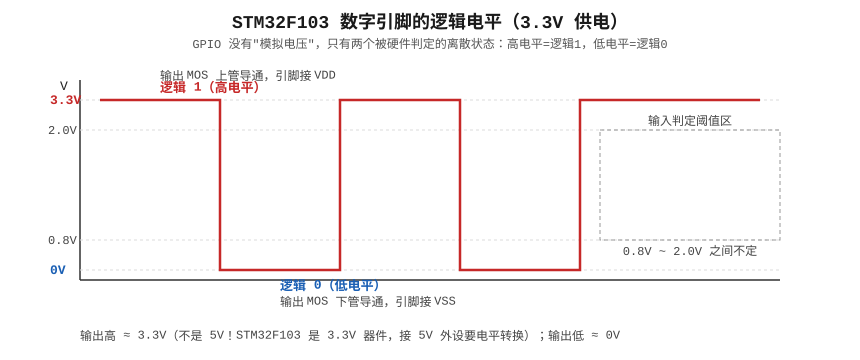
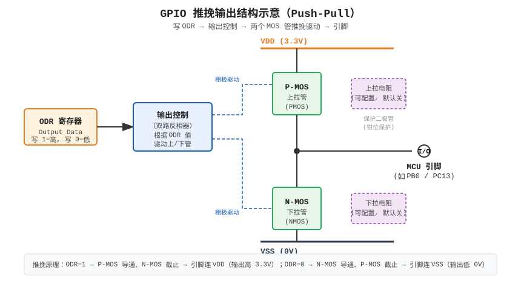
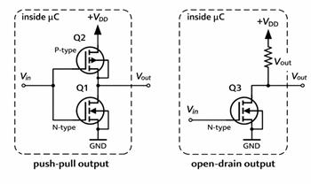
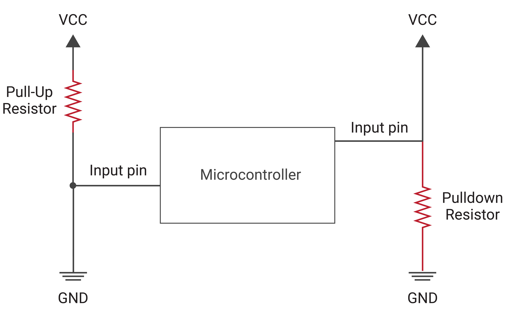
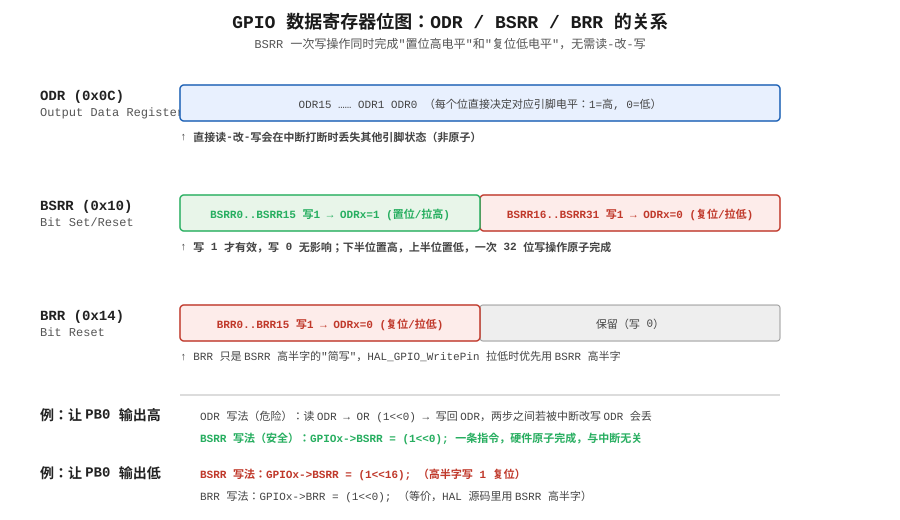
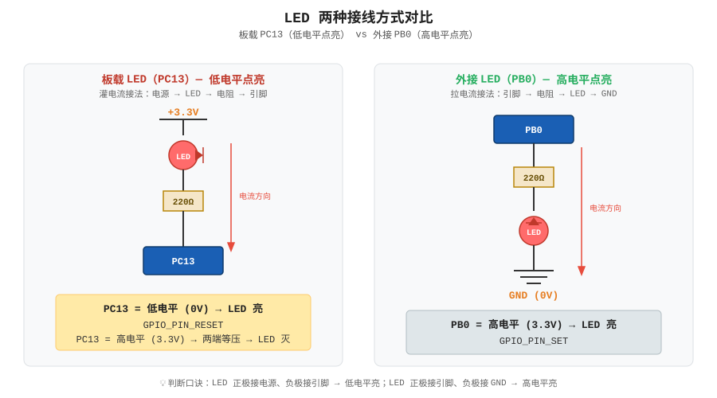
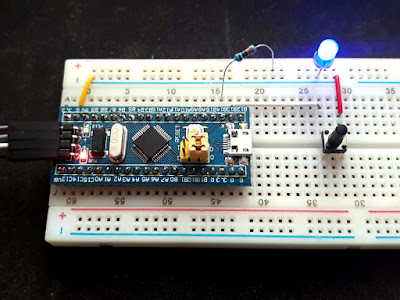

# 第3章 点亮第一个 LED —— GPIO 输出

> **本章目标**：别再把点灯当成"Hello World 随便跑一下"。我要带你把这一颗 LED 背后的所有事情掰碎了讲清楚——电在引脚上到底是怎么流的、寄存器一位一位是怎么配的、HAL 那层薄薄的封装底下藏着什么、为什么蓝pill 的板载灯要写 RESET 才亮。等你读完这一章，你应该能闭着眼睛把任何一个 STM32 引脚配成你想要的样子。

我第一次在蓝pill 上点灯，折腾了整整一个下午。代码抄的是网上最标准的 `HAL_GPIO_WritePin(GPIOC, GPIO_PIN_13, GPIO_PIN_SET);`，编译零警告，烧录零报错，板子接好了——灯就是不亮。我蹲在那儿换了三根杜邦线、怀疑了 ST-Link 、怀疑了 USB 口，最后发现：蓝pill 板载那颗 LED 是**低电平点亮**的，我写 SET 等于把它**关掉**了。这个坑我踩过一次，后来又看到至少三五个同学在同一个地方栽跟头。所以这一章我从最底下讲起，让你一次把它搞明白。

---

## 3.1 先建立一个直觉：引脚到底输出了什么

很多人学单片机的第一个模糊点就是——"输出高电平"到底输出了个啥？我用最朴素的方式讲。

STM32F103 是一颗 3.3V 供电的芯片。它的每个 GPIO 引脚在输出模式下，本质上就是在做一件事：**通过内部的两个 MOS 管，把这根引脚要么接到 3.3V，要么接到 GND**。



看上面这张图。你写"输出高"，芯片内部那个上面的 MOS 管（PMOS）打开，引脚被"推"到 3.3V；你写"输出低"，下面那个 MOS 管（NMOS）打开，引脚被"拉"到 0V。就这么简单。**引脚不会输出一个"中间电压"**——它要么和 3.3V 短路，要么和 GND 短路，中间那一段是留给输入判定用的。

这里有两个新手特别容易搞错的点，我先敲出来：

第一，**STM32F103 的高电平是 3.3V，不是 5V**。你以后拿万用表量引脚，输出高应该量到 3.2V~3.3V，量到 5V 那才叫见鬼。所以接 5V 的外设（比如老式的 Arduino 传感器）有时候要加电平转换，这个我们后面遇到再说。

第二，**输出能力很弱**。一个 GPIO 引脚推荐最大也就灌/拉几毫安（数据手册上是 8mA 左右，绝对最大值 25mA，但别这么干）。你直接用一个引脚去驱动继电器、驱动电机，芯片会烧。中间要加三极管或者 MOS 管做缓冲。LED 之所以能直接点，是因为一颗 LED 也就几毫安，引脚自己够得着。

---

## 3.2 GPIO 内部到底长什么样

打开参考手册 RM0008 的 GPIO 章节，你会看到一张很经典的结构图。我把它简化成下面这张：



从上到下捋一遍信号是怎么走的：

1. **ODR 寄存器**（Output Data Register）里存着你要输出的 0 或 1。你写代码让引脚输出高，本质就是把 ODR 对应的那一位写成 1。
2. 这个值经过**输出控制电路**，变成两个 MOS 管的开关信号。ODR=1 → 上面的 PMOS 开、下面的 NMOS 关；ODR=0 → 反过来。
3. 两个 MOS 管像两个"推拉门"，把引脚有力地推向 3.3V 或者 GND。这就是"推挽（Push-Pull）"这个名字的来历——一个推、一个拉，主动驱动。
4. 旁边还有一对**上下拉电阻**（大约 30k~50kΩ），由寄存器控制，可以把引脚默认拉到 3.3V 或 GND。这个在输出模式下基本用不上，输入模式才是它的舞台（第 5 章讲按键时你会天天跟它打交道）。

引脚旁边还接了一个**施密特触发器**，那是输入路径用的——外面进来的模拟电压在这里被整形干净，再送进 IDR 寄存器。输出的时候这条路径是关着的。

---

## 3.3 推挽 vs 开漏：别再只会用默认值了

CubeMX 里配 GPIO 输出时，有个下拉框写着"GPIO output mode"，默认是 Push Pull。我猜 90% 的人从来没动过它。但如果你不知道它还有个兄弟叫 Open Drain，你迟早会在 I2C、或者多机通信那种地方翻车。



两种结构的差别就在输出那一级：

**推挽输出（Push-Pull）**：上下两个 MOS 都在。高电平时上管导通把引脚推到 VDD，低电平时下管导通把引脚拉到 GND。**高低电平都是芯片自己主动驱动的**。好处是驱动能力强、边沿快；坏处是——你没法让它"输出一个由外部决定的高电平"。

**开漏输出（Open-Drain）**：上面那个 PMOS 被砍掉了，只剩下下面那个 NMOS。于是：
- 你写 ODR=0 → NMOS 导通，引脚被拉到 GND（低电平，芯片自己拉）。
- 你写 ODR=1 → NMOS 截止，引脚**悬空**，内部啥也不接。这时候高电平从哪来？必须靠你在板子外面加一个**上拉电阻**，把引脚拉到你想要的电压（3.3V 甚至 5V）。

开漏听起来很废，连高电平都要外部拉，但它有两个推挽永远做不到的事：

1. **线与（Wired-AND）**：好几个开漏引脚可以接在同一条线上，每个引脚只要"我要拉低"就把线拉低，没人拉的时候电阻把线拉高。任何一个人说低，总线就是低。这就是 **I2C 的 SDA/SCL 线为什么必须开漏**——两个设备同时推挽输出一个高一个低，等于 3.3V 通过两个导通的管子直接短路到 GND，瞬间烧管子。
2. **电平转换**：外部上拉电阻接 5V，那这条线的高电平就是 5V，STM32 自己还是 3.3V 器件，却能输出 5V 逻辑。有些老传感器就这么接。

所以记一个简单的分工：

- **点 LED、驱动蜂鸣器、控制一个只属于你的信号** → 推挽，默认就对。
- **I2C、单总线（OneWire）、多路共享一条线、跨电平** → 开漏 + 外部上拉。

本章我们点 LED，一律推挽。等做到第 11 章 OLED（I2C）的时候，你会回头感谢现在把这个搞明白了。

---

## 3.4 上下拉电阻：输入悬空为什么会乱跳

虽然这一章讲输出，但上下拉这个概念我顺手讲掉，因为它跟 GPIO 结构长在一起。



一个引脚如果既不接高也不接低，就叫**悬空（Floating）**。悬空引脚的电平是不确定的——周围一点电磁干扰就能让它在 0 和 1 之间疯狂乱跳，读出来的值跟掷骰子一样。为了避免这种情况，你需要一个电阻把它"默认"到一个确定电平：

- **上拉（Pull-up）**：电阻一端接引脚、一端接 3.3V。没人拉它的时候，它就是高电平。按键接在引脚和 GND 之间，按下时才拉低——这是最常见的按键接法（第 5 章）。
- **下拉（Pull-down）**：电阻一端接引脚、一端接 GND。没人拉它的时候，它就是低电平。按键接在引脚和 3.3V 之间，按下时才拉高。

STM32 内部已经把这对电阻做进去了（可选接/不接），CubeMX 里 Pull-up / Pull-down / No pull 三个选项就是控制这个。输出模式下选 No pull 就行；输入模式后面会详细讲。

---

## 3.5 寄存器级：F103 的 GPIO 到底是怎么配的

这一节我建议你慢一点读。很多人学 STM32 用了两年还在跟 HAL 函数打交道，你把这一节啃下来，你就超过他们了。

先泼一盆冷水：**网上很多教程直接讲 MODER、OTYPER、OSPEEDR、PUPDR 这几个寄存器——那是 STM32F4/L4/F7 的命名法，不是 F103 的**。F103 是比较老的 Cortex-M3 芯片，它的 GPIO 配置寄存器长得不一样，它把 16 个引脚的配置**压缩**进了两个寄存器里。我先讲 F103 真实的寄存器，最后再告诉你 F4 那一套叫什么，这样你以后看别的教程也不会乱。

### 3.5.1 F103 的 GPIO 寄存器全家福

每个 GPIO 端口（GPIOA、GPIOB……）在内存里映射成一组连续的 32 位寄存器：

| 偏移 | 寄存器 | 作用 |
|---|---|---|
| 0x00 | **CRL** | 配置引脚 0~7（每脚 4 位） |
| 0x04 | **CRH** | 配置引脚 8~15（每脚 4 位） |
| 0x08 | **IDR** | 输入数据（只读） |
| 0x0C | **ODR** | 输出数据（读写） |
| 0x10 | **BSRR** | 置位/复位（写 1 生效，原子） |
| 0x14 | **BRR** | 只复位（写 1 拉低） |
| 0x18 | **LCKR** | 引脚配置锁定 |

你发现没有？F103 没有独立的 MODER、OTYPER、OSPEEDR、PUPDR——**模式、推挽/开漏、速度、上下拉，全被塞进 CRL/CRH 里了**，每个引脚 4 位。

### 3.5.2 CRL/CRH：每个引脚 4 位怎么分

对于端口 x 的第 y 个引脚，CRL（y<8）或 CRH（y≥8）里有 4 位，从低位往高位数：

```
      位3   位2   位1   位0
      ┌─────┬─────┬─────┬─────┐
引脚y │ CNFy1 CNFy0 │ MODEy1 MODEy0 │
      └─────┴─────┴─────┴─────┘
       └── 配置(CNF) ─┘ └─ 模式/速度(MODE) ─┘
```

**MODEy[1:0] 决定方向和速度**：

| MODE 值 | 含义 |
|---|---|
| 00 | 输入模式（默认上电状态） |
| 01 | 输出模式，最大速度 10 MHz |
| 10 | 输出模式，最大速度 2 MHz |
| 11 | 输出模式，最大速度 50 MHz |

**CNFy[1:0] 决定输出类型或输入上下拉**：

当 MODE=输出（01/10/11）时，CNF 的含义：

| CNF 值 | 输出类型 |
|---|---|
| 00 | 通用推挽输出 |
| 01 | 通用开漏输出 |
| 10 | 复用功能推挽（串口/SPI 那种） |
| 11 | 复用功能开漏（I2C 那种） |

当 MODE=输入（00）时，CNF 的含义：

| CNF 值 | 输入类型 |
|---|---|
| 00 | 模拟输入（给 ADC 用，数字缓冲关掉） |
| 01 | 浮空输入（啥也不拉，靠外部信号） |
| 10 | 上拉/下拉输入（由 ODRx 这一位决定是上拉还是下拉） |
| 11 | 保留 |

举个具体例子。我要把 **PC13 配成推挽输出、速度 2MHz**：
- MODE13 = 10（输出 2MHz）
- CNF13 = 00（推挽）
- 拼起来这 4 位就是 `0010`，放在 CRH 的第 4×(13-8)=20~23 位。

你不用自己算这个，CubeMX 和 HAL 都帮你算好了。但你得知道背后是这么回事——哪天 CubeMX 罢工了，或者你要读别人直接操作寄存器的代码，你能看懂。

### 3.5.3 输出数据：IDR / ODR / BSRR / BRR

这四个寄存器是输出的核心，也是 HAL 函数真正在读写的东西：



**IDR（输入数据寄存器）**：只读，32 位里低 16 位每位对应一个引脚。它反映的是**引脚引脚上此刻真实的电压**，不管你把这个引脚配成输出还是输入，IDR 都能读到引脚上的实际电平（推挽输出时读回来就是你写出去的值）。读按键就是读它。

**ODR（输出数据寄存器）**：读写，低 16 位每位对应一个引脚。你写 ODR 的某一位 = 决定这个引脚下次输出高还是低。

**BSRR（位置位/复位寄存器）**：这个设计特别巧。它是一个 32 位寄存器，**低 16 位叫 BSy（Bit Set），高 16 位叫 BRy（Bit Reset）**：
- 往 BSy（低半字）写 1 → 对应引脚的 ODR 被硬件自动写成 1（拉高）。
- 往 BRy（高半字）写 1 → 对应引脚的 ODR 被硬件自动写成 0（拉低）。
- 写 0 的位**完全不影响**。
- 它只写不能读，读出来永远是 0。

**BRR（位复位寄存器）**：低 16 位写 1 = 把对应引脚拉低。它其实就是 BSRR 高半字的"另一个入口"，写 `BSRR = (1<<16)` 和写 `BRR = 1` 效果一模一样。

### 3.5.4 为什么 BSRR 是"原子操作"——这一段值得停下来想

假设我直接用 ODR 点灯，代码大概长这样：

```c
GPIOC->ODR |=  (1 << 13);   // 把 PC13 写成高，其他位保持不变
```

这行 C 代码编译出来其实是**三条**指令：先读 ODR 的当前值到 CPU 寄存器，用 OR 指令把第 13 位设上，再写回 ODR。这就是所谓的"读-改-写（Read-Modify-Write）"。

问题来了：假如 CPU 刚读完 ODR、还没写回去的那一瞬间，一个中断来了，而中断服务函数里也改了 ODR（比如它把 PC14 拉低）。中断跑完回到主程序，CPU 把它手里那份"旧的 ODR 值"写回去——**中断里对 PC14 的修改就被冲掉了**。这是典型的并发竞态。

BSRR 就是为了解决这个问题设计的。你写 `GPIOC->BSRR = (1<<13);` 是**一条指令、一次总线写**，硬件自己在内部安全地把 ODR 的第 13 位置 1，**根本不会去碰其他位**。中途就算来了中断，中断里也写 BSRR，两边各写各的位，谁也不踩谁。这就是"原子操作"的意思——整个动作要么做完、要么没做，中间没有能被打断的缝。

这就是为什么 ST 的 HAL 库写引脚一律用 BSRR/BRR 而不直接动 ODR。你以后写裸寄存器驱动，也要养成这个习惯。

---

## 3.6 回到蓝pill：板载 LED 为什么是低电平点亮

讲了这么多寄存器，我们接回实物。蓝pill 板上那颗小小的红色 LED（在 PC13 旁边），它的接法不是你以为的那样。

看原理图：LED 的阳极（长腿）经过一颗限流电阻接到 **3.3V**，阴极（短腿）接到 **PC13 引脚**。



我们顺着电流走一遍（电流从高电位流向低电位）：

- 当 PC13 输出**低电平 0V**：LED 阳极是 3.3V、阴极是 0V，两端有 3.3V 压差，电流流过 LED → **灯亮**。
- 当 PC13 输出**高电平 3.3V**：LED 阳极 3.3V、阴极也是 3.3V，两端没压差 → 没电流 → **灯灭**。

这就是开头我说的那个坑。**写 `GPIO_PIN_SET`（高电平）反而把灯关了，写 `GPIO_PIN_RESET`（低电平）才点亮**。这不是 STM32 的怪癖，是这块板子硬件设计时就这么接的。原理图决定逻辑，不是代码决定逻辑。

顺便把两种接法的名词讲一下，以后看别人的电路图不迷糊：

- **灌电流接法**：LED 从 VCC 经过电阻、LED 流进引脚（引脚吸收电流），引脚输出低时亮。板载 PC13 就是这种。
- **拉电流接法**：电流从引脚流出，经过电阻、LED 到 GND，引脚输出高时亮。你自己外接 LED 一般这么接。

你以后接任何 LED，先问自己两个问题：LED 阳极接哪？阴极接哪？想清楚了再决定写 SET 还是 RESET。

---

## 3.7 在面包板上外接一颗 LED

板载 PC13 只有一颗灯，玩起来不过瘾。我们外接一颗。下面这张是真实的面包板接线照片，蓝pill 插在面包板上，旁边那颗蓝色 LED 经过电阻接到引脚上：



实际接线很简单：

1. LED 长腿（阳极）接一颗 **220Ω~1kΩ 电阻**（颜色红红棕就是 220Ω）。
2. 电阻另一端接到你选的 GPIO，比如 **PB0**。
3. LED 短腿（阴极）直接接到面包板的 GND 排。
4. 这是"拉电流"接法——**PB0 输出高电平时 LED 亮**。

为什么要串个电阻？因为 LED 是个二极管，正向导通后两端压差大概 1.8~2V，如果你直接把 3.3V 加到 LED 两端，没有电阻限流，电流会飙升到烧掉 LED 甚至烧掉引脚。串一颗电阻把电流限制在几毫安就安全了。粗算一下：(3.3V − 2V) / 1kΩ ≈ 1.3mA，够亮又安全。

---

## 3.8 CubeMX 配置 PB0 为输出

前置假设你已经按第 2 章建好了工程、开了 Serial Wire、时钟跑到 72MHz。

配置步骤：

1. 在 CubeMX 芯片图上找到 **PB0** 引脚，点它，选 `GPIO_Output`。
2. 左边 Category 里点 `GPIO`，能看到 PB0 已经列在里面。点一下它，下面出现配置项：
   - **GPIO output level**：初始电平。我们写代码里再控制，这里选 Low 就行。
   - **GPIO mode**：`Output Push Pull`（推挽）。
   - **GPIO Pull-up/Pull-down**：`No pull-up and no pull-down`（输出不用上下拉）。
   - **Maximum output speed**：`Low`（2MHz 都够点 LED 了，选 Low 还省电、还减少噪声）。
   - **User Label**：填个 `LED_EXT`，这样生成的代码里会有 `LED_EXT_GPIO_Port`、`LED_EXT_Pin` 这种宏，可读性好很多。
3. 点 GENERATE CODE。

这里解释一下"Maximum output speed"。它不是说引脚真的跑得慢，而是说引脚内部 MOS 管的驱动强度。选 Low，管子翻转慢一点、耗电大一点的边沿；选 High，管子翻转快、边沿陡，但功耗和高频噪声都大。点 LED、继电器这种几十赫兹翻转一次的信号，选 Low 是绝对正确的；只有你驱动 SPI 时钟、高速串口这种十几 MHz 信号时才需要 High。

---

## 3.9 写代码：逐行解剖

打开生成的 `Core/Src/main.c`，找到 USER CODE 区。我们把整个闪烁写出来，然后一行一行讲。

```c
/* USER CODE BEGIN PV */
/* 这里本来留着放全局变量，我们暂时不用 */
/* USER CODE END PV */

int main(void)
{
  HAL_Init();                  /* 1. 初始化 HAL 库，内部会配好 SysTick */
  SystemClock_Config();        /* 2. 把时钟切到 72MHz（第 4 章细讲） */
  MX_GPIO_Init();              /* 3. CubeMX 自动生成：把 PB0、PC13 配成输出 */

  /* USER CODE BEGIN 2 */
  /* 进入主循环之前先做一次：把板载灯和外接灯都灭掉 */
  HAL_GPIO_WritePin(GPIOC, GPIO_PIN_13, GPIO_PIN_SET);    /* PC13 高电平=灭 */
  HAL_GPIO_WritePin(GPIOB, GPIO_PIN_0,  GPIO_PIN_RESET);  /* PB0 低电平=灭 */
  /* USER CODE END 2 */

  while (1)
  {
    /* USER CODE END WHILE */

    HAL_GPIO_TogglePin(GPIOC, GPIO_PIN_13);   /* 翻转板载灯 */
    HAL_GPIO_TogglePin(GPIOB,  GPIO_PIN_0);  /* 翻转外接灯 */
    HAL_Delay(500);                           /* 死等 500ms */

    /* USER CODE BEGIN 3 */
  }
  /* USER CODE END 3 */
}
```

几个要点：

**第 1 行 `HAL_Init()`**：它做的最重要的一件事是把 SysTick 嘀嗒设成 1ms 一次，这样后面 `HAL_Delay`、`HAL_GetTick` 才有依据。这个我们第 4 章会回来。

**第 3 行 `MX_GPIO_Init()`**：这是 CubeMX 根据你在图形界面里的选择，自动生成的函数。你打开它看一眼，它里面就是一串 `HAL_GPIO_Init()` 调用，把 PB0、PC13 的模式、速度、上下拉全配好。**你不应该手改这个函数**，要改就回 CubeMX。

**USER CODE BEGIN 2 / END 2**：这是进 while 之前只跑一次的地方。适合做初始化。

**USER CODE END WHILE / BEGIN 3**：这俩中间夹着 while 里反复跑的内容。CubeMX 每次重新生成代码，只会动 BEGIN/END 外面的部分，里面你写啥都不丢。这是第 2 章就强调过的铁律，这里再念一遍——**代码写在保护区外面，下次生成代码一定丢**。

**`HAL_GPIO_TogglePin`**：把当前电平翻一下——原来高变低、原来低变高。因为板载灯是低电平亮、外接灯是高电平亮，两个一起 Toggle 会出现"板载亮时外接灭、板载灭时外接亮"的效果，两个灯反着闪，挺好看。

**`HAL_Delay(500)`**：死等 500ms。它内部是忙等 `HAL_GetTick()` 计数，CPU 啥也不干就在那儿转。这叫阻塞延时。简单点灯没问题，但你要是以后做需要同时干别的事的项目，这种死等会把 CPU 占住。第 6 章讲定时器中断的时候我们会换一种不阻塞的玩法。

---

## 3.10 掀开 HAL 的盖子：函数到底干了什么

很多人学到这里会好奇：`HAL_GPIO_WritePin` 一句函数调用，背后是怎么写到寄存器的？我们打开 `stm32f1xx_hal_gpio.c`，把源码摆出来：

```c
void HAL_GPIO_WritePin(GPIO_TypeDef *GPIOx,
                       uint16_t GPIO_Pin,
                       GPIO_PinState PinState)
{
  /* 这两行是断言，Debug 模式下会检查参数合不合法 */
  assert_param(IS_GPIO_PIN(GPIO_Pin));
  assert_param(IS_GPIO_PIN_ACTION(PinState));

  if (PinState != GPIO_PIN_RESET)
  {
    GPIOx->BSRR = GPIO_Pin;     /* 要输出高：往 BSRR 低半字写 1 */
  }
  else
  {
    GPIOx->BRR  = GPIO_Pin;     /* 要输出低：往 BRR 写 1 */
  }
}
```

你看，就这么几行。所谓"写引脚"，归根到底就是往 BSRR 或者 BRR 写一个数。HAL 没有魔法，它只是把"我要写哪个端口的哪一位"这个抽象请求，翻译成正确的寄存器地址和位掩码。

那 `HAL_GPIO_TogglePin` 呢？

```c
void HAL_GPIO_TogglePin(GPIO_TypeDef *GPIOx, uint16_t GPIO_Pin)
{
  /* 读当前 ODR，和引脚掩码异或一下，再写回 ODR */
  GPIOx->ODR ^= GPIO_Pin;
}
```

注意它这里用的是**直接读写 ODR**，而不是 BSRR。为什么 Toggle 可以这么干？因为翻转需要"先知道当前是什么才能决定翻成什么"，BSRR 那种"只置位/只复位"的模式帮不上忙。它读一次 ODR、异或、写回——这就是前面讲的"读-改-写"，不是原子的。单线程主循环里用没问题；如果主循环和中断同时 Toggle 同一个引脚，就有可能出现"两边读了一样的值、各自写回各自的值，结果只翻了一次"的竞态。点灯这种玩具无所谓，真要在多中断里 Toggle，得自己用临界区把它包起来。

再看一个读引脚的，为第 5 章铺垫：

```c
GPIO_PinState HAL_GPIO_ReadPin(GPIO_TypeDef *GPIOx, uint16_t GPIO_Pin)
{
  GPIO_PinState bitstatus;
  if ((GPIOx->IDR & GPIO_Pin) != 0x00u)
    bitstatus = GPIO_PIN_SET;    /* IDR 对应位是 1 */
  else
    bitstatus = GPIO_PIN_RESET;  /* IDR 对应位是 0 */
  return bitstatus;
}
```

就是读 IDR 寄存器，跟你传进来的引脚掩码做个与运算，看那一位是不是 1。按键检测的底层就是这个。

---

## 3.11 不只是"看灯亮"：怎么验证真的输出了

点灯最直观的验证就是肉眼看灯。但肉眼只能告诉你"这颗 LED 接没接对"，验证不了"这个引脚是不是真的输出了 3.3V"。几种由浅入深的验证手段：

1. **肉眼看 LED**：最快，但只能验证你接了灯的那一个脚。
2. **万用表**：拨到直流电压档，红笔点引脚、黑笔点 GND。输出高应该读到 3.2~3.3V，输出低读到 0.0X V。这个办法能验证**任意一个 GPIO**，哪怕你没接灯。
3. **调试器寄存器窗口**：接好 ST-Link 进入 Debug，在 Keil 里打开 Peripheral → GPIOx，能看到 ODR、IDR、CRL、CRH 每个寄存器当前的值。你单步执行一次 WritePin，盯着 BSRR 窗口看，特别长见识。
4. **逻辑分析仪/示波器**（进阶）：把 probes 夹到 PB0 上，你能看到方波，量一下周期是不是 1 秒翻转一次（高 500ms + 低 500ms）。频率、占空比、上升沿毛刺全看得见。以后做 PWM、串口的时候这是必备工具。

如果你手头只有万用表，就养成习惯：写完一段 GPIO 代码，烧进去之前先想"我等下要用万用表量哪一脚"。这是我从学长那儿学来的习惯，帮我少走了很多弯路。

---

## 3.12 几个变体，练手用

学会一个 PC13 之后，同样的套路可以玩出很多花样。下面这几个你都可以自己试，代码都是改一两行的事。

**变体 A：外部 LED 高电平点亮（前面已经搭好的 PB0）**

```c
HAL_GPIO_WritePin(GPIOB, GPIO_PIN_0, GPIO_PIN_SET);    // 亮
HAL_GPIO_WritePin(GPIOB, GPIO_PIN_0, GPIO_PIN_RESET);  // 灭
```

和 PC13 的写法正好相反，因为接法相反。

**变体 B：两个 LED 以不同节奏闪**

板载灯 500ms 翻一次，外接灯 200ms 翻一次。用计数器实现：

```c
static uint32_t cnt = 0;
while (1)
{
  HAL_GPIO_TogglePin(GPIOC, GPIO_PIN_13);
  HAL_Delay(200);
  cnt++;
  if (cnt % 2 == 0) {           // 每过 200*2=400ms 翻一次 PB0
    HAL_GPIO_TogglePin(GPIOB, GPIO_PIN_0);
  }
}
```

我承认这个写法很糙——`HAL_Delay` 卡住的时候整个 CPU 都在等。第 6 章用定时器中断以后，这种多节奏任务会优雅得多。

**变体 C：呼吸灯预告**

让人眼感觉灯"慢慢变亮再慢慢变暗"，靠简单的 GPIO 翻电平做不到——因为 GPIO 只有 0 和 1 两个档。你需要 PWM（脉冲宽度调制），就是快速地在 0/1 之间切、控制高电平占的时间比例。这是第 7 章的内容，先在这儿埋个伏笔。

**变体 D：按键点灯预告**

反过来——读一个引脚的电平（输入模式），按键按下时灯亮，松开时灯灭。读引脚用的就是 `HAL_GPIO_ReadPin`，我们 3.10 节刚看过它的源码。这是 [第5章 按键输入与外部中断 EXTI](ch05_EXTI中断.md) 的主题。

---

## 3.13 掀开 HAL_GPIO_Init 的盖子

点灯那一句 `HAL_GPIO_WritePin` 我们看过了，那 CubeMX 自动生成的 `MX_GPIO_Init()` 里面那个 `HAL_GPIO_Init()` 又是干嘛的？它把你在图形界面选的那几个下拉框翻译成了寄存器的哪几位？我们打开源码看。

```c
void HAL_GPIO_Init(GPIO_TypeDef *GPIOx, GPIO_InitTypeDef *GPIO_Init)
{
  uint32_t position;
  uint32_t ioposition = 0x00u;
  uint32_t iocurrent  = 0x00u;
  uint32_t temp       = 0x00u;

  /* 对每一个要配置的引脚位循环处理 */
  ioposition = 0x00u;
  while ((GPIO_Init->Pin) != 0x00u)
  {
    ioposition = Position_Pin;           /* 这个引脚是几号 */
    iocurrent  = 0x01u << ioposition;    /* 掩码，比如 PB0 就是 0x0001 */

    /* ---- 第一步：清掉这 4 位原来的配置 ---- */
    if (ioposition < 8u)
    {
      temp = GPIOx->CRL;
      temp &= ~((uint32_t)0x0Fu << (ioposition * 4u));
    }
    else
    {
      temp = GPIOx->CRH;
      temp &= ~((uint32_t)0x0Fu << ((ioposition - 8u) * 4u));
    }

    /* ---- 第二步：根据你选的 mode 填 CNF 和 MODE ---- */
    if ((((GPIO_Init->Mode) & GPIO_MODE) == OUTPUT) || ...)
    {
      /* 输出模式：CNF 填推挽/开漏/复用，MODE 填速度档位 */
      temp |= (((uint32_t)(GPIO_Init->Mode & 0x10u) >> 2u)
              | (uint32_t)GPIO_Init->Speed) << (ioposition * 4u);
    }
    else
    {
      /* 输入模式：CNF 填浮空/上下拉/模拟，MODE 强制 00 */
      temp |= (((uint32_t)GPIO_Init->Mode & 0x10u) << (ioposition * 2u));
      /* 如果是上拉/下拉，还要动 ODR 的对应位来选上拉还是下拉 */
    }

    /* 写回 CRL 或 CRH */
    if (ioposition < 8u) GPIOx->CRL = temp;
    else                 GPIOx->CRH = temp;
  }
}
```

看着长，其实干的事就两件：**先把这个引脚在 CRL/CRH 里的 4 位清零，再按你选的模式重新填进去**。你在 CubeMX 里选的"Push Pull / Pull-up / Low speed"这些下拉值，最后都拼成了那 4 位。

有个细节值得注意：F103 选上拉还是下拉，是靠**ODR 寄存器对应那一位**来决定的。CNF=10（上下拉输入）只是告诉硬件"上下拉电阻接上了"，至于是接 VDD（上拉）还是接 VSS（下拉），看 ODRx：ODRx=1 → 上拉，ODRx=0 → 下拉。所以 HAL 选 Pull-up 时，会顺手把 ODR 对应位置 1。这个设计有点绕，但你知道就行。

---

## 3.14 不用 HAL，直接操作寄存器点灯（进阶练习）

如果你哪天想彻底搞清楚，可以把 HAL 扔一边，直接用寄存器点一次灯。PC13 在 GPIOC 的 CRH 里，对应位是 4×(13-8)=20 位开始的 4 位。推挽输出 2MHz = CNF=00, MODE=10 = `0010`：

```c
/* 1. 先开 GPIOC 的时钟！这一步忘了，所有操作都白搭 */
RCC->APB2ENR |= (1 << 4);     /* IOPCEN = 1，打开 GPIOC 端口时钟 */

/* 2. 配 PC13：CRH 里第 20~23 位清零，再写入 0010 */
GPIOC->CRH &= ~(0xF << 20);       /* 清 4 位 */
GPIOC->CRH |=  (0x2 << 20);       /* 写入 CNF=00, MODE=10 (输出2MHz推挽) */

/* 3. 点亮：PC13 低电平亮 → BSRR 高半字写 1 复位 */
GPIOC->BSRR = (1 << (13 + 16));   /* 复位 PC13 = 拉低 = 亮 */

/* 4. 延时（裸寄存器版 SysTick，后面章节会讲原理） */
for (volatile uint32_t i = 0; i < 800000; i++);

/* 5. 熄灭 */
GPIOC->BSRR = (1 << 13);          /* 置位 PC13 = 拉高 = 灭 */
```

这里面有个最容易踩的坑：**第一步必须开 GPIOC 的时钟**。STM32 为了省电，**每个外设的时钟默认是关的**，GPIOA/GPIOB/GPIOC 都挂在 APB2 总线上。你不去动 `RCC->APB2ENR` 把对应位打开，你往 GPIOC 寄存器写多少数据都没用——因为那个端口根本没通电。这就是为什么你"直接抄寄存器代码"经常点灯失败：漏了开时钟那一步。HAL 的 `MX_GPIO_Init()` 里面其实就有这一句 `__HAL_RCC_GPIOC_CLK_ENABLE()`，CubeMX 帮你加了。

这段裸寄存器代码我建议你照着敲一遍、烧进去、看到灯亮——你会对"寄存器到底是个啥"有质的理解。但以后写正经工程，还是用 HAL，因为它跨芯片移植方便、你不用记每一位的位置。

---

## 3.15 限流电阻到底怎么算

顺手把 LED 限流电阻的算法给你推一遍，以后你自己选电阻不抓瞎。

LED 的数学模型很简单：它正向导通后两端有个固定压降（叫 Vf），红光大概 1.8~2.0V，蓝/白光大概 3.0~3.2V。剩下的电压全落在串联电阻上，电阻的作用就是"把多余电压吃掉、把电流限制在安全范围"。

```
电阻阻值 R = (VCC − Vf) / If
```

蓝pill 是 3.3V 供电，点一颗红光 LED（Vf≈2.0V），想要 2mA 电流（够亮不刺眼）：

```
R = (3.3 − 2.0) / 0.002 = 650 Ω
```

手边没有 650Ω，用 1kΩ（红色黑红棕）就行，电流变成 (3.3−2.0)/1000 = 1.3mA，稍微暗一点但绝对安全。如果想亮一点，用 330Ω（橙橙棕），电流 4mA，也在引脚 8mA 推荐范围内。**别用 0Ω**——那等于 LED 直接跨在 3.3V 上，瞬间烧。

---

## 3.16 踩坑记录（这些坑我都替你踩过了）

**坑 1：灯不亮，先别怀疑代码，先怀疑正负极。** LED 是有方向的，长腿阳极接电阻、短腿接 GND。接反了它就不亮，但不会烧（限流电阻还在）。换个方向试试。

**坑 2：写了 SET 灯不亮。** 99% 是因为你接的是板载 PC13——它是低电平点亮，写 SET 等于关灯。把 SET 换成 RESET 试试。这个坑我自己踩过，也是这一章开头讲的那个故事。

**坑 3：端口名写错。** PC13 是 `GPIOC` 不是 `GPIOA`。CubeMX 里那个芯片图上，每个引脚旁边都写着 PC13、PB0 这种字样，前面的字母就是端口。看错端口名是新手最高频的错——编译不报错，因为 `GPIOA` 也是合法宏，只是你点灯的那个引脚根本不在 A 口上。

**坑 4：烧完没反应。** 回想第 2 章那几个最常见的原因：SYS 没开 Serial Wire？Debug 选了 Reset and Run？BOOT0 拨到 1 了没拨回来？一个一个排。

**坑 5：CubeMX 重新生成代码后代码不见了。** 检查你写的代码是不是在 `/* USER CODE BEGIN x */` 和 `/* USER CODE END x */` 之间。写在外面就被 CubeMX 覆盖。这是铁律，没什么好商量的。

**坑 6：选了输出速度 High，板子反而更耗电/更不稳定。** 点 LED 这种慢信号选 Low 就好。High 是给高速总线准备的，不是越快越好。

**坑 7：忘了串电阻直接接 LED。** 轻则 LED 微亮（因为内部有保护二极管），重则当场烧引脚。串个 1kΩ 电阻没多少钱，别省。

---

## 3.17 本章小结

到这里，"点灯"这件事我们算是从里到外扒了一遍。 recap 一下你应该带走的东西：

- 一个 GPIO 输出高 = 内部 PMOS 把引脚接到 3.3V；输出低 = NMOS 把引脚接到 GND。没有中间电压。
- 推挽能主动输出高低；开漏只能拉低，高电平靠外部上拉。点 LED 用推挽，I2C 用开漏。
- F103 的 GPIO 配置塞进 CRL/CRH 两个寄存器（每引脚 4 位：CNF 两位 + MODE 两位）；F4/L4 才拆成 MODER/OTYPER/OSPEEDR/PUPDR。看到别的教程用后一组名词，别懵，一回事。
- 写引脚用 BSRR（置位）/BRR（复位），一条指令原子完成，不会跟中断打架。直接动 ODR 是读-改-写，有竞态风险。
- 蓝pill 板载 LED 在 PC13、低电平点亮；外接 LED 看你自己怎么接，先想清楚阳极阴极再决定写 SET 还是 RESET。
- 业务代码永远写在 USER CODE 保护区里。

**自测题（做完再往下走）：**

1. 蓝pill 板载 LED 为什么要用 `GPIO_PIN_RESET` 点亮？如果我把 PC13 接成"引脚→电阻→LED→GND"，那应该写 SET 还是 RESET？
2. `HAL_GPIO_WritePin(GPIOB, GPIO_PIN_5, GPIO_PIN_SET)` 这一句，编译后大概会往哪个寄存器写什么值？
3. BSRR 寄存器低 16 位和高 16 位分别干什么？为什么说它是原子操作？
4. I2C 的 SDA 线为什么不能用推挽，必须开漏？
5. 你要把 PB7 配成"开漏输出、2MHz"，CRH 里对应的 4 位应该是 `CNF=? MODE=?`，拼出来是多少？

---

<!-- ===== 第3章 完 ===== -->
