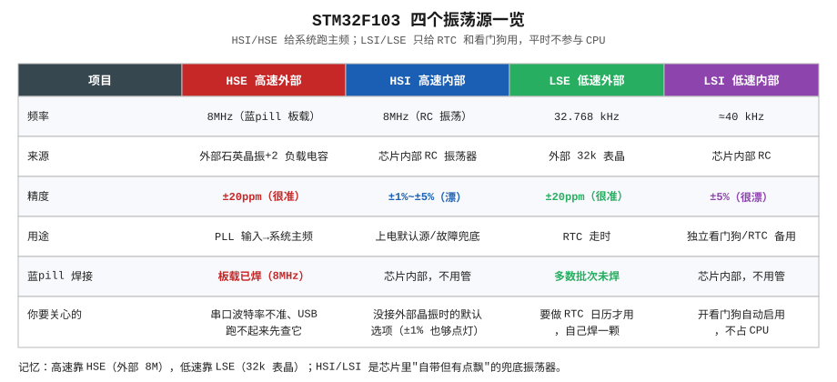
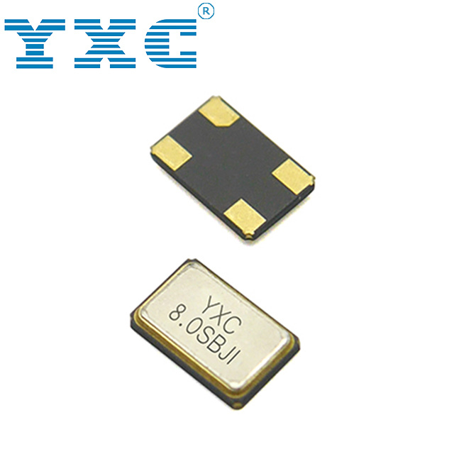
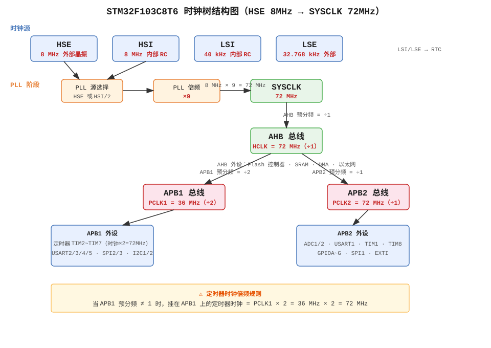
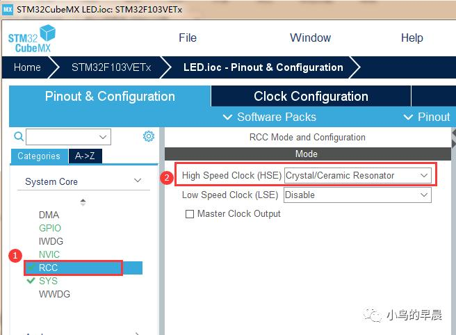
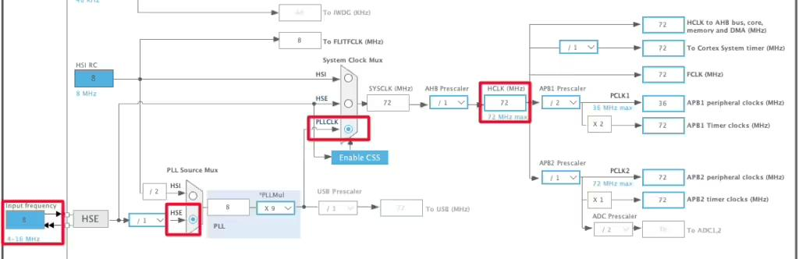
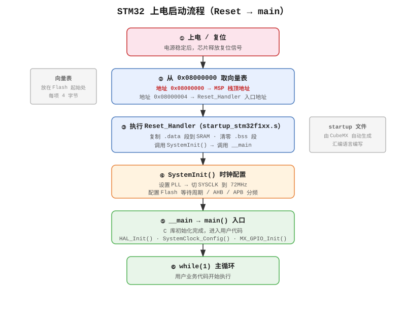
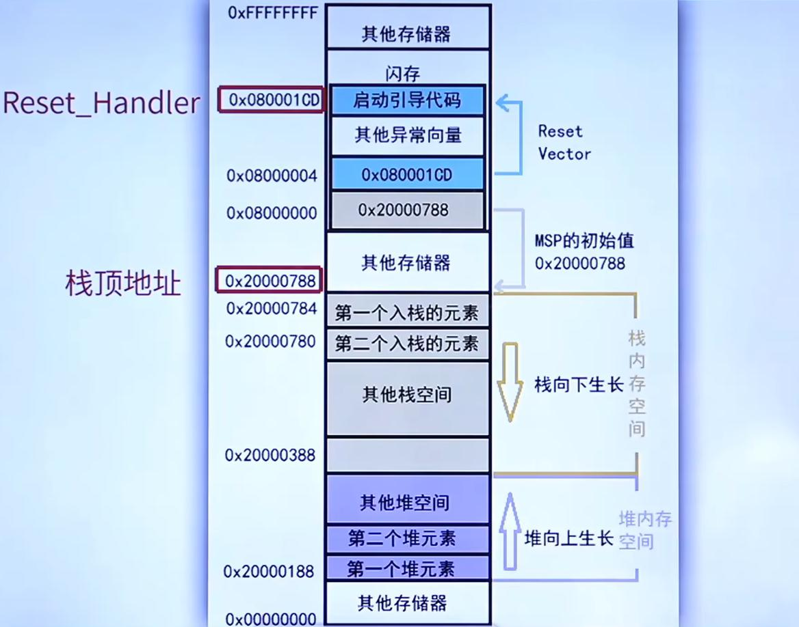
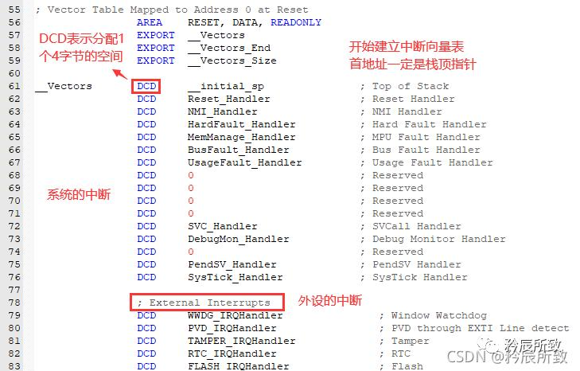
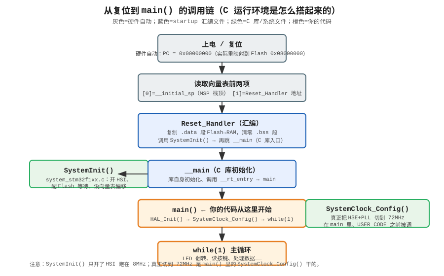
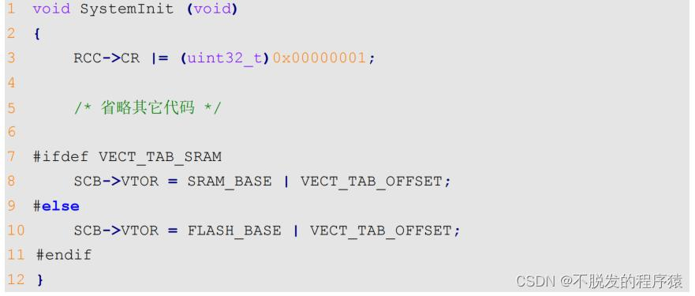

# 第4章 系统时钟树与启动流程

> **本章学习目标**
>
> 完成本章学习后，应能够：
>
> 1. 说明 STM32F103 四个振荡源（HSE/HSI/LSE/LSI）的特点与典型用途。
> 2. 描述从 HSE 8MHz 经 PLL×9 倍频至 SYSCLK 72MHz 的完整时钟路径，并推算 AHB/APB1/APB2 各总线频率。
> 3. 掌握"APB 预分频 ≠ 1 时定时器时钟 ×2"规则，说明为何 APB1=36MHz 而 TIM2/3/4 仍为 72MHz。
> 4. 描述从芯片复位到 main() 执行之间的完整启动流程，包括向量表、Reset_Handler、.data/.bss 段处理、SystemInit 与 SystemClock_Config 的分工。
> 5. 理解 BOOT0/BOOT1 引脚决定的三种启动方式及适用场合。
> 6. 解释 SysTick 与 HAL_Delay 的工作原理，说明中断中调用 HAL_Delay 为何会卡死。
> 7. 能够根据时钟树推算 USART 波特率分频系数。

本章讲解 STM32 从加电到稳定运行于 72MHz 的全过程。内容包括 8MHz 晶振如何倍频为 72MHz、APB1 为何为 36MHz 而挂接其上的定时器却跑 72MHz、main() 执行前芯片完成了哪些初始化。本章是后续定时器、串口、PWM、ADC 等章节的基础——时钟配置错误将导致后续所有外设配置出错。

初学者调试串口时常遇到"波特率设为 115200、串口助手接收全是乱码"的现象。其常见原因是 CubeMX 中未开启 HSE，芯片一直使用内部精度较低的 HSI（8MHz±5%）运行，PLL 倍频后的实际主频并非 72MHz，串口波特率计算结果自然偏差较大。将 HSE 切换后乱码即消失。由此可得一条经验：**STM32 外设能否正常工作，很大程度上取决于时钟配置是否正确**。

---

## 4.1 时钟在单片机中的作用

单片机并非自由运行的 CPU，而是一台**严格跟随节拍器**工作的器件。芯片内部存在持续振荡的方波，每一拍执行一件事——CPU 取一条指令、定时器加一数、串口移一位数据。该节拍器即时钟。

时钟频率直接决定以下模块的工作节奏：

- **CPU 运行速度**：72MHz 意味着每秒可完成 7200 万个时钟周期，Cortex-M3 大致每个周期执行一条指令（不等长指令）。
- **定时器精度**：定时器本质即"数时钟个数"。时钟为 72MHz 时，数 72000 个周期即 1ms。时钟错误则定时错误。
- **串口波特率准确性**：串口依靠收发双方按约定速度逐位传输。双方时钟偏差 2% 即产生乱码。
- **PWM 频率**：PWM 周期 = 定时器时钟 / (ARR+1)。定时器时钟变化则 PWM 频率随之变化。
- **ADC 采样速率**：ADC 亦由时钟驱动，时钟决定每秒采样点数。

STM32 的时钟结构不同于 Arduino"板上一颗晶振、所有模块共用"的简单设计。它采用**时钟树（Clock Tree）**结构：一个主振荡源经分频、倍频、多路选择器，如同水流一般分配到芯片内各外设。开发者需在 CubeMX 中将时钟树各分支配置到正确位置。

---

## 4.2 四个振荡源

F103 共有四个独立振荡源（外加一个用于倍频的 PLL）。各源特点与用途如下。



### 4.2.1 HSE——高速外部晶振

HSE = High-Speed External，即**外部高速晶振**。它是一颗焊接在开发板上的石英晶体，Blue Pill 采用 8MHz 封装：



开发板上银色长条、旁侧配两颗 20pF 小电容的元件即为此晶振。石英晶体在电激励下以极高稳定度的机械频率振动——8.000000MHz 即每秒精确振荡 800 万次，误差通常仅 ±20ppm（百万分之二十），每日累计误差不到两秒。

采用外部晶振而非内部振荡器的原因在于**精度**。串口通信、USB 通信、RTC 走时等场合对时钟精度要求较高，内部 RC 振荡器的漂移量无法满足。因此正式产品基本均使用 HSE。

### 4.2.2 HSI——高速内部 RC

HSI = High-Speed Internal，即**芯片内部自带的 RC 振荡器**。不依赖外部元件，上电默认运行于约 8MHz。

需注意"约"字的含义。HSI 由电阻电容充放电电路构成，频率随温度、电压漂移，出厂校准后约 ±1%，温度变化时可能漂移至 ±5%。LED 闪烁、呼吸灯等对时间精度要求不高的场合使用 HSI 足够；但串口、USB 等场合不应使用。

HSI 的主要作用是**上电默认时钟源与故障兜底**。芯片刚复位时 HSE 尚未起振（晶振起振需数毫秒稳定时间），CPU 先运行于 HSI，待系统配置完成后再切换至 HSE。若 HSE 损坏或未焊接晶振，芯片仍可退回 HSI 继续运行——这也是"忘记开 HSE 仍能点亮 LED、但串口不准"的原因。

### 4.2.3 LSE——低速外部 32.768kHz 表晶

LSE = Low-Speed External，即**外部低速晶振**。频率为 32.768kHz，即石英手表中使用的表晶。32768 = 2^15，经 15 次二分频后恰好得到 1Hz，便于秒计时。

其主要用途是为 **RTC（实时时钟）**提供走时基准——需要断电后仍能继续运行的日历功能即依赖此晶振。Blue Pill 多数批次**未焊接此晶振**（PCB 上留有焊盘但为空）。使用 RTC 功能需自行焊接。

### 4.2.4 LSI——低速内部 RC

LSI = Low-Speed Internal，即芯片内部低速 RC 振荡器，频率约 40kHz（范围 30~60kHz，精度较差）。

它专为**独立看门狗（IWDG）**设计——看门狗需在主时钟失效时仍能独立计数复位 CPU，因此不能使用主时钟源。LSI 即使系统主时钟崩溃仍持续运行，看门狗依靠其超时复位。LSI 亦可作为 RTC 备用时钟，但精度较差，日历每日可漂移数秒。

---

## 4.3 PLL：将 8MHz 倍频为 72MHz 的锁相环

获得 HSE 的 8MHz 后，如何得到 CPU 所需的 72MHz？直接使用 72MHz 晶振理论可行，但成本较高——高频石英晶振不仅价格贵，稳定性亦不如低频晶振。因此芯片内部集成了 **PLL（Phase-Locked Loop，锁相环）**电路。

其原理可简述为：PLL 是一个"自动跟踪+倍频"电路。给定 8MHz 参考输入，内部压控振荡器（VCO）运行于较高频率，反馈电路自动比较"输出频率除以 N"是否等于输入频率。若不等则微调 VCO，直至相等——此时输出即为输入的 N 倍。

F103 的 PLL 倍频系数 PLLMUL 可选范围为 ×2 至 ×16。本课程使用 **×9**：

```
HSE 8MHz ──► PLL 输入 ──► PLL ×9 ──► PLLCLK = 72MHz
```

PLL 锁定需一定时间（数百微秒量级），因此启动流程中需等待 PLL RDY 标志。HAL 库的 `HAL_RCC_OscConfig` 内部自动完成等待，无需用户干预。

F103 有一项硬限制：PLL 输入频率**不得超过 12MHz**，PLL 输出频率**不得超过 72MHz**。因此本配置选择 8MHz × 9 = 72MHz，而非 8 × 16 = 128MHz——后者超出芯片承受范围。

---

## 4.4 时钟树全景

综合上述模块，即构成 F103 的完整时钟树。该图在 CubeMX 中常见：



从上到下走一遍：

```
        HSE 8MHz ─┐
                  ├─► PLL ×9 ──► PLLCLK 72MHz ─┐
        HSI 8MHz ─┘                             │
                                                ▼
                                          SYSCLK (系统时钟)
                                                │
                                                ▼
                                          AHB 分频器 /1
                                                │
                                                ▼
                                          HCLK = 72MHz  ← CPU、内核、内存、DMA
                                                │
                          ┌─────────────────────┼─────────────────────┐
                          ▼                     ▼                     ▼
                    APB1 分频 /2           APB2 分频 /1            Cortex SysTick
                          │                     │                     │
                    PCLK1 = 36MHz        PCLK2 = 72MHz         (HCLK 八分频=9MHz)
                          │                     │
              TIM2/3/4 ×2=72MHz         TIM1 = 72MHz
              USART2/3 = 36MHz          USART1 = 72MHz
              I2C1/2 = 36MHz            SPI1 = 72MHz
              SPI2 = 36MHz              GPIOA/B/C
              ADC = 36/6 = 6MHz
```

其中最易出错的规则需单独说明——

### 4.4.1 APB 定时器时钟的"×2 规则"

由上图可见 APB1 分频为 /2 → PCLK1 = 36MHz。但挂接在 APB1 上的通用定时器 TIM2/TIM3/TIM4，其时钟**并非 36MHz，而是 72MHz**。

这并非笔误，而是 ST 芯片的硬件规则：

> **当 APB 预分频系数 = 1（不分频）时，该总线上定时器时钟 = PCLKx；当 APB 预分频系数 ≠ 1（即被分频）时，该总线上定时器时钟 = PCLKx × 2。**

此设计的原因是：定时器需要更高分辨率（更细计时粒度）。既然 APB1 已分频至 36MHz，定时器内部"再乘 2"恢复至 72MHz，使定时器计数基准与全芯片统一的 72MHz 一致，便于周期计算。

APB2 分频为 /1（PCLK2 直接 = 72MHz），不满足"分频系数 ≠ 1"条件，因此定时器时钟即为 PCLK2 = 72MHz，无需 ×2。

结论：**在 72MHz 配置下，F103 所有定时器时钟均为 72MHz**。此规律极为重要——第 6 章计算定时器周期时，应记住"所有通用定时器均跑 72MHz"，否则 TIM2 与 TIM1 的计算结果将不一致。

### 4.4.2 其他易忽略的规则

- **SysTick**：默认从 HCLK 八分频获取时钟。HCLK=72MHz 时，SysTick 时钟 = 9MHz。但 HAL 库默认将 SysTick 配置为"HCLK 直接作为时钟"（不分频），因此 `HAL_Delay` 实际按 72MHz 计数。此细节在 4.7 节验证 72MHz 时将用到。
- **ADC 时钟**：挂接在 APB2 上，需再次分频，最高 14MHz（实际配置约 72/6=12MHz）。
- **USB**：F103 的 USB 外设要求精确 48MHz 时钟。PLLCLK=72MHz 经 /1.5 分频恰好 48MHz——这就是 USB 必须运行于 72MHz（而非 64、48MHz）的原因。使用 USB 功能时主频无其他选择。
- **MCO**：PA8 可配置为"时钟输出引脚"，将 SYSCLK/HSI/HSE/PLL 四分频之一引出，供示波器测量。这是后续验证 72MHz 的关键手段。

---

## 4.5 CubeMX 中的时钟配置

原理讲解完毕，实际操作仅需两步。

### 4.5.1 第一步：在 RCC 中使能 HSE

许多初学者时钟配置失败，第一步即遗漏此项。CubeMX 默认不知道开发板上是否存在外部晶振。需进入 **RCC → Mode** 手动开启：



在左侧 Categories 中选择 `System Core → RCC`，将 **High Speed Clock (HSE)** 改为 `Crystal/Ceramic Resonator`。此操作即告知芯片："PD0/PD1 这两个引脚不作为 GPIO 使用，已在外部连接 8MHz 晶振，请使用之。"

未开启此项时，Clock Configuration 中 HSE 无法填入数值，CubeMX 不识别外部晶振。此即前文所述"串口全是乱码"的根源——许多教程直接引导进入 Clock Configuration，却忽略了开启 RCC。

### 4.5.2 第二步：在 Clock Configuration 中将频率配至 72

切换至 **Clock Configuration** 标签页，可见可视化时钟树。操作顺序：

1. **HSE (MHz)** 栏填 `8`（Blue Pill 板载晶振为 8MHz）。
2. **PLL Source Mux** 选 `HSE`。
3. **PLLMul** 选 `×9`（8 × 9 = 72）。
4. **System Clock Mux** 选 `PLLCLK`。
5. **HCLK (MHz)** 填 `72`。CubeMX 自动计算 APB1 需 /2、APB2 需 /1。
6. 顶部"To Cortex System Timer / AHB Prescaler / APB1 / APB2"行全部变为绿色（非红色）即配置成功。



该界面中所有黄色输入框均可点击，CubeMX 会自动检查组合合法性。例如将 HCLK 填为 108，将标红提示"F103 最高仅 72MHz"。

---

## 4.6 从加电到 main() 之前的启动流程

时钟配置讲解完毕，接下来讨论另一主题：芯片从通电到 `main()` 函数执行之间发生了什么？此过程称为**启动流程（Boot / Startup）**。



许多使用者长期开发 STM32 却未关注 main 之前的过程——这并无问题，CubeMX 已自动配置。但进行较深入调试（如栈溢出、向量表偏移、从 RAM 启动）时，不了解启动流程将难以排查。以下完整梳理。

### 4.6.1 第一步：硬件复位，PC 指向向量表

上电或按 RESET 后，Cortex-M3 内核自动执行两项操作（硬件行为，非代码）：

1. 将**栈指针 MSP** 初始化为向量表第一个 32 位字。
2. 将**程序计数器 PC** 初始化为向量表第二个 32 位字——即 Reset_Handler 的地址。

向量表位于 Flash 起始处，地址从 `0x08000000` 开始（F103 的 Flash 起始地址）。但内核复位后默认从 `0x00000000` 开始取指——此处存在"地址重映射"：芯片硬件将 `0x00000000` 映射至 `0x08000000`（从 Flash 启动时），因此内核读取的"第一个字"实际即 Flash 开头的栈顶值。



如上图所示，Flash 开头布局：

```
地址 0x08000000  ──►  初始 MSP  = 0x20000500 （栈顶，从 RAM 高地址往下长）
地址 0x08000004  ──►  Reset_Handler 地址 = 0x0800xxxx
地址 0x08000008  ──►  NMI_Handler
地址 0x0800000C  ──►  HardFault_Handler
...                   （后面全是各种中断向量）
```

### 4.6.2 向量表结构——startup_stm32f103x8.s

向量表非手工填写，而是在启动文件 `startup_stm32f103x8.s` 中用汇编定义。该文件位于 CubeMX 工程的 `Core/Startup/` 目录下。其开头部分如下：



```asm
__Vectors       DCD     __initial_sp        ; 顶栈地址（MSP 初始值）
                DCD     Reset_Handler       ; 复位向量
                DCD     NMI_Handler         ; NMI
                DCD     HardFault_Handler   ; 硬件错误
                DCD     MemManage_Handler
                DCD     BusFault_Handler
                DCD     UsageFault_Handler
                ...
                DCD     EXTI0_IRQHandler    ; 外部中断线 0
                DCD     EXTI1_IRQHandler
                ...
__Vectors_End
```

`DCD` 即"Define Constant Doubleword"——在 Flash 中放置一个 32 位数。`__initial_sp` 为链接脚本定义的栈顶地址（默认 0x20000500），其后一排均为各中断服务函数地址。

每个位置对应固定中断号。当某外设中断触发时，CPU 自动跳转至该表对应项，获取函数地址并执行。这也解释了为何在 NVIC 中使能某中断却未编写对应 Handler 函数时，芯片会跑飞——向量表中该地址为 Weak 定义的死循环。

### 4.6.3 Reset_Handler 的工作

Reset_Handler 为向量表第二项，是 CPU 复位后第一个真正执行的函数。它位于启动文件中，完成三项工作：

```asm
Reset_Handler   PROC
                EXPORT  Reset_Handler
                IMPORT  __main               ; C 库入口
                IMPORT  SystemInit           ; 系统初始化（配时钟）

                ; 1. 把 .data 段从 Flash 拷贝到 RAM
                LDR     R0, =_sidata          ; .data 在 Flash 里的源地址
                LDR     R1, =_sdata           ; .data 在 RAM 里的目的地址
                LDR     R2, =_edata
CopyData        CMP     R1, R2
                BCC     CopyDataLoop
                B       CopyDataEnd
CopyDataLoop    LDR     R3, [R0], #4
                STR     R3, [R1], #4
                B       CopyData
CopyDataEnd

                ; 2. 把 .bss 段清零
                LDR     R1, =_sbss
                LDR     R2, =_ebss
                MOVS    R3, #0
ZeroBss         CMP     R1, R2
                BCC     ZeroBssLoop
                B       ZeroBssEnd
ZeroBssLoop     STR     R3, [R1], #4
                B       ZeroBss
ZeroBssEnd

                ; 3. 先调 SystemInit 配时钟，再跳进 C 库 __main
                LDR     R0, =SystemInit
                BLX     R0
                LDR     R0, =__main
                BX      R0
                ENDP
```

三项工作的说明：

**拷贝 .data 段**：C 代码中"已初始化的全局变量"（如 `int counter = 42;`），其初始值 42 存储于 Flash，但运行时需存放于 RAM（因要修改）。因此启动时须将 Flash 中的初始值原样拷贝至 RAM。未拷贝时全局变量初始值为随机值。

**清零 .bss 段**：C 代码中"未初始化的全局变量"和"初始化为 0 的全局变量"（如 `int buffer[100];`）。C 标准规定这些变量开机必须为 0。Flash 中无需存储一长串 0，因此启动文件负责将该段 RAM 清零。

**调用 SystemInit，再跳转 __main**：SystemInit 为 ST 提供的系统初始化函数，后续详细讨论；__main 为 ARM C 库入口，完成库自身初始化后调用用户 main()。

### 4.6.4 完整调用链

综合上述环节，完整调用链如下：



有一极易混淆的点需注意：**SystemInit() 并非将系统切换至 72MHz 的函数**。它仅打开最基本时钟（HSI 8MHz）、配置 Flash 等待周期、告知内核向量表地址。真正切换至 HSE+PLL 72MHz 的代码，是在 main() 开头由 CubeMX 自动调用的 `SystemClock_Config()`。

即从 Reset_Handler 到进入 main() 这段时间，芯片实际仍运行于 8MHz HSI。main 中 `SystemClock_Config()` 执行完毕后，才真正切换至 72MHz。

---

## 4.7 SystemInit 与 SystemClock_Config 的配置内容

打开 `Core/Src/system_stm32f1xx.c`，定位 `SystemInit()`：



```c
void SystemInit(void)
{
  /* 1. 把 RCC 配置全部复位成默认值 */
  RCC->CR |= (uint32_t)0x00000001U;       /* 打开 HSION，HSI 当默认源 */
  RCC->CFGR = 0x00000000U;                /* 所有分频清零 */

  /* 2. 关闭 PLL、HSE、CSS，关闭所有外设时钟（省电） */
  RCC->CR  &= (uint32_t)0x00083FFFU;
  RCC->CIR  = 0x00000000U;                /* 关所有 RCC 中断 */

  /* 3. 根据宏选择向量表位置 */
#ifdef VECT_TAB_SRAM
  SCB->VTOR = SRAM_BASE | VECT_TAB_OFFSET;
#else
  SCB->VTOR = FLASH_BASE | VECT_TAB_OFFSET;   /* 向量表在 Flash 开头 */
#endif

  /* 4. 复位前先把 Flash 等待周期配成合适的（后面 PLL 开了要改） */
  FLASH->ACR &= ~FLASH_ACR_LATENCY;
  FLASH->ACR |= FLASH_ACR_LATERY_2;       /* 72MHz 需要 2 个等待周期 */
}
```

其工作较为克制——将芯片恢复至干净的初始状态（HSI 8MHz），等待 main() 中进一步配置。

真正"切换至 72MHz"的代码位于 `main.c` 的 `SystemClock_Config()`：

```c
void SystemClock_Config(void)
{
  RCC_OscInitTypeDef RCC_OscInitStruct = {0};
  RCC_ClkInitTypeDef RCC_ClkInitStruct = {0};

  /* ① 打开 HSE，开 PLL，PLL 源选 HSE，倍频 ×9 */
  RCC_OscInitStruct.OscillatorType = RCC_OSCILLATORTYPE_HSE;
  RCC_OscInitStruct.HSEState       = RCC_HSE_ON;
  RCC_OscInitStruct.HSEPredivValue = RCC_HSE_PREDIV_DIV1;   /* 不分频 */
  RCC_OscInitStruct.HSIState       = RCC_HSI_ON;            /* 留着 HSI 兜底 */
  RCC_OscInitStruct.PLL.PLLState   = RCC_PLL_ON;
  RCC_OscInitStruct.PLL.PLLSource  = RCC_PLLSOURCE_HSE;
  RCC_OscInitStruct.PLL.PLLMUL     = RCC_PLL_MUL9;          /* 8 × 9 = 72 */
  if (HAL_RCC_OscConfig(&RCC_OscInitStruct) != HAL_OK)
  {
    Error_Handler();
  }

  /* ② 切系统时钟到 PLL，配 AHB/APB 分频 */
  RCC_ClkInitStruct.ClockType = RCC_CLOCKTYPE_HCLK | RCC_CLOCKTYPE_SYSCLK
                              | RCC_CLOCKTYPE_PCLK1 | RCC_CLOCKTYPE_PCLK2;
  RCC_ClkInitStruct.SYSCLKSource   = RCC_SYSCLKSOURCE_PLLCLK;  /* 系统时钟用 PLL */
  RCC_ClkInitStruct.AHBCLKDivider  = RCC_SYSCLK_DIV1;          /* HCLK = 72 */
  RCC_ClkInitStruct.APB1CLKDivider = RCC_HCLK_DIV2;            /* PCLK1 = 36 */
  RCC_ClkInitStruct.APB2CLKDivider = RCC_HCLK_DIV1;            /* PCLK2 = 72 */
  if (HAL_RCC_ClockConfig(&RCC_ClkInitStruct, FLASH_LATENCY_2) != HAL_OK)
  {
    Error_Handler();
  }
}
```

其中 `FLASH_LATENCY_2` 参数需特别说明。F103 的 Flash 读取速度有限：CPU 在 24MHz 以下可零等待读取 Flash；24~48MHz 需 1 个等待周期；48~72MHz 需 **2 个等待周期**。原因是 Flash 物理读取需一定时间，CPU 过快会读到旧数据。CubeMX 自动配置为 `FLASH_LATENCY_2`，手写时钟配置时切勿遗漏，否则高速运行时将跑飞或读到错误指令。

---

## 4.8 验证 72MHz 配置

配置完成后，如何确认系统确实运行于 72MHz？以下三种方法由简至繁。

### 4.8.1 用 HAL_GetTick() 粗测

`HAL_GetTick()` 返回系统嘀嗒数（毫秒）。编写代码使 LED 翻转，中间调用 `HAL_Delay(1000)`，肉眼观察每秒翻转次数。若时钟配置错误（例如仍运行于 HSI 8MHz 而非 72MHz），延时将变为原来的 9 倍——LED 一秒翻转一次变为九秒才翻转一次，即可直观看出。

更精确的方法：在代码中读取一次 `HAL_GetTick()`，执行一段已知耗时操作后再读一次，比较差值。

### 4.8.2 调试器查看 RCC 寄存器

接 ST-Link 进入 Debug，打开寄存器窗口查看 RCC->CFGR：

- `SWS[1:0]`（系统时钟切换状态位）应为 `10`，表示当前使用 PLL。
- `SWS` 不为 10 时，说明仍运行于 HSI（00）或 HSE（01），PLL 切换未成功。

此方法最快，但需接调试器。

### 4.8.3 MCO 引脚输出时钟，用示波器测量（最可靠）

此方法最可靠。在 CubeMX 中将 **PA8** 配置为 `MCO`（Microcontroller Clock Output），选择待输出时钟源。代码中：

```c
HAL_RCC_MCOConfig(RCC_MCO1, RCC_MCO1SOURCE_SYSCLK, RCC_MCODIV_1);
```

（F103 为 MCO，非 MCO1，具体宏以所用 HAL 版本为准。）

配置后 PA8 引脚直接输出 SYSCLK 方波。示波器测量：

- 测得 72MHz 方波 → 系统时钟确为 72MHz。
- 测得 8MHz → 仍运行于 HSI，PLL 未切换成功。
- 测得约 8MHz 但非整数 → HSE 未起振或外部晶振未焊接好。

若无示波器，可用频率计。再无设备时，可将 MCO 接至另一块 STM32 的输入捕获引脚测量——属"用芯片测芯片"的方法，但切实可行。

### 4.8.4 串口波特率的时钟推算

时钟树讲完后，用一个具体实例加以应用——以此说明时钟错误为何导致串口乱码。

USART1 挂接在 APB2 上，PCLK2 = 72MHz。其内部波特率发生器时钟源即 PCLK2。目标波特率 115200 bit/s，芯片需将 72MHz 分频多少次？

```
USARTDIV = 72,000,000 / (16 × 115200) ≈ 39.06
```

该 39.06 被拆分为整数部分（39）与小数部分（0.06），写入 USART_BRR 寄存器。实际波特率 = 72MHz / (16 × 39.06) ≈ 115200。

假设未开启 HSE，芯片仍运行于 HSI。HSI 为 8MHz，但因 PLL 未切换成功，SYSCLK 实际为 8MHz（而非 72MHz）。HAL 库不知此情况——它仍假定系统为 72MHz，按 72MHz 计算 BRR，分频系数按 72MHz 配置，但实际芯片时钟仅 8MHz。实际波特率 = 8MHz / (16 × 39.06) ≈ **12800 bit/s**。

电脑端串口助手仍按 115200 接收，芯片却按 12800 发送——相差 9 倍，自然全为乱码。此即前文所述现象的数学本质。

因此应记住：**所有外设配置均基于"系统时钟为某值"的假设计算。时钟一变，所有外设寄存器均需重新计算。** CubeMX 自动完成计算，但使用者应理解其计算依据。

---

## 4.9 BOOT0 引脚与启动方式

前文一直称"CPU 从 Flash 0x08000000 开始取指"。实际上 F103 有三种启动方式，由 BOOT0 与 BOOT1 两个引脚电平决定：

| BOOT0 | BOOT1 | 启动位置 | 用途 |
|---|---|---|---|
| 0 | x | 主 Flash（0x08000000） | 正常运行用户程序 |
| 1 | 0 | 系统存储器（0x1FFFF0000） | 出厂内置串口 bootloader，用于串口烧录 |
| 1 | 1 | 内嵌 SRAM（0x20000000） | 调试用，较少使用 |

Blue Pill 板上 BOOT0 为跳线帽。平时位于"0"位置，从 Flash 运行用户程序。若拨至"1"再按复位，芯片进入出厂内置 bootloader，此时可通过 USB-TTL 模块经串口直接烧录程序——**这是 ST-Link 丢失或 SWD 焊死时的烧录手段**。烧录后须拨回 0，否则下次复位仍进入 bootloader，用户程序看似"不运行"。

第 2 章提到"芯片连不上时将 BOOT0 拨到 1"，即为此原理——进入 bootloader 后芯片处于干净状态，ST-Link 可重新连接。

---

## 4.10 .data / .bss / 堆 / 栈：RAM 布局

Reset_Handler 拷贝 .data、清零 .bss 这一过程，背后涉及 RAM 布局。F103C8T6 有 20KB SRAM，从 `0x20000000` 开始。链接脚本将其划分为若干区域：

```
0x20000000 ┌─────────────┐
           │   .data 段    │  已初始化全局变量（从 Flash 拷过来）
           ├─────────────┤
           │   .bss 段     │  未初始化/零初始化全局变量（启动时清零）
           ├─────────────┤
           │   堆 heap     │  malloc 用，从低往高长
           │   (向上长)    │
           │             │
           │   (空闲)     │
           │             │
           │   (向下长)    │
           │   栈 stack    │  函数局部变量、返回地址
0x20005000 └─────────────┘
```

栈从高地址 `0x20005000` 向下生长（每次函数调用压栈），堆从低地址向上生长（malloc 扩展）。两者相撞即"栈溢出"——这是嵌入式系统中最难排查的 bug 之一，常表现为"运行正常后突然随机死机"。

启动文件中 `__initial_sp = 0x20005000` 即栈顶初始值，MSP 复位后即设至此值。每调用一层函数、每进入一次中断，栈即向下"压"一节。

---

## 4.11 SysTick：HAL_Delay 的时钟来源

`HAL_Delay(500)` 上一章已多次使用，它如何知道经过了 500ms？答案是 SysTick。

SysTick 是 Cortex-M3 内核自带的 24 位倒计时定时器，专为操作系统提供"心跳"。HAL 库在 `HAL_Init()` 中将其配置为每 1ms 中断一次，每次中断将全局变量 `uwTick` 加 1。`HAL_Delay(n)` 的工作过程为：记录当前 `uwTick` 值，然后循环等待 `uwTick` 增加 n 次。

```c
void HAL_Delay(uint32_t Delay)
{
  uint32_t tickstart = HAL_GetTick();
  uint32_t wait = Delay;
  while ((HAL_GetTick() - tickstart) < wait)
  {
    ;   /* 啥也不干，等 SysTick 中断把 uwTick 加上去 */
  }
}
```

SysTick 时钟源默认为 HCLK（72MHz）。每 1ms 中断一次即每数 72000 个周期触发一次中断——该数值为重装载值，由 HAL 自动计算。

此处有一**关键注意事项**：若在中断服务函数中调用 `HAL_Delay()`，程序将卡死。原因是 SysTick 中断优先级低于普通中断，在中断中死等 `uwTick` 增加，而 `uwTick` 需由 SysTick 中断累加——SysTick 中断被高优先级中断阻塞，永远无法进入，`uwTick` 永不增长，`HAL_Delay` 永远等待不到。这正是"中断中不能使用 HAL_Delay"的原因。第 6 章定时器中断章节将反复遇到此问题。

---

## 4.12 常见错误与排查

**错误 1：RCC 中 HSE 未开启，全程使用 HSI。** 最为经典。症状为"LED 正常、串口乱码、USB 无法枚举"。回 CubeMX 检查 RCC → HSE 是否为 `Crystal/Ceramic Resonator`。

**错误 2：HSE 输入频率未修改。** 若开发板晶振非 8MHz（例如换为 12MHz），CubeMX 中仍填 8，则 PLL 倍频后的实际频率全部错误。晶振表面一般印有频率，应据此填写。

**错误 3：APB1 分频误填为 /1。** F103 有硬规定：APB1 最高 36MHz，不能运行于 72MHz。在 Clock Configuration 中将 APB1 分频填为 1 时，CubeMX 会标红。强行配置可能导致芯片不工作或跑飞。

**错误 4：修改主频后外设未重新计算。** 定时器 PSC、ARR、串口波特率分频等均基于"假设 HCLK=72MHz"计算。若将主频改为 48MHz，这些外设的实际频率全部随之变化——定时器变慢、串口偏移。修改时钟前应先明确哪些外设需重新配置。

**错误 5：代码开启 HSE，但 HSE 未起振导致程序卡死。** 若开发板未焊接外部晶振（部分 Blue Pill 批次焊盘为空），CubeMX 配置 HSE 后将一直等待 HSE 就绪，等待超时即卡在 `Error_Handler()`（死循环）。症状为"程序烧录后如同死机"。解决方法：要么焊接晶振，要么回 CubeMX 改回 HSI 作为系统时钟。

**错误 6：移植他人代码未修改 SystemClock_Config。** 他人使用 HSE 25MHz 晶振，而本开发板为 8MHz，照抄后 PLLMUL 仍为 ×?，倍频结果即错误。时钟配置必须针对本开发板的晶振频率重新配置。

**错误 7：PLL 输入频率超过 12MHz。** F103 的 PLL 输入有硬上限。若选择 HSE 16MHz 直接接入 PLL，芯片不保证正常工作。本课程使用的 8MHz 为安全值。

---

## 4.13 本章小结

- 四个振荡源：HSE（外部 8M，精度高）、HSI（内部 8M，漂移大）、LSE（外部 32.768k，供 RTC）、LSI（内部约 40k，供看门狗）。
- 时钟路径：HSE 8MHz → PLL ×9 → SYSCLK 72MHz → AHB /1 = 72MHz → APB1 /2 = 36MHz、APB2 /1 = 72MHz。
- **APB 定时器 ×2 规则**：APB 分频不为 1 时，该总线定时器时钟 = PCLK × 2。因此 F103 所有定时器在 72MHz 配置下均运行于 72MHz。
- 启动流程：复位 → 内核从 Flash 0x08000000 读取 MSP 和 Reset_Handler → Reset_Handler 拷贝 .data、清零 .bss → 调用 SystemInit（开 HSI、配 Flash 等待）→ __main → main() → SystemClock_Config()（真正切换至 72MHz）。
- 向量表位于 Flash 开头，每个中断号对应一个函数地址。中断服务函数即通过该表被 CPU 找到。
- 验证 72MHz：调 MCO 用示波器测量 PA8，或查看 RCC->CFGR 的 SWS 位。

### 练习题

1. Blue Pill 从 8MHz 晶振到 CPU 运行于 72MHz，中间经过哪些环节？画出该时钟树。
2. APB1 为 36MHz，为何挂接其上的 TIM2 能运行于 72MHz？
3. USART1 与 USART2 的总线时钟分别是多少？这会影响波特率配置吗？
4. 上电后到 main() 之前，CPU 运行于多少 MHz？由谁将其切换至 72MHz？
5. 向量表第一项与第二项分别存放什么？
6. 怀疑串口波特率不正确时，应首先检查什么？

---

下一章将进入 [第5章 按键输入与外部中断 EXTI](ch05_EXTI中断.md)——将 GPIO 从输出切换为输入，并引出 Cortex-M 最重要的概念之一：中断。

<!-- ===== 第4章 完 ===== -->
