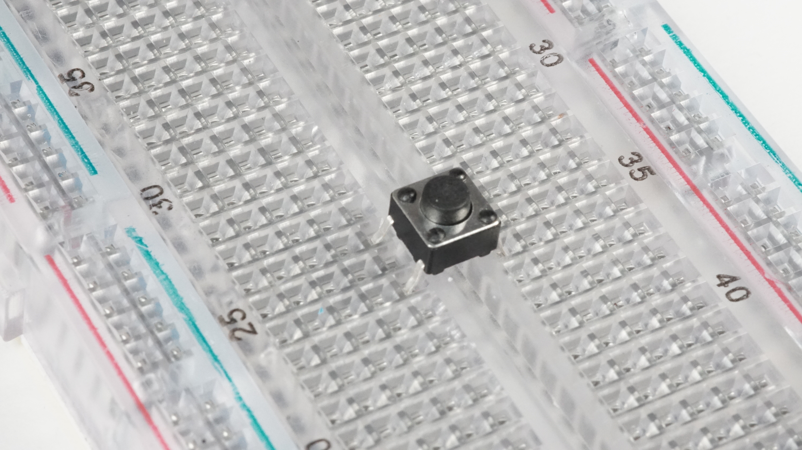
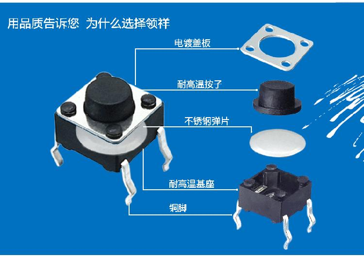
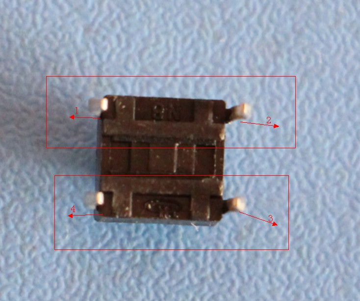
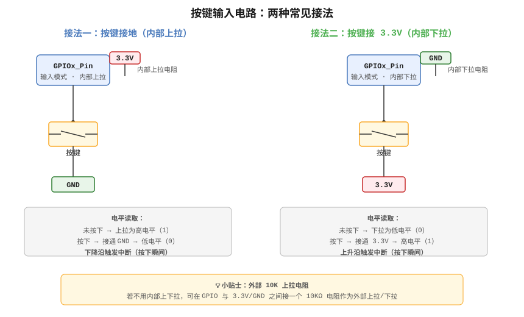
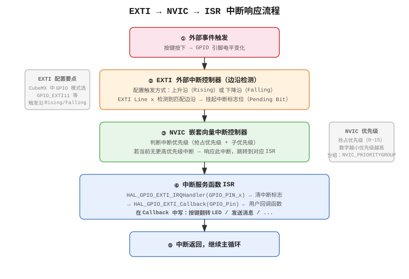
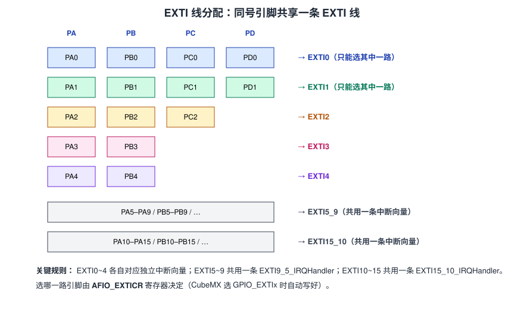
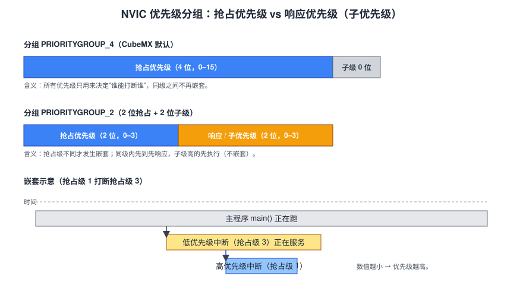
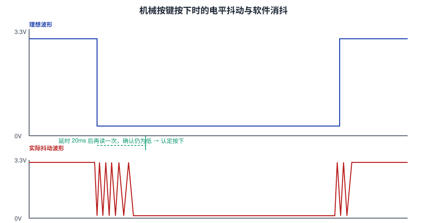
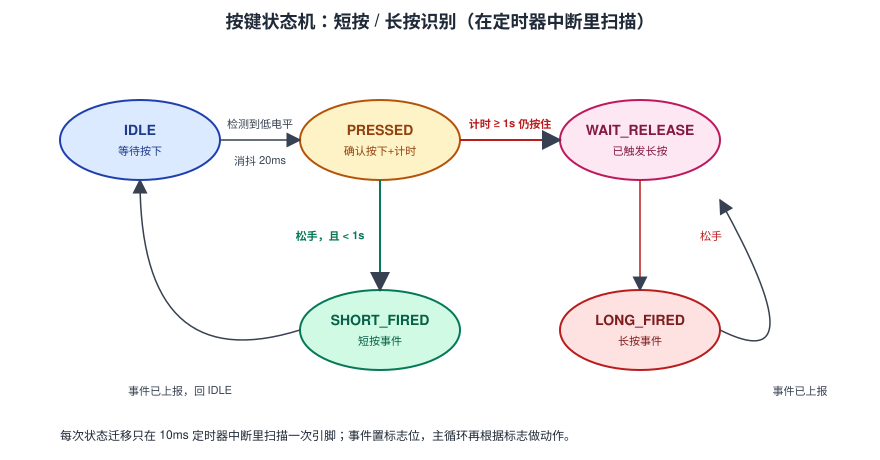

# 第5章 按键输入与外部中断 EXTI

## 本章学习目标

- 理解轻触开关的结构与上拉/下拉电路原理，能够正确接线并读取 GPIO 电平。
- 掌握轮询方式与中断方式在响应实时性上的差异，理解中断机制的硬件链条。
- 熟悉 CubeMX 配置 GPIO 外部中断的完整流程，掌握 HAL 库三层中断结构（`IRQHandler` → `HAL_xxx_IRQHandler` → `Callback`）的工作机制。
- 理解 EXTI 线的分配规则、AFIO 复用功能配置以及关键寄存器（IMR、RTSR、FTSR、PR）的作用。
- 掌握 NVIC 优先级分组（抢占优先级与子优先级）的概念与嵌套规则。
- 能够针对按键抖动问题，采用软件去抖动、定时器扫描或硬件 RC 滤波等方法加以处理。
- 了解长按、短按识别的状态机实现方法以及多按键、矩阵键盘的组织方式。

---

> 前四章介绍了 STM32 的输出功能——点亮 LED、配置时钟与串口。从本章开始，将介绍 STM32 如何"感知"外部事件：按下按键，LED 翻转；再次按下，LED 恢复。其背后所依赖的 **EXTI（External Interrupt）外部中断控制器** 与 **NVIC（Nested Vectored Interrupt Controller）嵌套向量中断控制器**，是后续所有"事件驱动"程序设计的硬件基础。

按键输入有两种基本实现方式：轮询与中断。轮询方式实现简单，但持续占用 CPU；中断方式由硬件自动响应事件，是嵌入式系统中处理外部事件的标准做法。本章将依次介绍按键电路、抖动处理、NVIC 优先级机制、HAL 库回调结构，并进一步介绍长按/短按等进阶状态机的写法。

---

## 5.1 按键输入的基本概念

### 5.1.1 轻触开关的结构





常见的 6×6mm、四脚元件称为 **轻触开关（Tactile Switch）**。其内部由两片金属弹片构成：未按下时两脚之间断开；按下时弹片受压导通；松开后弹片回弹。四脚并非四路独立——拆开观察，引脚 1 与 2 在内部连通，引脚 3 与 4 亦连通，因此本质上等效于一个两脚开关，另外两脚仅用于在面包板上稳定固定。



接线时任选一对（例如 1、3）接入电路即可，另一对悬空不影响电气特性。初学者常疑问：为何需要四根引脚？实际只使用其中一对即可。

### 5.1.2 上拉与下拉：确定引脚空闲电平



按键本身仅为一个开关，自身不产生电平。要使 MCU 的 GPIO 能够读出确定的 0 或 1，必须在引脚与电源/地之间接入一个电阻，将"未按下"时的电平钳位到一个确定值。

最常见的接法如下：

```
        3.3V
         │
        [R]  上拉电阻（10kΩ 最常用）
         │
  引脚 ──┼── 按键 ── GND
```

- **未按下**：按键断开，电阻将引脚拉至 3.3V → 读得高电平（`GPIO_PIN_SET`）。
- **按下**：按键导通，引脚直接接地 → 读得低电平（`GPIO_PIN_RESET`）。

亦可反接：按键接 3.3V，电阻下拉至 GND，此时"按下 = 高电平"。两种方式均可使用，仅逻辑相反而已。工程中常采用"按键接地 + 上拉"的接法，原因在于 GND 走线简短，且 STM32 的 GPIO 内部已集成上拉电阻，无需外部元件。

读取引脚电平的 HAL 函数为：

```c
GPIO_PinState HAL_GPIO_ReadPin(GPIO_TypeDef *GPIOx, uint16_t GPIO_Pin);
// 返回值是 GPIO_PIN_SET(1) 或 GPIO_PIN_RESET(0)
```

使用上的关键不在于"如何读取"，而在于"何时读取"。

### 5.1.3 轮询方式：实现简单但占用 CPU

最朴素的实现方式是在主循环中持续读取按键电平：

```c
while (1) {
  if (HAL_GPIO_ReadPin(GPIOA, GPIO_PIN_0) == GPIO_PIN_RESET) {
    HAL_GPIO_WritePin(GPIOC, GPIO_PIN_13, GPIO_PIN_RESET);  // 亮
  } else {
    HAL_GPIO_WritePin(GPIOC, GPIO_PIN_13, GPIO_PIN_SET);    // 灭
  }
}
```

该方式可以正常工作——按下时 LED 点亮，松开时熄灭。但存在两个显著问题：

1. **CPU 持续空转**。系统时钟运行在 72MHz，主循环反复执行 `ReadPin`，期间无法处理其他任务，是对 CPU 资源的浪费。
2. **响应受主循环阻塞影响**。若主循环中存在 `HAL_Delay(500)`、算法运算或串口等待等耗时操作，按键事件可能延迟数百毫秒才被检测到。

轮询方式的根本局限在于：**CPU 无法预知按键事件的发生时刻，只能通过反复查询来发现事件**。

### 5.1.4 中断方式：由硬件主动通知

中断的思路与轮询相反。程序不再主动查询引脚，而是预先配置 MCU：当 PA0 引脚出现高→低跳变时，由硬件暂停当前程序并跳转至中断服务函数。此后 CPU 可执行其他任务，事件发生时由硬件自动打断当前流程。

完整的硬件响应链条如下：

```
引脚电平出现边沿（上升沿 / 下降沿）
   └─► EXTI 控制器检测到这个边沿
        └─► 在 EXTI 挂起寄存器（PR）上置一个标志
             └─► NVIC 把这个事件转成一个中断号
                  └─► Cortex-M 内核暂停当前程序
                       └─► 跳转到对应的中断服务函数 ISR
                            └─► 我们写的回调被执行
                                 └─► 执行完回到断点，继续原程序
```



该机制的优势在于：**平时 CPU 执行自身任务，事件发生时由硬件自动响应，时间精度可达微秒级**。

---

## 5.2 实操一：轮询方式（快速验证）

先实现最简版本，建立基本操作流程。

### 5.2.1 CubeMX 配置

打开已有工程，执行以下配置：

1. **PC13** → 已配置为 `GPIO_Output`（连接板载 LED），无需修改。
2. **PA0** → 选择 `GPIO_Input`。
3. 切换至 `GPIO` 标签页，单击 PA0 所在行，将 `GPIO Pull-up/Pull-down` 设置为 `Pull-up`（内部上拉，配合按键接地使用）。
4. 重新生成代码。

> 需特别说明：STM32 内部上拉电阻的阻值约为 30~50kΩ，略大于外部常用的 10kΩ。日常应用中已足够；但若按键走线较长或环境干扰较大，建议外部增加 10kΩ 上拉电阻以提高可靠性。

### 5.2.2 代码实现

完整代码见 `code/ch05_button_poll.c`，核心部分如下：

```c
/* USER CODE BEGIN 2 */
HAL_GPIO_WritePin(GPIOC, GPIO_PIN_13, GPIO_PIN_SET);  /* 初始熄灭 */
/* USER CODE END 2 */

while (1)
{
  /* USER CODE END WHILE */

  /* 读 PA0：按下 → 低电平 → 点亮 */
  if (HAL_GPIO_ReadPin(GPIOA, GPIO_PIN_0) == GPIO_PIN_RESET)
  {
    HAL_GPIO_WritePin(GPIOC, GPIO_PIN_13, GPIO_PIN_RESET);
  }
  else
  {
    HAL_GPIO_WritePin(GPIOC, GPIO_PIN_13, GPIO_PIN_SET);
  }

  /* USER CODE BEGIN 3 */
}
```

烧录后即可验证：按下按键 LED 点亮，松开熄灭。至此已完成按键电平的读取。

需要进一步思考一个问题：**若在 `while(1)` 中加入 `HAL_Delay(200)`，再次按下按键，LED 将延迟约 200ms 才响应**。这正是轮询方式的固有代价。下一节将实现中断版本，以消除这种延迟。

---

## 5.3 实操二：外部中断方式（按键按下翻转 LED）

功能目标调整为：**每按一次按键，LED 翻转一次状态**。这是具有完整交互逻辑的典型用法。

### 5.3.1 CubeMX 配置（在轮询基础上增加三步）

1. 选择 **PA0**，本次配置为 `GPIO_EXTI0`。
2. 切换至 `GPIO` 标签页，单击 PA0 所在行：
   - `GPIO mode` 选择 `External Interrupt Mode with Falling edge trigger detection`（下降沿触发——即高→低跳变的瞬间，对应"按下"时刻）。
   - `GPIO Pull-up/Pull-down` 保持 `Pull-up`。
3. 在左侧目录树中展开 `System Core → NVIC`，勾选 `EXTI line0 interrupt`。优先级保持默认即可。
4. 重新生成代码。

CubeMX 自动完成了以下工作：
- 在 GPIO 初始化中将 PA0 配置为 EXTI 模式；
- 在 NVIC 中使能了 EXTI0 中断；
- 在 `stm32f1xx_it.c` 中生成了 `EXTI0_IRQHandler` 中断入口函数。

### 5.3.2 代码实现：仅编写最内层回调

代码见 `code/ch05_button_exti.c`，核心为一个回调函数：

```c
/* USER CODE BEGIN 4 */
void HAL_GPIO_EXTI_Callback(uint16_t GPIO_Pin)
{
  if (GPIO_Pin == GPIO_PIN_0)             /* 确认是 PA0 触发 */
  {
    HAL_GPIO_TogglePin(GPIOC, GPIO_PIN_13); /* 翻转 LED */
  }
}
/* USER CODE END 4 */
```

烧录后，每按一次按键 LED 翻转一次。主循环 `while(1)` 中无需编写任何代码——它保持为空。但按键事件仍可被正确响应。**这正是中断机制的价值：主循环无需主动轮询，事件发生时由硬件自动响应。**

### 5.3.3 HAL 库的三层中断结构

打开 `stm32f1xx_it.c`，可看到如下函数：

```c
void EXTI0_IRQHandler(void)
{
  HAL_GPIO_EXTI_IRQHandler(GPIO_PIN_0);
}
```

再打开 `stm32f1xx_hal_gpio.c`，其中定义为：

```c
void HAL_GPIO_EXTI_IRQHandler(uint16_t GPIO_Pin)
{
  if (__HAL_GPIO_EXTI_GET_IT(GPIO_Pin) != RESET)
  {
    __HAL_GPIO_EXTI_CLEAR_IT(GPIO_Pin);   /* 关键：清除挂起标志 */
    HAL_GPIO_EXTI_Callback(GPIO_Pin);     /* 调你写的回调 */
  }
}
```

最下层即为用户编写的 `HAL_GPIO_EXTI_Callback`。

HAL 库的中断处理采用三层结构：

```
EXTI0_IRQHandler         ← 硬件中断入口（向量表里的地址），CubeMX 生成
   └─► HAL_GPIO_EXTI_IRQHandler   ← HAL 库封装：判断+清标志+调回调
        └─► HAL_GPIO_EXTI_Callback ← 你写的业务逻辑
```

**用户仅需编写最内层的 Callback。** 清除挂起标志的工作已由 HAL 库完成。若不编写 Callback，中断仍会被响应、挂起标志仍会被清除，只是没有业务动作被执行。

该模式适用于后续所有外设：定时器中断、串口接收中断、ADC 转换完成中断等，均采用"在 Callback 中编写业务逻辑"的方式。

---

## 5.4 深入：EXTI 控制器的工作原理

至此基础功能已可运行。为了便于后续调试与理解底层机制，本节进一步剖析 EXTI 的寄存器级工作方式。

### 5.4.1 EXTI 线的分配规则

STM32F103 的 EXTI 控制器共包含 20 条线（EXTI0 ~ EXTI19），但**引脚分配存在硬性规则**：



- **EXTI0** 可连接 PA0、PB0、PC0、PD0……**但同一时刻只能选择其中一个**。
- **EXTI1** 可连接 PA1、PB1、PC1……同样只能选择一个。
- **EXTI2、EXTI3、EXTI4** 同理。
- **EXTI5 ~ EXTI9 共用一条中断向量**（`EXTI9_5_IRQHandler`），即这几条线触发时进入同一个 ISR，需在 Callback 中通过 `GPIO_Pin` 参数区分具体来源。
- **EXTI10 ~ EXTI15** 同样共用一条（`EXTI15_10_IRQHandler`）。

"选择哪一路"由 **AFIO 外部中断配置寄存器（EXTICR1~4）** 决定。在 CubeMX 中选择 `GPIO_EXTI0` 时，工具会自动写入相应配置：将 PA0 连接到 EXTI0 线。若需切换为 PB0，在 CubeMX 中重新选择即可，AFIO 配置会同步更新。

> 需特别说明：初学者常遇到如下问题——已将 PA0 配置为 EXTI0，随后又尝试将 PB0 也配置为外部中断。此时编译可通过，但烧录后中断并不触发。原因在于 EXTI0 已被 PA0 占用，PB0 无法再接入同一条线。

### 5.4.2 关键寄存器：IMR / RTSR / FTSR / PR

EXTI 对外设的控制由四个核心寄存器完成（每个 32 位，一位对应一条线）：

| 寄存器 | 作用 | 什么时候写 |
|---|---|---|
| **IMR**（Interrupt Mask） | 中断屏蔽，某位写 1 表示允许该线触发中断 | CubeMX 自动写 |
| **RTSR**（Rising Trigger） | 上升沿触发使能，写 1 表示高→低跳变要响应 | CubeMX 自动写 |
| **FTSR**（Falling Trigger） | 下降沿触发使能，写 1 表示低→高跳变要响应 | CubeMX 自动写 |
| **PR**（Pending Register） | 挂起标志，硬件自动置位；软件写 1 清除 | HAL 自动清 |

在 CubeMX 中选择"Falling edge trigger"，本质上是向 FTSR 的第 0 位写 1、RTSR 的第 0 位写 0；选择"Rising edge"则相反；选择"Rising/Falling"则两位均写 1——按下与松开都会触发中断。

需要强调的是，理解这些寄存器对于调试至关重要。当中断不触发时，可通过调试器查看 `EXTI->IMR`、`EXTI->FTSR`、`EXTI->PR` 三个寄存器，快速定位问题所在。

### 5.4.3 NVIC：优先级与嵌套机制



NVIC 是 Cortex-M 内核的组成部分，并非 ST 公司额外增加的外设。其管理的核心问题是：**当多个中断同时到达时，先响应哪一个？在响应一个中断的过程中，能否被另一个中断打断？**

每个中断都有一个优先级数值，分为两部分：

- **抢占优先级（Preemption Priority）**：决定能否打断其他中断。数值较小者可以打断数值较大者。
- **响应优先级 / 子优先级（Sub Priority）**：当两个中断的抢占级相同且同时挂起时，决定先响应哪一个。**子优先级不能打断正在执行的中断**。

CubeMX 默认采用 `NVIC_PRIORITYGROUP_4`——4 位全部分配给抢占优先级，范围为 0~15（共 16 级），子优先级为 0。入门阶段只需记住：**数值越小，优先级越高**。

举例说明：若 EXTI0 抢占级设为 1，TIM2 抢占级设为 3。当 EXTI0 触发时，即使 TIM2 正在执行中断服务程序，也会被 EXTI0 打断；待 EXTI0 执行完毕，再恢复执行 TIM2。这就是"中断嵌套"。

> 实践建议：外部中断与定时器通常使用默认优先级（均为 3）即可。仅当串口接收与某个高频中断发生冲突时，才将串口优先级调高。入门阶段不宜频繁调整优先级，以免造成概念混乱。

---

## 5.5 按键抖动与去抖动处理

### 5.5.1 抖动现象



机械按键按下时，金属弹片并非一次稳定接触——会发生数次弹跳，接触电阻反复跳变。结果是：**看似一次按下，实际电平在 5~20ms 内高低跳变十数次**。

若采用下降沿中断，一次按下可能触发十数次中断，LED 将"乱闪"——按一次翻转多次。这是实践中常见的问题，需加以处理。

### 5.5.2 软件去抖动：最常用的方法

软件去抖动的思路为：**检测到下降沿后，不立即处理，先延时 20ms 再读取一次引脚电平；若仍为低电平，才确认为真按下**。

最简化的写法：

```c
void HAL_GPIO_EXTI_Callback(uint16_t GPIO_Pin)
{
  if (GPIO_Pin == GPIO_PIN_0)
  {
    HAL_Delay(20);                              // 等 20ms 抖动过去
    if (HAL_GPIO_ReadPin(GPIOA, GPIO_PIN_0) == GPIO_PIN_RESET)
    {
      HAL_GPIO_TogglePin(GPIOC, GPIO_PIN_13);
    }
  }
}
```

> 需特别说明：**上述写法在中断中调用 `HAL_Delay`，并不推荐**。`HAL_Delay` 依赖 SysTick 累加计时，若中断优先级高于 SysTick，SysTick 将永远无法被响应，系统直接卡死。此处仅用于演示原理，实际项目中不应采用。

正确做法是采用定时器扫描——这将在第 6 章详细介绍。简述如下：将定时器配置为每 10ms 进入一次中断，在其中读取一次按键电平；连续读到 2 次低电平（即 20ms），才确认"按下"。该方式不依赖延时函数，也不会在中断中阻塞 CPU。

### 5.5.3 硬件去抖动：RC 滤波

若希望在硬件层面解决，可在按键两端增加 RC 滤波电路：

```
引脚 ──┬── 10kΩ ── 按键 ── GND
       │
       └── 0.1µF ── GND
```

电容将尖峰抖动平滑滤除，硬件输出即为干净波形。该方法可靠性高，但需增加一颗电阻与一颗电容。工程实践中，产品开发常采用硬件去抖动，原型验证阶段可使用软件扫描。

---

## 5.6 进阶：长按、短按与多按键识别

### 5.6.1 状态机：一个按键识别多种动作



实际项目中，一个按键往往需要承担多种功能：短按、长按、双击。如何识别？通常采用状态机。

思路为：定时器每 10ms 扫描一次引脚电平，在状态机中流转。以下是一个最小骨架（伪代码）：

```c
typedef enum {
  KEY_IDLE,
  KEY_PRESSED,      /* 已确认按下，开始计时 */
  KEY_LONG_FIRED,   /* 已经触发过长按事件 */
} key_state_t;

key_state_t state = KEY_IDLE;
uint16_t hold_ticks = 0;   /* 10ms 为单位 */
uint8_t  event = 0;        /* 事件标志：1=短按，2=长按 */

/* 在定时器 10ms 中断里调用 */
void key_scan(void)
{
  GPIO_PinState s = HAL_GPIO_ReadPin(GPIOA, GPIO_PIN_0);

  switch (state)
  {
  case KEY_IDLE:
    if (s == GPIO_PIN_RESET) {          /* 看到低电平 */
      hold_ticks++;
      if (hold_ticks >= 2) {            /* 连续 20ms 都低 → 真按下 */
        state = KEY_PRESSED;
        hold_ticks = 0;
      }
    } else {
      hold_ticks = 0;
    }
    break;

  case KEY_PRESSED:
    if (s == GPIO_PIN_RESET) {
      hold_ticks++;
      if (hold_ticks >= 100) {          /* 按住超过 1s */
        event = 2;                       /* 长按事件 */
        state = KEY_LONG_FIRED;
      }
    } else {                             /* 松手了 */
      if (hold_ticks < 100) event = 1;   /* 短按事件 */
      state = KEY_IDLE;
      hold_ticks = 0;
    }
    break;

  case KEY_LONG_FIRED:
    if (s == GPIO_PIN_SET) {             /* 松手才回 IDLE */
      state = KEY_IDLE;
      hold_ticks = 0;
    }
    break;
  }
}
```

主循环中检测到 `event != 0` 时执行相应动作，执行完毕将其清 0。该写法的优势在于：**中断中仅进行扫描与标志置位，真正的动作全部在主循环中完成**，不会阻塞中断。

### 5.6.2 多按键的组织方式

若有三个按键，最直接的做法是各占一条 EXTI 线：

- 按键 1 → PA0 → EXTI0
- 按键 2 → PB1 → EXTI1
- 按键 3 → PA2 → EXTI2

三条线、三个独立中断向量，互不干扰。回调函数中通过 `if (GPIO_Pin == GPIO_PIN_x)` 区分来源。

但若按键数量较多（例如 8 个），EXTI 线不够用时可采用以下两种方法：

1. **矩阵键盘**：行列扫描，用 8 个 GPIO 读取 16 个按键（4×4 矩阵）。将在后续章节单独介绍。
2. **共用一条 EXTI 线 + 轮询**：所有按键通过二极管或门接到 PA0，任意一个按下均触发 EXTI0 中断；进入中断后再轮询所有 GPIO，判断具体按键。该方式节省中断线，但逻辑稍复杂。

---

## 5.7 轮询与中断的适用场景

实践中两种方式各有适用场景，归纳如下：

| 场景 | 推荐方式 | 理由 |
|---|---|---|
| 简单 demo、教学 | 轮询 | 代码少，一眼看懂 |
| 按键需要实时响应 | 中断 + 定时器扫描 | 主循环不耽误，按键不丢 |
| 主循环里有大量阻塞操作（延时、串口等待） | 中断 | 否则按键会"失灵" |
| 按键数量多（≥4） | 矩阵扫描，不用中断 | 省引脚，逻辑统一 |
| 极低功耗场景 | 中断唤醒 | 平时休眠，按键按下才醒来 |

**建议**：入门阶段应先将轮询方式理解透彻，再实现中断版本进行对比。通过体会"主循环阻塞导致按键失灵"的问题，方能真正理解中断机制的价值。

---

## 5.8 寄存器级配置：不依赖 HAL 的 EXTI 实现

为彻底理解底层机制，本节介绍"裸寄存器版"的 EXTI 配置。CubeMX 生成的 HAL 代码本质上就是在操作这些寄存器，只是封装了函数接口。

假设要将 PA0 配置为下降沿外部中断：

```c
/* 1. 使能 GPIOA 和 AFIO 时钟 */
RCC->APB2ENR |= RCC_APB2ENR_GPIOAEN;
RCC->APB2ENR |= RCC_APB2ENR_AFIOEN;

/* 2. 把 PA0 配成浮空输入（EXTI 模式下输入缓冲始终开启） */
GPIOA->CRL &= ~(0xF << 0);   /* 清掉 PA0 的配置位 */
GPIOA->CRL |= (0x4 << 0);    /* 0100 = 浮空输入 */

/* 3. 用 AFIO_EXTICR1 把 EXTI0 线映射到 PA0（默认就是 PA0，这步其实可省） */
AFIO->EXTICR[0] &= ~(0xF << 0);   /* EXTI0 选 0 = PA0 */

/* 4. 允许 EXTI0 中断（IMR 第 0 位置 1） */
EXTI->IMR  |= (1 << 0);

/* 5. 配置下降沿触发（FTSR 第 0 位置 1） */
EXTI->FTSR |= (1 << 0);

/* 6. 配置 NVIC：使能 EXTI0 中断、设优先级 */
NVIC_SetPriority(EXTI0_IRQn, 3);
NVIC_EnableIRQ(EXTI0_IRQn);
```

该代码运行效果与 CubeMX 配置完全一致。理解寄存器级配置的意义在于：**阅读他人代码或调试遇到困难时，可对照寄存器手册判断每一步的作用**。

### 5.8.1 AFIO 复用功能的作用

AFIO（Alternate Function IO，复用功能 IO）承担两项职责：

1. **EXTI 线选择**（即上文的 `EXTICR` 寄存器）——决定 EXTI0 ~ EXTI15 分别连接到哪个 GPIO 端口。
2. **外设引脚重映射**——例如 SPI1 的 SCK 默认在 PA5，通过 AFIO 可重映射到 PB3。

入门阶段通常无需手动配置 AFIO，CubeMX 选择 `GPIO_EXTIx` 时会自动处理。但应了解其存在，否则在遇到 `__HAL_AFIO_REMAP_SWJ_NOJTAG()` 等宏时可能产生困惑。

## 5.9 常见问题排查

以下是实际开发中频繁出现的问题及排查方法：

1. **中断不触发**：首先检查 CubeMX 中 NVIC 配置栏是否勾选了 `EXTI line0 interrupt`。若漏勾，编译可通过、烧录后按键无响应。
2. **触发边沿反了**：按键接地 + 上拉接法中，按下为高→低跳变，应使用 **Falling edge**。若误选 Rising edge，则松开时才触发。
3. **一次按键翻转多次**：抖动未处理。应采用定时器扫描方式，而非在中断中加 `HAL_Delay`。
4. **回调中加 `HAL_Delay` 导致卡死**：中断中不得调用依赖 SysTick 的函数。确需延时，应采用定时器扫描方式实现。
5. **EXTI 线冲突**：PA0 使用了 EXTI0，PB0 无法再接入同一条线。可改用 PB1（EXTI1）。
6. **回调未被调用**：检查 `EXTI0_IRQHandler` 中是否漏写 `HAL_GPIO_EXTI_IRQHandler(GPIO_PIN_0)`（CubeMX 自动生成，注意不要误删）；确认 Callback 编写在 `USER CODE BEGIN 4` 区段内，以免被下次代码生成覆盖。
7. **读按键电平逻辑反了**：上拉接地接法应为"按下 = 低电平"。若逻辑相反，应先核对电路图，避免凭记忆编写代码。

---

## 5.10 本章小结

初学者首次接触中断时，最容易困惑的是"为何需要多层函数"。理解了 HAL 的三层结构后，后续阅读任何 STM32 工程中的中断函数，均可按此套路定位：先找硬件入口（`xxx_IRQHandler`），再看 HAL 完成了哪些工作（清标志），最后编写自身的 Callback。

本章要点归纳：

- 按键本质为一个开关，依靠上拉/下拉电阻将空闲电平钳位到确定值。
- 轮询方式实现简单但占用 CPU、响应较慢；中断方式实时性好，但需处理抖动与优先级。
- EXTI 是引脚到中断的桥梁，同号引脚共享一条线（EXTI0~4 独立，EXTI5~9、EXTI10~15 共用）。
- NVIC 管理优先级：抢占级决定能否嵌套，子级决定同级中断的响应顺序。
- HAL 的中断采用三层结构：`IRQHandler` → `HAL_xxx_IRQHandler` → `Callback`，用户仅需编写 Callback。
- 去抖动推荐采用定时器扫描方式（详见第 6 章），不应在中断中调用 `HAL_Delay`。
- 寄存器层面：IMR 允许中断、RTSR/FTSR 选择边沿、PR 为挂起标志。HAL 已封装这些操作，但调试时应能读懂。

### 练习题

1. 按键接地 + 内部上拉接法下，按下时读到的电平是高还是低？若改为按键接 3.3V，逻辑将如何变化？
2. 能否同时将 PA0 和 PB0 配置为 EXTI0？为什么？若要同时使用两个外部中断，应如何选择引脚？
3. `HAL_GPIO_EXTI_Callback` 中为何不需要手动清除标志位？该工作由谁完成？
4. 若两个中断的抢占优先级分别为 2 和 3，数值上哪个代表"更高优先级"？抢占级 2 能否打断抢占级 3？若两个中断抢占级相同、子优先级分别为 1 和 5，又将如何处理？
5. 中断服务函数中调用 `HAL_Delay(100)` 为何会导致系统卡死？请从 SysTick 优先级的角度解释。
6. 一个 4×4 矩阵键盘需要几个 GPIO 引脚？为何不采用 16 个独立 EXTI 线？

下一章将介绍定时器——按键去抖动、状态机、周期任务等功能，均依赖定时器提供时间基准。

---

<!-- ===== 第5章 完 ===== -->
