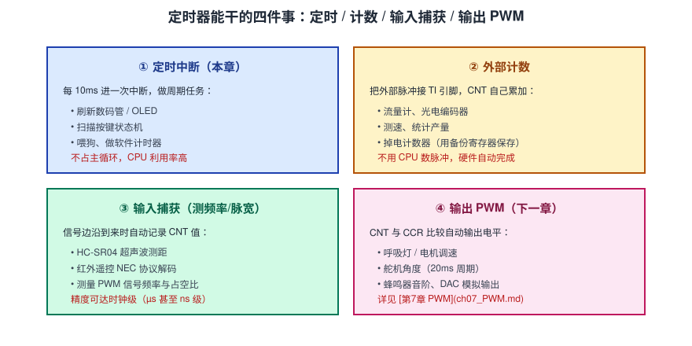
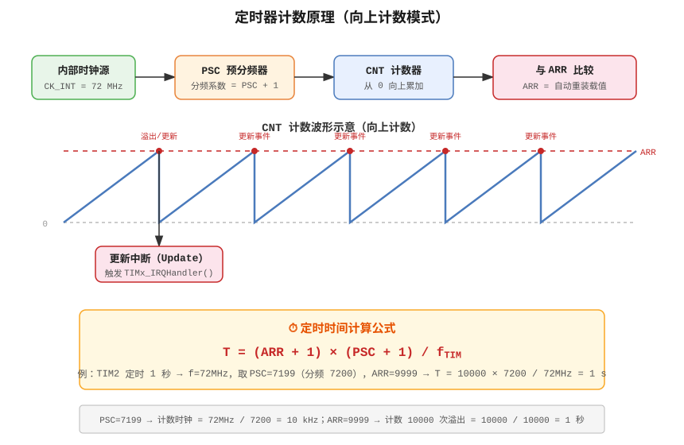
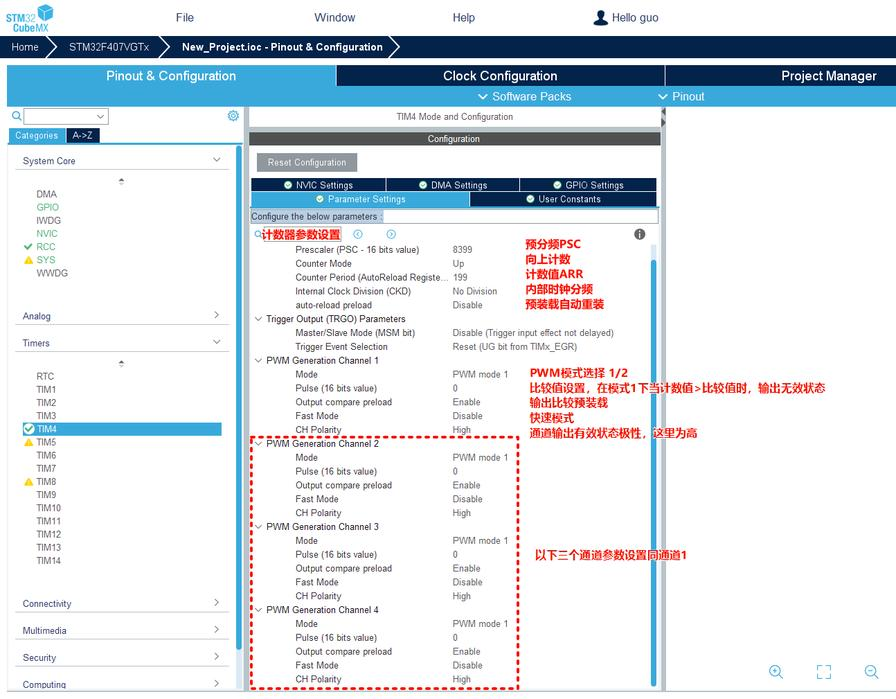
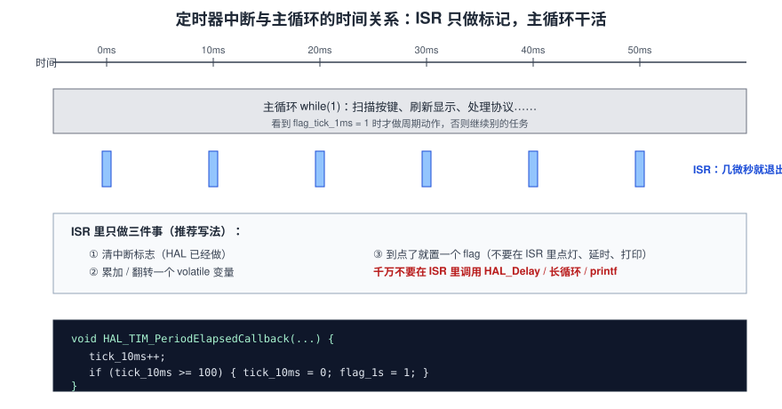
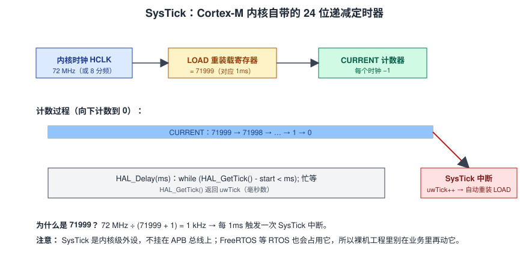
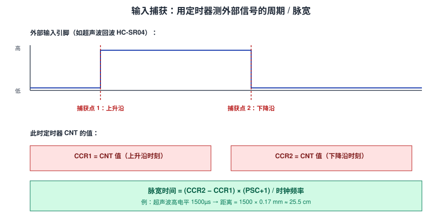

# 第6章 定时器（SysTick / TIM）

> 上一章我们用 EXTI 做了按键中断，但有件事一直没解决——按键抖动怎么办？我说"用定时器扫描"，那定时器到底怎么用？这一章就把它讲透。
>
> 我自己玩 STM32 的感受是：**GPIO 输出 + 外部中断 + 定时器，这三件套凑齐，你已经能写出 80% 的单片机小项目了**。呼吸灯、串口收发、数码管、秒表、遥控解码……背后都是这三个东西在打转。定时器尤其重要，因为后面的 PWM、输入捕获、FreeRTOS 时基，全建立在它上面。

这章我会从最基础的"定时器是什么"讲起，把 PSC/CNT/ARR 三个寄存器掰开揉碎，推一遍定时公式，然后用 TIM2 做一个"LED 每秒翻转"的小例子，最后再讲 SysTick 和 HAL_Delay 的内部原理，以及那种"中断里只置标志、主循环干活"的推荐写法。

---

## 6.1 定时器是什么：一个会自己数数的硬件

你写软件延时的时候，本质是让 CPU 跑一堆空循环：

```c
for (volatile int i = 0; i < 1000000; i++);  // 纯浪费 CPU
```

这种写法又慢又不准——编译器优化一下、时钟频率变一下，延时就不对了。**定时器是一个独立的硬件计数器**，它挂在时钟上，每个时钟节拍自动 +1，数到你设定的数就触发中断。CPU 在它数数的时候完全可以去干别的事，到点了硬件自动叫你。

### 6.1.1 F103 上有哪些定时器



F103C8T6 上一共有这些定时器：

| 类型 | 编号 | 位宽 | 挂在哪 | 典型用途 |
|---|---|---|---|---|
| 高级定时器 | **TIM1** | 16 位 | APB2（72MHz） | 电机 PWM、互补输出、刹车 |
| 通用定时器 | **TIM2 / TIM3 / TIM4** | 16 位 | APB1（36MHz，但定时器时钟 ×2 = 72MHz） | 定时、PWM、输入捕获 |
| 基本定时器 | （F103C8T6 没有 TIM6/7） | — | — | 纯定时 |
| **SysTick** | 内核级 | 24 位递减 | 内核时钟 HCLK | HAL 延时、RTOS 时基 |

这一章我用 **TIM2** 做演示。后面 [第7章 PWM](ch07_PWM.md) 还是用 TIM2，你会发现同一个定时器，配不同的模式，能干完全不同的事。

### 6.1.2 时基单元：PSC、CNT、ARR 三个寄存器



一个定时器的核心就是这三个寄存器：

```
时钟源（72MHz）
   │
   ▼
[PSC 预分频器]  ← 把 72MHz 分频成慢一点的计数频率
   │  例如 PSC=71 → 72MHz/(71+1) = 1MHz，即 1µs 跳一次
   ▼
[CNT 计数器]    ← 每个计数节拍 +1，从 0 开始往上数
   │
   ▼
[ARR 自动重装载] ← CNT 数到 ARR 就溢出（产生中断），CNT 归零重新数
```

**核心公式（背下来）：**

```
溢出时间 T = (ARR + 1) × (PSC + 1) / f_clk
```

注意里面的 `+1`——这是新手最容易算错的地方。PSC 写 0 表示不分频（1 分频），不是 0 分频。ARR 写 0 表示 1 个计数就溢出，不是 0 个。

### 6.1.3 算一遍：让 TIM2 每 1ms 中断一次

我们来推一遍。目标：1ms 进一次中断。

1. **时钟源是多少？** TIM2 挂在 APB1 上。APB1 分频系数是 2（PCLK1 = 36MHz），STM32 有个规则：**APB1 分频 > 1 时，挂在 APB1 上的定时器时钟会自动 ×2**。所以 TIM2 的输入时钟 = 36MHz × 2 = **72MHz**。
2. **分频成多少？** 我想要计数频率是 1MHz（每 µs 数一下），那 PSC = 72MHz / 1MHz - 1 = 71。
3. **ARR 设多少？** 1ms 就是 1000µs，所以 ARR = 1000 - 1 = 999。

验证：T = (999 + 1) × (71 + 1) / 72MHz = 1000 × 72 / 72 000 000 = 1/1000 s = 1ms。对。

> CubeMX 里对应的就是 `Prescaler = 71`、`Counter Period = 999`。CubeMX 不会帮你做这个换算，它只把数字写进寄存器。所以你要自己会算。

### 6.1.4 再算一遍：直接 1 秒一次中断

如果你想"一次中断就是 1 秒"，那就把 PSC 和 ARR 都拉大：

- 选 PSC = 7199 → 计数频率 = 72MHz / (7199+1) = 10kHz（每 100µs 跳一次）
- 选 ARR = 9999 → 溢出周期 = (9999+1) × 100µs = 10 000 × 100µs = 1s

这种做法的好处是中断频率低、CPU 负担小；坏处是定时精度只能到 100µs 级别。如果你的应用需要 1ms 一次心跳，那就用前面那组（PSC=71、ARR=999），然后在中断里数 100 次才做一次 1 秒的动作。

我个人习惯用 **PSC=71（1MHz 计数）、ARR=9999（10ms 溢出）** 这一组。理由：10ms 的中断频率刚好够扫按键、刷新数码管；1MHz 计数分辨率也够；ARR=9999 在 16 位范围内（最大 65535）。这是我项目里的"黄金组合"。

---

## 6.2 实操：TIM2 定时中断，LED 每秒翻一次

### 6.2.1 CubeMX 配置



1. 左侧树展开 `Timers → TIM2`，勾选 `Activated`。
2. 切到 `Parameter Settings` 标签页：
   - `Prescaler (PSC)` = **71**
   - `Counter Mode` = `Up`（向上计数）
   - `Counter Period (ARR)` = **9999**
   - `auto-reload preload` = `Enable`（开了之后 ARR 改值不会立刻生效，要等下一次溢出才更新，避免计数中途改 ARR 出乱子）
3. 切到 `NVIC Settings` 标签页，勾上 **`TIM2 global interrupt`**。
4. 重新生成代码。

### 6.2.2 代码

完整代码在 `code/ch06_timer_it.c`。我把它拆成几块讲：

**第一步：声明一个计数器（文件顶部）**

```c
/* USER CODE BEGIN PV */
volatile uint32_t tim_counter = 0;
/* USER CODE END PV */
```

注意 `volatile` 关键字——这个变量在中断里会被修改，编译器不能把它优化到寄存器里，否则主循环读到的就是旧值。

**第二步：启动定时器（main 函数里）**

```c
/* USER CODE BEGIN 2 */
HAL_TIM_Base_Start_IT(&htim2);
/* USER CODE END 2 */
```

光在 CubeMX 里配了还不够，**必须调用 `HAL_TIM_Base_Start_IT` 才会真正启动计数和中断**。我见过太多人漏了这行，结果中断永远不触发，还以为是 CubeMX 配错了。

**第三步：写中断回调（文件底部）**

```c
/* USER CODE BEGIN 4 */
void HAL_TIM_PeriodElapsedCallback(TIM_HandleTypeDef *htim)
{
  if (htim->Instance == TIM2)              /* 确认是 TIM2 触发的 */
  {
    tim_counter++;
    if (tim_counter >= 100)               /* 100 × 10ms = 1s */
    {
      tim_counter = 0;
      HAL_GPIO_TogglePin(GPIOC, GPIO_PIN_13);
    }
  }
}
/* USER CODE END 4 */
```

烧进去，你会看到板载 LED 每 1 秒翻转一次。主循环 `while(1)` 里我什么都没写——它就是空的，但定时器在背后乖乖打节拍。

### 6.2.3 为什么要在中断里数 100 次，不直接 1 秒一次

两种做法我都试过，给你说下区别：

- **直接 PSC=7199、ARR=9999（1 秒中断）**：CPU 最闲，但你要扫描按键、刷新 OLED、做协议解析时，1 秒才进一次中断根本来不及。
- **PSC=71、ARR=9999（10ms 中断），数 100 次**：中断频率适中，按键扫描（10ms 一次足够）、串口超时检测、显示刷新都能在同一个中断里完成。

**推荐用第二种**。理由是：一个工程里通常有多种周期任务（10ms 扫按键、50ms 刷数码管、1s 做心跳），用一个高频中断做"时基"，在里面分频出各种周期，是最常见的写法。

---

## 6.3 深入：HAL 的定时器中断到底干了什么

### 6.3.1 三层结构又出现了

和上一章的 EXTI 一样，定时器中断也是三层：

```
TIM2_IRQHandler          ← stm32f1xx_it.c 里的硬件入口
   └─► HAL_TIM_IRQHandler(&htim2)   ← HAL 库封装
        └─► HAL_TIM_PeriodElapsedCallback(&htim2)  ← 你写的回调
```

`HAL_TIM_IRQHandler` 内部做了这些事：
1. 检查更新中断标志 `UIF`（更新事件 = CNT 溢出）；
2. 如果是，清掉 `UIF`；
3. 调用 `HAL_TIM_PeriodElapsedCallback`。

所以你不用手动清标志，也不用判断 `if (TIM2->SR & TIM_SR_UIF)`。HAL 全包了。

### 6.3.2 寄存器级看一眼（了解即可）

TIM2 的控制寄存器 `CR1`（控制寄存器 1）：

- `CEN` 位（第 0 位）：计数器使能。写 1 开始计数，写 0 停止。
- `DIR` 位（第 4 位）：计数方向。0 向上计数，1 向下计数（高级定时器才有）。
- `ARPE` 位（第 7 位）：自动重装载预装载使能。开了之后 ARR 改值要等下次更新事件才生效。

状态寄存器 `SR`（状态寄存器）：
- `UIF` 位（第 0 位）：更新中断标志。硬件在 CNT 溢出时置 1，软件写 0 清除。

你 CubeMX 里勾的那些选项，本质就是在写这些位。调试器里打开 `TIM2->CR1`、`TIM2->CNT`、`TIM2->ARR` 看一眼，`CNT` 是不是在不停地 +1，一眼就知道定时器跑没跑起来。

### 6.3.3 定时器和主循环的时间关系



我想强调一个**非常重要的写法原则**：

> **中断里只做最少的事——清标志（HAL 做了）、累加计数、到点置一个 flag。真正的业务动作（点灯、串口发送、算法处理）放到主循环里做。**

反面教材（不推荐）：

```c
/* 不推荐：中断里直接干活 */
void HAL_TIM_PeriodElapsedCallback(TIM_HandleTypeDef *htim)
{
  if (htim->Instance == TIM2)
  {
    tim_counter++;
    if (tim_counter >= 100) {
      tim_counter = 0;
      /* 下面这些都不应该在中断里做 */
      HAL_UART_Transmit(&huart1, "tick\r\n", 6, 100);  /* 串口发送阻塞 */
      HAL_Delay(50);                                   /* 延时卡死 */
      OLED_ShowNumber(...);                            /* 刷屏慢 */
    }
  }
}
```

为什么不推荐？
1. 中断里调 `HAL_UART_Transmit` 是阻塞的，等串口发完那 6 个字节要几毫秒，期间其他中断都被堵住；
2. `HAL_Delay` 靠 SysTick，而 SysTick 优先级通常不高，定时器中断优先级高的话，SysTick 永远不被响应，直接死锁；
3. 中断里做的事越多，中断响应越慢，其他中断就越来不及。

正确写法（推荐）：

```c
volatile uint8_t flag_1s = 0;   /* 中断里置，主循环里清 */

void HAL_TIM_PeriodElapsedCallback(TIM_HandleTypeDef *htim)
{
  if (htim->Instance == TIM2)
  {
    tim_counter++;
    if (tim_counter >= 100) {
      tim_counter = 0;
      flag_1s = 1;                 /* 只置标志 */
    }
  }
}

/* main 里 */
while (1)
{
  if (flag_1s) {
    flag_1s = 0;                   /* 主循环里清 */
    HAL_GPIO_TogglePin(GPIOC, GPIO_PIN_13);
    /* 这里再做串口、OLED 等耗时操作 */
  }
}
```

**中断是"响应快"的地方，主循环才是"干活"的地方**。这个分工想清楚了，你的嵌入式代码就清爽了一大半。

---

## 6.4 SysTick：HAL_Delay 背后的那个定时器

你可能早就用了 `HAL_Delay(1000)`，但它到底是怎么实现的？

### 6.4.1 SysTick 原理



SysTick 是 Cortex-M 内核自带的一个 24 位**递减**计数器（注意是递减，不是 TIM 那种递增）。HAL 把它配置成每 1ms 触发一次中断：

- 时钟源 = HCLK（72MHz）
- LOAD 寄存器 = 71999（72MHz / 72000 = 1kHz）
- 每个 1ms，SysTick 中断跑一次，`uwTick++`

### 6.4.2 HAL_Delay 是怎么实现的

```c
void HAL_Delay(uint32_t Delay)
{
  uint32_t tickstart = HAL_GetTick();   /* 记住现在的毫秒数 */
  while ((HAL_GetTick() - tickstart) < Delay) {
    /* 忙等 */
  }
}
```

就这么简单。`HAL_GetTick()` 返回全局变量 `uwTick`，SysTick 中断每 1ms 把它加 1。所以 `HAL_Delay(1000)` 就是等 `uwTick` 走了 1000 步。

### 6.4.3 一个容易踩的坑：SysTick 优先级

SysTick 也是一个中断，它也有优先级。如果你在定时器中断里调用 `HAL_Delay`，而定时器的优先级比 SysTick 高，那 SysTick 永远抢不到 CPU，`uwTick` 永远不增加，`HAL_Delay` 就死在那了。

**经验法则：SysTick 的优先级要比所有业务中断都低。** CubeMX 默认配置就是这样，你别手滑把它调高了。

### 6.4.4 FreeRTOS 会接管 SysTick

后面 [第12章 FreeRTOS](ch12_FreeRTOS.md) 你会看到：一旦用了 FreeRTOS，SysTick 就被 RTOS 征用做系统节拍了。那时候你**不能再用 `HAL_Delay`**，要改用 `vTaskDelay()`。这是后话，先有个印象。

---

## 6.5 预告：定时器的另外两种玩法

这一章我们只用了定时器最基础的"定时中断"功能。但定时器能干的事远不止这个：

### 6.5.1 输入捕获（测频率 / 脉宽）



你把一个外部信号（比如超声波 HC-SR04 的回波）接到定时器的输入通道上。定时器会在信号**边沿**到来的瞬间，自动把当前的 `CNT` 值锁存到 `CCR` 寄存器里。两次捕获的差值，就是这段时间的长度——换算成时间就是脉宽。

这种方法不需要 CPU 一直在测，硬件自动完成，精度可达 µs 级。后面做超声波、红外遥控解码都会用到。

### 6.5.2 输出比较 / PWM

这是 [第7章 PWM](ch07_PWM.md) 的主角。定时器的 `CCR` 寄存器和 `CNT` 比较，相等时自动改变输出引脚的电平。这样就得到一个方波，改变 `CCR` 就能改变占空比——呼吸灯、舵机、电机调速全靠它。

---

## 6.6 变体玩法：从 LED 闪烁到秒表

### 6.6.1 变体一：按键改变 LED 闪烁频率

把上一章的按键和这一章的定时器结合一下：按一次按键，闪烁速度加快一档。

```c
volatile uint8_t speed_level = 0;   /* 0=1s, 1=500ms, 2=200ms */

/* EXTI 回调里 */
void HAL_GPIO_EXTI_Callback(uint16_t GPIO_Pin)
{
  if (GPIO_Pin == GPIO_PIN_0) {
    speed_level = (speed_level + 1) % 3;
  }
}

/* 定时器 10ms 中断里 */
void HAL_TIM_PeriodElapsedCallback(TIM_HandleTypeDef *htim)
{
  static const uint32_t levels[] = {100, 50, 20};   /* 对应 1s, 500ms, 200ms */
  if (++tim_counter >= levels[speed_level]) {
    tim_counter = 0;
    HAL_GPIO_TogglePin(GPIOC, GPIO_PIN_13);
  }
}
```

这就是"事件驱动 + 周期任务"的标准组合。你会发现，我们只用了两个最基础的外设（GPIO EXTI + TIM），但已经能写出挺有意思的交互了。

### 6.6.2 变体二：电子秒表

拓展一下：用定时器做 1ms 心跳，主循环里维护一个 `ms_count`，接到 OLED 上就是个秒表。

```c
volatile uint32_t ms_count = 0;

void HAL_TIM_PeriodElapsedCallback(TIM_HandleTypeDef *htim)
{
  ms_count++;
  /* 1000ms = 1s，这里只做累加，显示在主循环里刷 */
}

/* main 里 */
while (1)
{
  OLED_ShowNumber(1, 1, ms_count / 1000, 4);   /* 秒 */
  OLED_ShowNumber(1, 3, ms_count % 1000 / 10, 3); /* 毫秒 */
  HAL_Delay(50);
}
```

这个程序的精度取决于你的定时器配置——PSC=71、ARR=999 时，1ms 一次中断，误差只有几个时钟周期，比软件延时准得多。

---

### 6.6.3 变体三：用定时器做软件 PWM（不占硬件 PWM 通道）

有些时候你想让多个 LED 做呼吸效果，但 TIM2 只有 4 个通道。怎么办？用定时器中断模拟软件 PWM：

```c
volatile uint8_t pwm_level = 0;     /* 0~100 */
volatile uint8_t pwm_counter = 0;

/* 1ms 中断 */
void HAL_TIM_PeriodElapsedCallback(TIM_HandleTypeDef *htim)
{
  pwm_counter++;
  if (pwm_counter >= 100) pwm_counter = 0;   /* 100ms 一个周期 */

  /* 占空比 = pwm_level% */
  if (pwm_counter < pwm_level) {
    HAL_GPIO_WritePin(GPIOC, GPIO_PIN_13, GPIO_PIN_RESET);  /* 亮 */
  } else {
    HAL_GPIO_WritePin(GPIOC, GPIO_PIN_13, GPIO_PIN_SET);    /* 灭 */
  }
}
```

这种做法的缺点是占 CPU（1ms 中断一次），优点是任意引脚都能做 PWM。入门阶段你用硬件 PWM（下一章）就够了，这里只是让你有个概念。

### 6.6.4 调试技巧：怎么知道定时器真的在跑

我调试定时器的三板斧：

1. **看 CNT 寄存器**：调试器暂停两次，看 `TIM2->CNT` 的值是不是在涨。在涨就说明时钟源进来了。
2. **看 SR 寄存器的 UIF 位**：暂停时 UIF 应该是 1（说明溢出过）。如果一直是 0，说明 ARR 设得太大或者时钟没进来。
3. **示波器/逻辑分析仪**：在定时器中断里翻转一个引脚，用示波器看频率对不对。这是最直观的。

> 我自己最常用的是第 3 种——在中断里 `HAL_GPIO_TogglePin` 一个空闲引脚，示波器一接，频率准不准一眼就知道。

---

## 6.7 定时器时钟源：不只内核时钟一种

在 CubeMX 里点开 TIM2 的 `Parameter Settings`，你会看到有个 `Clock Source` 选项。默认是 `Internal Clock`，但其实定时器有好几种时钟源可选：

| 时钟源 | 说明 | 典型用法 |
|---|---|---|
| **Internal Clock（CK_INT）** | 内部 APB 倍频时钟（72MHz） | 我们前面用的定时中断 |
| **External Trigger Mode（ITRx）** | 用其他定时器的输出做时钟 | 多个定时器级联，做超长计时 |
| **External Clock Mode 1（TIx）** | 外部引脚 TI1/TI2 上的脉冲 | 测外部脉冲数、流量计 |
| **External Clock Mode 2（ETR）** | 专用 ETR 引脚 | 更高频的外部计数 |

入门阶段你只用 Internal Clock 就够了。但如果以后你要做"数外部脉冲"——比如接个光电编码器数轮子转了几圈——那就要把时钟源切到 External Clock Mode，让 CNT 跟着外部引脚的脉冲走，而不是跟着内核时钟走。

### 6.7.1 时钟树再看一眼

第 4 章讲过时钟树，这里把定时器相关的部分摘出来：

```
HSE 8MHz → PLL ×9 → SYSCLK 72MHz
   ├─ AHB 分频 → HCLK 72MHz
   │    ├─ APB1 分频 /2 → PCLK1 36MHz
   │    │    └─ 定时器时钟 ×2 → TIM2/3/4 = 72MHz
   │    └─ APB2 分频 /1 → PCLK2 72MHz
   │         └─ 定时器时钟 ×1 → TIM1 = 72MHz
   └─ Cortex 内核 SysTick → 72MHz
```

记住这个 ×2 规则：**只要 APB 分频系数 > 1，该总线上的定时器时钟就自动 ×2**。这是 STM32 为了让定时器能拿到最高频率做的设计。F103 上 APB1 默认分频是 2，所以 TIM2/3/4 永远是 72MHz；APB2 默认不分频，所以 TIM1 也是 72MHz。

> 我为什么反复强调这个？因为我见过有人把 APB1 分频改成 1（PCLK1 也是 72MHz），结果定时器时钟变成 72MHz × 1 = 72MHz，和之前一样——因为规则是"分频 > 1 才 ×2"，分频 = 1 时不 ×2，刚好还是 72MHz。巧的是数值一样，但原理不一样。

### 6.7.2 不同型号定时器的差异（了解即可）

F1 系列里定时器也分三六九等：

- **TIM1（高级）**：多了刹车输入（BKIN）、互补输出、死区时间插入，专门给电机控制用。
- **TIM2/3/4（通用）**：16 位（TIM2 在大容量型号上是 32 位），4 个通道，能做 PWM、输入捕获、输出比较。
- **TIM6/7（基本）**：没有外部引脚，纯定时，主要给 DAC 做触发用。

F103C8T6 上你能用到的就是 TIM1、TIM2、TIM3、TIM4。入门阶段把 TIM2 玩明白就够了，其他定时器用法大同小异。

## 6.8 常见坑（都是我翻过的车）

> 这一节我列的坑，都是我自己或者身边朋友真踩过的。你照着打钩排查，能省不少调试时间。

1. **忘了 `HAL_TIM_Base_Start_IT`**：CubeMX 配置好了，不调用这个函数，定时器根本不跑。我第一次调的时候查了半天寄存器才发现。
2. **NVIC 没勾 TIM2 global interrupt**：定时器在跑，但中断到不了 CPU。CubeMX 里 NVIC 标签页必须勾。
3. **PSC/ARR 算错**：常见错误是忘加 `+1`。PSC=71 是 72 分频，不是 71 分频。ARR=9999 是 10000 个计数，不是 9999 个。
4. **中断里用 `HAL_Delay`**：死锁。记住：中断里永远别调延时。
5. **多个定时器共用回调，忘了判断是哪个**：写了 `TIM2` 和 `TIM3`，回调里不判断 `htim->Instance`，两个中断都会触发 LED 翻转，时序全乱。
6. **变量没加 `volatile`**：中断里改的变量，主循环里读不到新值，因为编译器优化把它放进寄存器了。
7. **APB1 定时器时钟以为是 36MHz**：实际是 72MHz（×2 规则）。算错时钟，整个定时都偏一倍。
8. **改了时钟树忘记重算 PSC/ARR**：第 4 章改了 SYSCLK 从 72MHz 到 48MHz，定时器分频也要跟着改，不然定时全偏。

---

## 6.9 本章小结

> 这一章的东西其实不多，核心就是一个公式 + 一个回调函数。但你以后写的几乎所有工程，都会用到定时器。它就像一个节拍器——你不需要时时刻刻盯着它，它在背后准时打拍子，你跟着拍子做事就行。

- 定时器 = 硬件计数器，靠 PSC 分频、CNT 计数、ARR 比较，到点触发中断。
- 核心公式：`T = (ARR + 1) × (PSC + 1) / f_clk`，别忘 `+1`。
- APB1 定时器时钟是 PCLK1 × 2（=72MHz），这是 STM32 的硬规则。
- `HAL_TIM_Base_Start_IT` 启动；`HAL_TIM_PeriodElapsedCallback` 写业务。
- 中断里只置标志，主循环干活——这是嵌入式的基本纪律。
- SysTick 是内核 24 位递减定时器，HAL_Delay 靠它做毫秒级心跳。
- 定时器还有输入捕获、输出 PWM 两种高级玩法，后面章节展开。
- 时钟源不只有内部时钟，还能接外部脉冲做计数，进阶时再玩。

**自测题：**
1. 写出定时器溢出周期公式，并解释每个参数的含义。
2. 要让 TIM 每 100ms 中断一次（计数频率 1MHz），PSC 和 ARR 怎么配？
3. 为什么 F103 的 APB1 定时器时钟是 72MHz 而不是 36MHz？
4. 中断回调里为什么不能调用 `HAL_Delay`？
5. `volatile` 关键字在这里起什么作用？不加会怎样？
6. 如果我想让一个定时器同时服务 10ms 扫描、50ms 刷新、1s 心跳，你会怎么设计中断里的代码？

下一章我们玩定时器的进阶用法——**PWM**。用同一个 TIM2，配不同的模式，输出可调占空比的方波，做呼吸灯和舵机。

---

> 这一章的代码量其实很少，但概念密度很高。建议你合上文档，自己默写一遍定时公式，再算一组 PSC/ARR 配置，确认自己真的理解了。定时器是后面所有章节的地基，别跳过。

**动手作业**：把本章的 LED 每秒翻转改成每 500ms 翻转一次，不改 PSC/ARR，只改中断里的计数阈值。再试一次：不改计数阈值，把 PSC 改成 7199、ARR 改成 4999，看效果有什么不同。做完这两个练习，你就真的掌握定时公式了。

---

<!-- ===== 第6章 完 ===== -->
