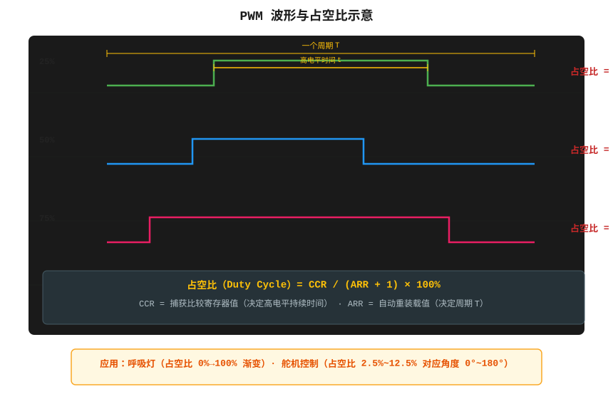
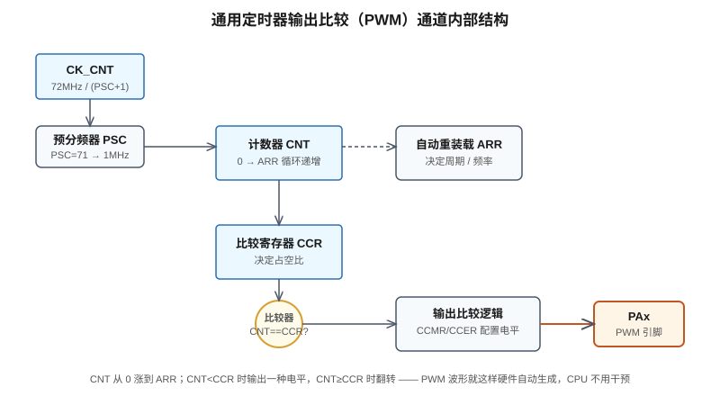
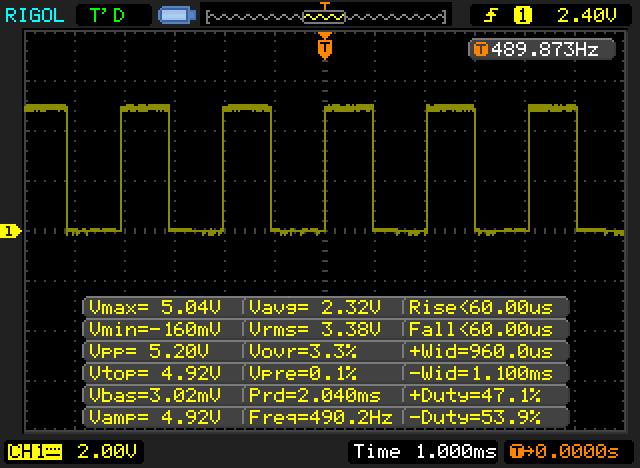
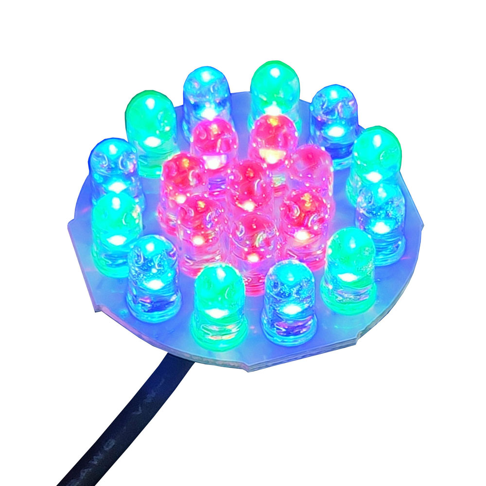
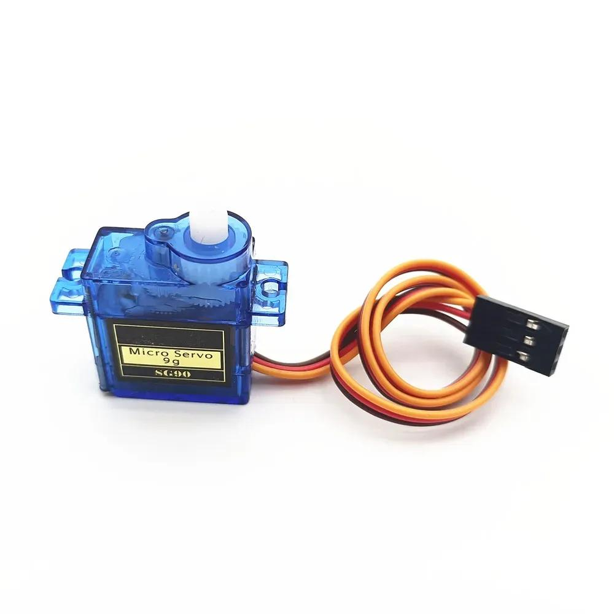
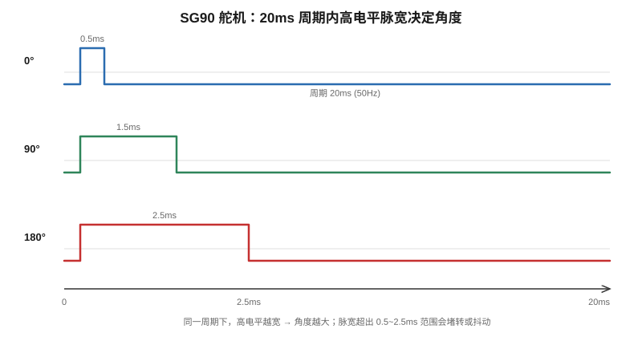

# 第7章 PWM 输出：从呼吸灯到舵机，占空比是怎么算出来的

> 上一章我们把定时器当中断源用，让它定时翻一个 LED。这一章要让同一个定时器去干一件更聪明的事——输出一串占空比可调的方波。呼吸灯、调光、电机调速、舵机角度，背后全是这一个手法。我自己第一次拿示波器量到 PWM 波形的那天，才真正把"占空比"这三个字从教科书里看进了脑子里。

## 7.1 为什么要折腾一个方波出来

你可能会问：LED 亮灭我已经会了，GPIO 拉高拉低就行，为什么非要搞一个频率上千赫兹、不停跳的方波？

原因很简单——**人眼跟不上，电器也跟不上，但它们对"平均电压"有反应**。

一个 LED 接在引脚上，引脚高它就亮，低它就灭。如果我让引脚以 1kHz 的频率快速高一下、低一下，人眼根本看不出闪烁，只觉得它"半亮"。亮的时间占整个周期的比例，就是占空比（Duty Cycle）。占空比 50%，它就像被供了 1.65V 一样亮（3.3V 的一半）；占空比 10%，它就暗得几乎看不见。

这东西有个名字，叫 **PWM**（Pulse Width Modulation，脉冲宽度调制）。



图里那三条波形，周期一模一样，只有高电平的宽度在变。注意一个细节：**频率不变，只改脉宽**，这就是 PWM 和普通"闪灯"的区别。闪灯是改频率，PWM 是锁死频率改脉宽。

它能干的事，我列一下你就有概念了：

- **调光**：LED 亮度、屏幕背光、台灯无级调光。
- **调速**：直流电机转速、风扇快慢。
- **调角度**：舵机转到指定位置（这是本章第二个实战）。
- **当 DAC 用**：PWM 后面加一个电阻电容滤波，能滤出一个平稳的直流电压，等于用数字引脚输出了模拟电压。
- **驱动蜂鸣器**：改频率出不同音调。

下一节，我们看看 STM32 是怎么"自动"产生这种波形的——重点是，这活儿根本不用 CPU 一行代码一行代码地翻转引脚。

## 7.2 定时器里那个"比较器"：PWM 是硬件自动生成的

我第一次学 PWM 时犯过一个特别蠢的错误：在主循环里不停 `HAL_GPIO_WritePin`，靠延时凑一个方波。结果频率稍微一高，CPU 就被占满，别的事全干不了，而且波形歪歪扭扭。后来才知道，STM32 的定时器里早就藏好了一个专门干这事的模块。

通用定时器内部有这么一条流水线：



拆开讲，就三个关键寄存器：

1. **PSC（预分频器）**：对 72MHz 时钟再分一次频。比如 PSC=71，计数时钟就变成 72MHz/(71+1)=1MHz，也就是计数器每 1µs 走一格。
2. **ARR（自动重装载值）**：计数器从 0 一路数到 ARR，然后清零、重新数，如此循环。一个循环的时间就是 PWM 的周期。
3. **CCR（捕获/比较寄存器）**：这是 PWM 的灵魂。计数器 CNT 在往上数的时候，硬件有个比较器，一直在拿 CNT 和 CCR 比大小。

那输出引脚的电平什么时候变？这就是"输出比较模式"干的事。以最常用的 **PWM 模式 1** 为例：

- 当 **CNT < CCR** 时，引脚输出 **有效电平**（比如高电平）。
- 当 **CNT ≥ CCR** 时，引脚输出 **无效电平**（低电平）。
- CNT 数到 ARR 之后清零，下一个周期从头再来。

你品一下这个逻辑：CCR 越大，CNT 小于它的时间越长，高电平占比就越大。**CCR 直接就是占空比的旋钮。**

整个过程——从 0 数到 ARR、到点翻引脚、数满清零——全是硬件自己跑的。CPU 唯一要做的，就是在初始化时把 PSC、ARR、CCR 写好，之后想调亮度了，改一下 CCR 就行。这就是为什么呼吸灯一点都不卡。

### 7.2.1 几个你迟早会遇到的寄存器

HAL 库把这些都封装好了，但万一哪天你要翻参考手册、或者 CubeMX 配出来的波形跟你想的不一样，下面这几个寄存器你得认识：

- **`TIMx_CCR1`（捕获/比较寄存器 1）**：就是 CCR1，你改的那个占空比旋钮。`__HAL_TIM_SET_COMPARE` 宏最终写的就是它。
- **`TIMx_CCMR1`（捕获/比较模式寄存器 1）**：低 6 位的 `OC1M[2:0]` 决定输出比较模式。PWM 模式 1 是 `110`，PWM 模式 2 是 `111`。还有 `OC1PE`（输出比较预装载使能）这一位，建议一直开着——它让你写的新 CCR 值在整个周期结束后才生效，避免改到一半导致波形毛刺。
- **`TIMx_CCER`（捕获/比较使能寄存器）**：`CC1E` 是输出使能开关（相当于这个通道接不接到引脚上），`CC1P` 是极性位——决定"有效电平"是高还是低。默认高有效，但你接的 LED 如果是低电平点亮，可能就要把它翻过来。
- **`TIMx_CR1`**：`CEN` 位是定时器总开关，`HAL_TIM_PWM_Start` 干的就是把这一位置 1。

你在 CubeMX 里看到的 `PWM Generation CH1`、`PWM Generation CH1N`（互补输出）、`CH Polarity = High/Low`，背后就是这几位。

### 7.2.2 PWM 模式 1 和模式 2，到底差在哪

这俩是一对反相输出：

- **PWM 模式 1（向上计数）**：CNT < CCR 时输出有效电平，CNT ≥ CCR 时无效。我们前面一直用的就是这个。
- **PWM 模式 2（向上计数）**：反过来，CNT < CCR 时无效，CNT ≥ CCR 时有效。

它存在的意义，主要是配合极性位 `CC1P`，方便你在"高电平点亮"和"低电平点亮"两种接法之间切换，而不用改 CCR 的计算公式。你记住模式 1 怎么用就够了，遇到反相输出再切到模式 2。

至于高级定时器（TIM1、TIM8）还有"互补输出"（CH1 和 CH1N 同时输出一对反相 PWM，带死区），那是给三相电机、电源用的，F103 这颗蓝 Pill 用不到，先有个印象就行。

## 7.3 两个公式，手把手算给你看

光说没用，我们把数字代进去。

### 7.3.1 频率公式

PWM 的周期，等于"计数器数完一整圈"的时间。计数器每格是 1/(72MHz/(PSC+1))，一共要数 (ARR+1) 格（从 0 数到 ARR 是 ARR+1 个数），所以：

```
T_PWM = (ARR + 1) × (PSC + 1) / 72MHz

f_PWM = 72MHz / ((PSC + 1) × (ARR + 1))
```

注意那个 **+1**，很多人第一次算错就错在这。PSC=71 不是除以 71，是除以 (71+1)=72。ARR=999 也不是 999 格，是 1000 格。

我们 LED 调光的例子：PSC=71（→1MHz 计数），ARR=999。

```
f_PWM = 1MHz / (999 + 1) = 1MHz / 1000 = 1000Hz = 1kHz
```

对，1kHz。人眼对 1kHz 的闪烁完全无感，只看到一个稳定的亮度。

### 7.3.2 占空比公式

高电平持续了多少格？在 PWM 模式 1 下，从 0 到 CCR 都是高电平，共 CCR 格。总周期是 ARR+1 格。所以：

```
占空比 D = CCR / (ARR + 1)
```

接着上面的例子，ARR=999：

- CCR=0 → D=0%，LED 全灭。
- CCR=500 → D=500/1000=50%，一半亮。
- CCR=999 → D=999/1000≈100%，最亮。

如果你想要"30% 亮度"，那 CCR = 0.3 × 1000 = 300。就这么直接。

### 7.3.3 舵机的例子：50Hz 是怎么凑出来的

舵机要的频率是 50Hz（周期 20ms），不是 1kHz。我们重新配 PSC 和 ARR：

```
要 T = 20ms = 0.02s
取计数时钟 1MHz（PSC=71），那需要数多少格？
格数 = 0.02s × 1,000,000 = 20000 格
所以 ARR = 20000 - 1 = 19999
```

验证一下：f = 1MHz/(19999+1) = 1MHz/20000 = 50Hz。周期正好 20ms。

而脉宽呢，1 格 1µs，我要 1.5ms 的高电平，那 CCR = 1500。

这就是为什么后面舵机代码里那个数是 1500、2500 这种——它们不是魔法数字，是 1µs 一格数出来的。

## 7.4 示波器实拍：看看我们到底输出了什么

光对着公式推，不如拿示波器量一次。下图是一台真实示波器抓到的 PWM 波形，屏幕上直接把频率、占空比都算出来了：



你看屏幕下方那几行测量值：`Freq=490.2Hz`、`+Duty=47.1%`、`Prd=2.040ms`。这意味着什么？

- 周期约 2ms，频率约 500Hz，跟我们算的 1kHz 差了一半——这是因为这个波形是别人用别的配置测的，正好提醒你：**频率不对的时候，第一反应就是回去对 PSC 和 ARR 的公式**。
- 占空比 47.1%，说明 CCR 大概是 ARR 的一半左右。

我自己第一次把探头搭到 PA0 上时，看到屏幕上跳出一连串整整齐齐的方波，那种"我真的造了一个波形出来"的成就感，比 LED 闪起来强烈多了。如果你的板子上没有示波器也没关系——逻辑分析仪（几十块钱的那种）甚至直接用另一块 STM32 的输入捕获功能，都能量出频率和占空比。

## 7.5 实战一：呼吸灯

呼吸灯就是让占空比从 0 慢慢爬到 100%，再慢慢退回 0，循环往复。人的视觉系统对亮度变化的响应不是线性的，但做个 Demo，线性渐变已经足够像呼吸了。



### 7.5.1 CubeMX 配置

我们用 TIM2 的通道 1，引出到 PA0。

1. 左侧 `Timers → TIM2`，勾选 `Activated`。
2. 把 `Channel1` 设成 `PWM Generation CH1`。
3. `Parameter Settings` 里填：
   - `Prescaler (PSC)` = **71**
   - `Counter Mode` = Up
   - `Counter Period (ARR)` = **999**
   - `Pulse (CCR1)` = 0（初值全灭）
4. 引脚会自动配成 PA0 复用功能，不用手动管。

生成代码后，你会看到 CubeMX 帮你写了 `MX_TIM2_Init()`，里面已经把 PSC、ARR、CCR 全设好了。

### 7.5.1.1 对着 CubeMX 界面一步步点

第一次配的同学，我把界面上每一栏填什么再细化一遍，免得你对着英文菜单发愣：

1. 左侧菜单找 `Timers` → `TIM2`，把 `Clock Source` 选成 `Internal Clock`（默认就是）。
2. 把 `Channel1` 的下拉框从 `Disable` 改成 `PWM Generation CH1`。这时 PA0 那个绿色的小方块会自动出现 `TIM2_CH1` 的标注。
3. 切到 `Parameter Settings` 标签页，展开 `TIM2`：
   - `Prescaler (PSC - 16 bits value)`：填 **71**
   - `Counter Mode`：`Up`
   - `Counter Period (ARR - 16 bits value)`：填 **999**
   - `Clock Division`：默认
   - `auto-reload preload`：`Enable`（开预装载，前面讲过）
4. 展开 `Channel1`：
   - `Pulse (CCR1)`：**0**（起灯全灭）
   - `OC Mode`：`PWM mode 1`
   - `CH Polarity`：`High`（高电平有效）
5. 顶部 `Project Manager` 里确认工程名、工具链，然后点 `GENERATE CODE`。

烧进去之前，先把 PA0 用杜邦线接一个 LED（串 220Ω 电阻）到 GND。烧好之后按复位，应该立刻看到 LED 像呼吸一样慢慢亮、慢慢暗。

如果没反应，按这个顺序排：第一，确认 `HAL_TIM_PWM_Start` 这行代码写到了 `USER CODE BEGIN 2` 区，而不是主循环外面；第二，用万用表量 PA0 对 GND 的平均电压，应该在 0 到 3.3V 之间缓慢变化；第三，把 CCR 直接写死成 500，看 LED 是不是固定半亮——如果是，说明 PWM 是好的，问题在渐变逻辑；如果完全不亮，那就是引脚、启动、接线三者之一。

### 7.5.2 代码

完整工程我放在 `code/ch07_pwm_breath.c`，核心就这么几行：

```c
/* 全局变量：当前占空比对应的 CCR 值，以及渐变方向 */
uint16_t duty = 0;
uint8_t  dir  = 1;        /* 1 = 增亮，0 = 变暗 */

/* main 里，初始化完外设之后启动 PWM 输出 */
HAL_TIM_PWM_Start(&htim2, TIM_CHANNEL_1);

/* 主循环 */
while (1)
{
  if (dir) {
    duty += 5;
    if (duty >= 999) dir = 0;     /* 到顶了，往回走 */
  } else {
    duty -= 5;
    if (duty <= 0)   dir = 1;     /* 到底了，再往上 */
  }

  __HAL_TIM_SET_COMPARE(&htim2, TIM_CHANNEL_1, duty);
  HAL_Delay(10);
}
```

两个关键点要解释一下：

**为什么要先 `HAL_TIM_PWM_Start`？** CubeMX 虽然把寄存器配好了，但默认定时器是停着的（CEN 位没置 1），PWM 不会有输出。这跟第 6 章中断模式要 `HAL_TIM_Base_Start_IT` 是一个道理——配置归配置，启动归启动。

**`__HAL_TIM_SET_COMPARE` 这个宏是干嘛的？** 它就是直接改 CCR 寄存器的值。你每次调用它，硬件下一个周期就用新的占空比了，完全无缝。别自己去读写结构体里的某个成员，用这个宏最稳。

### 7.5.3 呼吸效果的调节手感

我把步进设成 5、延时 10ms，你可以试试改这两个数：

- 步进 5、延时 10ms：从 0 到 999 要走 200 步，约 2 秒一个来回，呼吸比较舒展。
- 步进 20、延时 5ms：呼吸很快，像着急喘气。
- 步进 1、延时 5ms：非常平滑，但单个周期拉到 10 秒以上，有点慢。

接线提醒一下：PA0 接一个 LED（串个 220~1k 电阻）到 GND，是高电平点亮。如果你用的是板载那个 PC13 的 LED，它是反过来的（低电平点亮），那呼吸方向会反，把 `dir` 反过来或者 CCR 取补就行。

### 7.5.4 为什么你看呼吸灯总是"暗段太短、亮段太跳"

这是个很经典的问题。LED 的亮度和占空比之间，**在人眼里不是线性关系**。人眼对亮度的感知大致跟"亮度的 1/3 次方"成正比（伽马矫正，gamma≈2.2）。也就是说，占空比从 0% 拉到 50%，你觉得亮度翻了好几倍；从 50% 拉到 100%，反而觉得没怎么变。

我们上面代码是线性地 `duty += 5`，观感就是：暗部"唰"一下就亮了，亮部却半天没动静。想要那种柔和、均匀的呼吸，得把占空比按一条曲线给出去。最简单的做法，用一个查表或者用 `duty = 999 * (1 - cos(angle)) / 2` 这种余弦曲线：

```c
/* 用余弦曲线当占空比，视觉上更像呼吸 */
for (uint16_t i = 0; i <= 180; i++) {
  float rad = i * 3.14159f / 180.0f;
  duty = (uint16_t)(999.0f * (1.0f - cosf(rad)) / 2.0f);
  __HAL_TIM_SET_COMPARE(&htim2, TIM_CHANNEL_1, duty);
  HAL_Delay(15);
}
```

你把两段代码跑一下对比，立刻能看出差别。做产品的时候这个细节很重要，同样是呼吸灯，专业的观感就是这么抠出来的。

### 7.5.5 硬件 PWM 和软件 PWM，差一个数量级

我前面说过我最早是在主循环里靠 `HAL_GPIO_TogglePin` + 延时凑方波的。那种叫"软件 PWM"。问题是：

- 频率一高，CPU 全被占满，别的事干不了；
- 延时稍微被中断打断一下，波形立刻歪掉；
- 想开几路 PWM，就要几路定时器中断，越搞越乱。

硬件 PWM 的好处是，配好之后波形在引脚上自己跑，主循环该干嘛干嘛。做产品时永远优先用硬件 PWM，软件 PWM 只在你引脚实在被占满时应急用一下。F103 的通用定时器 TIM2~TIM5 一共能提供十多路 PWM 输出，基本够玩。

## 7.6 实战二：SG90 舵机控制

呼吸灯只是开胃菜，舵机才是 PWM 真正的"经典应用"。我第一次玩舵机的时候，拿着那只 9g 的小塑料舵机转来转去，觉得这东西怎么这么听话——给个数字，它就稳稳停在那个角度上，原来全靠 PWM。



### 7.6.1 舵机到底要什么样的信号

SG90 这类小舵机，内部有个电位器跟着摇臂转，有个控制电路一直在"对账"：它每隔 20ms 收一个脉冲，量一下这个脉冲高电平持续多久，然后让电机转到"对应这个脉宽"的角度。

对应关系是这样的：



具体数值（SG90 标称范围，不同批次略有出入）：

| 角度 | 高电平脉宽 | 占空比（周期20ms） | CCR（1MHz计数） |
|---|---|---|---|
| 0° | 0.5ms | 2.5% | 500 |
| 45° | 1.0ms | 5.0% | 1000 |
| 90° | 1.5ms | 7.5% | 1500 |
| 135° | 2.0ms | 10.0% | 2000 |
| 180° | 2.5ms | 12.5% | 2500 |

注意，**周期必须是 20ms（50Hz）**，频率错了舵机会乱抖。而脉宽超出 0.5~2.5ms 这个范围，舵机会自己保护、堵在端点上，你硬给 3.0ms 它也不会真的转到 270°，只会嗡嗡响。

### 7.6.2 为什么舵机频率这么低

你可能会纳闷：LED 调光要用 1kHz 才不闪，舵机怎么反而要用 50Hz 这么"慢"的频率？

原因是舵机内部根本不是在看瞬时电压，它的控制电路干的事是：**每隔 20ms 量一次这个脉冲有多宽，然后让电机把摇臂转到对应的角度**。这个 20ms 是它内部位置环的刷新周期，你给快了它也来不及反应，给慢了它就失步、乱抖。所以你看到的舵机数据手册，清一色写着"50Hz、周期 20ms"。

而 LED 调光用 1kHz，是因为人眼有个"视觉暂留"，只要刷新频率高于约 100Hz，人眼就把快速的亮灭当成了平均亮度。用 50Hz 调光，你一眼就能看到灯在闪；用 20kHz 调光，连蜂鸣的电磁噪音都没有（开关电源常用这个范围），但对 LED 其实没必要。

一句话：**PWM 频率不是越高越好，是要匹配你的负载**。

### 7.6.3 不同应用的频率怎么选

我把常见的几档频率整理给你，省得你下次再翻：

| 应用 | 典型 PWM 频率 | 为什么 |
|---|---|---|
| 舵机（SG90、MG996） | 50Hz | 内部位置环刷新周期 |
| 普通直流电机调速 | 10kHz~25kHz | 避开人耳能听见的啸叫 |
| LED 调光 | 100Hz~1kHz | 高于闪烁融合频率即可 |
| 开关电源 / DC-DC | 100kHz~1MHz | 频率越高电感电容越小 |
| 电子蜂鸣器 | 2kHz~5kHz（音频范围） | 你要听的就是这个频率 |
| class-D 功放 | 300kHz~1MHz | 远高于音频，少失真 |

你看，同一个 PWM 外设，靠改 PSC/ARR 能从 50Hz 跨到上百万赫兹，这就是它好用的地方。

### 7.6.4 配置和代码

配置上跟呼吸灯同一个定时器，只是 PSC/ARR 换成 50Hz 那套：PSC=71，ARR=19999。

```c
HAL_TIM_PWM_Start(&htim2, TIM_CHANNEL_1);

/* 直接转到 90° */
__HAL_TIM_SET_COMPARE(&htim2, TIM_CHANNEL_1, 1500);
```

如果想让它来回扫，就这么写（完整见 `code/ch07_pwm_servo.c`）：

```c
/* 从 0° 慢慢扫到 180° */
for (uint16_t pos = 500; pos <= 2500; pos += 50) {
  __HAL_TIM_SET_COMPARE(&htim2, TIM_CHANNEL_1, pos);
  HAL_Delay(20);
}
/* 再扫回来 */
for (uint16_t pos = 2500; pos >= 500; pos -= 50) {
  __HAL_TIM_SET_COMPARE(&htim2, TIM_CHANNEL_1, pos);
  HAL_Delay(20);
}
```

### 7.6.3 接线和供电，这是最容易翻车的地方

SG90 有三根线：

- **红色**：电源。
- **棕色/黑色**：GND。
- **橙色/黄色**：信号线，接 PA0。

信号线 3.3V 通常够用，舵机内部识别的是高电平边沿，对电压绝对值不太敏感。**但电源千万别从 STM32 的 3.3V 引脚取**——SG90 转动那一下电流能冲到几百毫安，蓝 Pill 的 3.3V 稳压根本扛不住，表现就是舵机一抖、板子复位、LED 全灭。正确做法是舵机红线接 **外部 5V**（比如 USB 排针的 5V，或者单独的 5V 电源），然后 **GND 和 STM32 的 GND 必须连在一起**（共地）。

我见过太多人舵机不转、乱抖，最后查出来全是供电或者共地的问题。

### 7.6.5 写个角度换算函数，别再手算 CCR 了

每次想让舵机转到 47°，你都要心算一遍"0.5ms + 角度 × 2ms/180°"，烦不烦？封装一下：

```c
/* 把 0~180° 的角度换算成 CCR 值
 * 前提：PSC=71, ARR=19999，计数时钟 1MHz
 * 0°  -> 500 (0.5ms)
 * 180° -> 2500 (2.5ms)
 */
uint16_t servo_angle_to_ccr(uint8_t angle)
{
  if (angle > 180) angle = 180;
  return 500 + (uint16_t)angle * 2000 / 180;
}

/* 用法：让舵机转到 90° */
__HAL_TIM_SET_COMPARE(&htim2, TIM_CHANNEL_1, servo_angle_to_ccr(90));
```

`angle × 2000 / 180` 这行：2000 是 0° 到 180° 的 CCR 跨度（2500−500），180 是角度跨度。这样你以后直接传角度值，代码可读性立刻上去了。不同舵机的端点脉宽略有差别（有的是 0.5~2.5ms，有的是 0.9~2.1ms），买回来先拿这个函数在 0°、90°、180° 三个点试一下，卡住了就微调 500 和 2500 这两个端点值。

## 7.7 PWM 和 DAC，到底差在哪

既然 PWM 能"平均出一个电压"，那它跟真正的 DAC（数模转换器）有什么区别？这个问题值得想清楚，因为它决定了你什么时候该用哪个。

| 对比项 | PWM + RC 滤波 | 片上 DAC |
|---|---|---|
| 输出本质 | 高速方波，靠滤波取平均 | 真正的模拟电压 |
| 纹波 | 有，跟滤波电容大小、PWM 频率有关 | 几乎无 |
| 精度 | 取决于 CCR 位数（F1 定时器 16 位） | 12 位 |
| 驱动能力 | 弱，要加运放才能带负载 | 弱，同样要加缓冲 |
| 占用引脚 | 任意一个定时器通道引脚 | 专门的 DAC 引脚（PA4/PA5） |
| 成本 | 0 元，软件/寄存器搞定 | F103C8T6 这颗芯片根本没有 DAC |

重点是最后一行：**STM32F103C8T6（就是蓝 Pill 这颗）压根没有 DAC 外设**。所以你想在这颗芯片上输出一个模拟电压、做个任意波形、控个电源电压，基本只能靠 PWM 加滤波电阻电容。等到后面你换 F4、F7、H7 的芯片，才会看到真正的 DAC。

PWM 后面跟一个简单的 RC 低通（比如 1kΩ + 10µF），就能从 0~3.3V 里滤出一个可调的直流，驱动个 LED 亮度、小功率加热片、或者给别的电路当可调参考电压，完全够。

## 7.8 我踩过的那些坑

把我这些年攒的经验给你列一遍，省得你再走一遍：

1. **PWM 输出了，但频率不对。** 百分之九十是忘了 PSC 和 ARR 后面那个 +1。拿示波器量一下实际频率，反推一下配置，比盯着 CubeMX 猜快。
2. **LED 不亮 / 舵机不转。** 检查三件事：调了 CCR 但忘了 `HAL_TIM_PWM_Start`？CCR 是否一直是 0？引脚是不是选对了通道（PA0=TIM2_CH1，不是 TIM2_CH2）？
3. **舵机一直抖。** 先查供电，再查周期是不是真的 50Hz。还有一种情况是你在主循环里不停改 CCR 但没有保持——舵机需要每 20ms 收到一个脉冲，只要定时器在跑它就一直收，别在主循环里把定时器停了。
4. **呼吸灯有闪烁感。** PWM 频率太低了，低于 200Hz 人眼就能察觉。调光场合建议 1kHz 以上；要是给开关电源用，一般几十 kHz。
5. **改了占空比没反应。** 确认你 `__HAL_TIM_SET_COMPARE` 的通道号和 CubeMX 里配的通道是同一个。TIM_CHANNEL_1 配错成 TIM_CHANNEL_2，波形照跑，但你改的是另一个通道，自然没反应。
6. **直接写 `htim2.Instance->CCR1 = duty` 也能跑，但不推荐。** 能用宏就用宏，可读性好，也不容易写错寄存器名。
7. **多个通道同时输出 PWM。** 同一个定时器的 4 个通道共享同一个 PSC 和 ARR（也就是共享同一个频率），只有各自的 CCR 不同。这意味着你用一个 TIM2 就能同时驱动 4 路 LED 调光，频率全是 1kHz，亮度各自独立。要不同频率，就得用不同定时器。
8. **CubeMX 改完 PSC/ARR 忘了重新生成代码。** 我见过有人在 CubeMX 里改了配置，直接拿旧 hex 去烧，结果波形还是老样子。养成习惯：CubeMX 一改，先点 "Generate Code"，再编译。

## 7.9 举一反三：这些东西你都可以自己试

学到这，PWM 这把刀你算是握手里了。顺着往下玩，几个方向供你挑：

- **RGB 灯调彩色**：拿三个 PWM 通道分别控红、绿、蓝，改三个 CCR 就能混出任意颜色。这个我在后续章节的 LED 实验里还会用到。
- **直流电机调速**：别直接把电机接引脚，那点电流引脚扛不住。要经过一个 MOSFET（比如 AO3400、IRL540）或者电机驱动芯片（L298N、TB6612），PWM 接驱动板的方向/使能脚。
- **电位器调光**：结合第 9 章的 ADC，拧电位器改 ADC 采样值，再把采样值当 CCR——就是一个纯硬件的无级调光器。
- **蜂鸣器播放音符**：改 PSC/ARR 出不同频率，配合占空比出方波音乐。

### 7.9.1 拿直流电机举个具体例子

假设你要用 PWM 调一个 5V 的直流小电机。引脚那点 20mA 电流绝对不够，你得这么搭：

```
STM32 PWM 引脚 ──[1kΩ]──┐
                        │
                     ┌──┴──┐
                     │ 栅极 │  N-MOSFET (AO3400 / IRL540)
                     └──┬──┘
                        │
   5V ──[电机]──────────┘ 漏极
                        │
                       源极
                        │
                       GND
```

PWM 占空比 50%，电机两端的平均电压就是 2.5V，转速大概就是一半。注意两个细节：电机两端一定要反向并联一个续流二极管（1N5819 之类），不然 MOSFET 关断瞬间电机的反向电动势会击穿管子；栅极到 PWM 引脚串个 1k 电阻，能抑制振铃。

PWM 频率选 20kHz 左右——这个频率超过人耳上限（约 20kHz），电机不会发出高频啸叫。PSC/ARR 就重新算：20kHz 下，1MHz 计数的话 ARR = 1MHz/20000 - 1 = 49。

### 7.9.2 手上没有示波器怎么办

示波器几百到几千块，学生党未必有。但你想验证 PWM 频率对不对，有几种便宜办法：

- **USB 逻辑分析仪**：二三十块钱一个，配套 sigrok/PulseView 软件，能同时抓 8 路，频率、占空比一目了然，比示波器还方便读数。强烈建议备一个。
- **用另一个 STM32 做输入捕获**：把被测 PWM 接到另一个定时器的输入捕获通道，固件里量高电平和周期的时间，串口打印出来。这本身就是个很好的练习。
- **拿 LED 看亮度反推**：把 CCR 设成 ARR 的一半，接 LED，亮度明显是一半；设成 10%，几乎不亮。粗调够用。

### 7.9.3 F103 上哪几个引脚能输出 PWM

新手常犯的错是：我想用 PB0 输出 PWM，但在 CubeMX 里选 TIM2 怎么也找不到这个脚。原因是——**每个定时器通道固定映射在特定引脚上**，不是随便挑。F103 常用的 PWM 引脚我列个表，你接电路前对照一下：

| 定时器 | 通道 1 | 通道 2 | 通道 3 | 通道 4 |
|---|---|---|---|---|
| TIM1 | PA8 | PA9 | PA10 | PA11 |
| TIM2 | PA0 / PA15 | PA1 / PB3 | PA2 / PB10 | PA3 / PB11 |
| TIM3 | PA6 / PB4 | PA7 / PB5 | PB0 | PB1 |
| TIM4 | PB6 | PB7 | PB8 | PB9 |

你注意到 PA9、PA10 同时也是 USART1 的 TX/RX 了吧？这就是为什么我做 PWM 呼吸灯时选 PA0（TIM2_CH1），而不选 PA9——PA9 要留给串口用，这是下一章的事。做项目时引脚复用冲突是家常便饭，CubeMX 里冲突会直接给你标红。

### 7.9.4 关于"预装载"和更新事件

最后补一个稍微深一点、但你早晚会碰到的点。CCR 寄存器有个"影子寄存器"机制：你写进去的新 CCR 值，并不会立刻在当前周期生效，而是要等一个**更新事件（UEV）**——也就是计数器数到 ARR 的那一刻——才真正搬到输出比较逻辑里。

这个设计的好处是：如果你在周期中间改 CCR，波形不会突然乱跳一下，而是整个周期结束后平滑切到新值。CCMR 寄存器里的 `OCxPE` 位就是管这个的，CubeMX 默认是开的（PWM 模式建议一直开）。

什么时候你会意识到它的存在？当你用 PWM 做音频输出、或者高速改占空比时，如果发现改了 CCR 要过一小会儿才反应过来，不是你代码写错了，是这个机制在起作用。

## 7.10 本章小结

- PWM 是"锁死频率、只改高电平宽度"的方波，平均电压由占空比决定。
- STM32 靠定时器的输出比较硬件自动生成 PWM，CPU 只负责配寄存器、改 CCR。
- 两个公式要能自己推：`f = 72MHz / ((PSC+1)(ARR+1))`，`占空比 = CCR / (ARR+1)`。
- 呼吸灯用 1kHz、CCR 在 0~999 之间来回扫；舵机用 50Hz（周期 20ms）、CCR 在 500~2500 之间对应 0~180°。
- `HAL_TIM_PWM_Start` 启动，`__HAL_TIM_SET_COMPARE` 改占空比，这两个是你天天要敲的。
- F103 没有 DAC，PWM + 滤波就是这颗芯片的"模拟输出"方案。

### 本章配套代码

- `code/ch07_pwm_breath.c`：呼吸灯完整逻辑（TIM2_CH1，PA0）。
- `code/ch07_pwm_servo.c`：SG90 舵机定点 + 扫角。

这两份文件不是完整工程，是插在 CubeMX 生成的 `main.c` 对应 `USER CODE` 区里的片段——你要做的就是把它们粘到标注的位置，重新编译烧录。

下一章我们就要用到 PA9/PA10 了，做 PWM 时记得别再占这两个引脚，不然串口就没法用了。

## 自测题

1. PSC=71、ARR=999，PWM 频率是多少？要让占空比 30%，CCR 设多少？
2. 舵机为什么必须用 50Hz？频率改成 1kHz 会发生什么？
3. 为什么呼吸灯要先 `HAL_TIM_PWM_Start`，不配这一步会怎样？
4. 同样是控制 LED，GPIO 翻转和 PWM 的区别在哪？后者省了什么？
5. 你的板子没有 DAC，想输出一个 1.65V 的直流，用 PWM 怎么实现？画一下外围 RC 电路。

> 参考答案提示：
> 1. f = 72MHz/((71+1)(999+1)) = 1000Hz；CCR = 0.3×1000 = 300。
> 2. 舵机内部位置环按 20ms 刷新一次；频率高了它处理不过来，表现为抖、无力或者乱跳。
> 3. 定时器 CEN 位没置 1，计数器根本不跑，引脚保持空闲状态没有波形。
> 4. GPIO 翻转要 CPU 干预、占空比受代码延时影响；PWM 是硬件自动生成，CPU 只改 CCR，波形精确且不占资源。
> 5. PWM 引脚接一个低通 RC（1kΩ 串接、10µF 到地），把 CCR 设成 ARR 的一半，平均电压就是 3.3V×50% = 1.65V。

---

下一章我们换个方向：不输出波形了，让板子开口说话。串口是 STM32 连接电脑、连模块、连别的 MCU 的标配，也是你调试时最重要的"眼睛"。见 [第8章 串口通信 UART](ch08_串口.md)。

到这里，你已经掌握了 STM32 最常用的两类"输出"：GPIO 电平（第 3 章）和 PWM 波形（本章）。前者只能表达"开"和"关"两种状态，后者能表达任意连续的平均能量。从这一章起，你做的东西会从"闪灯"进化到"调光、调速、调角度"，这就是从单片机入门到嵌入式入门的那一步。

下一章我们让 STM32 学会"听"——串口是它跟外界对话的嘴，接下来要让它能"读"传感器、"读"电位器。先把这一章的两个实验（呼吸灯、舵机扫角）真正在自己的板子上跑一遍，再往下走。
