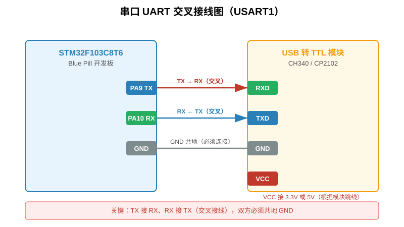
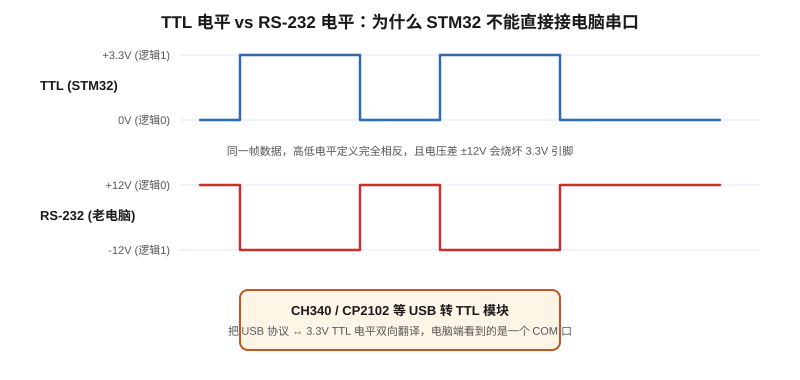
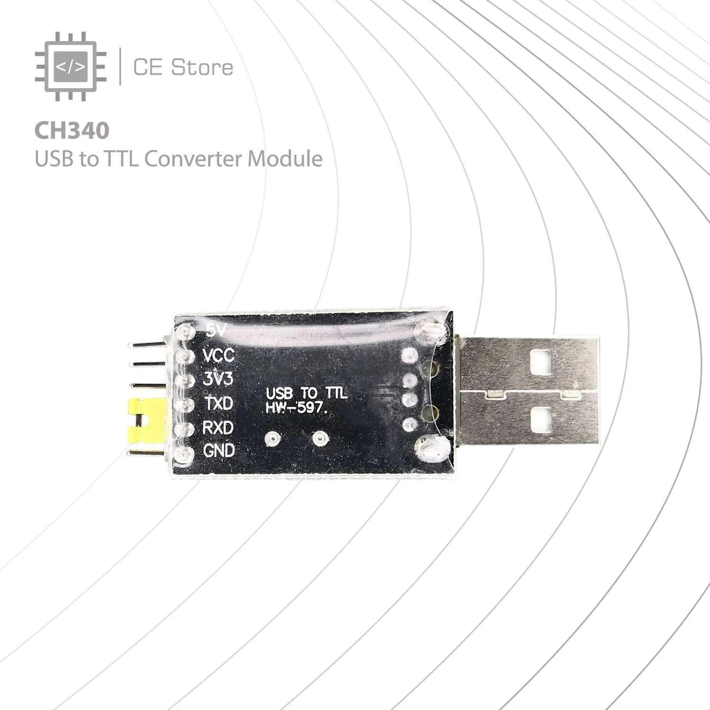
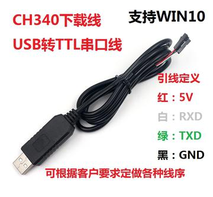
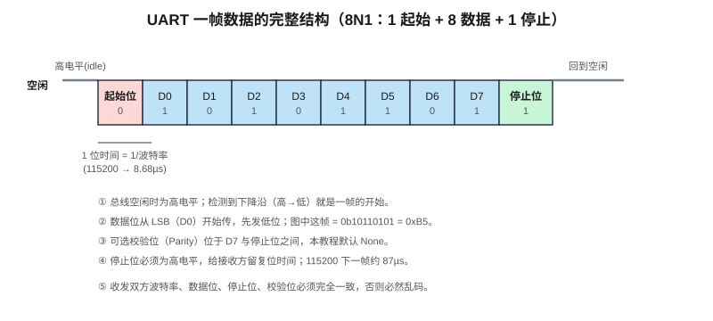
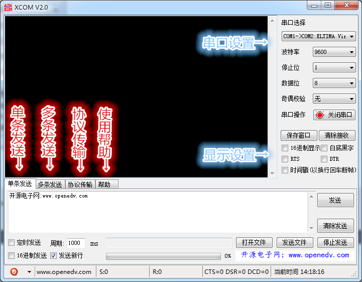
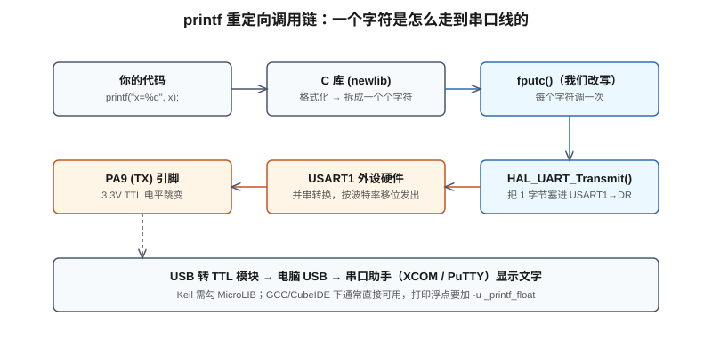
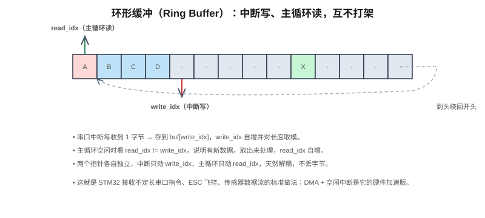

# 第8章 串口通信 UART：让 STM32 开口说话，把 printf 请回来

> 前面章节的实验均为单板自运行——LED 闪烁、按键检测、PWM 输出。但单片机若不能与外界交换数据，即为信息孤岛。串口（UART/USART）是 STM32 最廉价、最通用的对外接口：仅需两根线与一块 USB 转 TTL 模块，即可与电脑通信。本章介绍 UART 的原理、配置方法、printf 重定向与中断接收，并作为后续所有调试的基础。

## 本章学习目标

- 理解 UART 异步串行通信的基本原理，掌握帧格式（8N1）与波特率概念。
- 区分 3.3V TTL 电平与 RS-232 电平，理解 USB 转 TTL 模块的作用。
- 能够使用 CubeMX 配置 USART1（PA9/PA10，115200，8N1），完成 Hello World 发送。
- 掌握 Keil 下 `fputc` 重定向与 GCC 下 `_write` 重定向的方法，实现 `printf` 调试输出。
- 掌握中断接收的配置流程，理解为何回调中必须重新调用 `HAL_UART_Receive_IT`。
- 了解 USART_DR、USART_SR 寄存器及 TXE、TC、RXNE、ORE 标志位的含义。
- 掌握不定长字符串接收的环形缓冲方案与常见串口故障排查方法。

## 8.1 串口通信概述

### 8.1.1 串口为何成为嵌入式"母语"

嵌入式系统中存在 I2C、SPI、CAN、USB 等多种通信协议，串口仍被广泛使用，原因如下：

- **简单**：仅需 TX（发）与 RX（收）两根线，无时钟线，无复杂协议栈。
- **通用**：几乎所有 MCU 均集成 UART；蓝牙模块、Wi-Fi 模块、GPS 模块、传感器、示波器、打印机等设备普遍采用串口通信。
- **调试手段**：将 `printf` 重定向到串口后，可如 PC 程序一般将 STM32 内部变量输出到电脑。这是嵌入式开发最重要的调试手段。

**UART**（Universal Asynchronous Receiver/Transmitter）中的"A"表示异步——收发双方之间无共同时钟线，完全依靠预先约定的"波特率"对齐每一位的时间。



接线规则：**TX 接 RX，RX 接 TX，GND 接 GND**。交叉连接的原因是：一方的发送脚（TX）必须连接到另一方的接收脚（RX）；若两个输出脚对接，双方均无法接收数据。

## 8.2 电平标准与 USB 转 TTL 模块

### 8.2.1 TTL 与 RS-232 的区别

STM32 引脚高电平为 **3.3V**、低电平为 **0V**，称为 **TTL 电平**。而老式 DB9 串口采用 **RS-232 电平**——高电平为负 12V、低电平为正 12V，且逻辑定义相反。



若将 STM32 的 3.3V TTL 直接连接老式 DB9 串口，轻则收不到数据，重则损坏芯片。现代电脑已取消 DB9 接口，仅保留 USB 口，因此需使用 **USB 转 TTL 串口模块**，其功能如下：

1. 将电脑 USB 信号转换为串口数据（对电脑虚拟出一个 COM 口）。
2. 将串口数据转换为 **3.3V TTL 电平**，直接对接 STM32 引脚。

常见芯片包括 CH340（廉价）、CP2102（稳定）、FT232（性能优但价格较高）。本实验采用 CH340。



该类模块一面为 USB 头，另一面引出排针：5V/3V3、GND、TXD、RXD，通常附带杜邦线。



接线需特别注意：

- 模块 **TXD** → STM32 **PA10**（USART1_RX）
- 模块 **RXD** → STM32 **PA9**（USART1_TX）
- 模块 **GND** → STM32 **GND**
- 5V/3V3 一般不接（STM32 自供电）；若模块需从 STM32 取电则另行连接。

## 8.3 帧格式与波特率

### 8.3.1 一帧数据的结构

串口数据并非 8 根线并行传输，而是一根线逐位传输。总线空闲状态为高电平。发送数据时，先发一个"起始位"（拉低），再从最低位开始依次发送 8 个数据位，最后发一个"停止位"（拉高）。



各字段说明如下：

1. **空闲位**：总线空闲时为高电平。
2. **起始位（1 位）**：一个低电平脉冲，通知接收方"开始发送，准备采样"。接收方在 RX 引脚检测到下降沿即表示一帧数据到来。
3. **数据位（8 位）**：实际传输的字节，从最低位（LSB）开始发送。需注意——先发低位、后发高位，与日常数字书写顺序相反。
4. **校验位（可选，1 位）**：支持奇校验、偶校验，用于检错。入门阶段不使用，配置选 None。
5. **停止位（1 位）**：一个高电平，标志一帧结束，总线回到空闲状态。常见为 1 位，也可配置为 1.5 或 2 位。

上述配置通常简写为 **8N1**：8 位数据、无校验、1 位停止位，为最常用组合。

**波特率**指每秒传输的位数。115200 表示每秒传输 115200 位，每位时间为 1/115200 ≈ 8.68µs。接收方在每一位的中间位置采样，判定该位为 0 或 1。若收发双方波特率不一致，采样点将错位，输出即为乱码。

### 8.3.2 UART 与 USART 的区别

CubeMX 中显示为 `USART1`、`USART2`、`USART3`，而日常口语称为 UART，二者关系如下：

- **UART**：Universal Asynchronous Receiver/Transmitter，异步，无时钟线，即本章使用的模式。
- **USART**：Universal Synchronous/Asynchronous Receiver/Transmitter，同步/异步两用。额外提供时钟线（CK 引脚），可工作于同步模式（如驱动智能卡、LCD 屏）。

F103 上的 USART1/2/3 均为 USART，但仅使用其异步模式，故称为 UART 亦无误。除 USART 外，F103 还集成 **UART4/UART5**（仅异步，不支持同步），挂接于 APB1 总线。蓝 Pill C8T6 可引出的串口为 USART1（PA9/PA10）、USART2（PA2/PA3）、USART3（PB10/PB11）。

## 8.4 波特率误差分析

### 8.4.1 波特率发生器原理

USART 外设内部集成波特率发生器，本质为时钟分频。F103 的 USART1 挂接于 APB2 总线，时钟为 72MHz。分频值存储于 `USART_BRR` 寄存器：

```
实际波特率 = 72MHz / USARTDIV
```

若目标波特率为 115200：

```
USARTDIV = 72,000,000 / 115,200 = 625
```

结果为整数。再计算 9600：

```
USARTDIV = 72,000,000 / 9600 = 7500
```

亦为整数。再计算 38400：

```
USARTDIV = 72,000,000 / 38,400 = 1875
```

同样为整数。

### 8.4.2 分频量化误差

分频值并非任意整数——`USARTDIV` 由 12 位整数部分与 4 位小数部分组成，小数部分仅可取 0/16、1/16、2/16……15/16。即分频值必须为 k + n/16 形式。当目标波特率不能整除时，须四舍五入至最近的 1/16 倍数，由此产生误差。

例如目标波特率 57600：

```
理想 USARTDIV = 72,000,000 / 57,600 = 1250  （又是整数，没误差）
```

再试 230400：

```
理想 = 72,000,000 / 230,400 = 312.5
但分频只能取 k + n/16，312.5 = 312 + 8/16 ✓ 正好是 16 等分的一半，没误差
```

72MHz 时钟对常见波特率较为友好。CubeMX 已自动计算 `USARTDIV`，无需手动计算。但若更换时钟源（如使用内部 HSI 8MHz）后配置 115200，误差将明显增大——HSI 本身存在 ±1% 偏差，叠加后可能超出串口允许的 ±2% 误差范围，表现为乱码。**因此出现乱码时应首先检查时钟与波特率配置。**

## 8.5 CubeMX 配置与 Hello World

### 8.5.1 CubeMX 配置步骤

1. 左侧 `Connectivity → USART1`，将 `Mode` 设为 `Asynchronous`（异步模式）。
2. `Parameter Settings` 中：
   - `Baud Rate` = **115200**
   - `Word Length` = **8 Bits**
   - `Parity` = **None**
   - `Stop Bits` = **1**
   - `Data Direction` = `Receive and Transmit`
3. 引脚自动分配：**PA9 = USART1_TX**，**PA10 = USART1_RX**，无需修改。
4. 重新生成代码。

### 8.5.2 阻塞发送

CubeMX 已自动生成 `MX_USART1_UART_Init()`。在 `main.c` 的 `USER CODE BEGIN 2` 区添加发送代码：

```c
HAL_UART_Transmit(&huart1, (uint8_t *)"Hello World!\r\n", 15, 1000);
```

`HAL_UART_Transmit` 四个参数分别为：句柄、数据指针、长度、超时时间（ms）。该函数为**阻塞函数**——调用后一直等待，直到所有字节发送完毕才返回。其中 `\r\n` 为回车加换行，串口助手才能正常换行；仅发送 `\n` 在部分工具中会出现"只换行不回车"的错位现象。

烧录后打开串口助手（XCOM、SSCOM、PuTTY 均可），选择对应 COM 口、波特率 115200，按板子复位键，应显示 `Hello World!`。



### 8.5.3 串口助手使用说明

以 XCOM 为例，界面各功能说明如下：

- **COM 口选择**：下拉框选择 CH340 对应端口。插上模块后，在电脑"设备管理器 → 端口"中可查看 `USB-SERIAL CH340 (COMx)`。若插上无反应，通常为 CH340 驱动未安装，需前往官网下载安装。
- **波特率**：选 **115200**，必须与固件配置完全一致。
- **数据位/停止位/校验**：默认 8、1、None，与固件一致。
- **打开串口**：点击该按钮，状态灯点亮后开始监听。
- **发送区**：在输入框输入字符后点击"发送"即发送至 STM32。建议勾选"发送新行"（自动追加 `\r\n`），否则 STM32 无法判断命令结束。
- **显示区**：接收区可选"HEX 显示"或"字符串显示"，文本调试选用字符串（ASCII）模式。

常用串口调试工具还包括 VSCode Serial Monitor 插件与 `minicom`（Linux/Mac）。XCOM 的优势是中文界面、自带 HEX/ASCII 切换，适合入门。

## 8.6 printf 重定向

### 8.6.1 重定向原理

`HAL_UART_Transmit` 虽可发送数据，但每次需手动指定长度并强制转换 `uint8_t *`，使用不便。实际开发中更倾向于采用标准 C 语言格式：

```c
printf("adc = %d, voltage = %.2f V\r\n", adc, voltage);
```

实现该功能需将 C 库 `printf` 底层的"输出一个字符"函数重定向到 USART1。Keil（ARMCC）中该函数为 `fputc`；GCC/newlib 中通常为 `_write`。以下以 Keil 常用的 `fputc` 方案为例：



代码写在 `main.c` 顶部：

```c
/* USER CODE BEGIN Includes */
#include <stdio.h>
/* USER CODE END Includes */

/* USER CODE BEGIN 0 */
int fputc(int ch, FILE *f)
{
  HAL_UART_Transmit(&huart1, (uint8_t *)&ch, 1, 1000);
  return ch;
}
/* USER CODE END 0 */
```

原理：C 库 `printf` 将格式化字符串拆分为单个字符时，最终需将字符输出到"标准输出"。默认情况下标准输出指向屏幕，而嵌入式系统无屏幕——`fputc` 即为该输出钩子。将其改为将字符发送至 USART1 后，`printf` 即等同于直接输出到串口。

此后即可正常使用：

```c
printf("System Clock = %lu Hz\r\n", SystemCoreClock);
printf("Count = %d, Ratio = %.1f%%\r\n", cnt, ratio);
```

典型传感器调试主循环示例如下：

```c
while (1) {
  uint16_t v = read_sensor();
  printf("[%lu ms] sensor = %d, filtered = %d\r\n",
         HAL_GetTick(), v, filtered);
  HAL_Delay(100);
}
```

串口助手每 100ms 输出一行，包含传感器原始值、滤波值与时间戳。相较于调试器断点单步运行，该方法效率显著更高。这是 `printf` 被称为嵌入式调试"眼睛"的原因。

### 8.6.2 Keil 下使能 MicroLIB

使用 Keil 时需注意：未勾选 MicroLIB，`printf` 要么无输出，要么编译报错。操作步骤：

- 魔术棒（Options for Target）→ `Target` 标签 → 右下角勾选 **`Use MicroLIB`**。

MicroLIB 是 Keil 为 ARM 嵌入式裁剪的轻量 C 库，其 `printf` 仅支持基本格式（`%d %s %c %x` 等），不支持 `%f` 浮点输出。若需打印浮点，可不勾选 MicroLIB（代码体积增大），或将浮点数先转为字符串再发送。

### 8.6.3 GCC / CubeIDE 下的配置

使用 STM32CubeIDE 或 PlatformIO（均基于 GCC/newlib）时，`fputc` 可能不生效，需重定向 `_write`：

```c
int _write(int fd, char *ptr, int len)
{
  HAL_UART_Transmit(&huart1, (uint8_t *)ptr, len, 1000);
  return len;
}
```

此外，newlib 默认不链接浮点格式化链，打印 `%f` 将输出空。需在工程链接选项中添加 `-u _printf_float`（CubeIDE：Project → Properties → Settings → Linker → Misc → Other options）。

完整代码见 `code/ch08_uart_printf.c`。

## 8.7 中断接收

### 8.7.1 阻塞接收的局限性

仅发送不接收不能构成双向通信。本节实现 echo 功能：串口助手发送的字符，STM32 原样回发。

最直观的方法是在主循环中调用 `HAL_UART_Receive` 等待一个字节。但该函数会阻塞 CPU，直到收到字节才返回。若串口助手不发送数据，主循环将停在该处，LED 闪烁与按键检测均无法执行。该方式在多数应用中不可接受。

正确方法为**中断接收**：配置 USART1"收到字节即触发中断通知 CPU"，CPU 随后执行其他任务；硬件收到字节后触发中断，在中断回调中处理。主循环可并行执行其他任务。

### 8.7.2 CubeMX 配置

在 USART1 原有配置基础上，切换至 `NVIC Settings` 标签页，勾选 `USART1 global interrupt` 为 Enable。重新生成代码后，`stm32f1xx_it.c` 中自动生成 `USART1_IRQHandler`。

### 8.7.3 中断接收代码

```c
/* USER CODE BEGIN PV */
uint8_t rx_byte;
/* USER CODE END PV */

/* USER CODE BEGIN 2 */
HAL_UART_Receive_IT(&huart1, &rx_byte, 1);   /* 启动一次中断接收 */
/* USER CODE END 2 */

/* USER CODE BEGIN 4 */
void HAL_UART_RxCpltCallback(UART_HandleTypeDef *huart)
{
  if (huart->Instance == USART1) {
    HAL_UART_Transmit(&huart1, &rx_byte, 1, 100);          /* 把收到的字节发回去 */
    HAL_UART_Receive_IT(&huart1, &rx_byte, 1);            /* 再开一次接收，等下一个字节 */
  }
}
/* USER CODE END 4 */
```

完整代码见 `code/ch08_uart_echo.c`。

### 8.7.4 回调中重启接收的原因

这是 HAL 中断接收最经典的注意事项。`HAL_UART_Receive_IT` 的语义为"接收 N 个字节，完成后触发一次回调"。当 N 个字节接收完毕，中断自动关闭——**该机制不会自动循环**。

因此必须在回调中再次调用 `HAL_UART_Receive_IT`，通知库"已准备好接收下一个字节"。初学者编写 echo 程序后发现仅能回显一个字符即停止，原因即在于遗漏该调用。

## 8.8 USART 寄存器与标志位

### 8.8.1 关键寄存器

本节介绍 USART 的寄存器层原理，便于后续排查乱码与丢数据问题。USART 涉及两个关键寄存器：

- **`USART_DR`（数据寄存器）**：写入该寄存器即将字节送入发送移位寄存器；读取该寄存器即从接收移位寄存器取走字节。HAL 库 `Transmit/Receive` 底层操作即读写该寄存器。
- **`USART_SR（状态寄存器）`**：其中关键标志位如下：
  - **TXE（Transmit data register Empty）**：发送数据寄存器空，表示可写入下一个字节。
  - **TC（Transmission Complete）**：整帧（含移位寄存器）发送完成。TXE 为 1 并不代表线上数据已全部发完，TC 才表示发送完成。
  - **RXNE（Read data register Not Empty）**：接收数据寄存器有新字节，应尽快读取。
  - **ORE（Overrun Error）**：上一个字节未读走而新字节已到来，发生溢出——即丢数据。

HAL 库已封装上述标志位：`HAL_UART_Transmit` 内部等待 TXE 置位、写入 DR、等待 TC；`Receive_IT` 即使能 RXNE 中断，中断触发后读取 DR 并清标志。

**ORE 溢出错误为高频故障点**。表现为：使用中断接收，但回调处理耗时过长（如回调中执行 10ms 延时），或主循环来不及处理新数据，ORE 一旦置位，USART1 即停止接收，后续数据全部丢失。遇到该情况时，应先将回调中的耗时操作移出，必要时先读 SR 再读 DR 手动清除 ORE。

### 8.8.2 中断响应流程

`HAL_UART_Receive_IT` 的完整调用链如下：

1. 调用 `HAL_UART_Receive_IT(&huart1, &rx_byte, 1)`，HAL 将 `rx_byte` 地址存入 `huart1->pRxBuffPtr`，剩余接收字节数存入 `RxXferCount`，并将 CR1 寄存器的 RXNEIE 位置 1——即"RXNE 标志置位即触发中断"。
2. 线上到来一个字节，硬件将其搬入 RDR 寄存器，RXNE 自动置 1。
3. CPU 跳转至 `stm32f1xx_it.c` 中的 `USART1_IRQHandler`，即 CubeMX 生成的中断入口。
4. 该 handler 调用 `HAL_UART_IRQHandler(&huart1)`，HAL 库判断为 RXNE 中断后，将 RDR 值读入 `pRxBuffPtr` 指向地址（即 `rx_byte`），指针前移、计数减一。
5. `RxXferCount` 减至 0 时，HAL 关闭 RXNEIE，调用 `HAL_UART_RxCpltCallback`——即用户重写的弱定义回调函数。
6. 回调处理完成后，再次调用 `HAL_UART_Receive_IT`，回到第 1 步，等待下一个字节。

理解该调用链后可知：回调中不宜执行耗时操作——整个过程均在中断上下文执行，若处理时间过长，下一个字节的中断将无法及时响应，导致 ORE。

## 8.9 不定长字符串接收与环形缓冲

### 8.9.1 基本接收方案

单字节 echo 较为简单，但实际项目中需接收命令行字符串——例如串口助手发送 `"LED_ON\r\n"`，STM32 需解析整串。逐字节接收时，通常以 `\n` 或 `\r` 作为结束标志。

最基本的实现如下：

```c
uint8_t rx_buf[128];
volatile uint16_t rx_idx = 0;

void HAL_UART_RxCpltCallback(UART_HandleTypeDef *huart)
{
  if (huart->Instance == USART1) {
    rx_buf[rx_idx++] = rx_byte;
    if (rx_byte == '\n') {
      rx_buf[rx_idx] = '\0';
      printf("\r\nReceived: %s", rx_buf);
      rx_idx = 0;
    }
    HAL_UART_Receive_IT(&huart1, &rx_byte, 1);
  }
}
```

该方法可满足入门需求，但存在两个问题：

1. 单行超过 127 字节时，`rx_buf` 越界。
2. 中断中写入与主循环读取同时操作，两指针易冲突。

### 8.9.2 命令解析骨架

升级后可实现命令响应功能。例如发送 `LED_ON` 时板载灯亮，发送 `LED_OFF` 时灯灭。完整接收与解析骨架如下：

```c
uint8_t  rx_buf[128];
volatile uint16_t rx_idx = 0;
volatile uint8_t  line_ready = 0;   /* 一整行收完的标志 */

void HAL_UART_RxCpltCallback(UART_HandleTypeDef *huart)
{
  if (huart->Instance == USART1) {
    if (rx_idx < sizeof(rx_buf) - 1) {
      rx_buf[rx_idx++] = rx_byte;
    }
    if (rx_byte == '\n') {
      rx_buf[rx_idx - 1] = '\0';   /* 把 \n 换成字符串结束符 */
      line_ready = 1;
    }
    HAL_UART_Receive_IT(&huart1, &rx_byte, 1);
  }
}

/* 主循环里 */
while (1) {
  if (line_ready) {
    if (strncmp((char *)rx_buf, "LED_ON", 6) == 0) {
      HAL_GPIO_WritePin(GPIOC, GPIO_PIN_13, GPIO_PIN_RESET);  /* 板载 LED 亮 */
      printf("LED is ON\r\n");
    } else if (strncmp((char *)rx_buf, "LED_OFF", 7) == 0) {
      HAL_GPIO_WritePin(GPIOC, GPIO_PIN_13, GPIO_PIN_SET);
      printf("LED is OFF\r\n");
    } else {
      printf("Unknown cmd: %s\r\n", rx_buf);
    }
    rx_idx = 0;
    line_ready = 0;
  }
}
```

该模式在后续项目中反复使用：中断仅负责"将字节存入缓冲、遇换行置标志"，主循环检测到标志后执行 `strncmp` 解析。如此中断执行时间极短，不影响其他任务。

### 8.9.3 环形缓冲

工程上更稳健的方案为**环形缓冲（Ring Buffer）**：



实现方式为开辟固定大小数组，使用两个指针：

- `write_idx`：中断每收到一个字节即写入该位置，指针加一并对数组长度取模。
- `read_idx`：主循环空闲时检测 `read_idx != write_idx`，若不等则表示有新数据，取出处理后指针加一并取模。

两指针各管一侧：中断仅修改写指针，主循环仅修改读指针，天然解耦。这是串口命令行、飞控系统、传感器数据流的标准方案。更高级的实现采用 **DMA + 空闲中断（IDLE）**，由 DMA 在后台接收数据，整行结束时才触发一次中断通知 CPU——详见第 10 章 [DMA](ch10_DMA.md)。

## 8.10 常见故障排查

串口调试常出现"接线看似正常但通信失败"的情况，本节汇总高频问题：

1. **收不到数据或全为乱码。** 按以下顺序排查：
   - TX/RX 是否接反（最常见）？
   - 双方波特率是否均为 115200（串口助手侧易遗忘修改）？
   - GND 是否共地（USB 模块与 STM32 的 GND 必须相连）？
   - 串口助手是否选错 COM 口？
2. **仅能发送一个字符后无反应。** 回调中遗漏再次调用 `HAL_UART_Receive_IT`，详见 8.7.4 节。
3. **printf 完全无输出。** 依次检查：Keil 是否勾选 MicroLIB；GCC 是否重定向 `_write`；`fputc` 是否写在 `USER CODE BEGIN 0` 区域内（区域外会被 CubeMX 重新生成时覆盖）。
4. **打印浮点显示 `%` 或空。** MicroLIB 不支持 `%f`；GCC 未添加 `-u _printf_float`。
5. **回显出现"阶梯"错位。** 仅发送 `\n` 而未发送 `\r`。可在串口助手设置中自动追加 `\r`，或代码中发送 `\r\n`。
6. **3.3V 模块与 5V 模块电平不匹配。** 部分老式 USB 转 TTL 模块为 5V 逻辑，直连 3.3V STM32 多数情况可识别，但长期不稳定。购买时应选择 3.3V/5V 跳线可选的模块，拨至 3.3V 档。
7. **波特率正确仍乱码。** 多为时钟配置问题。F103 默认使用外部 8MHz HSE 倍频至 72MHz；若工程中改为内部 HSI 8MHz，再配 115200 将因偏差产生乱码。可用 `SystemCoreClock` 打印实际时钟，核对是否为 72000000。
8. **中断中执行操作过多。** 串口接收回调中禁止使用 `HAL_Delay`、禁止复杂运算、禁止发送大段字符串——中断执行过久会饿死其他中断并导致丢数据。中断仅执行"收字节、存缓冲"，复杂处理交由主循环。
9. **上电瞬间乱码后恢复正常。** MCU 刚复位时 USART 尚未初始化，引脚电平跳变被串口助手误判为数据。可在 USART 初始化完成后先发送 `printf("\r\n-- system ready --\r\n")`，分隔乱码与正式数据。
10. **两块板子串口直连必须共地。** 仅连接 TX/RX 两根线而未共地，双方"0V"参考点不同，电平识别全部错误。独立供电的两块板子之间串口通信，GND 必须相连。

### 8.10.1 硬件流控（RTS/CTS）说明

USART 还支持两根额外信号线：RTS（Request To Send，准备接收）与 CTS（Clear To Send，可以发送）。双方通过这两根线互相握手，避免一方发送过快、另一方接收不及。入门阶段及蓝牙、GPS 等模块均不使用。仅在高波特率、大数据流场合（如 STM32 之间以 921600 传日志）才需考虑。了解该选项即可，避免在 CubeMX 中见到时困惑。

## 8.11 拓展应用

串口调试打通后，可作为 STM32 项目的通用接口：

- **连接蓝牙模块（HC-05、JDY-31）**：模块为串口透传，STM32 发送的数据手机 App 接收，手机发送的数据 STM32 接收。可用于遥控与数据上云。
- **连接 GPS 模块（NEO-6M）**：模块默认以 9600 波特率输出 NMEA 语句，串口接收后解析 `$GPRMC` 即可获取经纬度。
- **连接 Wi-Fi 模块（ESP-01/S）**：通过 AT 命令控制联网，串口即为 AT 命令通道。
- **调试日志输出**：程序关键节点打印 `printf("step3 done\r\n")`，程序跑飞时根据最后输出定位，效率高于调试器。
- **多 MCU 通信**：两块 STM32 之间、STM32 与树莓派之间，串口直连（注意共地）最为便捷。

### 8.11.1 多串口分配

一块 STM32 可同时使用多个串口。F103C8T6 至少引出 USART1（PA9/PA10）、USART2（PA2/PA3）、USART3（PB10/PB11）三组。典型分配方案如下：

- **USART1**：接 USB 转 TTL，专用于 `printf` 调试。
- **USART2**：接蓝牙模块 HC-05，实现手机无线控制。
- **USART3**：接 GPS 模块，接收 NMEA 数据。

三个串口可同时运行，互不干扰。CubeMX 中将对应 USART 均设为 `Asynchronous`，各自配置波特率，代码自动生成 `huart1/huart2/huart3` 三个句柄，操作方式完全一致。因此建议将调试串口固定在 USART1——其最靠近 USB、接线最便捷。

## 8.12 本章小结

- UART 为异步串行通信，TX/RX 交叉连接并共地，依靠波特率对齐。
- 一帧格式为：1 位起始位 + 8 位数据位 + 1 位停止位（8N1），LSB 先发。
- STM32 引脚为 3.3V TTL 电平，连接电脑必须经 USB 转 TTL 模块（CH340 等）。
- `HAL_UART_Transmit` 为阻塞发送；`HAL_UART_Receive_IT` 为中断接收，回调中必须重新启动。
- `printf` 重定向（Keil 重 `fputc`、GCC 重 `_write`）为嵌入式调试标配，Keil 需勾选 MicroLIB。
- 工程上接收不定长数据采用环形缓冲，进阶方案为 DMA + IDLE 中断（见 [第10章 DMA](ch10_DMA.md)）。
- 串口乱码按四步排查：TX/RX 接反、波特率不一致、未共地、时钟配置错误。

### 本章配套代码

- `code/ch08_uart_printf.c`：printf 重定向到 USART1。
- `code/ch08_uart_echo.c`：中断接收与回显。

### 8.12.1 上电前检查清单

首次调试串口前，按以下清单逐项核对，可大幅缩短排查时间：

- [ ] CH340 驱动已安装，设备管理器中可查看 COM 口。
- [ ] 模块 **TXD** 接 STM32 **PA10**，模块 **RXD** 接 **PA9**（非同名对接）。
- [ ] 模块 **GND** 与 STM32 **GND** 已用杜邦线连接。
- [ ] CubeMX 中 USART1 设为 `Asynchronous`，波特率 115200、8N1。
- [ ] 使用中断接收时，NVIC 中 `USART1 global interrupt` 已勾选。
- [ ] 代码中 `HAL_UART_Receive_IT` 在 `USER CODE BEGIN 2` 启动一次，回调中再次启动。
- [ ] 串口助手已选对 COM 口，波特率 115200，已点击"打开串口"。
- [ ] 使用 printf 时，Keil 已勾选 MicroLIB，GCC 已链接 `_printf_float`。

实践中"接线正确但通信失败"的问题，绝大多数为 COM 口选错或 GND 未连。硬件问题应优先于软件排查。

串口调试初次调通可能需花费较长时间，但一旦调通后，后续工程均会先跑通 printf 再编写业务代码。这是嵌入式开发的重要分水岭。

下一章将利用串口这一"眼睛"读取 STM32 内部 ADC 值与传感器读数。没有串口时，这些数值只能借助调试器推测；有了串口，一行 `printf` 即可将其显示。

建议进入下一章前，完成本章两个实验：先发送 `Hello World`，再运行 echo 程序，最后通过发送 `LED_ON`/`LED_OFF` 命令控制板载灯。若过程中遇到问题，按 8.10 节清单逐项排查，90% 的串口问题均可在该清单中找到答案。

### 8.12.2 写在最后

串口外设技术上并不复杂——仅数根线、几个寄存器、一套帧格式。但它是嵌入式开发中"使用频率最高、故障次数最多"的外设，原因在于：调试时所有内部状态均需通过串口输出，串口正常则系统状态可观测，串口异常则整个工程失去观测手段。掌握本章内容后，后续开发将更为顺畅。

下一章 ADC 采集的电位器值，即通过串口打印显示。串口与 ADC 两个外设组合，即构成一个最简单的数据记录仪。

---

**下一章：[第9章 ADC 模拟量采集](ch09_ADC.md)**

---

下一章介绍 STM32 的模拟量采集——电位器、光敏电阻、温度传感器。串口调试已打通，可直接用于打印 ADC 采样值。见 [第9章 ADC 模拟量采集](ch09_ADC.md)。

## 练习题

1. 串口接线为何要求 TX 接 RX？若将两个 TX 对接会出现什么现象？
2. 8N1 配置下一帧共多少位？在 115200 波特率下，传输一个字节理论上需多长时间？
3. Keil 下 printf 无输出，应从哪些方面排查？
4. 中断接收回调中为何必须再次调用 `HAL_UART_Receive_IT`？缺少该调用会产生什么结果？
5. STM32 使用内部 HSI 8MHz 作为时钟，USART1 直接挂接该时钟，配置 115200 会出现什么问题？请计算分频值与误差。

> 参考答案提示：
> 2. 1 起始 + 8 数据 + 1 停止 = 10 位；10/115200 ≈ 86.8µs 每字节。
> 3. 检查 MicroLIB 是否勾选、`fputc` 是否写对位置、`huart1` 是否初始化、串口助手波特率与 COM 口是否正确。
> 5. 8MHz/115200 = 69.44，分频仅可取 k+n/16，最接近值为 69 + 7/16 = 69.4375，实际波特率 115229，误差 +0.025% 尚可；但 HSI 本身 ±1% 偏差叠加后即超出允许范围。这是推荐使用外部晶振的原因。
