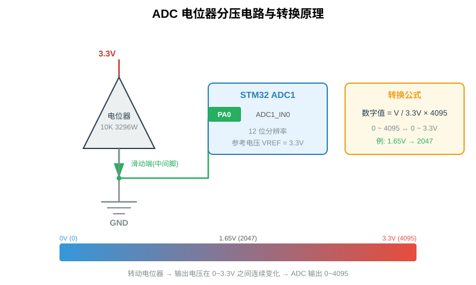
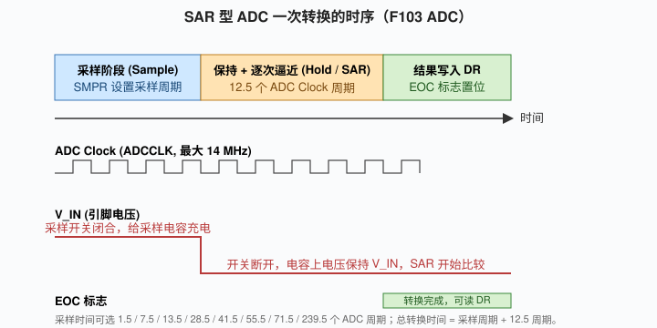
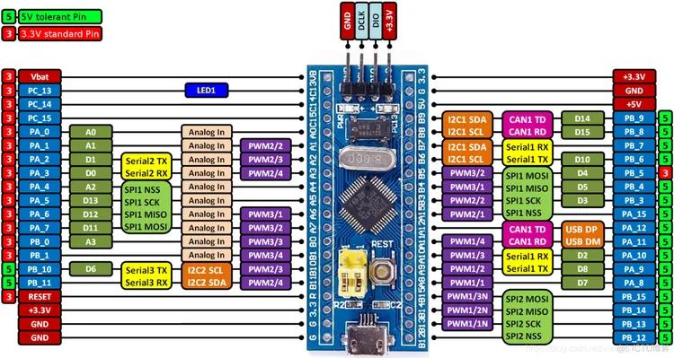
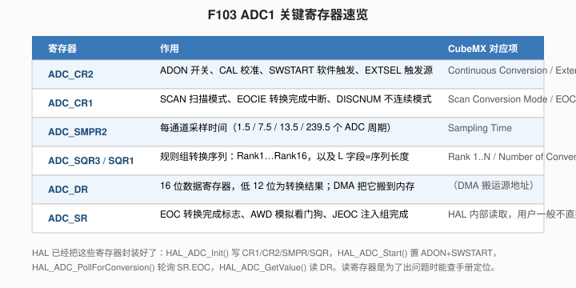
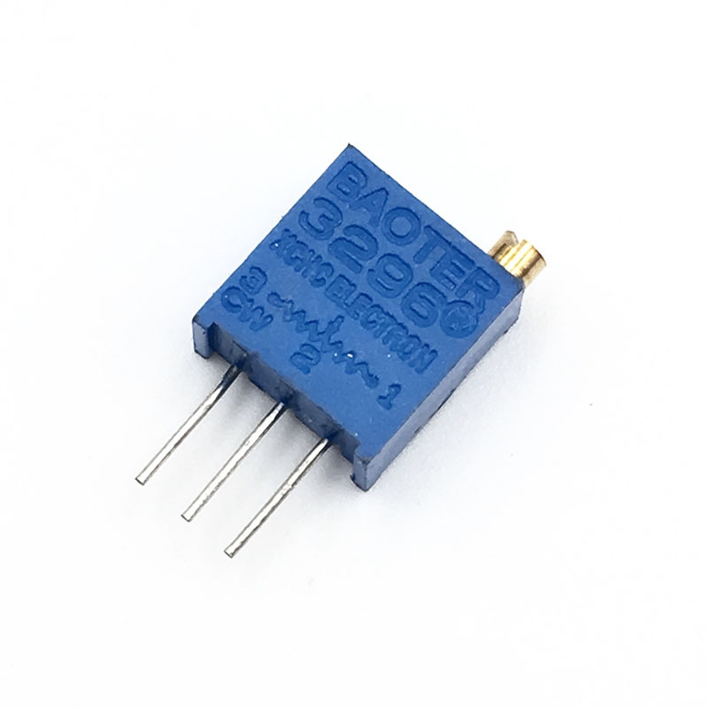
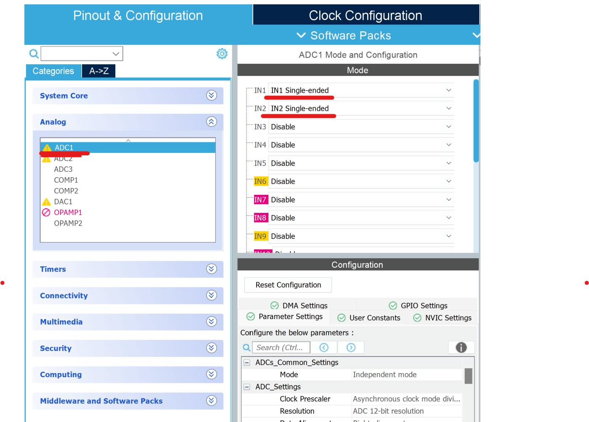
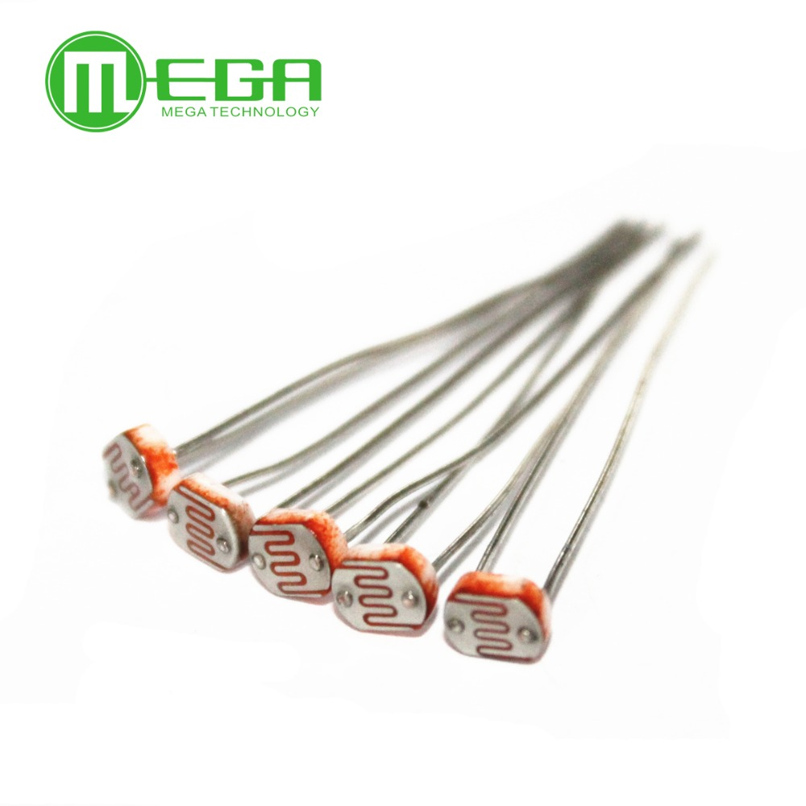
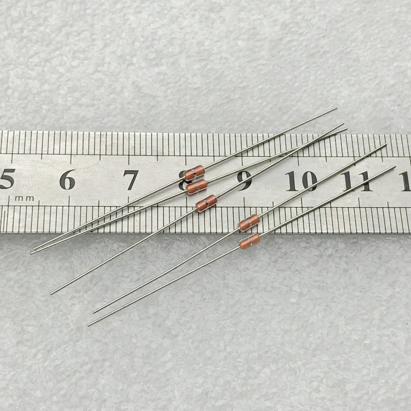
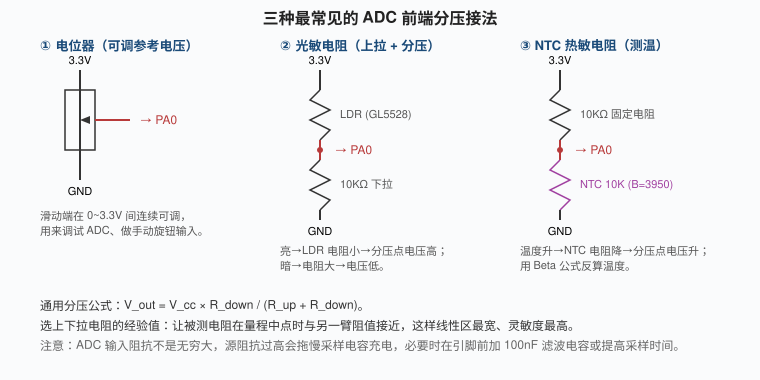

# 第9章 ADC 模拟量采集：从电位器到光敏电阻

## 本章学习目标

学完本章后，应当能够：

- 解释 ADC（Analog-to-Digital Converter，模数转换器）的作用，并说明 12 位逐次逼近型 ADC 的量化原理。
- 熟练运用换算公式 `数字值 N = V_in / V_ref × 4095` 将 ADC 原始读数换算为实际电压。
- 查阅 STM32F103C8T6 数据手册，正确列出 ADC1 外部通道与引脚的对应关系。
- 在 CubeMX 中完成 ADC1 的时钟、分辨率、对齐方式、采样时间、扫描模式与连续模式配置。
- 使用 HAL 库实现单通道单次采样（轮询方式）、多通道扫描 + DMA 连续采样。
- 根据光敏电阻、NTC 热敏电阻等传感器特性，设计合理的分压电路。
- 区分量化误差、参考电压误差与有效位数，并采用软件滤波手段提升数据稳定性。

---

## 9.1 ADC 的基本概念与量化原理

数字世界只有 0 和 1，而现实世界是连续的：旋钮的位置、环境亮度的强弱、温度的高低，均属于模拟量。单片机要感知这些物理量，必须先把连续电压"切"成有限个离散台阶，这一过程即由 ADC 完成。

### 9.1.1 F103C8T6 内部 ADC 的主要参数

STM32F103C8T6 内部集成的 ADC 具有以下特征：

- **12 位逐次逼近型（SAR）**：每次转换输出一个 0~4095 的整数，因为 2^12 = 4096 个量化台阶。
- **最多 18 个外部通道**：F103C8T6 实际引出到引脚的是 ADC1 的 IN0~IN9，对应 PA0~PA7、PB0、PB1。
- **参考电压 V_REF+**：Blue Pill 板子上直接接到 3.3V，没有单独引出 VREF+ 引脚（LQFP48 封装把 VREF+ 内部连到 VDDA）。
- **最高 1 MSPS**：ADC 时钟最高 14 MHz，转换一次最少 14 个周期，换算下来每秒约可完成 100 万次采样。

转换公式如下：

```
数字值 N = V_in / V_ref × 4095
V_in    = N × V_ref / 4095
```

以 V_ref = 3.3V 为例，1 LSB（最低有效位）代表的电压为 3.3/4095 ≈ 0.806 mV，即 ADC 能够分辨的最小电压变化约为 0.8 mV。



举例说明：若电位器中间滑动端输出 1.65V，则 ADC 读数为 1.65/3.3×4095 ≈ 2047，恰为量程的一半；当旋钮拧到两端时，读数应分别接近 0 或 4095。

### 9.1.2 量化误差与有效位数

需特别说明的是：**12 位是理论分辨率，不等于测量精度。**

ADC 将连续电压切分为 4096 个台阶，本身即引入 ±0.5 LSB 的量化误差。叠加参考电压误差、内部电阻网络温漂与电源噪声后，实际可达到的"有效位数"（ENOB）通常仅为 10~11 位。由此可得以下结论：

- 使用 ADC 制作简易电压表时，不应期望其精度达到台式万用表水平；
- 读取电位器时，1000 以内的数值波动基本属于噪声；
- 进行温度测量时，**软件多次采样取平均**比单纯追求位数更有效。

工程上常用的做法是：将采集到的原始值右移两位（即除以 4），相当于把 12 位数据按 10 位使用，曲线可立即变得平滑。

### 9.1.3 SAR 型 ADC 的转换过程

"逐次逼近"一词的逻辑可类比为在天平上从大到小依次试加砝码，整个过程分为四步：

1. **采样阶段**：ADC 内部采样电容通过开关接到外部引脚，充电至 V_in。该阶段所需时间由 SMPR 寄存器配置。
2. **保持阶段**：开关断开，电容上的电压保持不变，与外部信号源隔离。
3. **逐次比较**：SAR 逻辑从最高位开始试探，先判定"是否为 2048？"，由内部 DAC 输出对应电压与电容上的 V_in 比较；若 V_in 较大则保留该位，否则清零；随后依次试探 1024、512……直至最低位。整个过程共进行 12 次比较，固定占用 12.5 个 ADC 时钟周期。
4. **结果写入 DR**：比较结束后，12 位结果写入 ADC_DR 寄存器，硬件置 EOC 标志。



需要强调的是采样时间这一常被忽略的参数。CubeMX 中 SMPR 默认配置为 1.5 个 ADC 周期，看似极快，但前提是信号源内阻足够小。若前端接光敏电阻 + 10 kΩ 分压电路，等效源阻抗可能达到数千欧，1.5 个周期不足以将采样电容充满，会导致读数偏小且跳动。工程上一般将采样时间提高到 55.5 或 71.5 个周期，以数微秒的时间换取数据稳定性。

---

## 9.2 引脚与通道映射

F103C8T6（LQFP48 封装）将 ADC1 的通道引出到 10 个引脚，对应关系如表 9-1 所示。

| 通道 | 引脚 |
|---|---|
| ADC1_IN0 | PA0 |
| ADC1_IN1 | PA1 |
| ADC1_IN2 | PA2 |
| ADC1_IN3 | PA3 |
| ADC1_IN4 | PA4 |
| ADC1_IN5 | PA5 |
| ADC1_IN6 | PA6 |
| ADC1_IN7 | PA7 |
| ADC1_IN8 | PB0 |
| ADC1_IN9 | PB1 |

芯片内部另有两个特殊通道：ADC1_IN16 为内部温度传感器（测量芯片结温，而非环境温度），ADC1_IN17 为内部参考电压 VREFINT（约 1.2V），可用于反算外部 VDDA 的实际值。



需注意一个细节：**一个引脚不能同时作为 ADC 输入与其他外设使用。** 在 CubeMX 中将 PA0 配置为 `ADC1_IN0` 后，引脚自动进入 Analog 模式，数字输入缓冲器被断开。此时若再试图将 PA0 作为 GPIO 读取按键，将无法得到有效电平——这是初学者最常遇到的配置错误。

### 9.2.1 ADC 关键寄存器速览

使用 HAL 库开发时通常无需直接操作寄存器，但在调试出现异常时，查阅参考手册中的寄存器定义可快速定位问题。F103 ADC1 的关键寄存器如下：



各寄存器的主要作用为：

- `ADC_CR2`：ADON 位用于开/关 ADC，SWSTART 位用于软件触发一次转换，ALIGN 位选择左对齐或右对齐。
- `ADC_CR1`：SCAN 位开启扫描模式，EOCIE 位开启转换完成中断。
- `ADC_SMPR2`：每 3 位控制一个通道的采样时间。
- `ADC_SQR3 / SQR1`：规则组的转换序列，Rank 1~16 依次填入通道号，L 字段填入序列长度。
- `ADC_DR`：16 位数据寄存器，低 12 位为转换结果。

CubeMX 通过图形化配置自动完成上述寄存器写入，使用者只需了解其背后的物理含义。

---

## 9.3 ADC 的三种转换模式

F103 的 ADC 支持多种工作模式，可按触发方式与通道数组合选用。

### 9.3.1 单次转换（Single Conversion）

调用 `HAL_ADC_Start()` 启动一次转换，转换结束后即停止，EOC 标志置位，CPU 读取一次 DR 后 ADC 进入空闲状态。下一次采样需再次调用 `HAL_ADC_Start()`。

适用场景：在主循环中每隔固定延时采样一次电位器并打印结果，属于低速、低开销的应用。其优点是逻辑简单、代码量最少。

### 9.3.2 连续转换（Continuous Conversion）

ADC 完成一次转换后自动启动下一次，无需 CPU 再次触发，DR 寄存器始终保存最新转换值。

适用场景：配合 DMA 在后台持续将采样值搬入数组，CPU 完全不参与触发。本章 9.6 节的多通道 DMA 实验即采用此模式。

### 9.3.3 扫描模式与规则组/注入组

扫描模式（Scan Conversion Mode）指：规则组中配置了几个通道，ADC 即按 Rank 顺序依次转换一遍，转完整组后停止。该模式可与连续模式叠加——扫描 + 连续，即形成"通道 0、1、0、1、0、1……"的循环采样。

注入组（Injected Group）是规则组的"插队"机制，最多 4 个通道，可配置外部触发源（例如定时器溢出），在规则组转换过程中强行插入。该机制在一般教学与常规项目中较少使用，此处仅作名词说明，避免在查阅参考手册时产生困惑。

三种模式的典型组合如表 9-2 所示。

| 模式组合 | 触发方式 | 适用场景 |
|---|---|---|
| 单次 + 不扫描 | CPU 调一次 Start | 手动读旋钮 |
| 连续 + 不扫描 | 启动后自动循环 | 单通道高速采样 + DMA |
| 连续 + 扫描 | 启动后按 Rank 循环 | 多通道同时采样 + DMA |
| 单次 + 扫描 | CPU 触发一次转完一组 | 一次性扫几个传感器 |

---

## 9.4 实验一：电位器 + 串口打印

本节通过一个完整实验，演示单通道单次采样的配置与编程流程。

### 9.4.1 硬件接线

使用 3296W 多圈电位器（或任意 10 kΩ 电位器），按以下方式接线：

- 引脚 1 → 3.3V
- 引脚 3 → GND
- 引脚 2（中间滑动端）→ **PA0**



上述电路构成一个最简单的分压电路：旋钮拧至一端时 PA0 为 3.3V，拧至另一端时 PA0 为 GND，中间位置电压随角度线性变化。

### 9.4.2 CubeMX 配置步骤

1. 新建工程，选择芯片 STM32F103C8。
2. 在左侧 `Analog → ADC1` 中勾选 `Active`。
3. 在 `Parameter Settings` 中配置：
   - `Clock Prescaler` = PCLK2/6（F103 默认 SYSCLK = 72 MHz，PCLK2 = 72 MHz，经 6 分频后 ADC 时钟为 12 MHz，满足 ADC 时钟不超过 14 MHz 的约束）。
   - `Resolution` = 12 bits。
   - `Data Alignment` = Right alignment（右对齐，DR 低 12 位为转换结果）。
   - `Scan Conversion Mode` = Disable（单通道实验暂不开启扫描）。
   - `Continuous Conversion Mode` = Disable（单次转换）。
   - `External Trigger Conversion Source` = Regular Conversion launched by software。
   - `Rank 1` 的 `Channel` = Channel 0，`Sampling Time` = 55.5 Cycles（建议从 55.5 周期起步，不要使用默认的 1.5 周期）。
4. 在 Pinout 视图中点击 PA0，选择 `ADC1_IN0`。
5. 同时开启 USART1（115200-8-N-1），用于 printf 打印采样结果。
6. 生成代码。



### 9.4.3 参考代码

在 CubeMX 生成工程的 `main.c` 中，USER CODE 区域加入以下代码：

```c
/* USER CODE BEGIN PV */
uint16_t adc_val = 0;
float voltage = 0.0f;
/* USER CODE END PV */

/* 主循环里： */
while (1)
{
  /* USER CODE END WHILE */

  HAL_ADC_Start(&hadc1);                  // 软件触发一次转换
  HAL_ADC_PollForConversion(&hadc1, 100); // 最多等 100ms
  adc_val = HAL_ADC_GetValue(&hadc1);     // 读 DR 低 12 位
  voltage = adc_val * 3.3f / 4095.0f;     // 换算成电压

  printf("ADC = %4d,  Voltage = %.3f V\r\n", adc_val, voltage);
  HAL_Delay(300);

  /* USER CODE BEGIN 3 */
}
```

上述流程即为"单次转换三件套"：`HAL_ADC_Start` → `HAL_ADC_PollForConversion` → `HAL_ADC_GetValue`。其中 `HAL_ADC_PollForConversion` 内部轮询 SR.EOC 位，超时时间到达时返回 `HAL_TIMEOUT`。

完整工程见 `code/ch09_adc_single.c`。

### 9.4.4 验证方法

编译下载后打开串口助手，应观察到类似输出：

```
ADC = 2047,  Voltage = 1.651 V
ADC = 2050,  Voltage = 1.653 V
ADC = 2045,  Voltage = 1.649 V
```

转动电位器，数值应在 0~4095 之间平滑变化。用万用表测量 PA0 对 GND 的电压，与串口打印值对比，误差一般应在 ±0.02V 以内。

一种常见故障现象是：串口始终输出 0。此时应首先检查 CubeMX 中是否将 PA0 正确配置为 `ADC1_IN0`——若引脚仍处于复位默认的浮空 GPIO 模式，`HAL_ADC_Start` 不会报错，但读取结果为无效值。

> 提示：在 CubeIDE 中使用 printf 打印浮点数据时，需在 Project → Settings → MCU Settings → Linker 中添加 `-u _printf_float`，否则会输出 `?` 或乱码字符。详见 [第8章 串口通信](ch08_串口.md)。

---

## 9.5 传感器接入：光敏电阻与 NTC 热敏电阻

电位器属于手动输入装置，而 ADC 更典型的应用是连接各类模拟传感器。本节介绍两种最常见传感器的分压接法。

### 9.5.1 光敏电阻 GL5528



光敏电阻的特性为：**光照强 → 电阻小（数千欧），光照弱 → 电阻大（数兆欧）**。由于单一电阻无法产生电压信号，必须与固定电阻组成分压电路。

推荐接法如下：

```
3.3V ──[LDR GL5528]──┬── PA0
                      │
                     [10KΩ]
                      │
                     GND
```

光照增强时 LDR 阻值减小，分压点电压升高；用手捂住 LDR 时电压下降。该电路可直接用于"光线自动控制 LED"类实验。

### 9.5.2 NTC 热敏电阻 10 kΩ



NTC 为负温度系数热敏电阻：温度升高时电阻减小。25°C 时标称阻值 10 kΩ，100°C 时约降至 1 kΩ 多一点。

推荐接法如下：

```
3.3V ──[10KΩ 固定电阻]──┬── PA0
                          │
                         [NTC 10K]
                          │
                         GND
```

将固定电阻置于上拉臂、NTC 置于下拉臂的原因在于：NTC 受热后阻值减小，此接法下温度越高、分压点电压越低，符合直观习惯；反之接法亦可行，仅需在换算公式中取倒数。

由 ADC 读数换算 NTC 阻值：

```
R_ntc = R_fixed × V_adc / (V_ref - V_adc)
```

再由 Beta 公式反算温度：

```
1/T = 1/T0 + (1/B) × ln(R_ntc / R0)
```

其中 T0 = 298.15 K（25°C），R0 = 10 kΩ，B = 3950。该公式在公开资料中已有成熟的代码实现，移植时只需替换对应变量名即可。

### 9.5.3 分压电阻取值原则



选取上下拉电阻时遵循一条经验法则：**使被测电阻在量程中点附近与另一臂阻值接近。** 例如 NTC 在 25°C 为 10 kΩ，应选配 10 kΩ 固定电阻；在 50°C 时 NTC 降至约 4 kΩ，此时分压点电压约为 3.3×4/(10+4) ≈ 0.94V，仍位于量程中段，线性度最佳。

若所选固定电阻与被测电阻相差 10 倍以上，分压曲线将严重靠近 0 或 VCC，中间大部分区域灵敏度极低，这是光线检测类实验中常见的设计失误。

---

## 9.6 多通道采样：扫描模式 + DMA

单通道采样已可满足基本需求，但实际项目中往往需要同时采集多路信号，例如一路旋钮、一路光敏、一路 NTC。若仍在主循环中逐通道轮询，代码将如下所示：

```c
while (1) {
  read_ch0();   // 阻塞 100ms
  read_ch1();   // 又阻塞 100ms
  read_ch2();   // 又阻塞 100ms
  printf(...);
}
```

这种方式既慢又占用 CPU。正确做法是采用**扫描模式 + DMA**，由 ADC 自动循环转换、DMA 自动将结果搬入数组，CPU 仅需在主循环中读取数组。

### 9.6.1 CubeMX 配置步骤

1. ADC1 参数配置：
   - `Scan Conversion Mode` = Enable
   - `Continuous Conversion Mode` = Enable
   - `Number of Conversion` = 2（两个通道）
   - Rank 1：Channel 0，Sampling Time 55.5 Cycles
   - Rank 2：Channel 1，Sampling Time 55.5 Cycles
2. PA0 选择 `ADC1_IN0`，PA1 选择 `ADC1_IN1`。
3. 切到 ADC1 的 `DMA Settings` 标签，点击 Add：
   - DMA Request = ADC1
   - Mode = Circular（循环模式）
   - Data Width：Peripheral = Half Word，Memory = Half Word（与 ADC_DR 的 16 位宽度匹配）
4. 在 NVIC 中确认 `DMA1 channel1 global interrupt` 已勾选（`HAL_ADC_Start_DMA` 内部需要使用）。


### 9.6.2 参考代码

```c
/* USER CODE BEGIN PV */
uint16_t adc_buf[2];   // 注意：这里用 uint16_t，因为 ADC_DR 是 16 位
/* USER CODE END PV */

/* USER CODE BEGIN 2 */
HAL_ADC_Start_DMA(&hadc1, (uint32_t*)adc_buf, 2);
/* USER CODE END 2 */

while (1)
{
  /* USER CODE END WHILE */
  printf("CH0=%4d (%.2fV)  CH1=%4d (%.2fV)\r\n",
         adc_buf[0], adc_buf[0]*3.3f/4095.0f,
         adc_buf[1], adc_buf[1]*3.3f/4095.0f);
  HAL_Delay(500);
  /* USER CODE BEGIN 3 */
}
```

完整工程见 `code/ch09_adc_multi_dma.c`。

需说明 `adc_buf` 的类型选择：HAL 函数签名为 `uint32_t*`，但实际 ADC_DR 仅有 16 位有效。使用 `uint16_t adc_buf[2]` 再强转为 `(uint32_t*)` 同样可行——DMA 按半字（2 字节）搬运，两个通道恰好填满 4 字节。使用 `uint32_t adc_buf[2]` 亦可，只是每个元素占 4 字节、高 16 位为 0。工程上推荐使用 `uint16_t`，以与硬件数据宽度保持一致。

启动后 ADC 即在后台循环转换：CH0 → CH1 → CH0 → CH1……，DMA 自动将 DR 的值分别搬入 `adc_buf[0]`、`adc_buf[1]`。主循环读取的即为最新值，CPU 占用几乎为零。这也是下一章将 DMA 单独成章的原因。

---

## 9.7 参考电压与电源噪声

前文已述，V_ref 默认取自板子上的 3.3V（即 VDDA）。但需注意，该 3.3V 本身并非理想电压源：

- 板子上的 3.3V 由 AMS1117-3.3 LDO 产生，负载调整率约 ±1%，即 ±33 mV。
- USB 供电时，5V 输入本身可能在 4.7~5.2V 之间波动。
- DC-DC 开关电源的纹波会直接耦合到 ADC 采样值上。

**实际测量中常见现象为：即便输入短接至 GND，ADC 读数也并非稳定为 0，而是在 0~5 之间跳变；输入接 3.3V 时，读数也并非稳定为 4095，而是在 4090~4095 之间波动。** 上述现象属于正常情况。

若需进行精确测量，工程上常采用以下几种方法：

1. **多次采样取平均**：连续读取 16 次，剔除最大值与最小值，取中间 14 次的平均值。该方法对随机噪声抑制效果显著。
2. **在 VDDA 引脚加 LC 滤波**：常见最小系统板上已集成 10 Ω 磁珠 + 10 nF + 1 μF 滤波网络，更换不同厂商的 STM32 最小系统板时应查阅其原理图。
3. **利用内部 VREFINT 反算 VDDA**：ADC1_IN17 为内部 1.20V 基准，读取该通道后假设其值准确，反推 VDDA 的实际值：

   ```
   VDDA_real = 1.20V × 4095 / adc_vrefint
   ```

   随后其他通道的电压换算均以该实际 VDDA 为基准，精度可显著提高。
4. **外接精密基准源**：例如将 TL431（2.5V 基准，精度 1%）直接接入 VREF+ 引脚。但 Blue Pill 已将 VREF+ 连接至 VDDA，需修改 PCB 才能使用，初学者暂不必尝试。

---

## 9.8 常见故障与调试思路

本节集中列出 ADC 使用过程中高频出现的故障现象及排查方法。

**1. 读数始终为 0 或始终为 4095。**
多为接线问题：引脚悬空或电位器中间滑动端未正确接入。应先用万用表测量 PA0 对 GND 的电压，确认硬件上确有 0~3.3V 变化后，再排查软件配置。

**2. 数值频繁跳动，幅度达 100~200。**
前端阻抗过高、采样时间不足所致。将 Sampling Time 由 1.5 周期改为 55.5 或 71.5 周期；若仍跳动，可在 PA0 对 GND 处并联一只 100 nF 电容，构成硬件低通滤波。

**3. 多通道模式下 `adc_buf[0]` 与 `adc_buf[1]` 数据不对应。**
应检查 CubeMX 中 Rank 的配置顺序。DMA 严格按 Rank 1、Rank 2、Rank 3……的顺序向数组搬运数据，Rank 1 的结果永远位于 `adc_buf[0]`，与物理传感器接入哪个引脚无关。若将 Rank 1 误设为 IN1、Rank 2 设为 IN0，则数组中所谓 CH0 的数据实际上来自 PA1。

**4. 浮点 printf 输出 `?`。**
CubeIDE 未添加 `-u _printf_float` 链接选项所致。

**5. 接入光敏电阻后采样范围过窄。**
分压电阻取值不当所致。亮时 LDR 约 5 kΩ，暗时约 500 kΩ，若配 10 kΩ 下拉，亮时分压点约 2.4V，暗时约 3.23V，变化范围仅 0.8V。此类应用应换用更大的下拉电阻（例如 100 kΩ），或增加一级运放缓冲。

**6. 启动 DMA 模式后试图再次手动单次读取。**
两种模式存在冲突。DMA 模式启动后 ADC 持续连续转换，不可再调用 `HAL_ADC_PollForConversion`。需切换模式时，应先调用 `HAL_ADC_Stop_DMA`，再重新 Start。

**7. ADC 上电后首次读数总是偏大。**
这是 F103 的典型现象，原因是未执行 ADC 内部校准。CubeMX 生成代码时默认在 `MX_ADC1_Init()` 之后调用一次 `HAL_ADCEx_Calibration_Start(&hadc1)`，但在手动编写寄存器代码或使用早期版本 HAL 时，该步骤可能遗漏。校准原理是让 ADC 内部短接参考、测量一次偏差并存入校准寄存器。手动补加如下代码即可：

```c
HAL_ADC_DeInit(&hadc1);
MX_ADC1_Init();
HAL_ADCEx_Calibration_Start(&hadc1);
```

完成校准后再启动转换，数据稳定性会明显改善。

**8. 采用中断方式采样，回调中读不到新值。**
`HAL_ADC_ConvCpltCallback` 是转换完成中断回调，回调内应调用 `HAL_ADC_GetValue()` 将 DR 读走，否则 EOC 标志不会被清除，下一次转换将停止。HAL 库内部虽已自动读取一次，但用户自定义回调时仍建议再读一次以确保标志清零。

---

## 9.9 中断方式：不使用 DMA 的 CPU 解放方案

在介绍 DMA 之前，有必要先说明中断方式，因为它是 DMA 的前置概念——理解了中断的局限，才能理解 DMA 的价值。

在 CubeMX 中为 ADC1 勾选 `End of Conversion Interrupt`，然后使用以下代码：

```c
/* USER CODE BEGIN 2 */
HAL_ADC_Start_IT(&hadc1);   // 启动一次中断转换
/* USER CODE END 2 */

void HAL_ADC_ConvCpltCallback(ADC_HandleTypeDef* hadc)
{
  if (hadc->Instance == ADC1) {
    adc_val = HAL_ADC_GetValue(&hadc1);
    HAL_ADC_Start_IT(&hadc1);   // 再触发下一次
  }
}
```

每次转换完成即进入一次中断，CPU 在中断中读取一次值后退出。其代价在于：**每次转换都要经历一次中断入栈、读 DR、出栈的过程**。若采样频率为 1 kHz，中断开销尚可接受；但若采样频率提高到 10 kHz，中断将占用大量 CPU 时间，此时 DMA 即成为必要方案。

DMA 与中断的本质区别可概括为：

- **中断方式**：每搬运一个元素，CPU 进入一次中断。
- **DMA 方式**：搬运 N 个元素期间 CPU 不介入，仅在搬完 N 个元素（或半满、空闲事件）时进入一次中断（循环模式下甚至完全不进中断）。

这正是高速 ADC、连续串口接收等场景必须使用 DMA 的原因。

---

## 9.10 内部温度传感器与 VREFINT 通道

F103 的 ADC1 还集成两路无需外接元件的内部通道：

- **ADC1_IN16**：内部温度传感器，测量的是芯片结温而非环境温度。换算公式见数据手册：`Temperature (°C) = (Vsense - V25) / Avg_Slope + 25`，其中 V25 典型值 1.43V，Avg_Slope 为 4.3 mV/°C。
- **ADC1_IN17**：内部 VREFINT，约 1.20V。如 9.7 节所述，可用于反算 VDDA 实际电压。

在 CubeMX 中勾选 `Temperature Sensor Channel` 与 `VREFINT Channel` 即可启用这两路通道。读取并换算后，可观察到芯片当前结温——例如用手按住芯片约 10 秒，读数可上升 3~5°C。

---

## 9.11 软件滤波方法

ADC 原始数据通常不能直接使用。即便硬件设计良好，电源纹波、接触抖动与外界干扰仍会导致读数波动。工程上常用的软件滤波方法按复杂度由低到高排列如下。

**1. 算术平均法**：连续读取 N 次，求和后除以 N。实现简单，对随机噪声有效，但对周期性干扰（如开关电源的 50 kHz 纹波）抑制效果一般。

```c
uint32_t sum = 0;
for (int i = 0; i < 16; i++) {
  HAL_ADC_Start(&hadc1);
  HAL_ADC_PollForConversion(&hadc1, 100);
  sum += HAL_ADC_GetValue(&hadc1);
}
uint16_t avg = sum / 16;
```

**2. 滑动平均法**：维护一个环形缓冲区，每次新数据替换最老数据后求平均。与算术平均相比响应更快，无需等待凑满 N 个样本再计算。

**3. 中值滤波法**：连续读取 5 次，排序后取中间值。对"瞬时毛刺"（例如手触碰引脚、附近电机启动瞬间的干扰）抑制效果尤为明显。

**4. 一阶滞后滤波（低通）**：

```c
filtered = filtered * 0.8 + new_value * 0.2;
```

系数越小输出越平滑，但响应越慢。该算法在 8 位机上即属经典方案，在 Cortex-M3 上执行毫无压力。

工程上常见的组合方案为：**硬件 100 nF 电容 + 滑动平均 8 点 + 中值滤波 5 点**。按此方案处理后，一般工业现场传感器数据的波动可压缩到 ±2 个 LSB 以内。

---

## 9.12 本章小结

- ADC 将模拟电压量化为 0~4095 的数字，1 LSB ≈ 0.8 mV（3.3V 参考）。
- SAR 型 ADC 一次转换 = 采样（时长由 SMPR 决定）+ 12.5 周期逐次比较 + 写入 DR。
- 单通道轮询三件套：`HAL_ADC_Start` → `HAL_ADC_PollForConversion` → `HAL_ADC_GetValue`。
- 多通道连续采样采用扫描 + 连续 + DMA，通过 `HAL_ADC_Start_DMA` 一次启动，后台自动完成采样。
- 分压电路的上下臂电阻应与被测电阻在同一量级，以保证量程中段灵敏度。
- 参考电压本身存在误差，多次平均 + 内部 VREFINT 校算是性价比最高的精度提升手段。
- 下一章将专门讨论 DMA 的工作机制，解释 ADC 接入 DMA 后为何能够实现后台自动数据搬运。

---

## 练习题

1. 设参考电压为 3.3V、ADC 为 12 位，输入电压为 2.0V，试计算理论上 ADC 应读到的数字值。若读得数字值为 2700，反算输入电压为多少？
2. 在前端接入光敏电阻 + 10 kΩ 分压电路时，为何 CubeMX 默认的 1.5 周期采样时间往往不够？应如何调整？
3. 多通道 DMA 采样时，`adc_buf[0]` 中存放的是 Rank 1 还是 Rank 2 的转换结果？若物理上把传感器接到了 IN1 而 Rank 1 配为 IN0，会出现什么现象？
4. 采用 NTC（25°C 时 10 kΩ）分压测温时，固定电阻应取多大阻值才能保证量程中段线性度最佳？试结合分压公式说明理由。

---

<!-- ===== 第9章 完 ===== -->

下一章：[第10章 DMA 数据传输](ch10_DMA.md)
