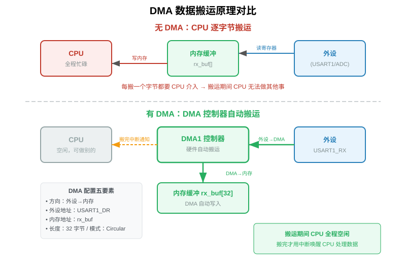
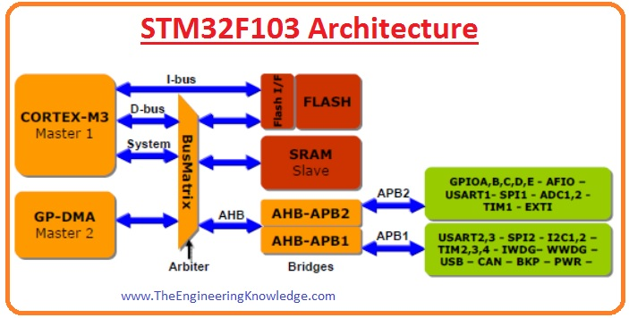
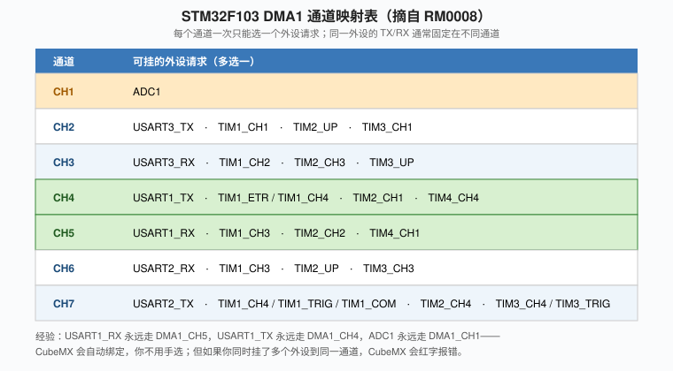
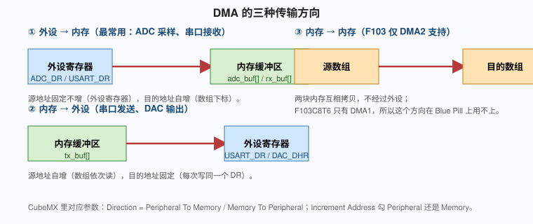
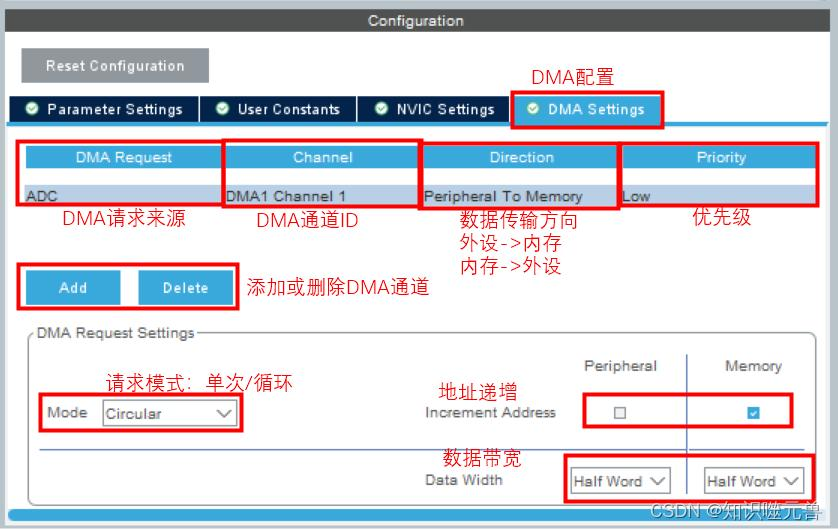

# 第10章 DMA 数据传输：让 CPU 从搬运工里解放出来

> 上一章结尾我们用 `HAL_ADC_Start_DMA` 让 ADC 自己在后台采样，CPU 一行代码没写，数据就乖乖进了数组。这一章我们拆开看 DMA 到底是什么、为什么这么香、以及用它做串口不定长接收时我踩过的那些坑。

我第一次听说 DMA 是在做串口 GPS 模块的时候。GPS 模块 9600 波特率持续吐 NMEA 语句，我用 `HAL_UART_Receive` 阻塞接收，结果主循环的延时函数全乱了；改成逐字节中断接收，又发现高负载下偶尔丢字节。后来学会用 DMA + 空闲中断，整个世界清净了。

---

## 10.1 没有 DMA 的世界：CPU 是个被低估的搬运工

你回想一下：从外设读一个字节，CPU 实际做了什么？

```c
while (!(USART1->SR & USART_SR_RXNE));   // 1. 轮询标志
uint8_t b = USART1->DR;                  // 2. 从 DR 读一个字节
buf[idx++] = b;                          // 3. 写进内存数组
if (idx >= N) process();                 // 4. 处理
```

每收一个字节，CPU 至少要跑 5~10 条指令，还要占着寄存器、占用着流水线。如果是中断接收，每字节还要压栈出栈，更贵。

我们算一笔账：USART1 115200 波特率，每秒大约能收 11520 个字节。每次中断就算 200 个时钟周期（压栈 + 读 DR + 写内存 + 出栈），CPU 占用率 = 11520 × 200 / 72000000 ≈ 3.2%。看着不多对吧？但如果你再开 ADC 1kHz 采样、SPI 读 OLED 刷屏、再加 PWM 舵机控制……占用率就上去了。更要命的是，**中断是随机插入的**，主循环的实时性根本没法保证。

DMA（Direct Memory Access，直接存储器访问）就是来解决这个问题的。它是 Cortex-M3 内核旁边一个**独立的硬件搬运工**，CPU 只要告诉它"从哪搬到哪、搬多长、搬完告诉我"，它自己就跑了。搬运期间 CPU 完全空闲，该干嘛干嘛；搬完 N 个字节，DMA 发一个中断给 CPU，CPU 才醒过来处理一次。

```
无 DMA：CPU 亲自搬运，每字节都要管 → 慢、占资源
有 DMA：DMA 硬件搬运，CPU 只在搬完时被通知一次 → 快、解放 CPU
```



打个比方：没有 DMA 的 CPU 像一个前台接待，每个客人来都要亲自领到座位、倒水、点菜、传菜；有了 DMA 等于雇了一个服务员（DMA 控制器），前台只负责接待和结账，中间传菜全是服务员干。

---

## 10.2 DMA 在 F103 里的位置：它是怎么和 CPU 抢总线的

F103C8T6 的内核是 Cortex-M3，内部有三条总线：I-bus（取指）、D-bus（取数据）、System 总线（访问外设）。DMA 挂在 System 总线上，和 CPU 共享总线带宽。



关键概念：**总线仲裁器（Bus Arbiter）**。当 CPU 和 DMA 同时要访问 SRAM 或外设时，仲裁器决定谁先用。F103 的策略是 CPU 优先级高一点，但 DMA 也能拿到总线周期。所以 DMA 搬运不是"CPU 停一下"，而是"CPU 和 DMA 分时共用总线"，吞吐量上 DMA 能占到 20~40% 的总线带宽。

F103 有两个 DMA 控制器：

- **DMA1**：挂在 APB1 上，7 个通道，只能访问 SRAM 和 APB1 上的外设，**不支持内存到内存**。
- **DMA2**：挂在 AHB 上，5 个通道，支持内存到内存，能访问所有外设。

Blue Pill（C8T6）只引出了 DMA1，DMA2 在这个封装上是不可用的（F103RCT6 以上才完整）。所以你在 Blue Pill 上学 DMA，主要就是玩 DMA1。

---

## 10.3 DMA1 通道映射：谁能用谁，早就定死了

很多人第一次配 DMA 时会懵：为什么 ADC1 自动绑到 DMA1 Channel 1？为什么 USART1_RX 不能选 Channel 1？答案是：**F103 的 DMA 通道和外设是硬件映射死的，不能任意组合。**



你记住几个最常用的就行：

| 通道 | 最常见外设 | 用途 |
|---|---|---|
| DMA1_CH1 | ADC1 | ADC 采样自动搬运 |
| DMA1_CH4 | USART1_TX | 串口发送 |
| DMA1_CH5 | USART1_RX | 串口接收 |
| DMA1_CH6 | USART2_RX | 串口 2 接收 |
| DMA1_CH7 | USART2_TX | 串口 2 发送 |

CubeMX 帮你自动选通道，你不用手填。但你要知道：如果你想让 ADC1 和 USART1_RX 同时用 DMA，它们不冲突，因为 CH1 和 CH5 是独立的；但如果你想让 USART1_TX 和 TIM4_CH4 都用 CH4，就冲突了，CubeMX 会红字报错。

---

## 10.4 DMA 的五大传输要素

配一个 DMA 通道，本质上就是回答五个问题：

1. **从哪搬（源地址）**：外设寄存器（比如 `&USART1->DR`，地址固定不变）还是内存数组（地址自增）。
2. **搬到哪（目的地址）**：和源地址反过来。
3. **搬多少（数据长度 CNDTR）**：一次搬几个元素，写在 CNDTR 寄存器里，DMA 每搬一个自动减一。
4. **每次搬多宽（数据宽度）**：Byte（8 位）、Half Word（16 位）、Word（32 位）。串口是 Byte，ADC 是 Half Word。
5. **搬完怎么办（模式）**：
   - **Normal（正常模式）**：CNDTR 减到 0 就停，下次要重启得手动再 `HAL_UART_Receive_DMA`。
   - **Circular（循环模式）**：CNDTR 减到 0 自动重载，从头再搬，永远不停。ADC 连续采样、串口持续接收都用这个。

方向有三种：



- **外设 → 内存**：ADC 采样、串口接收。源地址固定（外设 DR），目的地址自增。
- **内存 → 外设**：串口发送、DAC 输出。源地址自增（数组），目的地址固定（外设 DR）。
- **内存 → 内存**：F103C8T6 用不上（DMA2 才能做）。

---

## 10.5 DMA 寄存器速览（知道就行）

F103 的 DMA 每个通道有 5 个寄存器：

- **DMA_CCRx**（Channel Configuration Register）：控制寄存器，包含方向（DIR）、源/目的自增（MINC/PINC）、数据宽度（MSIZE/PSIZE）、模式（CIRC）、中断使能（TCIE/HTIE/TEIE）。
- **DMA_CNDTRx**（Channel Number of Data To Transfer）：要搬多少个元素，16 位，最大 65535。
- **DMA_CPARx**（Channel Peripheral Address Register）：外设地址。
- **DMA_CMARx**（Channel Memory Address Register）：内存地址。
- **DMA_ISR / DMA_IFCR**：中断状态和清除。

CubeMX 帮你把这些都填好了，你只要知道背后的逻辑：

```c
// HAL_UART_Receive_DMA 内部大致做的事：
DMA1_Channel5->CPAR = (uint32_t)&USART1->DR;  // 源：串口 DR
DMA1_Channel5->CMAR = (uint32_t)rx_buf;        // 目的：你的数组
DMA1_Channel5->CNDTR = 32;                     // 搬 32 字节
DMA1_Channel5->CCR |= DMA_CCR_CIRC |           // 循环模式
                     DMA_CCR_MINC |            // 内存地址自增
                     DMA_CCR_TCIE;             // 搬完中断使能
DMA1_Channel5->CCR |= DMA_CCR_EN;              // 启动 DMA
```

外设那边（USART1）的接收中断其实也得开，因为空闲中断是 USART 自己发的，DMA 只管搬数据。

---

## 10.6 实操一：串口 DMA 接收不定长数据

这是我最常用的 DMA 场景：上位机发一串任意长度的数据，STM32 收到一帧就打印一帧。

### 10.6.1 为什么不能简单地 `HAL_UART_Receive_DMA`

你可能会想：不就是 `HAL_UART_Receive_DMA(&huart1, buf, 32)` 吗？但问题是：

- 上位机发的是不定长的，比如有时候发 5 个字节，有时候发 20 个字节。
- 如果你设 `Length=32`，那上位机只发 5 个字节时，DMA 永远凑不满 32，全传输中断永远不来，你什么都收不到。
- 如果你设 `Length=5`，上位机发 10 个字节时，第 6 个字节就溢出到 buffer 外面了。

**这就是 DMA 接收不定长数据的经典难题。** 解法是：**循环模式 + 空闲中断（Idle Line）**。

### 10.6.2 原理

串口有个"空闲中断"：当总线连续 1 个字节时间没有数据，硬件认为这一帧结束了，触发 IDLE 中断。你在中断里读一下 CNDTR，用"预设长度 - 剩余长度"就算出这一帧实际收了多少字节。

F103 HAL 把这套逻辑封装成了 `HAL_UARTEx_ReceiveToIdle_DMA`。

### 10.6.3 CubeMX 配置

1. USART1 Activated，115200-8-N-1。
2. `NVIC Settings`：勾上 `USART1 global interrupt`。
3. 切到 `DMA Settings`，点 Add：
   - DMA Request = `USART1_RX`
   - Stream/Channel = 默认（DMA1 Channel5）
   - Direction = Peripheral To Memory
   - Mode = **Circular**
   - Data Width = Byte / Byte
   - Priority = Medium
4. 生成代码。



### 10.6.4 代码

```c
/* USER CODE BEGIN PV */
uint8_t rx_buf[64];
/* USER CODE END PV */

/* USER CODE BEGIN 2 */
HAL_UARTEx_ReceiveToIdle_DMA(&huart1, rx_buf, sizeof(rx_buf));
/* USER CODE END 2 */

/* DMA 接收事件回调（接收满或空闲时触发） */
void HAL_UARTEx_RxEventCallback(UART_HandleTypeDef *huart, uint16_t Size)
{
  if (huart->Instance == USART1)
  {
    printf("Received %u bytes: ", Size);
    for (uint16_t i = 0; i < Size; i++) printf("%c", rx_buf[i]);
    printf("\r\n");

    // 循环模式下不用重启，但保险起见再调一次
    HAL_UARTEx_ReceiveToIdle_DMA(&huart1, rx_buf, sizeof(rx_buf));
  }
}
```

完整工程见 `code/ch10_uart_dma.c`。

### 10.6.5 验证

串口助手发：

```
hello
```

STM32 串口打印：

```
Received 6 bytes: hello
```

再发一串：

```
abcdefg
```

打印：

```
Received 8 bytes: abcdefg
```

不管你发多长（只要不超过 64 字节），STM32 都能正确识别这一帧的结束并回调。这就是为什么我说 GPS 模块、蓝牙透传、上位机协议都用这套组合。

### 10.6.6 我踩过的坑

**坑 1：循环模式里 buffer 被覆盖。**
循环模式下 DMA 一直在后台写 `rx_buf`，如果你在回调里处理数据花了太长时间，新数据已经覆盖了老数据。解决办法：回调里第一时间把数据 memcpy 到另一个 buffer，主循环再慢慢处理；或者用双缓冲。

**坑 2：忘了开 USART1 全局中断。**
DMA 中断是 DMA1_CH5 的，但空闲中断是 USART1 自己的。两个 NVIC 都要勾上。我有一次只勾了 DMA 的，结果回调永远不来，调试半天。

**坑 3：回调里又调用 `HAL_UART_Receive_DMA`。**
循环模式下其实不需要重启，DMA 自己在跑。但 HAL 库在某些版本里，第一次回调后 CNDTR 会停，所以保险起见还是重新调一次。注意：重新调的时候**不要**在回调里做耗时操作，否则会丢下一帧。

**坑 4：printf 阻塞。**
回调里 `printf` 是阻塞的（走 `HAL_UART_Transmit`），如果打印很多字符，回调会持续很久。短数据无所谓，长数据建议改成：回调里只设置一个 flag + memcpy，主循环里再 printf。

---

## 10.7 实操二：ADC + DMA 连续采样（回顾）

上一章 9.6 节我们已经写过：

```c
HAL_ADC_Start_DMA(&hadc1, (uint32_t*)adc_buf, 2);
```

现在你应该能看懂它背后的逻辑了：

- ADC1 配成扫描 + 连续模式，每转完一个通道就发 DMA 请求。
- DMA1_CH1 配成循环模式，源地址固定 = `&ADC1->DR`，目的地址自增 = `adc_buf`。
- 两个通道来回转，DMA 自动把结果填进 `adc_buf[0]`、`adc_buf[1]`。
- CPU 完全不用管，主循环想读就读。


如果你想要"采满 N 个点就通知我一次"，可以开 DMA 的半传输中断（HT）和全传输中断（TC）：

```c
// 在 CubeMX DMA Settings 里把 "Half Transfer Interrupt" 勾上
// 或者在代码里：
SET_BIT(DMA1_Channel1->CCR, DMA_CCR_HTIE);

void HAL_ADC_ConvHalfCpltCallback(ADC_HandleTypeDef* hadc) {
  // adc_buf 前一半已经填满，可以处理了
}
void HAL_ADC_ConvCpltCallback(ADC_HandleTypeDef* hadc) {
  // adc_buf 后一半已经填满
}
```

这就是所谓的"双缓冲"：DMA 写后半段时 CPU 读前半段，DMA 写前半段时 CPU 读后半段，永远不冲突。做示波器、声音采集都靠这个技巧。

---

## 10.8 实操三：串口 DMA 发送

接收讲完了，发送其实更简单：

```c
/* USER CODE BEGIN 2 */
char msg[] = "Hello via DMA TX\r\n";
HAL_UART_Transmit_DMA(&huart1, (uint8_t*)msg, sizeof(msg)-1);
/* USER CODE END 2 */
```

DMA 会自动把 `msg` 里的字节一个一个塞进 USART1_DR，CPU 完全不管。发完触发 `HAL_UART_TxCpltCallback`。

实际项目里我经常把日志打印改成 DMA 发送：

```c
printf("...");   // 这个是阻塞的
```

改成：

```c
char log_buf[128];
int n = snprintf(log_buf, sizeof(log_buf), "...");
HAL_UART_Transmit_DMA(&huart1, (uint8_t*)log_buf, n);
```

主循环立刻继续跑，串口慢慢发。注意 `log_buf` 要定义成全局或 static，不能是栈上的局部变量——DMA 是异步的，函数返回后栈帧就回收了。

---

## 10.9 DMA 中断优先级：和中断一起用时的坑

我之前踩过一个坑：ADC 用 DMA 连续采样（1kHz），同时串口用 DMA 接收。结果串口数据经常丢。

排查下来是这样：

- ADC 全传输中断优先级默认是 5，串口中断优先级也是 5。
- ADC 中断每次进处理函数要花几十微秒，串口字节一来就被 ADC 中断挡住。
- 串口 DR 只有一个字节的 FIFO，被挡住两个字节就溢出。

**解决办法：把高速外设（ADC、SPI 接收）的中断优先级调低，把实时性高的（串口接收、外部中断）优先级调高。**

CubeMX 里在 `NVIC` 标签改优先级数字，数字越小优先级越高。我一般：

- SysTick：15（最低）
- 串口接收：5
- ADC 转换完成：7
- 外部按键中断：3

---

## 10.10 常见坑与调试清单

把 DMA 相关的坑集中列一下，出问题时对着查：

**1. DMA 没反应，buffer 一直是 0。**
- 外设是否真正使能了 DMA？比如 ADC 要在 CR2 里开 DMA 位（`HAL_ADC_Start_DMA` 内部会做），USART 要在 CR3 里开 DMAT/DMAR 位（`HAL_UART_Receive_DMA` 会做）。如果你手搓寄存器，这一步漏了。
- DMA 通道使能位（EN）有没有置。

**2. 只触发一次回调就停了。**
- 模式设成了 Normal 而不是 Circular。Normal 模式 CNDTR 减到 0 就停，要重启。

**3. buffer 里数据错位。**
- 数据宽度不匹配。外设是 16 位（ADC_DR），DMA 配成 Byte 就会把一个 16 位数拆成两个字节搬，数组布局全错。CubeMX 里 Data Width 要两边一致。

**4. 内存地址自增没开。**
- CPAR（外设地址）和 CMAR（内存地址）的自增是分开的。外设 DR 地址固定，不能自增；内存数组必须自增。搞反了，DMA 会把数组所有元素写到同一个地址。

**5. 回调没进。**
- 检查 NVIC：DMA 中断和外设中断都要开。
- 检查中断优先级分组（NVIC_PriorityGroup），CubeMX 默认配 4 位抢占优先级 + 0 位子优先级，如果你手动改过，可能导致中断不触发。

**6. DMA 发送时数据是乱的。**
- `tx_buf` 是栈上局部变量，DMA 异步发送时函数已经返回，栈帧被回收了。改成全局或 static。

**7. 接了 DMA 之后，printf 阻塞。**
- `printf` 默认走 `HAL_UART_Transmit`（阻塞版），如果你想用 DMA 发送日志，要重定向 `_write` 函数到 `HAL_UART_Transmit_DMA`，但那样 printf 就变成异步的，多线程下要加锁。简单项目别折腾。

---

## 10.11 什么时候该用 DMA，什么时候不该用

我被问过很多次："我是不是所有数据传输都该用 DMA？" 答案是：**看数据量和频率。**

- **偶尔发几个字节**（比如每秒一次 printf）：阻塞就行，DMA 配置的开销比收益还大。
- **高频连续数据流**（ADC 1kHz 采样、串口持续接收 GPS、SPI 刷屏 OLED）：必须 DMA，否则 CPU 扛不住。
- **大块内存拷贝**（比如一整帧图像缓存）：DMA 是首选，虽然 F103C8T6 没有内存到内存 DMA，但可以用 SPI 把内存数据搬到外部 Flash。
- **偶尔的短命令**（比如收到 1 字节 LED 开关）：中断就行，DMA 杀鸡用牛刀。

经验法则：**如果你单次搬运少于 16 个字节，或者频率低于 100Hz，别用 DMA；超过这个量级，DMA 几乎总是更优。**

---

## 10.12 DMA 一次完整搬运的生命周期

为了让你彻底搞清楚 DMA 是怎么跑起来的，我把 USART1_RX 接收 32 字节这一整个过程按时间轴拆给你看：

**阶段 0：CPU 配置**
1. 你调 `HAL_UARTEx_ReceiveToIdle_DMA`。
2. HAL 把 `&USART1->DR` 写进 `DMA1_CPAR5`。
3. 把 `rx_buf` 数组地址写进 `DMA1_CMAR5`。
4. 把 32 写进 `DMA1_CNDTR5`。
5. 配置 `DMA1_CCR5`：外设地址不增、内存地址自增、Byte/Byte、Circular 模式、开传输完成和半传输中断。
6. 置 `DMA1_CCR5` 的 EN 位，DMA 开始工作。
7. 置 USART1_CR3 的 DMAR 位，允许串口向 DMA 发请求。

**阶段 1：第一个字节到达**
8. USART1 收到一个字节，硬件把它塞进 DR，置 RXNE 标志。
9. 因为 DMAR 开了，USART1 同时向 DMA1_CH5 发一个硬件请求。
10. DMA 仲裁器批准请求（CPU 此刻可能在跑别的，让出总线）。
11. DMA 读 `&USART1->DR`（拿到这个字节），写进 `CMAR5` 指向的地址。
12. CNDTR5 从 32 减到 31，CMAR5 自动加 1（指向下一个数组元素）。
13. 这个字节的搬运完成，CPU 根本没参与。

**阶段 2：连续 32 个字节**
14. 重复 8~13 步，每个字节都由 DMA 自己搬。
15. 中途 CNDTR5 减到 16 的时候，DMA 触发半传输中断（HT），CPU 可以进来读前 16 个字节。

**阶段 3：收满或空闲**
16. 如果 CNDTR5 减到 0，DMA 触发全传输中断（TC），Circular 模式下 CNDTR 自动重载回 32，从头开始。
17. 如果中途串口总线空闲 1 字节时间，USART1 自己触发 IDLE 中断，CPU 进中断读 CNDTR5 算出实际收到几个字节，回调 `HAL_UARTEx_RxEventCallback`。

整个过程 CPU 只在 17 步（和半传输）时被打断，中间的字节搬运全部硬件完成。这就是为什么 DMA 接收 115200 波特率能做到 CPU 占用率不到 0.1%。

---

## 10.13 调试 DMA 的三板斧

DMA 不工作的时候，别急着改代码，按顺序查：

**第一板斧：看 CNDTR 在不在动。**
Keil / STM32CubeIDE 调试时，把 `DMA1_Channel5->CNDTR` 加到 Watch 窗口。如果外设发数据了，CNDTR 应该不断减少。如果 CNDTR 不动，说明外设根本没发 DMA 请求——回去查 USART_CR3 的 DMAR 位、或者 ADC_CR2 的 DMA 位有没有被置上。

**第二板斧：看 ISR 中断标志。**
`DMA1->ISR` 是一个只读寄存器，每位对应一个通道的事件（TCIF、HTIF、TEIF）。如果你开了中断但回调不来，看看 ISR 里对应位是不是已经置位但没清掉。HAL 内部会清，但如果你手搓寄存器，要记得写 `DMA1->IFCR` 清标志。

**第三板斧：在回调里打个 LED。**
最简单粗暴：进回调就翻转 LED。如果 LED 不闪，说明回调根本没进，问题在 DMA 配置或 NVIC；如果 LED 闪了但数据不对，问题在数据宽度或地址自增。

我自己的习惯是：**任何 DMA 工程，第一步先接 LED 验证回调，第二步再看数据。** 别一上来就 printf，因为 printf 本身阻塞，会掩盖时序问题。

---

## 10.14 DMA 发送的完成回调和异步陷阱

发送比接收简单，但有个异步陷阱：

```c
char msg[] = "hello";
HAL_UART_Transmit_DMA(&huart1, (uint8_t*)msg, 5);
// 下一行立刻改 msg
strcpy(msg, "world");   // ← 危险！DMA 可能还在发 "hello"
```

DMA 是异步的，你调完 `HAL_UART_Transmit_DMA`，函数立刻返回，但 DMA 还在后台一个字节一个字节地往 DR 搬。如果你立刻改 `msg`，DMA 可能就搬到一半读到新值，串口上吐出来的就是 `hworle` 这种乱码。

正确做法：

```c
// 方法 1：用发送完成回调
volatile uint8_t tx_done = 1;
void HAL_UART_TxCpltCallback(UART_HandleTypeDef *huart) {
  if (huart->Instance == USART1) tx_done = 1;
}

// 发送前等上一次发完
while (!tx_done);
tx_done = 0;
HAL_UART_Transmit_DMA(&huart1, (uint8_t*)msg, 5);

// 方法 2：短数据直接用阻塞版，DMA 留给长 buffer
```

短数据用阻塞 `HAL_UART_Transmit` 其实完全没问题，代码简单、没有异步陷阱。DMA 真正的用武之地是长 buffer、连续数据流。

---

## 10.15 双缓冲：让 ADC 采样和处理同时进行

最后给你一个进阶技巧，做示波器、声音采集、高速数据记录都用得上。

思路很简单：DMA 配成 Circular，buffer 长度 N。DMA 搬前 N/2 个的时候触发半传输中断（HT），搬后 N/2 个的时候触发全传输中断（TC）。CPU 在 HT 里处理前半段数据，在 TC 里处理后半段数据——**DMA 和 CPU 各用一半 buffer，互不打架**。

```c
/* USER CODE BEGIN 2 */
HAL_ADC_Start_DMA(&hadc1, (uint32_t*)adc_buf, 128);  // 128 个点
/* USER CODE END 2 */

void HAL_ADC_ConvHalfCpltCallback(ADC_HandleTypeDef* hadc) {
  // 前 64 个点已经采完，DMA 在后台采后 64 个
  process_chunk(&adc_buf[0], 64);
}
void HAL_ADC_ConvCpltCallback(ADC_HandleTypeDef* hadc) {
  // 后 64 个点采完，DMA 又回去采前 64 个
  process_chunk(&adc_buf[64], 64);
}
```

这套模式的好处是：你不用停 ADC 就能处理数据，吞吐率比"采满 N 个停一下、处理完再启动"高两倍以上。做 FFT 频谱分析、电流波形记录、振动传感器都靠它。

---

## 10.16 本章小结

- DMA 是独立于 CPU 的硬件搬运工，CPU 配置好后完全空闲，搬完才通知。
- F103C8T6 只有 DMA1，7 个通道，通道和外设硬件映射死，ADC1→CH1、USART1_RX→CH5、USART1_TX→CH4。
- 五大传输要素：源地址、目的地址、长度、数据宽度、模式（Normal/Circular）。
- 串口不定长接收用 `HAL_UARTEx_ReceiveToIdle_DMA`（循环模式 + 空闲中断）。
- ADC 连续采样用 `HAL_ADC_Start_DMA`，配扫描 + 循环模式，CPU 完全不参与。
- 中断优先级要分清：实时性高的（串口接收）调高，后台批量传输（ADC 采样）调低。
- 不是所有场景都要用 DMA：小数据、低频用阻塞或中断更简单。

---

**自测题**：

1. DMA 相比 CPU 逐字节搬运，CPU 占用率能降到多少？为什么？
2. F103C8T6 上 ADC1 和 USART1_RX 分别挂在 DMA1 的哪个通道？能同时用吗？
3. Normal 和 Circular 模式的区别？什么时候用哪个？
4. 串口收不定长数据为什么必须用"DMA + 空闲中断"？
5. 为什么 ADC_DR 是 16 位，DMA 的 Data Width 就不能配成 Byte？
6. 你在回调里 `printf` 大量数据，可能导致什么问题？怎么规避？
7. 双缓冲模式下，半传输中断和全传输中断分别对应 buffer 的哪一半？
8. 为什么 `tx_buf` 必须定义成全局或 static，不能是函数内的局部变量？

---

**下一步推荐**：把这两章的内容串起来，做一个"ADC 采样 + DMA 搬运 + 串口 DMA 上传"的小项目——PA0 接电位器，ADC 1kHz 采样，DMA 后台搬到数组，串口通过 DMA 把每 16 个点发给上位机画曲线。这是嵌入式里最经典的信号采集链路，跑通了你对 DMA 就真的理解了。

---

<!-- ===== 第10章 完 ===== -->

上一章：[第9章 ADC 模拟量采集](ch09_ADC.md)　下一章：[第11章 I2C / SPI 通信（OLED 实战）](ch11_I2C_SPI与OLED.md)
