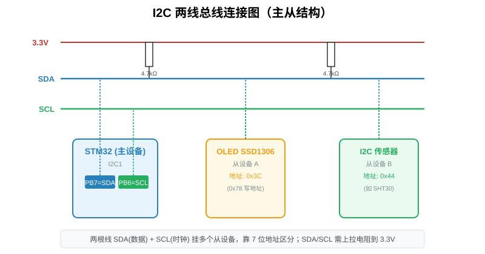
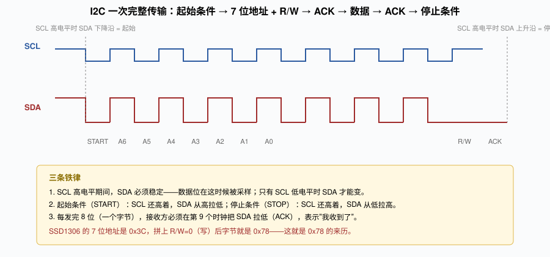
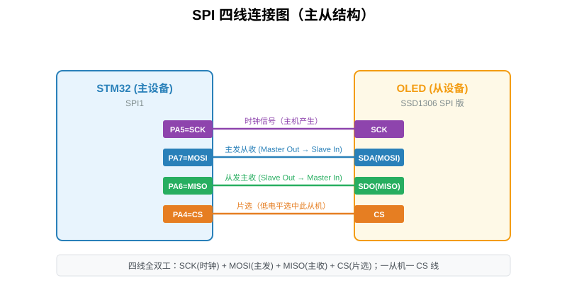
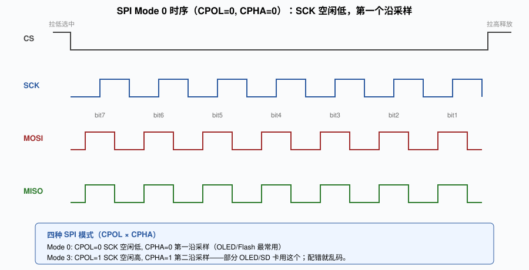
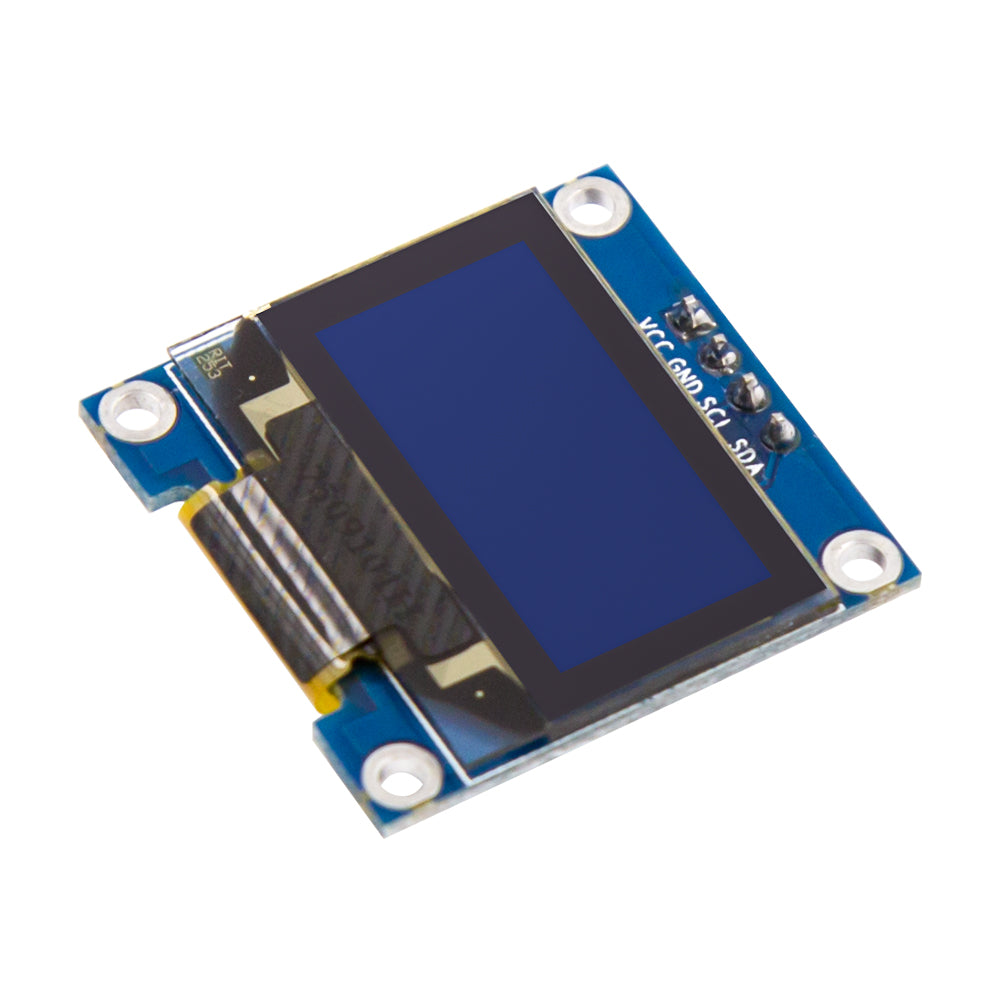
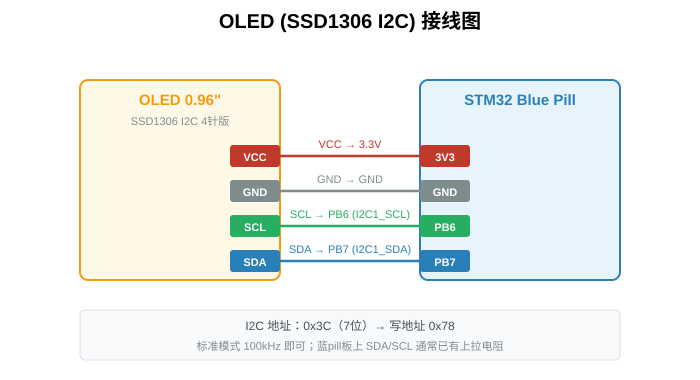
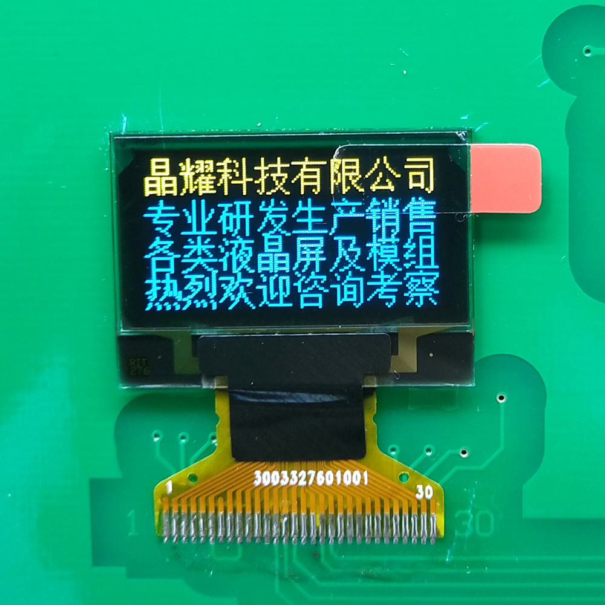
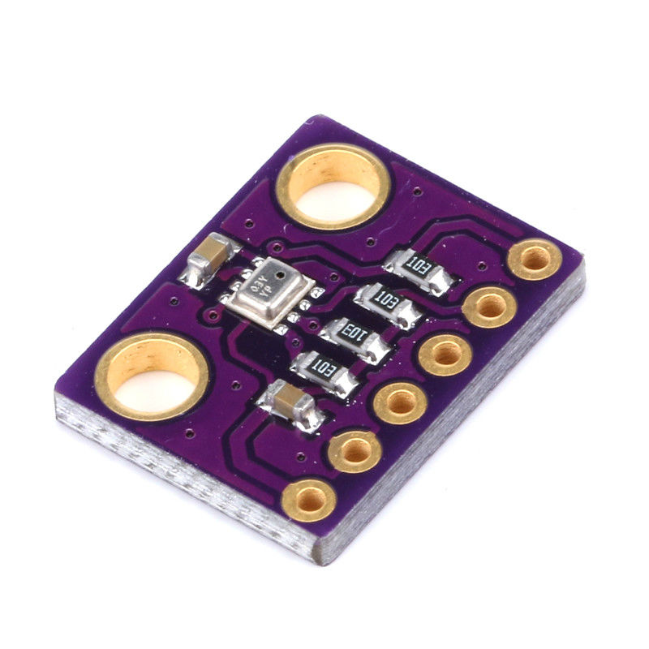
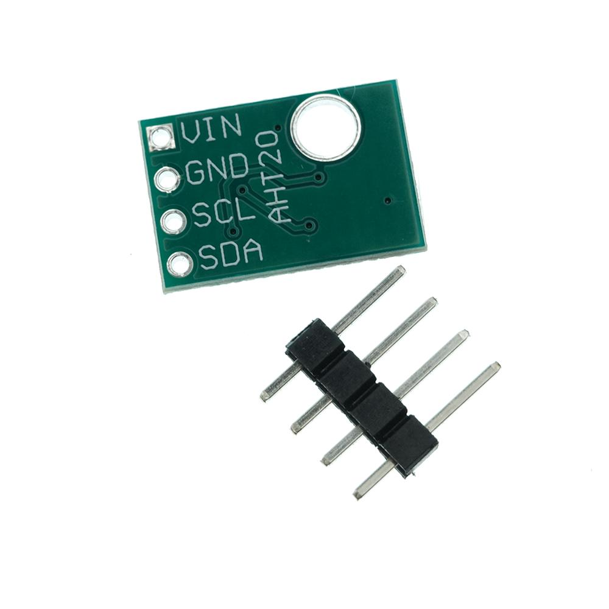
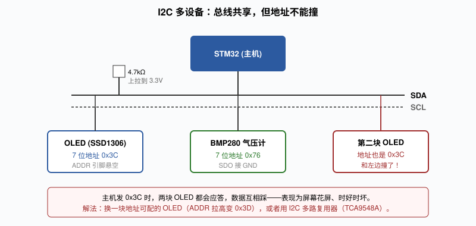

# 第11章 I2C / SPI 通信（OLED 实战）

> 前序章节已经完成了 STM32 内部资源的学习，包括 GPIO、定时器、ADC、串口与 DMA。自本章起，STM32 进入与外部器件交互的阶段：通过串行总线与传感器、显示屏、存储芯片等外设进行数据交换。当 STM32 首次通过 I2C 驱动 OLED 正常显示字符时，标志着其外设驱动能力从"点亮自身 LED"扩展到了"驱动外部显示设备"。

本章介绍两种最常用的串行总线：I2C 与 SPI。二者的功能定位一致，均用于在器件之间搬运数据，但电气逻辑与协议思路差异明显，放在一起对比学习，有助于在工程选型时准确判断适用场景。最后以 SSD1306 0.96 寸 OLED 为载体，完整走通 I2C 从接线、CubeMX 配置到底层寄存器的全流程。

示例代码见 [code/ch11_oled_i2c.c](code/ch11_oled_i2c.c)。

---

## 本章学习目标

- 理解串行总线相对于 UART 点对点通信的优势，能够区分 I2C 与 SPI 的适用场景。
- 掌握 I2C 的物理层结构（开漏输出 + 上拉电阻）、起始/停止条件、帧格式与 ACK 机制。
- 理解 SSD1306 7 位地址与 8 位写/读地址之间的换算关系（0x3C 与 0x78、0x79）。
- 了解 F103 I2C 主要寄存器（CR1/CR2/DR/SR1/SR2）的功能定位。
- 掌握 SPI 四线定义、CPOL/CPHA 四种模式与全双工传输原理。
- 独立完成 SSD1306 OLED 的接线、CubeMX 配置、I2C 地址扫描、驱动集成与字符显示。
- 理解 SSD1306 显存缓冲机制（8 页 × 128 列）与 UpdateScreen 的必要性。
- 能够将同一套 I2C 驱动套路迁移到 AHT20、BMP280 等传感器。

---

## 11.1 串行总线的引入背景

[第 8 章串口](ch08_串口.md)已经能够实现 STM32 与 PC 之间的点对点通信，依靠 TX/RX 两根线与 UART 协议。但 UART 属于点对点通信：一根线只能连接一个设备，且双方必须事先约定波特率。若需要同时挂接温湿度传感器、气压计、OLED 等多个外设，USART 数量有限（F103C8T6 仅三组），无法满足需求。

串行总线的核心思路是：**所有设备共享同一组线**。主机发送数据时附带从机地址，只有被寻址的设备产生应答。由此，一组 SCL 与一组 SDA 理论上可挂接 128 个设备（7 位地址），显著节省引脚与布线。

I2C 与 SPI 是两类典型串行总线，差异如下：

- I2C：仅两根线，半双工，速率较低（标准模式 100 kbps、快速模式 400 kbps），布线简单，支持多主机。
- SPI：四根线，全双工，速率高（可达数十 MHz），但每个从机需独占一根片选线，设备增多时引脚开销显著。

工程实践中的常见分工：

- 慢速传感器（温湿度、气压、OLED）通常选用 I2C。
- 高速外设（Flash、TFT 彩屏、SD 卡）通常选用 SPI。

掌握这一分工后，后续选型即可避免纠结。

---

## 11.2 I2C 协议：两根线的通信原理

### 11.2.1 物理层：开漏输出与上拉电阻

I2C 的 SCL 与 SDA 均为**开漏输出**（open-drain）。器件只能将线拉低至 GND，无法主动驱动到 3.3 V；线被释放为高电平，需依靠外部上拉电阻拉回 3.3 V。



该设计天然支持"线与"逻辑：任意一个器件将线拉低，整条线即处于低电平，无需额外仲裁。多个传感器挂接在同一根 SDA 上时，不会出现电平冲突。

上拉电阻典型取值为 4.7 kΩ，一端接 3.3 V。多数模块（OLED、BMP280 等）板载已焊接上拉电阻，无需外加；若使用裸芯片飞线，则需自行焊接。Blue Pill 在 PB6/PB7 上未板载上拉，由模块自带的上拉即可满足需求。

### 11.2.2 起始条件与停止条件

总线空闲时，SCL 与 SDA 均被上拉电阻拉为高电平。一次完整传输以**起始条件（START）**开始，以**停止条件（STOP）**结束：

- **START**：SCL 保持高电平时，SDA 由高变低。
- **STOP**：SCL 保持高电平时，SDA 由低变高。

这两类信号的特殊性在于：正常数据传输期间，SDA 仅允许在 SCL 为低电平时变化。因此 SCL 高电平期间的 SDA 跳变，被协议解读为起始或停止。

### 11.2.3 一帧数据的结构

一次完整的 I2C 写操作时序如下：



帧结构可拆解为以下步骤：

1. 主机发送 START。
2. 主机发送一个字节：**高 7 位为从机地址**，**最低位为 R/W**（0 表示写，1 表示读）。
3. 被寻址的从机在第 9 个时钟周期将 SDA 拉低，回复 **ACK**（Acknowledgment）表示在线。
4. 随后主机或从机发送数据字节，每发送完一个字节，对方回复一个 ACK。
5. 最后主机发送 STOP，总线回归空闲。

由此可以解释 SSD1306 地址存在 0x3C 与 0x78 两种说法的原因：**0x3C 为 7 位地址**，拼上 R/W=0（写）之后，完整地址字节为 `0x3C << 1 = 0x78`；若为读操作，则为 `0x3C << 1 | 1 = 0x79`。HAL 库函数要求传入已拼好 R/W 位的完整字节，因此工程代码中出现的是 0x78。

### 11.2.4 F103 的 I2C 寄存器

HAL 库已封装了底层操作，但通信异常时仍需向下查看一层。F103 I2C 外设的主要寄存器如下：

- **CR1**（Control register 1）：外设使能（PE 位）、发送 START、发送 STOP、应答使能。
- **CR2**：时钟分频、中断使能。
- **DR**（Data register）：待发送或已接收的数据写入/读取该寄存器。
- **SR1 / SR2**（Status）：START 是否发送完成、地址是否匹配、TXE/RXNE、AF（应答失败）等状态位。

`HAL_I2C_Mem_Write` 的内部流程依次为：CR1 发 START → 写 DR 发送地址 → 等待 SR1 的 ADDR 位置位 → 写 DR 发送寄存器地址 → 写 DR 发送数据 → 等待 BTF → CR1 发 STOP。常规应用无需手写该流程；但若通信卡死，使用调试器观察 SR1 卡在哪个状态位，远比盲目排查高效。

> 需特别说明：F103 的硬件 I2C 存在历史上已知的硅片缺陷（非软件缺陷），在某些极端时序条件下会导致总线锁死。若通信出现无规律卡死现象，可切换为 GPIO 模拟 I2C（软件 I2C）方案，相关实现可在公开代码库中获取。

---

## 11.3 SPI 总线：高速但费线

### 11.3.1 四根线的定义

SPI 的线数多于 I2C：



- **SCK**（Serial Clock）：由主机产生时钟，与 UART 相同属于同步通信。
- **MOSI**（Master Out Slave In）：主机发送、从机接收。
- **MISO**（Master In Slave Out）：从机发送、主机接收。
- **CS/SS**（Chip Select）：片选，主机拉低哪根 CS，即选中哪个从机。

由于 MOSI 与 MISO 相互独立，SPI 为**全双工**通信：一个时钟沿上主机发送一位、从机同时发送一位，数据双向并行流动。这也是 SPI 速率高于 I2C 的重要原因之一。

F103 的 SPI1 默认引脚为：**PA5 = SCK、PA6 = MISO、PA7 = MOSI**。CS 由任意空闲 GPIO 充当（例如 PA4）。

### 11.3.2 CPOL 与 CPHA：四种模式

SPI 没有统一的起始/停止信号，依靠 CS 拉低开始传输、CS 拉高结束传输。但时钟的**极性**与**采样相位**可配置：

- **CPOL**（Clock Polarity）：SCK 空闲电平。0 = 空闲低，1 = 空闲高。
- **CPHA**（Clock Phase）：在第一个时钟沿还是第二个时钟沿采样。0 = 第一沿采样，1 = 第二沿采样。

二者组合构成四种模式（Mode 0 ~ 3）：



绝大多数 OLED、Flash、SD 卡采用 **Mode 0**（CPOL = 0、CPHA = 0），但也有部分设备使用 Mode 3。CubeMX 中选择 `Mode = Transmit Only Master` 时默认为 Mode 0；若 OLED 接入 SPI 后出现全乱码或花屏，应首先将模式切换至 Mode 3 测试，CPOL/CPHA 不匹配是首要怀疑对象。

### 11.3.3 HAL_SPI_Transmit 的内部流程

```c
HAL_StatusTypeDef HAL_SPI_Transmit(SPI_HandleTypeDef *hspi, uint8_t *pData, uint16_t Size, uint32_t Timeout);
```

使用方式简洁：传入 SPI 句柄、数据指针与长度，函数即完成全部数据发送。内部流程大致如下：

1. 循环 Size 次：
2. 等待 TXE 位置位（发送寄存器为空）。
3. 将一个字节写入 DR。
4. 等待 BSY 位清零。

由于 SPI 为全双工，发送期间 MISO 上同样会有数据流入；若无需接收，可直接忽略。若需接收数据，使用 `HAL_SPI_Receive` 或 `HAL_SPI_TransmitReceive`（同时收发）。

---

## 11.4 实战：点亮 SSD1306 OLED



本节采用市面最常见的 0.96 寸 128×64 OLED 模块，蓝色背光，驱动芯片为 SSD1306，接口为 I2C。

### 11.4.1 接线



| OLED 引脚 | STM32 (Blue Pill) | 说明 |
|---|---|---|
| GND | GND | 地 |
| VCC | 3V3 | 禁止接 5 V，SSD1306 为 3.3 V 器件 |
| SCL | **PB6** | I2C1_SCL |
| SDA | **PB7** | I2C1_SDA |

接线仅四根，比 LED 电路更为简洁。

### 11.4.2 CubeMX 配置

1. 左侧 `Connectivity → I2C1` 选择 `I2C`。
2. 参数保持默认：I2C Speed Mode = Standard Mode，Clock Speed = 100000 Hz（100 kbps）。该速率对 OLED 已足够，无需使用 400 kbps。
3. PB6 自动复用为 I2C1_SCL、PB7 自动复用为 I2C1_SDA。
4. 在 Project Manager 中生成代码。

生成完成后，`main.c` 中会出现 `MX_I2C1_Init()`，句柄名为 `hi2c1`。

### 11.4.3 总线扫描：I2C Scanner

在接入 OLED 之前，建议先运行一次 I2C 扫描程序。初学者最常遇到的问题是"地址究竟是多少"——不同模块的 ADDR 引脚电平不同，仅凭数据手册无法直接确定。

```c
void I2C_Scan(void) {
    printf("I2C Scanner:\r\n");
    for (uint8_t addr = 1; addr < 128; addr++) {
        if (HAL_I2C_IsDeviceReady(&hi2c1, addr << 1, 1, 2) == HAL_OK) {
            printf("Found device at 0x%02X (7-bit) / 0x%02X (8-bit write)\r\n",
                   addr, addr << 1);
        }
    }
    printf("Scan done.\r\n");
}
```

`HAL_I2C_IsDeviceReady` 的本质是发送 START + 地址 + 等待 ACK。若从机回复 ACK，说明设备在线。将该函数在 `main` 初始化阶段调用一次，打开串口即可观察到总线上所有设备的地址。

典型的地址异常案例如下：OLED 模块 ADDR 悬空时地址为 0x3C；若通过跳线将 ADDR 接至 VCC，地址变为 0x3D，对应的写地址为 0x7A。驱动中仍使用 0x78 时通信必然失败。此时通过 I2C Scanner 扫描到实际地址为 0x7A，修改驱动中一行地址定义即可正常显示。

### 11.4.4 驱动来源

SSD1306 本身不带字库，所有需要显示的字符与图形均由 MCU 计算出"哪些像素应点亮"，再通过 I2C 逐批写入显示缓冲区。自行编写字模提取工具成本较高，工程上通常直接采用 GitHub 上成熟的轻量驱动（如 afiskon 的 ssd1306 库，或 STM32 社区常用的 syuez 版本），将 `ssd1306.c` 与 `ssd1306.h` 拷入工程，将 I2C 句柄改为指向 `&hi2c1` 即可使用。

> 需特别说明：OLED 无显示时，应首先使用 I2C Scanner 扫描总线，确认设备数量与地址。驱动中默认地址为 0x78 并不一定与所接模块匹配；若模块 ADDR 引脚被接至高电平，实际写地址为 0x7A（即 0x3D << 1）。

### 11.4.5 应用代码

主函数初始化之后，添加如下代码：

```c
/* USER CODE BEGIN Includes */
#include "ssd1306.h"
#include "font.h"
/* USER CODE END Includes */

/* USER CODE BEGIN 2 */
ssd1306_Init();                              // 发初始化命令序列
ssd1306_Fill(Black);                         // 整个显存缓冲清 0

ssd1306_SetCursor(0, 0);                     // 光标移到 (0, 0)
ssd1306_WriteString("Hello STM32!", Font_7x10, White);

ssd1306_SetCursor(0, 20);
ssd1306_WriteString("I2C SSD1306 ok", Font_7x10, White);

ssd1306_UpdateScreen();                      // 把整个显存刷到屏幕
/* USER CODE END 2 */
```

完整代码见 [code/ch11_oled_i2c.c](code/ch11_oled_i2c.c)。

烧录运行后，OLED 第一行显示 "Hello STM32!"，第二行显示 "I2C SSD1306 ok"。



### 11.4.6 写缓冲与刷屏幕两层结构

SSD1306 内部显存为 128×64 位 = 1024 字节，但 I2C 一次只能写入一小段。若逐像素地通过 I2C 发送命令绘制矩形，每帧需要数十次 I2C 通信，效率极低。

成熟的 SSD1306 驱动均采用如下分层设计：

1. 在 MCU 的 RAM 中开辟 1024 字节数组 `buffer[1024]`，称为"显存缓冲"。
2. `ssd1306_SetCursor`、`ssd1306_WriteString`、`ssd1306_DrawPixel` 等函数**仅修改该数组**，不触发 I2C。
3. 最后调用一次 `ssd1306_UpdateScreen()`，将整个 1024 字节通过 I2C 连续写入 SSD1306。

效率提升的原因在于：I2C 通信中"起始条件 + 地址 + 停止条件"存在固定开销。若 1024 字节分 1024 次发送，每次均需 START、地址、STOP，开销占比过高；而连续写 1024 字节时，START 与 STOP 仅各执行一次，效率显著提升。

> 需特别强调：绘制完成后必须调用一次 `UpdateScreen()`，否则屏幕内容不会刷新。工程中常见现象是初始化序列完全正确但屏幕无变化，多数原因即在于遗漏了该调用。

### 11.4.7 SSD1306 显存布局：8 页 × 128 列

绘制图形时需了解显存组织方式。SSD1306 的 128×64 像素并非按行排列，而是划分为 **8 个页（page）**，每页 8 行：

- Page 0 = 第 0~7 行
- Page 1 = 第 8~15 行
- ...
- Page 7 = 第 56~63 行

每个页内，一列对应 8 个像素（恰好一个字节），bit0 为最上方像素，bit7 为最下方像素。因此 `buffer[page * 128 + column]` 这一字节的每一位，代表该列 8 个像素的亮灭状态。

驱动中的 `ssd1306_DrawPixel(x, y)` 大致实现如下：

```c
void ssd1306_DrawPixel(uint8_t x, uint8_t y, uint8_t color) {
    buffer[x + (y / 8) * 128] |= (1 << (y % 8));   // 算页和列，置位
}
```

理解这一布局后，自行实现进度条、波形等图形绘制即有据可依。

### 11.4.8 底层 I2C 写命令结构

驱动向 OLED 发送的内容分为命令与数据两类，通过一个"控制字节"区分：

- 控制字节 `0x00`：后续为命令（如设置对比度、设置显示方向）。
- 控制字节 `0x40`：后续为显存数据（直接刷像素）。

底层函数结构如下：

```c
void ssd1306_WriteCommand(uint8_t cmd) {
    uint8_t buf[2] = {0x00, cmd};
    HAL_I2C_Master_Transmit(&hi2c1, 0x78, buf, 2, 100);
}

void ssd1306_WriteData(uint8_t data) {
    uint8_t buf[2] = {0x40, data};
    HAL_I2C_Master_Transmit(&hi2c1, 0x78, buf, 2, 100);
}
```

`HAL_I2C_Mem_Write` 是更常用的版本，将"控制字节 + 寄存器地址 + 数据"打包发送：

```c
// 把 1024 字节显存刷进 SSD1306 的 GDDRAM
HAL_I2C_Mem_Write(&hi2c1, 0x78, 0x40, 1, buffer, 1024, 1000);
//                地址  控制字节  寄存器长度  数据  长度  超时
```

其中 `0x40` 即为控制字节，告知 SSD1306 "后续数据均为显存内容"。

### 11.4.9 HAL I2C 的三种工作模式

HAL 中 I2C 接口函数存在多套版本：`HAL_I2C_Master_Transmit`、`HAL_I2C_Master_Transmit_IT`、`HAL_I2C_Master_Transmit_DMA`。三者的差异在于"CPU 等待数据发送完成的方式"：

- **阻塞模式（不带 _IT / _DMA）**：CPU 原地轮询，每发送一个字节检查一次 SR1 寄存器。实现简单，但发送 1024 字节 OLED 显存时 CPU 被占用约 80 ms，期间无法执行其他任务。
- **中断模式（_IT）**：每发送完一个字节硬件自动触发中断，在中断服务函数中发送下一字节。CPU 可在两次中断之间执行其他任务。
- **DMA 模式（_DMA）**：由 DMA 控制器自动搬运数据，CPU 完全不参与，发送完 1024 字节仅在结束时触发一次中断。

对于 OLED 刷新这类大块数据传输，建议使用 DMA 版本。1024 字节在 100 kbps I2C 上约耗时 80 ms，阻塞模式会导致系统卡顿 80 ms，LED 闪烁等任务均会出现明显停顿；使用 DMA 时调用方式如下：

```c
HAL_I2C_Master_Transmit_DMA(&hi2c1, 0x78, buffer, 1024);
```

调用后 CPU 即可返回执行其他任务，DMA 发送完成后会通过 `HAL_I2C_MasterTxCpltCallback` 通知应用层。该原理与[第 10 章 DMA](ch10_DMA.md)一致。

### 11.4.10 中文显示的实现方法

上述代码仅能显示英文 ASCII。若需显示中文（如"温度 26.5°C"），不能直接发送中文字符串——SSD1306 本身不带中文字库。实现思路如下：

1. 使用取模软件（如 PCtoLCD2002 或在线取模工具），将每个汉字转换为 16×16 或 12×12 的点阵数组。
2. 将这些数组存放于 Flash 中。
3. 自行实现 `oled_show_chinese(x, y, "温度")` 函数，逐字查询点阵表并绘制到显存 buffer 中。

例如"温"字 16×16 的点阵数据形式如下（16 列 × 16 行 / 8 = 32 字节）：

```c
const uint8_t hanzi_wen[32] = { /* ... 取模软件生成 ... */ };
```

理解这一过程后即可明确：OLED 上所有"字符"本质上都是点阵图形，不存在特殊处理机制。若嫌自行取模繁琐，GitHub 上已有封装好的中文字库（如 `oledfont.h`），直接引入即可。

### 11.4.11 图形绘制：进度条与波形

理解显存为 1024 字节数组后，图形绘制即为对该数组的操作：

```c
// 画一条横线
void draw_hline(uint8_t x, uint8_t y, uint8_t len) {
    for (uint8_t i = 0; i < len; i++) {
        buffer[(y / 8) * 128 + x + i] |= (1 << (y % 8));
    }
}

// 画一个进度条：0~100
void draw_progressbar(uint8_t percent) {
    uint8_t width = percent * 120 / 100;   // 满格 120 像素
    for (uint8_t x = 0; x < width; x++) {
        for (uint8_t y = 30; y < 40; y++) {
            buffer[(y / 8) * 128 + 10 + x] |= (1 << (y % 8));
        }
    }
}
```

在"环境监测仪"类应用中，温湿度、气压、电池电量等数据均可通过此类小图形展示，视觉效果优于纯文字。

### 11.4.12 初始化序列的含义

SSD1306 驱动中的初始化命令序列（`0xAE, 0xD5, 0xA8, 0xD3...`）常被初学者直接照抄而不加理解。以下拆解关键命令，便于后续更换屏幕或自行编写驱动时心中有数：

- `0xAE`：关闭显示（初始化期间先关显示，避免乱闪）。
- `0xD5 0x80`：设置时钟分频，默认 0x80。
- `0xA8 0x3F`：设置多路复用率（MUX ratio），0x3F = 63，对应 64 行。
- `0xD3 0x00`：显示偏移，0 表示无偏移。
- `0x8D 0x14`：**开启电荷泵**。SSD1306 面板本身需要 7~9 V 电压点亮 OLED，而模块仅 3.3 V 供电，依靠芯片内部电荷泵升压。该命令缺失时屏幕永远不会点亮——这是初学者最常遗漏的条目。
- `0x20 0x00`：内存寻址模式，0x00 = 水平寻址（即前述"8 页 × 128 列"连续刷写方式）。
- `0xA1` / `0xC8`：屏幕左右翻转、上下翻转。若接线后字符倒置，修改这两条命令即可。
- `0xAF`：打开显示。

初始化序列并非"魔法"，而是将面板工作模式配置为目标状态。例如字符上下颠倒的模块，可将 `0xC8` 改为 `0xC0` 解决。

---

## 11.5 扩展：接入其他 I2C 传感器

OLED 点亮之后，"接入 I2C 设备"的流程即已打通。无论是温湿度、气压还是加速度计，驱动套路完全一致：

1. 查阅数据手册，确定 7 位地址与寄存器映射。
2. CubeMX 开启 I2C（同一组 SCL/SDA 直接并联，I2C 天然支持多设备）。
3. 使用 `HAL_I2C_Mem_Read` / `HAL_I2C_Mem_Write` 读写寄存器。
4. 将原始数据换算为物理量。

以 BMP280 气压计为例，地址为 0x76（SDO 接 GND）或 0x77（SDO 接 VCC）。读取芯片 ID 寄存器（0xD0）应返回 0x58：

```c
uint8_t id;
HAL_I2C_Mem_Read(&hi2c1, 0x76 << 1, 0xD0, 1, &id, 1, 100);
// id == 0x58 说明芯片在线
```



再以 AHT20 温湿度传感器为例，地址固定为 0x38，上电后需发送初始化命令（0xBE）方可启动测量：



```c
// 触发测量
uint8_t trigger[3] = {0xAC, 0x33, 0x00};
HAL_I2C_Mem_Write(&hi2c1, 0x38 << 1, 0x00, 1, trigger, 3, 100);
// 等 80ms
HAL_Delay(80);
// 读 7 个字节：状态 + 湿度 20bit + 温度 20bit + CRC
uint8_t raw[7];
HAL_I2C_Mem_Read(&hi2c1, 0x38 << 1, 0x00, 1, raw, 7, 100);
```

读出的为原始二进制数据，换算公式详见各器件数据手册，照式代入即可。

### 11.5.1 多设备共享总线的地址冲突

这是 I2C 的核心优势——同一组 SCL/SDA 可挂接多个设备。但前提是**地址不得冲突**：



例如同时挂接一块 OLED（0x3C）与一个 BMP280（0x76），二者地址不同，主机发 0x3C 时仅 OLED 应答，发 0x76 时仅 BMP280 应答，互不干扰。

但若需挂接两块相同的 OLED 显示不同内容，则会出现地址冲突——两块均为 0x3C，主机发地址时两块同时应答，数据相互干扰。解决方案有两种：

1. 选用地址可配置的 OLED 模块（ADDR 引脚拉高即变为 0x3D），一块悬空、一块拉高。
2. 使用 I2C 多路复用芯片 TCA9548A，将一组 I2C 扩展为 8 组独立总线，每组独立寻址。

---

## 11.6 I2C 与 SPI 的选型：OLED 接口对比

市面常见 OLED 模块分为 I2C 版（4 脚）与 SPI 版（7 脚）两类。对比如下：

| 维度 | I2C OLED (4脚) | SPI OLED (7脚) |
|---|---|---|
| 接线 | 4 根 | 7 根（多 RES/DC/CS） |
| 刷新速度 | 1024 字节 @ 100k ≈ 80ms/帧 | 1024 字节 @ 10M ≈ 1ms/帧 |
| 适合场景 | 文字、简单 UI、仪表盘 | 动画、波形刷新、TFT 联动 |
| 引脚占用 | 2 个 | 4 个（SCK/MOSI + 3 GPIO） |
| 代码改动 | 现成 | 底层写函数从 I2C 换成 SPI |

建议初学者优先使用 I2C 版：接线少、调通速度快、有助于建立信心。待需要实现动画（如心率条、波形滚动）时，再切换至 SPI 版——上层 `ssd1306_WriteString` 等函数无需修改，仅需将底层 `ssd1306_WriteCommand/Data` 的实现从 `HAL_I2C_Master_Transmit` 替换为 `HAL_SPI_Transmit` 配合 DC/CS 电平控制即可。

SPI 版 OLED 接线参考：

| OLED (SPI) | STM32 |
|---|---|
| GND / VCC | GND / 3V3 |
| SCK (D0) | PA5 (SPI1_SCK) |
| SDA (D1/MOSI) | PA7 (SPI1_MOSI) |
| RES | 任意 GPIO（PA3 例） |
| DC | 任意 GPIO（PA2 例） |
| CS | 任意 GPIO（PA4 例） |

DC 引脚为"命令/数据"选择器：DC 拉低表示后续发送的是命令，拉高表示后续发送的是显存数据。相比 I2C 的控制字节方式更为直接。

---

## 11.7 常见问题与排查

以下汇总 I2C / SPI 调试中的常见问题与处理方法。

**1. OLED 完全无显示、无反应。**

应依次检查四项：VCC 是否接 3.3 V（接 5 V 可能损坏部分模块，或导致不亮）；SCL/SDA 是否接反（PB6/PB7 不可混淆）；地址是否正确（0x78 或 0x7A，运行 I2C Scanner 确认）；是否遗漏了 `ssd1306_UpdateScreen()` 调用。

**2. OLED 点亮但全是花点 / 乱码。**

初始化序列不正确。不同厂家的 SSD1306 模块初始化命令略有差异（尤其是对比度、电荷泵部分），应更换完整初始化序列测试。此外，显存缓冲未清零也可能导致上电时 buffer 为随机值。

**3. I2C 通信卡死，HAL 返回 HAL_I2C_ERROR_BUSY。**

通常为 SDA 被从机持续拉低（上一次通信被从机异常打断，从机一直占用总线）。软件层面可手动发送 9 个 SCL 时钟释放总线，或直接重启 MCU。硬件层面需检查上拉电阻阻值是否过大（线长超过 20 cm 时 4.7 kΩ 可能不足）。

**4. SPI 接 TFT 彩屏全为乱码。**

首先在 Mode 0 与 Mode 3 之间切换，八成由 CPOL/CPHA 不匹配导致。其次检查 DC 引脚的电平切换时机是否正确。

**5. 多个 I2C 设备仅一个可用。**

运行 I2C Scanner 检查地址。若两个设备地址相同（如两块均为 0x3C 的 OLED），按前述方法修改 ADDR 跳线或加装 TCA9548A。

**6. 5 V 系统接 3.3 V 模块。**

F103C8T6 为 3.3 V 器件，部分教学板使用 5 V 给 VCC 供电。I2C/SPI 模块必须使用 3.3 V，否则即使不烧毁也会工作异常。

**7. 线长导致通信不稳定。**

面包板上杜邦线杂乱走线时，SDA/SCL 线长超过 30 cm，100 kbps 尚可工作，400 kbps 即出现错误。原因是总线寄生电容增大，应将上拉电阻换小（如 2.2 kΩ），或降速至 100 kbps。工程实践中走线应尽量短。

---

## 11.8 综合实践：环境监测仪雏形

将本章与前序章节内容组合，即可实现一个"环境监测仪"：

- AHT20 读取温湿度（I2C，地址 0x38）。
- BMP280 读取气压（I2C，地址 0x76，与 AHT20 共用 PB6/PB7）。
- OLED 显示温度、湿度、气压（I2C，地址 0x78，同一组总线）。
- 串口每隔 2 秒打印一次数值（DMA 发送，[第 8 章串口](ch08_串口.md) + [第 10 章 DMA](ch10_DMA.md)）。

主循环结构如下：

```c
while (1) {
    aht20_read(&temp, &humi);
    bmp280_read(&pressure);

    ssd1306_Fill(Black);
    ssd1306_SetCursor(0, 0);
    char buf[24];
    sprintf(buf, "T:%.1fC H:%.0f%%", temp, humi);
    ssd1306_WriteString(buf, Font_7x10, White);
    sprintf(buf, "P:%.0f Pa", pressure);
    ssd1306_SetCursor(0, 20);
    ssd1306_WriteString(buf, Font_7x10, White);
    ssd1306_UpdateScreen();

    printf("T=%.2f H=%.2f P=%.0f\r\n", temp, humi, pressure);
    HAL_Delay(2000);
}
```

该系统硬件成本低廉，但可将 I2C、OLED、串口、ADC 等知识点串联跑通一遍，效果远胜于单纯阅读教程。

---

## 11.9 本章小结

- I2C 为两线半双工总线，采用开漏输出 + 上拉电阻，依靠 7 位地址区分从机，速率 100 kbps / 400 kbps，适合传感器、OLED 等慢速设备。
- SPI 为四线全双工总线，依靠片选区分从机，速率可达数十 MHz，适合 Flash、TFT 屏等高速设备。
- SSD1306 OLED 驱动分为三层：底层 HAL 写命令/数据、中层显存缓冲、上层图形 API；绘制完成后必须调用 `UpdateScreen()` 才能刷新。
- 接入任意 I2C 传感器（AHT20、BMP280、MPU6050）的套路一致：地址 + 寄存器映射 + `HAL_I2C_Mem_Read/Write`。
- I2C 多设备共享总线的前提是地址不冲突；地址冲突时可通过 ADDR 跳线或 TCA9548A 多路复用解决。

## 11.10 练习题

1. I2C 的 SCL/SDA 为什么必须采用开漏输出 + 上拉电阻？若直接采用推挽输出会出现什么问题？
2. SSD1306 的 7 位地址为 0x3C，请计算对应的写地址与读地址分别为多少？若 ADDR 引脚接 VCC 使 7 位地址变为 0x3D，写地址又是多少？
3. 为什么 OLED 驱动要在 MCU RAM 中开辟 1024 字节的显存缓冲，而不是直接逐像素写入 SSD1306？请从 I2C 通信开销角度解释。
4. SPI 的 CPOL=1、CPHA=1 对应 Mode 几？该模式下 SCK 空闲电平为高还是低？
5. 若需在同一组 I2C 总线上挂接两块 OLED 与一个 BMP280，会遇到什么问题？请给出两种解决方案。

下一章将从"硬件外设"切换到一个全新维度——[第 12 章 FreeRTOS](ch12_FreeRTOS.md)，学习如何让 STM32 同时执行多个任务。

---

<!-- ===== 第11章 完 ===== -->
