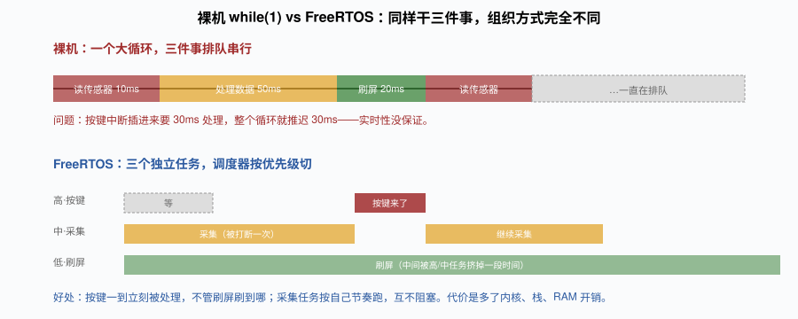
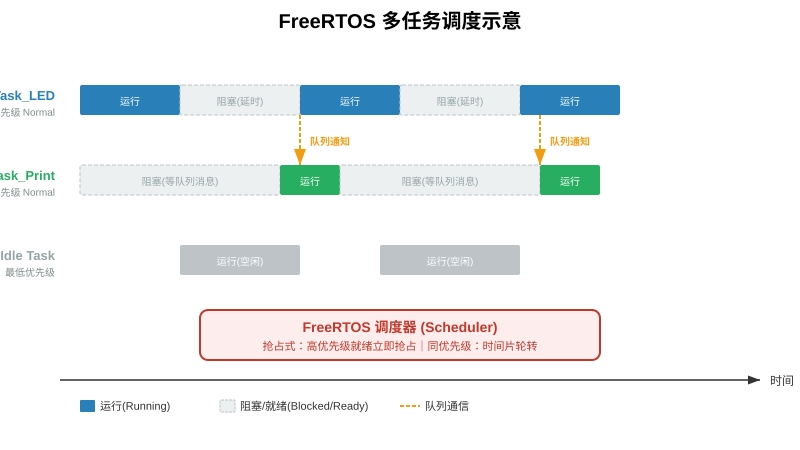
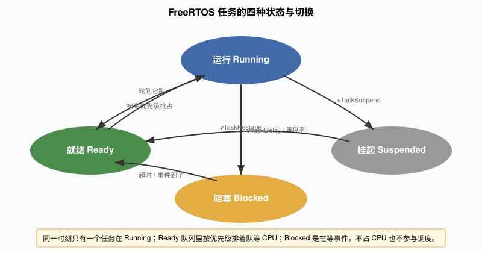
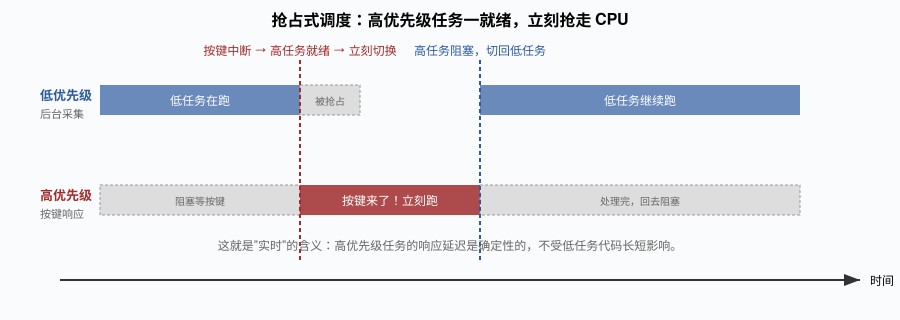
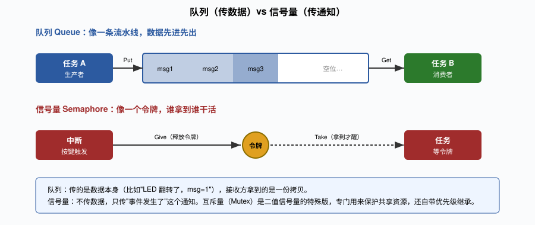
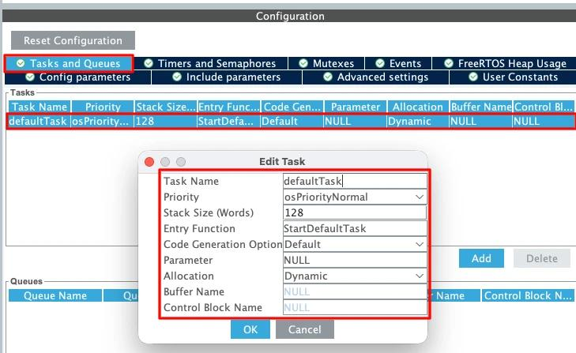

# 第12章 FreeRTOS 实时操作系统入门

> 上一章我们让 STM32 接上了 OLED 和传感器，能读温湿度、能刷屏幕。但你有没有发现一个问题——在主循环里，读传感器、刷屏幕、等 2 秒，这三件事是**排队**干的。传感器读得快、屏幕刷得慢，串口打印想插进来就得等。到了项目稍微复杂一点，你想"一边采集、一边显示、一边响应按键、一边和蓝牙通信"，裸机的 `while(1)` 就开始顶不住了。

FreeRTOS 就是来解决这个问题的。这一章我会从"为什么要 RTOS"讲起，把任务、调度、队列、信号量这些概念捋清楚，最后用 CubeMX 一键集成，写一个两个任务 + 队列的经典例子。代码在 [code/ch12_freertos_task.c](code/ch12_freertos_task.c)。

---

## 12.1 裸机的天花板：为什么需要 RTOS

### 12.1.1 裸机 while(1) 的真实样子

你前面写的所有程序，骨架都是这样的：

```c
int main(void) {
    HAL_Init();
    /* 各种初始化 */
    while (1) {
        sensor_read();      // 读传感器，10ms
        oled_update();      // 刷屏幕，20ms
        uart_send();        // 串口发数据，5ms
        key_scan();         // 扫按键，5ms
        HAL_Delay(100);     // 延时 100ms
    }
}
```

看起来没问题对吧？但你仔细想：

1. **所有事情串行排队**。传感器、屏幕、串口、按键一个接一个跑，任何一环慢了，后面所有都被拖慢。
2. **延时是阻塞的**。`HAL_Delay(100)` 这 100ms 里，CPU 就在那空转，按键按了要 100ms 后才被扫到，体感"卡"。
3. **实时性没保证**。按键中断能抢 CPU，但中断里不能干重活（否则其他中断也被拖慢），干轻活又干不完——这就是"中断只做标记，主循环轮询处理"这个老套路的根源。
4. **代码越长越难维护**。一个 `while(1)` 里塞 500 行代码，谁都不敢改。



### 12.1.2 RTOS 的思路：把大循环拆成多个独立任务

RTOS 的思路是：**不要一个 while(1) 干所有事，把每件事做成一个独立的"任务"，让调度器决定什么时候跑哪个任务**。

```c
void Task_Sensor(void *arg) {
    for (;;) {
        sensor_read();
        vTaskDelay(pdMS_TO_TICKS(100));   // 每 100ms 读一次，期间让出 CPU
    }
}

void Task_OLED(void *arg) {
    for (;;) {
        oled_update();
        vTaskDelay(pdMS_TO_TICKS(50));    // 每 50ms 刷一次
    }
}

void Task_Key(void *arg) {
    for (;;) {
        key_scan();
        vTaskDelay(pdMS_TO_TICKS(20));    // 每 20ms 扫一次按键
    }
}
```

三个任务各跑各的，调度器负责"在合适的时间切到合适的任务"。你写代码的时候不用关心"现在该不该干下一件事"，每个任务自己管自己的节奏。

### 12.1.3 FreeRTOS 为什么是它

市面上 RTOS 很多：RT-Thread、μC/OS、Zephyr、ThreadX……但 FreeRTOS 是入门最顺的那个，原因很实在：

- **开源 + MIT 许可**，商用不花钱。
- **CubeMX 原生集成**，勾选一下就生成工程，不用自己移植。
- **代码小**，内核编译完才几 KB，F103C8T6（64KB Flash / 20KB RAM）完全装得下。
- **生态大**，遇到问题 Google 一下全是答案。

我不是说 FreeRTOS 比别的好，而是对新手来说，它是"路径最短"的那个。等你熟了，再去看 RT-Thread 的组件化设计也不迟。

---

## 12.2 任务：FreeRTOS 里最基本的单位

### 12.2.1 一个任务长什么样

任务就是一个 C 函数，但有两个规矩：

1. 函数永不返回（里面是 `for(;;)` 死循环）。
2. 不能永远占着 CPU——要延时、要等事件的时候，主动"让出"。

```c
void vTaskBlink(void *argument)
{
    for (;;) {
        HAL_GPIO_TogglePin(GPIOC, GPIO_PIN_13);
        vTaskDelay(pdMS_TO_TICKS(500));   // 每 500ms 翻一次 LED
    }
}
```

`argument` 是创建任务时传进来的参数，不用就忽略。`vTaskDelay` 是 FreeRTOS 的延时函数，它和裸机的 `HAL_Delay` 有本质区别——这个后面会讲。

### 12.2.2 栈和优先级：每个任务的"私人装备"

创建一个任务的时候，你要给它两样东西：

- **栈（stack）**：任务自己的局部变量、函数调用、中断压栈，都用这块内存。F103 上一般给 128~512 个字（每个字 4 字节，也就是 512~2048 字节）。给小了会栈溢出（HardFault 死机），给大了浪费 RAM。
- **优先级（priority）**：数字越大优先级越高（FreeRTOS 的约定，和很多系统不一样）。0 是最低，configMAX_PRIORITIES-1 是最高。

```c
xTaskCreate(vTaskBlink, "Blink", 128, NULL, 1, NULL);
//                         栈大小   参数  优先级  句柄
```

CubeMX 里这一切可视化：你在 `Tasks and Queues` 标签里双击任务，填名字、栈大小、优先级，代码自动生成。



### 12.2.3 任务的四种状态

任务不是"要么跑、要么不跑"这么简单。它有四种状态：



- **运行（Running）**：当前正在用 CPU。同一时刻只有一个任务在这个状态。
- **就绪（Ready）**：能跑，但 CPU 被更高优先级的占着，在排队。
- **阻塞（Blocked）**：在等某个事件——延时到、队列有消息、信号量给了。阻塞状态的任务不参与调度，不占 CPU。
- **挂起（Suspended）**：被 `vTaskSuspend()` 主动暂停了，除非有人 `vTaskResume()`，否则永远不跑。

这个状态机是理解 FreeRTOS 的钥匙。你写的任务里那句 `vTaskDelay(500)`，本质就是让任务进入"阻塞"状态 500ms，调度器趁这 500ms 切到别的任务跑。时间一到，任务回到"就绪"，等调度器下次切到它。

---

## 12.3 调度器：高优先级先跑，同级时间片轮转

### 12.3.1 抢占式调度

FreeRTOS 默认是**抢占式调度**（preemptive）：

- 任何时候，只要有一个**高优先级任务进入就绪态**，调度器立刻把当前低优先级任务切下来，让高优先级任务跑。
- 同样优先级的任务，按**时间片**（默认 1ms）轮流跑，看起来像"同时进行"。



这就是"实时"的含义——按键响应、紧急处理这类高优先级任务，不会被低优先级的刷屏、采集代码拖住。响应延迟是确定性的。

### 12.3.2 vTaskDelay vs HAL_Delay：为什么必须换

这是新手最容易踩的坑。`HAL_Delay` 是裸机的延时：它靠 SysTick 中断维护一个全局计数器，然后 `while` 死等时间到。在 FreeRTOS 里你用它，会发生什么？

```c
void bad_task(void *arg) {
    for (;;) {
        HAL_GPIO_TogglePin(GPIOC, GPIO_PIN_13);
        HAL_Delay(500);    // 错！
    }
}
```

`HAL_Delay(500)` 这 500ms 里，CPU 在死等，但**调度器不知道这个任务在等**，它不会切到别的任务。其他任务本来应该跑，结果全被这个 `HAL_Delay` 卡住了。系统看起来像死机。

正确写法是 `vTaskDelay(pdMS_TO_TICKS(500))`：

```c
void good_task(void *arg) {
    for (;;) {
        HAL_GPIO_TogglePin(GPIOC, GPIO_PIN_13);
        vTaskDelay(pdMS_TO_TICKS(500));   // 让出 CPU，500ms 后回来
    }
}
```

`vTaskDelay` 会把任务扔进"阻塞"队列，调度器立刻切到别的就绪任务。500ms 后（其实是 500 个 tick），任务自动回到"就绪"。

> 我第一次用 FreeRTOS 的时候，图省事在任务里写了 `HAL_Delay`，结果两个任务像在轮流卡住，LED 闪一下停好久。查了一下午才发现是这个问题。记住：**任务里一律用 `vTaskDelay`，别用 `HAL_Delay`**。`HAL_Delay` 只在 main 初始化阶段、调度器启动之前用。

### 12.3.3 configTICK_RATE_HZ：系统节拍

FreeRTOS 的"时间"是按 tick 算的。`configTICK_RATE_HZ`（在 FreeRTOSConfig.h 里）默认 1000，也就是 1ms 一个 tick。`pdMS_TO_TICKS(500)` 就是 `500 * 1000 / 1000 = 500` 个 tick。

这个值不是越大越好。1000Hz 意味着每 ms 进一次 SysTick 中断，中断开销会占掉一部分 CPU；100Hz 又太粗（10ms 精度）。1000 是个折中值，对 F103 够用。

---

## 12.4 任务间通信：队列、信号量、互斥量

任务不是孤立的，它们之间要传数据、要同步。FreeRTOS 给了几样工具：



### 12.4.1 队列（Queue）：传数据的流水线

队列是一个**先进先出**的缓冲区。任务 A 把数据塞进去（`osMessageQueuePut`），任务 B 从另一头取出来（`osMessageQueueGet`）。

- 传的是**数据本身**（值拷贝），不是指针。你塞一个 4 字节的整数，队列里就存一份拷贝。
- 队列满了，塞的任务可以选择"等一会儿"（阻塞）；队列空了，取的任务也可以"等消息来"（阻塞）。
- 因为有阻塞，任务 A 塞完数据就去干别的，任务 B 有消息了自动被唤醒——不需要你写"有没有消息"的轮询。

### 12.4.2 信号量（Semaphore）：传通知的令牌

信号量不传数据，只传"事件发生了"这个信号。最常见的用法：**中断通知任务**。

比如按键中断里，你不能干重活（要消抖、要处理按键逻辑），就释放一个信号量；任务在另一端 `Take` 这个信号量，拿到之后再处理按键。信号量像一个令牌：中断 Give 一下，任务 Take 到就醒。

- **二值信号量**（Binary Semaphore）：令牌要么有要么没有，像个标志。
- **计数信号量**（Counting Semaphore）：可以攒多个令牌，比如中断里按了 3 次键，任务醒来处理 3 次。

### 12.4.3 互斥量（Mutex）：保护共享资源

两个任务都要写同一个全局数组怎么办？如果一个任务写到一半被切走，另一个任务接着写，数据就乱了。

互斥量像一把锁：任务 A 要碰共享资源之前先 `Take` 锁，用完 `Give` 锁。期间任务 B 想 `Take` 就会阻塞，等 A 放锁。这样同一时刻只有一个任务在碰共享资源。

互斥量和二值信号量长得很像，但有个关键区别：**互斥量带优先级继承**。意思是如果低优先级任务拿着锁，高优先级任务在等锁，低优先级任务会被临时"提升"到高优先级，让它快点干完放锁——这是为了缓解"优先级反转"问题（下面会讲）。

### 12.4.4 优先级反转：一个经典的坑

这个概念你先有个印象就行。场景是这样：

- 高优先级任务 H、中优先级任务 M、低优先级任务 L。
- L 拿到了互斥锁，在改共享资源。
- H 醒来，要碰同一个资源，等锁，阻塞。
- 这时 M 就绪了（它不需要锁），因为 H 在等、L 被 M 抢占，M 开始跑。
- 结果：**M 这个"中优先级"的任务，反而比高优先级的 H 先跑完了**。这就是优先级反转。

听说过火星探路者号 1997 年在火星上反复重启吗？就是这个问题。FreeRTOS 的互斥量带优先级继承，能让 L 在 H 等锁期间临时升到 H 的优先级，快速放锁，M 就插不进来了。所以记住：**保护共享资源用互斥量，别用二值信号量**。

---

## 12.5 CubeMX 集成 FreeRTOS：动手



### 12.5.1 CubeMX 配置

1. 左边 `Middleware → FREERTOS` 勾选 Activated。
2. `Interface` 选 **CMSIS_V2**（新版 API，对应 `osThreadNew`、`osMessageQueuePut` 这套）。
3. 切到 `Config parameters` 标签，保持默认就行：
   - `Tick Rate (Hz)` = 1000
   - `Minimum Stack Size (Words)` = 128
   - 堆大小 `Total Heap Size` 默认 1536 字节左右，够两三个任务用。
4. 切到 `Tasks and Queues` 标签：
   - 双击默认的 `defaultTask`，把名字改成 `Task_LED`，Priority 选 `osPriorityNormal`。
   - 点 `Add`，新加一个任务，名字 `Task_Print`，优先级也 `osPriorityNormal`，栈 256（因为要 printf）。
5. 切到 `Queues` 标签，点 `Add`，名字 `MsgQueue`，Queue size = 5，Item size = 4 字节（传一个 uint32_t）。
6. 重新生成代码。

生成之后，CubeMX 会在 `freertos.c` 里给你两个任务函数骨架、一个队列句柄。你只要在 `/* USER CODE BEGIN ... */` 之间填代码就行。

### 12.5.2 工程文件结构

启用 FreeRTOS 之后，你的工程多了几个东西：

- `freertos.c`：所有任务函数、队列创建都在这里。CubeMX 自动生成，你只在 USER CODE 块里写。
- `FreeRTOS/` 目录：内核源码（tasks.c、queue.c、list.c 等），不用动。
- `FreeRTOSConfig.h`：所有配置开关（节拍、堆大小、优先级数），出问题的时候来这里调。
- `main.c` 里：原来的 `while(1)` 没了，最后一句是 `osKernelStart()`——启动调度器，然后 CPU 就再也不回来了（调度器接管）。

你打开 `freertos.c` 会看到一段像这样的自动生成代码：

```c
void MX_FREERTOS_Init(void) {
  /* 创建任务 */
  osThreadAttr_t Task_LED_attributes = {0};
  Task_LED_attributes.stack_size = 128 * 4;
  Task_LED_attributes.priority = osPriorityNormal;
  Task_LEDHandle = osThreadNew(Task_LED, NULL, &Task_LED_attributes);

  /* 创建队列 */
  osMessageQueueAttr_t MsgQueue_attributes = {0};
  MsgQueueHandle = osMessageQueueNew(5, 4, &MsgQueue_attributes);
}
```

这就是 CubeMX 帮你做的事——你在界面上填的栈大小、优先级、队列长度，全变成了这些 C 调用。看懂它，以后你想纯手写 FreeRTOS（不用 CubeMX）也能上手。

### 12.5.2.1 CMSIS-RTOS v2 是什么

你可能注意到 API 名字是 `osThreadNew`、`osMessageQueuePut`，而不是 FreeRTOS 原生的 `xTaskCreate`、`xQueueSend`。这是因为 CubeMX 默认用了 **CMSIS-RTOS v2**——ARM 搞的一层封装，把不同 RTOS（FreeRTOS、RT-Thread、RTX）的 API 统一成同一套名字。

好处：你写的代码换个 RTOS 基本不用改。坏处：多了一层间接，出问题的时候你得知道"osMessageQueuePut 内部就是调的 xQueueSend"。初学用这套就行，等你要抠性能或者看 FreeRTOS 官方文档的时候，再回去看原生 API 也不迟。

### 12.5.3 写两个任务

完整代码在 [code/ch12_freertos_task.c](code/ch12_freertos_task.c)。我贴出来逐行讲：

```c
void Task_LED(void *argument)
{
    /* USER CODE BEGIN Header_Task_LED */
    uint32_t msg = 1;
    for (;;)
    {
        HAL_GPIO_TogglePin(GPIOC, GPIO_PIN_13);          // 翻转蓝pill的LED
        osMessageQueuePut(MsgQueueHandle, &msg, 0, 0);   // 往队列塞消息
        vTaskDelay(pdMS_TO_TICKS(1000));                 // 阻塞 1 秒
    }
    /* USER CODE END Header_Task_LED */
}
```

逐行解释：

- `HAL_GPIO_TogglePin`：每跑一次翻一次 PC13 的 LED。
- `osMessageQueuePut(MsgQueueHandle, &msg, 0, 0)`：把 `msg`（值是 1）塞到队列里。第三个参数 0 是优先级，第四个参数 0 是"队列满了不等待"——立刻返回。
- `vTaskDelay(1000 tick)`：让出 CPU 一秒。

```c
void Task_Print(void *argument)
{
    /* USER CODE BEGIN Header_Task_Print */
    uint32_t rmsg;
    for (;;)
    {
        osMessageQueueGet(MsgQueueHandle, &rmsg, 0, portMAX_DELAY);
        printf("LED toggled, msg=%lu\r\n", rmsg);
    }
    /* USER CODE END Header_Task_Print */
}
```

- `osMessageQueueGet(..., portMAX_DELAY)`：从队列取消息，**没有消息就一直等**（portMAX_DELAY = 永远阻塞）。这意味着 Task_Print 大部分时间在阻塞，不占 CPU。
- 一旦 Task_LED 塞了消息，Task_Print 立刻被唤醒，串口打印。

**验证效果**：

- LED 每 1 秒翻转一次。
- 串口每 1 秒打印一行 `LED toggled, msg=1`——不是 Task_Print 自己定时打，而是被队列消息唤醒打。
- 两个任务看起来"同时在跑"，实际上调度器在它们之间快速切。

---

## 12.6 中断和 FreeRTOS 怎么配合

这是另一个新手大坑。你在[第 5 章外部中断](ch05_EXTI中断.md)写的按键回调，如果切到 FreeRTOS 之后直接照搬，会死机。

### 12.6.1 为什么不能在中断里调普通 API

FreeRTOS 的 API 不是可重入的。普通任务里调 `osMessageQueuePut` 没问题，因为任务是被调度器切的、有上下文保护。但中断是随机插入的——如果中断打断了另一个 API 调用的中间状态，内核数据结构就坏了，直接 HardFault。

FreeRTOS 的解法是：**每个 API 都有一个 `FromISR` 版本**，专门给中断用。它做事更小心，不会在中断里做那些会破坏内核状态的操作。

### 12.6.2 正确写法

```c
void HAL_GPIO_EXTI_Callback(uint16_t GPIO_Pin)
{
    if (GPIO_Pin == GPIO_PIN_0)
    {
        BaseType_t xHigherPriorityTaskWoken = pdFALSE;
        uint32_t evt = 1;
        osMessageQueuePutFromISR(MsgQueueHandle, &evt, 0, &xHigherPriorityTaskWoken);

        // 如果这次唤醒的任务优先级比当前任务高，触发一次上下文切换
        portYIELD_FROM_ISR(xHigherPriorityTaskWoken);
    }
}
```

关键三件事：

1. 用 `...FromISR` 版本。
2. 传一个 `xHigherPriorityTaskWoken` 变量进去，API 会告诉你"我唤醒了一个更高优先级的任务"。
3. 中断最后调 `portYIELD_FROM_ISR`，让调度器立刻切到那个高优先级任务，而不是等中断退出后再切。

### 12.6.3 中断优先级的硬性规则

这是最阴的一个坑：**FreeRTOS 接管了 SysTick 和 PendSV 两个中断**，它规定——所有调用 `FromISR` API 的中断，优先级**必须低于**某个阈值（由 `configMAX_SYSCALL_INTERRUPT_PRIORITY` 决定）。

F103 上这个值默认是 5（数字越大优先级越低，回忆一下[第 5 章 NVIC](ch05_EXTI中断.md)讲的优先级编号）。意思是：你的外部中断、USART 中断，优先级要设成 5 或更高的数字（比如 5、6、10），不能是 0~4。

为什么？因为 FreeRTOS 内核本身在临界区（关中断）的时候，它需要屏蔽掉所有"会调 FreeRTOS API"的中断，保证内核数据结构不被破坏。优先级 0~4 的中断不受 FreeRTOS 控制——如果你在里面调了 `FromISR` API，内核正在改队列的时候被你打断，就崩了。

> 我第一次踩这个坑的时候，按键中断设成了优先级 0（最高），按一下按键就 HardFault。查了半天，才发现中断优先级必须比 `configMAX_SYSCALL_INTERRUPT_PRIORITY` 低。CubeMX 里把外部中断改成 5 就好了。

---

## 12.7 常见坑和经验

**1. 任务一启动就 HardFault。**
九成是栈太小。CubeMX 里把任务栈从 128 调到 256 或 512 试试。printf 特别吃栈（浮点 printf 更夸张），Task_Print 我给的是 256。

**2. 任务里用了 `HAL_Delay`，系统像卡住。**
换成 `vTaskDelay(pdMS_TO_TICKS(...))`。前面讲过了。

**3. 队列句柄是 NULL。**
CubeMX 里加了队列但重新生成代码之后，没注意句柄变量名变了（比如 `MsgQueueHandle` 拼成 `msgQueueHandle`）。对着 `freertos.c` 里的实际变量名改。

**4. 中断里调普通 API，死机。**
换成 `FromISR` 版本，检查中断优先级设成 ≥5。

**5. defaultTask 还在跑。**
CubeMX 默认生成一个 `defaultTask`，如果你没删它，它也在后台跑（可能只是 `vTaskDelay(osWaitForever)`，但占栈）。要么删掉，要么改成用它。

**6. RAM 不够用。**
F103C8T6 只有 20KB RAM。FreeRTOS 内核 + 每个任务栈 + 队列，加起来要算着用。一个栈 256 字（=1KB）的任务，3 个任务就是 3KB，加内核加队列，再加上 OLED 显存 1KB、串口缓冲……RAM 很容易爆。爆了表现是随机死机，因为栈溢出踩了相邻内存。

**7. 中断里做了太多事。**
哪怕是 `FromISR` 版本，中断里也别干重活。原则：中断只"发个通知"，处理逻辑全在任务里做。中断一长，所有其他中断和实时性都被拖慢。

**8. 怎么知道任务栈给小了？**
FreeRTOS 有个好用的 API：`uxTaskGetStackHighWaterMark(TaskHandle)`。它返回这个任务历史上用过的最小剩余栈（单位是字）。如果这个值接近 0，说明栈快溢出了，得加大。我一般在调试期每个任务里加一句：

```c
printf("LED task stack left: %u words\r\n",
       uxTaskGetStackHighWaterMark(Task_LEDHandle));
```

跑半小时看一下数字，心里就有数了。经验值：跑起来之后剩余栈别低于 20~30 字，留点余量。

**9. 空闲任务（Idle Task）是干嘛的？**
FreeRTOS 启动时自动创建一个优先级最低（0）的"空闲任务"，所有其他任务都阻塞的时候，CPU 就跑它。它主要做两件事：回收被删除任务的内存、跑用户的空闲钩子（如果开了 configUSE_IDLE_HOOK）。你写代码的时候不用管它，但知道为什么"系统闲着的时候 CPU 还在跑"——跑的就是它。

---

## 12.8 变体练习：把例子玩出花

掌握了上面的两任务 + 队列，你可以做这些扩展：

**变体一：三任务 + 传感器**
加一个 Task_Sensor，每 500ms 读一次 AHT20（[第 11 章](ch11_I2C_SPI与OLED.md)），读到的温湿度通过队列发给 Task_OLED。Task_OLED 收到消息就刷新屏幕。这样三个任务各司其职，谁都不阻塞谁。

**变体二：按键信号量**
把按键从轮询改成中断。按键中断里 `osSemaphoreRelease`，任务里 `osSemaphoreAcquire`——拿到信号量的任务做按键处理（消抖、计数、改 LED 模式）。这是 FreeRTOS 最经典的用法。

**变体三：任务通知（Task Notification）**
FreeRTOS 有个轻量机制叫"任务通知"，比信号量快、省 RAM。中断里直接 `vTaskNotifyGiveFromISR(TaskHandle)`，任务里 `ulTaskNotifyTake` 就醒了。不用创建队列或信号量对象。简单的"中断通知任务"场景，优先用这个。

### 12.8.1 一个三任务的完整骨架

把前面的东西拼起来，我做环境监测仪时 FreeRTOS 版的骨架是这样的（你可以直接套）：

```c
/* Task_Sensor: 每 500ms 读一次 AHT20，结果通过队列发给显示任务 */
void Task_Sensor(void *arg) {
    for (;;) {
        float temp, humi;
        aht20_read(&temp, &humi);
        sensor_msg_t msg = {.temp = temp, .humi = humi};
        osMessageQueuePut(SensorQueueHandle, &msg, 0, 0);
        vTaskDelay(pdMS_TO_TICKS(500));
    }
}

/* Task_Display: 收到传感器消息就刷一次 OLED，平时阻塞 */
void Task_Display(void *arg) {
    sensor_msg_t msg;
    for (;;) {
        osMessageQueueGet(SensorQueueHandle, &msg, 0, portMAX_DELAY);
        oled_show_temp_humi(msg.temp, msg.humi);
    }
}

/* Task_Key: 等按键信号量，按一下切换显示单位（℃ / ℉） */
void Task_Key(void *arg) {
    for (;;) {
        osSemaphoreAcquire(KeySemHandle, osWaitForever);
        display_unit = (display_unit == CELSIUS) ? FAHRENHEIT : CELSIUS;
        /* 消抖 */
        vTaskDelay(pdMS_TO_TICKS(200));
    }
}
```

这个结构的好处是：读传感器慢了不影响显示（队列缓冲）；OLED 刷屏 80ms 也不阻塞传感器（它在自己任务里）；按键随时按随时响应（高优先级）。每个任务都简短，改起来不会动到其他部分。

### 12.8.2 优先级怎么排

我自己的习惯：

- 最高优先级：紧急处理（故障、停机、电机 PWM 紧急输出）。
- 高：按键、通信接收（响应要快）。
- 中：传感器采集（周期固定）。
- 低：OLED 刷屏、日志打印（慢点没事）。

为什么刷屏要放最低？因为它最慢（I2C 刷一次 80ms），如果它优先级高，会把别的事全堵了。让它在低优先级跑，CPU 有空就刷，没空就不刷——反正数据是从队列里拿的，晚一点显示无所谓。

---

## 12.9 什么时候该上 RTOS，什么时候裸机就够

我见过很多新手学完 FreeRTOS 之后，做个 LED 闪烁也非要上 RTOS，纯属过度设计。给你我的判断标准：

| 你的项目 | 建议 |
|---|---|
| 点个 LED、读个按键、偶尔串口打印 | 裸机，RTOS 是杀鸡用牛刀 |
| 一个 main 循环里超过 3 件事，互相之间还要等 | 上 RTOS |
| 要同时干"采数据 + 刷屏 + 响按键 + 通信" | RTOS |
| 项目代码超过 500 行，越写越乱 | RTOS，拆任务能救命 |
| 对实时性有要求（按键响应 < 10ms） | RTOS，靠优先级保证 |

裸机不是过时的东西——简单的项目裸机代码更短、更可控、调试更快。RTOS 是复杂项目的工具，不是目标。

---

## 12.10 本章小结

- RTOS 解决的是裸机 `while(1)` 串行、阻塞、难维护的问题。
- 任务 = 独立函数 + 独立栈 + 优先级，永远是死循环。
- 调度器：高优先级抢占，同级时间片轮转。任务在 Running / Ready / Blocked / Suspended 四种状态间切换。
- 队列传数据、信号量传通知、互斥量保护共享资源（带优先级继承，别拿信号量代替）。
- CubeMX 一键集成 FreeRTOS（CMSIS-V2），任务函数在 `freertos.c` 里写。
- 任务里用 `vTaskDelay`，别用 `HAL_Delay`。
- 中断里用 `...FromISR` 版本 API，中断优先级必须低于 `configMAX_SYSCALL_INTERRUPT_PRIORITY`。
- 栈给小了会 HardFault；RAM 要算着用。

**自测题：**

1. `vTaskDelay(1000)` 和 `HAL_Delay(1000)` 在 FreeRTOS 工程里的行为有什么本质区别？
2. 三个任务优先级分别是 1、2、3，优先级 3 的任务在 `vTaskDelay`，优先级 1 的任务在跑，此时优先级 2 的任务就绪了，调度器会怎么做？
3. 队列和互斥量有什么区别？保护一个"两个任务都要写的全局数组"，该用哪个？
4. 为什么中断里调 `osMessageQueuePut`（不带 FromISR）会死机？
5. F103C8T6 只有 20KB RAM，你要跑 4 个任务，栈各给多大？怎么算这笔账？

到这里，[STM32 从点灯到 FreeRTOS](ch01_硬件认知.md) 的主线就走完了。剩下的坑、参考资料、接下来学什么，都在[附录](appendix.md)里。

---

<!-- ===== 第12章 完 ===== -->
